# A complete study companion to causal vibration prediction

**MECG 7780 — Time Serial Dependency Modeling via Advanced Machine Learning Algorithms**  
**Audience:** a graduate engineering student learning machine learning and signal processing.  
**Evidence policy:** measurements come from the supplied files and saved experiments; equations explain methods; synthetic examples demonstrate mathematics; missing measurements remain missing. The course PDF is authoritative for assessment.

> Read this guide beside `notebooks/00_COMPLETE_PROJECT_WALKTHROUGH.ipynb`. The notebook executes the analysis; this guide explains why its operations mean what they mean. Exact numerical experiment results are maintained in `reports/results_summary.csv` and the final report. No statement here establishes independent test performance or physical fault-detection accuracy.

## Learning objectives and reading routes

After working through the guide, you should be able to construct a causal prediction window by hand, derive ridge regression, explain GRU gates and TCN receptive fields, distinguish prediction from diagnosis, calculate residual indicators, check the units in angular resampling, and defend an honest validation experiment.

A student new to programming should read Chapters 1–8 before running the notebook's data and baseline sections. A student preparing to explain neural models should read Chapters 9–14, then inspect the trained-model section of the notebook. The diagnostic pathway is Chapters 15–19 and 23. Read Chapters 24–30 before reproducing the release or defending the study.

The prerequisite chain is elementary algebra → vectors and arrays → mean and variance → least squares → optimization → neural networks. Complex numbers and integration are introduced only where Fourier analysis and angular resampling require them. You do not need to understand every derivation before running the code, but you do need to understand sample indexing before interpreting any score.

## Contents

1. [Purpose, requirements and evidence](#chapter-1-purpose-requirements-and-evidence)
2. [Files, provenance and measurement meaning](#chapter-2-files-provenance-and-measurement-meaning)
3. [Rotating machinery and nonstationarity](#chapter-3-rotating-machinery-and-nonstationarity)
4. [Sampling and spectral analysis](#chapter-4-sampling-and-spectral-analysis)
5. [Time series, randomness and ARMA](#chapter-5-time-series-randomness-and-arma)
6. [Causal supervised learning](#chapter-6-causal-supervised-learning)
7. [Scaling, splits and leakage](#chapter-7-scaling-splits-and-leakage)
8. [Baselines and ridge derivation](#chapter-8-baselines-and-ridge-derivation)
9. [Multilayer neural networks](#chapter-9-multilayer-neural-networks)
10. [Recurrent networks and GRUs](#chapter-10-recurrent-networks-and-grus)
11. [Causal dilated temporal convolution](#chapter-11-causal-dilated-temporal-convolution)
12. [Speed conditioning and novelty](#chapter-12-speed-conditioning-and-novelty)
13. [Training and model selection](#chapter-13-training-and-model-selection)
14. [Accuracy, runtime and uncertainty](#chapter-14-accuracy-runtime-and-uncertainty)
15. [Observed, predicted and residual signals](#chapter-15-observed-predicted-and-residual-signals)
16. [Residual statistics and autocorrelation](#chapter-16-residual-statistics-and-autocorrelation)
17. [Angular resampling](#chapter-17-angular-resampling)
18. [Envelope, correlated kurtosis and PMI](#chapter-18-envelope-correlated-kurtosis-and-pmi)
19. [Diagnosis and anomaly masking](#chapter-19-diagnosis-and-anomaly-masking)
20. [Reading the actual EDA](#chapter-20-reading-the-actual-eda)
21. [Inspecting trained artifacts](#chapter-21-inspecting-trained-artifacts)
22. [Interpreting controlled experiments](#chapter-22-interpreting-controlled-experiments)
23. [Record-wise fault-candidate analysis](#chapter-23-record-wise-fault-candidate-analysis)
24. [Reproduction on a local machine](#chapter-24-reproduction-on-a-local-machine)
25. [Notebook, package and configuration](#chapter-25-notebook-package-and-configuration)
26. [Bias, limits and research priorities](#chapter-26-bias-limits-and-research-priorities)
27. [Reading the lecturer's article critically](#chapter-27-reading-the-lecturers-article-critically)
28. [Worked defense questions](#chapter-28-worked-defense-questions)
29. [Glossary and sources](#chapter-29-glossary-and-sources)
30. [Appendix: equations and code navigation](#chapter-30-appendix-equations-and-code-navigation)

## Notation and units

| Symbol | Meaning | Unit or shape |
|---|---|---|
| \(x_t\) | supplied normalized vibration at sample \(t\) | dimensionless scalar |
| \(x_t^{raw}\) | supplied unnormalized vibration | source amplitude units, not verified SI units |
| \(s_t\), \(u_t\) | supplied speed and its normalized value | source units; dimensionless |
| \(f_s\), \(\Delta t\) | sampling frequency and interval | Hz; seconds |
| \(L\) | predictor history length | samples |
| \(\hat x_t\), \(e_t\) | prediction and residual \(x_t-\hat x_t\) | dimensionless |
| \(X\), \(y\) | design matrix and target vector | \(n\times p\); \(n\) |
| \(\lambda\) | ridge penalty | depends on design and loss convention |
| \(h_t\) | recurrent hidden state | learned feature vector |
| \(q(t)\) | cumulative shaft cycles under a stated speed-unit assumption | cycles |
| \(P\), \(T\) | angular samples per cycle and CK period in samples | samples/cycle; samples |
| \(\rho[k]\) | normalized autocorrelation at lag \(k\) | dimensionless |

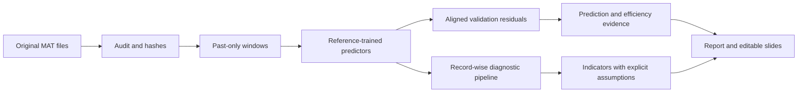

# Chapter 1: Purpose, requirements and evidence

The engineering question is whether a compact model can predict the next vibration sample accurately and efficiently while preserving useful information in the prediction residual. The primary supervised task is one-step prediction using previously observed vibration. A model does not diagnose a fault merely by predicting a waveform well.

The uploaded **Score Allocation Updated** course PDF requires MSE, CPU/GPU time as available, and fault-detection investigation. It encourages speed as an additional input and references the Spa LPV-ARMA article. The printed progress rubric is organization 4%, clarity 6%, algorithms understood 8%, novelty 2%. The printed final rubric is organization 16%, clarity 24%, performance 30%, novelty 10%. These supersede the different percentages repeated in the master prompt. Progress is 8 minutes; final is 12 minutes.

The PDF prints progress on November 4, 2026 but report/code on December 7, 2025 at 24:00 and final presentation on December 9, 2025. The contradiction requires instructor confirmation; it does not authorize inventing corrected dates.

Five research questions organize the study: Which model has lowest aligned validation MSE? What is its computational cost? Does speed conditioning help beyond capacity? What do residual indicators reveal without labels? How sensitive are findings to context, seed and assumptions? The answer “speed did not help in this experiment” is scientifically useful. The answer “fault accuracy is unavailable without labels” is necessary, not a weakness to hide.

**Evidence ladder.** A value in a prompt is a hypothesis until checked. A value calculated from one supplied recording is an observation. A repeatable difference across seeds supports robustness to initialization. Independent recordings at new operating conditions support broader generalization. These levels are different. The present train/validation data cannot by themselves establish machine-to-machine generalization.

# Chapter 2: Files, provenance and measurement meaning

The accessible files include `sigtrain.mat`, `sigvalid.mat`, the MATLAB reference `fdt_featcal.m`, the updated course PDF, the master prompt and the subsequently supplied complete-record fault-data package. The original large fault upload could not be transferred directly; this access limitation was resolved by **20 MATLAB parts containing ten complete records each**, preserved in `data/raw/sigfault1_parts/`. File and logical field-level hashes, ranges and record order were verified against the supplied manifest. The resulting **200 fault-candidate records** are now available for actual analysis. `sigtest.mat` and `sigfault2.mat` were not supplied. The manifest distinguishes verified inputs from unavailable optional files.

Both accessible MAT datasets contain one structure with 24,000 samples at 3,200 Hz. Samples occur at \(1/3200\), \(2/3200\), …, \(24000/3200\) seconds. The sample-count duration \(N/f_s\) is 7.5 s, whereas last minus first timestamp is 7.4996875 s. Both are correct descriptions of different quantities.

| Field | Interpretation and audit action |
|---|---|
| `x` | provided normalized vibration; primary modeling input and target |
| `xraw` | source amplitude trace; verify transform, preserve unchanged |
| `t` | seconds; verify positive increments and consistency with `fs` |
| `fs`, `N` | sampling rate and declared sample count; validate against arrays |
| `spd` | speed trajectory; unit is not encoded explicitly |
| `spdnorm` | supplied normalized speed; preserve extrapolation |
| `spdmin`, `spdmax` | reference speed scaling bounds |
| `xmean`, `xstd` | three-element metadata arrays; only first-entry transform established |

The verified transform uses the first entries:

\[
x_t=\frac{x_t^{raw}-0.0026221941677904226}{0.42517293168840065}.
\]

The speed transform is

\[
u_t=\frac{s_t-124.07455535625635}{167.3376580579989-124.07455535625635}.
\]

Neither transform establishes physical units. Plot `x` as “normalized vibration,” not acceleration in m/s². Do not infer that the other metadata entries identify channels or classes. Training `xmean` is `[0.00262219, 0, 0]` approximately; validation includes additional nonzero entries. Those facts establish array contents, not their undocumented purpose.

A hash is a content fingerprint. SHA-256 lets another researcher determine whether their file bytes match the study, but cannot prove that a recording is healthy or that its acquisition labels are correct. Preserve the originals and generate new output paths rather than overwriting raw data.

```python
from pathlib import Path
from hashlib import sha256
from scipy.io import loadmat
p = Path('data/raw/sigtrain.mat')
print(sha256(p.read_bytes()).hexdigest())
r = loadmat(p, simplify_cells=True)['sigtrain']
assert len(r['x']) == int(r['N']) == 24000
assert int(r['fs']) == 3200
```


## Independently measured audit values

The following values come from [the audit JSON](../reports/data_audit.json), not from preliminary figures in the prompt. Standard deviations are the empirical array summaries used by the audit.

| Quantity | Training | Validation |
|---|---:|---:|
| Normalized vibration mean | -0.003079531999 | -0.01185096092 |
| Normalized vibration standard deviation | 1.040098453 | 1.047268332 |
| Raw excerpt mean | 0.001312860519 | -0.00241651363 |
| Raw excerpt standard deviation | 0.4422217085 | 0.445270147 |
| Minimum source speed | 124.3228402 | 124.3351792 |
| Maximum source speed | 167.3335184 | 167.3225388 |
| Minimum normalized speed | 0.005738952203 | 0.006024160184 |
| Maximum normalized speed | 0.9999043136 | 0.9996505271 |
| Maximum amplitude reconstruction error | 0 | 0 |
| Maximum speed reconstruction error | 0 | 0 |

The aligned speed Pearson correlation is **0.9999995705**, while aligned vibration correlation is **0.04129076**. All validation speed values lie inside the observed training speed range. These are same-index descriptive correlations, not a search over arbitrary shifts and not proof of independent speed-path generalization.

The measured training raw standard deviation is approximately 0.44222, whereas stored first-entry `xstd` is approximately 0.42517. Their difference directly demonstrates why one should not describe the supplied transform as normalization fitted to only this excerpt. The exact reconstruction errors reported by this execution are zero in the computed arrays; that is stronger than merely having similarly shaped histograms.

# Chapter 3: Rotating machinery and nonstationarity

A gearbox response can combine shaft-related oscillations, tooth-meshing components, structural resonances, load changes and measurement noise. Their sum can be complicated even without a defect. Speed variation moves shaft-synchronous frequencies across time. An ordinary Fourier transform aggregates the entire record, so an oscillation that sweeps from one frequency to another appears spread across frequencies.

For intuition, a fixed-speed oscillator has \(x(t)=A\cos(2\pi f_0t)\). A changing-speed oscillator is better written \(x(t)=A(t)\cos(2\pi q(t))\), where \(q(t)\) counts cumulative cycles. Instantaneous cycle rate is \(dq/dt\). If this rate doubles, the oscillation period in seconds halves, even though a one-cycle pattern remains one cycle in angular coordinates.

Stationarity is stronger than “looks approximately steady.” Strict stationarity means all finite-dimensional distributions are invariant to time shift. Weak stationarity requires constant mean and autocovariance depending only on lag, with finite variance. A 7.5-second trace cannot establish either property universally. Rolling RMS, spectrograms and speed-conditioned error expose variation; they are descriptive checks, not proofs of a complete stochastic model.

A defect could produce periodic impacts. It could also excite a resonance whose visible oscillation frequency differs from the impact repetition frequency. This distinction motivates envelope analysis. Without tooth counts, shaft identities and speed units, one cannot assign a spectral line to a particular physical fault order merely because it is prominent.

**Worked interpretation.** Suppose two spectral ridges move upward together as supplied speed rises. This is compatible with speed-related excitation. It does not establish which gear generates them. The next question should be whether a dimensionally justified order representation makes the ridges stable, not whether a convenient class label can be attached.

# Chapter 4: Sampling and spectral analysis

Sampling converts a continuous signal into values separated by \(\Delta t=1/f_s\). Here \(\Delta t=0.0003125\) s. The Nyquist frequency is \(f_s/2=1600\) Hz. Frequencies above Nyquist can alias into the measured band unless acquisition filtering prevents them. We cannot reconstruct what the sensor never resolved or verify undocumented hardware anti-aliasing from the array alone.

For \(N\) samples, the discrete Fourier transform is

\[
X_k=\sum_{n=0}^{N-1}x_n\exp(-2\pi i kn/N),\qquad f_k=kf_s/N.
\]

Here \(i^2=-1\); complex coefficients encode amplitude and phase. Frequency-bin spacing is \(f_s/N\). Zero padding interpolates the displayed spectrum but does not increase information or resolve arbitrarily close tones.

For a rectangular-window, one-sided amplitude spectrum of real data, begin with \(|X_k|/N\) and double positive frequencies except the even-length Nyquist bin. For odd lengths, there is no exact Nyquist bin, so the last positive-frequency bin must also be doubled. The MATLAB helper doubles `2:end-1` for both cases, which requires a documented correction for odd-length arrays. A constant offset appears at zero frequency; subtract the mean only when your scientific question calls for it.

Power spectral density is different from amplitude. A PSD integrates approximately to variance under the chosen scaling and has units amplitude²/Hz. Welch's method averages windowed segment periodograms to reduce variance at the cost of frequency resolution. A spectrogram computes localized spectra; shorter windows improve time localization and worsen frequency resolution. Neither a centered spectrogram nor offline envelope analysis should be silently inserted into causal predictor inputs.

```python
import numpy as np
from scipy.signal import welch
fs = 3200
n = np.arange(3200)
y = 2*np.sin(2*np.pi*100*n/fs)
f, psd = welch(y, fs=fs, nperseg=1024, scaling='density')
assert abs(np.mean(y*y)-2.0) < 1e-12
print(f[np.argmax(psd)])  # a nearby Welch bin, not necessarily exactly 100
```

The sine has amplitude 2 and mean square 2. A PSD peak height is not its amplitude. Window leakage, averaging and bin alignment all affect displayed peaks. In the project figures, normalized amplitude is dimensionless; its PSD has units 1/Hz.

# Chapter 5: Time series, randomness and ARMA

A time series is an ordered sequence. Its order carries information that a bag of values does not. For example, `[1,-1,1,-1]` and `[1,1,-1,-1]` have identical histograms but different temporal dependence.

A random variable is a mathematical representation of uncertain outcomes, not an assertion that every measured vibration sample is independent noise. Mean estimates the center; variance estimates squared spread about the mean. Autocovariance at lag \(k\) measures the relationship between deviations separated by \(k\) samples. Periodic vibration can remain strongly correlated across many lags.

An autoregressive model AR(\(p\)) writes

\[
x_t=b+\sum_{j=1}^{p}a_jx_{t-j}+\epsilon_t.
\]

The coefficients express linear relationships to the past. Their signs can encode oscillation. The innovation \(\epsilon_t\) represents what the chosen model does not explain. Residuals from a fitted approximate model are not automatically true independent innovations.

An ARMA model additionally uses prior innovations:

\[
x_t=b+\sum_j a_jx_{t-j}+\sum_k c_k\epsilon_{t-k}+\epsilon_t.
\]

That moving-average term makes estimation and prediction recursion different from a plain lag regression. Setting coefficients to functions of speed gives an LPV concept: the relationship changes with an observed scheduling variable. A sparse LPV-ARMA includes further parameterization and regularized estimation choices. An AR model with speed interactions captures only part of that idea and must be called a surrogate.

**Checkpoint.** If residual autocorrelation remains after fitting AR, has the implementation failed? Not necessarily. It may indicate insufficient lag, nonlinear dependence, unmodeled speed effects or nonstationarity. First verify alignment, then investigate model adequacy.

# Chapter 6: Causal supervised learning

For a lag \(L\), one supervised example contains the previous \(L\) observations and targets the next observation:

\[
\mathbf z_t=(x_{t-L},\ldots,x_{t-1}),\quad y_t=x_t.
\]

The order shown is oldest to newest. Reversing that order is permissible only if fitting and prediction use the same documented convention. Including \(x_t\) in the input is leakage even when a network does not appear to exploit it.

Take `x=[10,20,30,40,50]` and `L=3`. The two examples are `[10,20,30]→40` and `[20,30,40]→50`. There are \(N-L\) examples. A common error forms a window ending at the target and reports implausibly low MSE because the answer appears in the input.

```python
import numpy as np
x = np.array([10.,20.,30.,40.,50.])
L = 3
windows = np.lib.stride_tricks.sliding_window_view(x, L+1)
X, y = windows[:, :-1], windows[:, -1]
assert np.array_equal(X[0], [10,20,30])
assert y[0] == 40
```

The primary protocol is teacher-forced one-step prediction: when predicting sample \(t\), measured values through \(t-1\) are known. It is not free-running forecasting, in which prior predictions are recursively fed back. One-step accuracy cannot be advertised as stable long-horizon forecasting.

Speed-aware predictors use past speed, for example \(u_{t-1}\) or a full past-speed window. Contemporaneous \(u_t\) could be a valid exogenous-input scenario if genuinely available before prediction; it must be labeled separately. Offline diagnostic resampling can use a whole record because it is not the online predictor. These two causal contracts must not be confused.

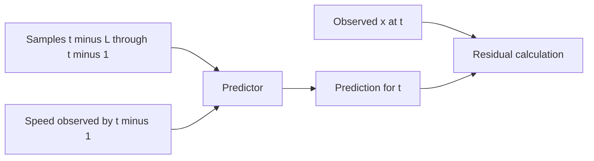

A useful adversarial test changes samples after a cutoff and checks that predictions at or before that cutoff do not change. This detects future-looking filtering and padding errors that ordinary shape tests miss.

# Chapter 7: Scaling, splits and leakage

Scaling changes numerical coordinates. Given reference mean \(\mu_*\) and standard deviation \(\sigma_*\), normalized vibration is \((x^{raw}-\mu_*)/\sigma_*\). Its inverse is \(x^{raw}=\sigma_*x+\mu_*\). A prediction error transforms as \(e^{raw}=\sigma_*e\), so raw-coordinate MSE is \(\sigma_*^2\operatorname{MSE}\). This is still in source amplitude units² unless physical units are verified.

Stored reference scaling need not equal the empirical mean and standard deviation of the supplied training excerpt. Therefore normalized `x` need not have exactly zero mean and unit variance. Replacing supplied scaling independently for each file changes the experiment and may remove fault-amplitude differences. A fault record containing only normalized `x` should never be treated as unnormalized acceleration and standardized again without justification.

The official training recording fits parameters. Validation supports model selection and supplies the reported provisional accuracy. Because the same validation recording can influence architecture or checkpoint choice, it is not an untouched final test. Absent `sigtest.mat` means no actual test score. Randomly splitting overlapping windows from one recording puts near-duplicate temporal neighborhoods on both sides of a split; this does not demonstrate independent generalization.

For a blocked internal split at target index \(b\), the last training target and first held-out target should be separated sufficiently that their input windows do not overlap if independence of windows is being asserted. An embargo of at least the longest context is a simple conservative construction. Always show actual indices rather than merely writing “time-series split.”

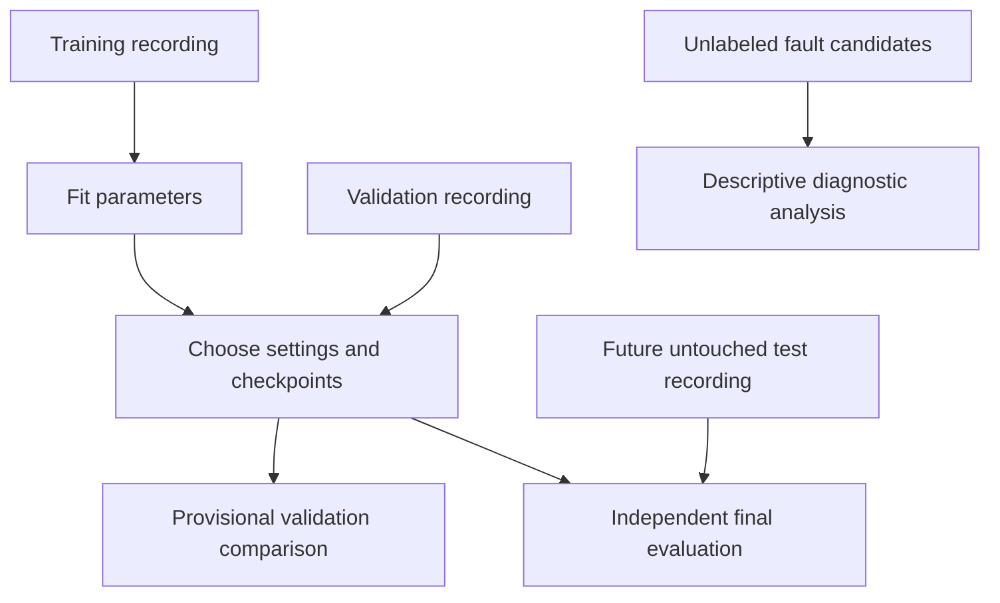

The supplied speed trajectories can be highly correlated without proving vibration leakage. Correlation warrants caution: validation may cover almost the same operating path. To allege leakage one would need evidence of prohibited information sharing, duplication or target contamination. To claim novel speed transfer one would need meaningfully different trajectories or conditions.

# Chapter 8: Baselines and ridge derivation

The zero predictor always returns 0. The empirical-mean predictor returns the training mean. These differ when the provided normalized training excerpt has nonzero mean. Persistence returns \(x_{t-1}\); it is a strong benchmark for slowly changing signals but can perform poorly on oscillations with rapid phase change.

For AR, form a matrix \(X\) whose rows are lag vectors and a vector \(y\) of next samples. An intercept can be represented by a column of ones or handled separately. Least squares minimizes

\[
J(a)=\|y-Xa\|_2^2.
\]

Expanding and differentiating gives \(\nabla J=2X^TXa-2X^Ty\). At a stationary point \(X^TXa=X^Ty\). The familiar inverse expression is a derivation, not a recommendation to compute an inverse numerically. QR, SVD or a reliable least-squares solver are preferable when columns are correlated.

For ridge regression,

\[
J_\lambda(a)=\|y-Xa\|_2^2+\lambda\|a\|_2^2,
\qquad (X^TX+\lambda I)a=X^Ty.
\]

Regularization stabilizes coefficient estimates and discourages large weights. The intercept is normally excluded from the penalty by centering or explicit solver support. Penalty values are not comparable across packages unless the loss convention, scaling and sample count agree. Minimizing mean loss plus \(\alpha\|a\|²\) differs from summed loss plus the same numeric \(\alpha\|a\|²\).

**Hand example.** With `X=[[1],[2]]`, `y=[2,4]`, no intercept, ordinary least squares gives \(a=10/5=2\). Ridge with \(\lambda=1\) gives \(a=10/6=1.6667\). Predictions are shrunk toward zero. In a multi-lag waveform, this shrinkage can reduce out-of-record variance even when it increases training error.

```python
import numpy as np
X = np.array([[1.],[2.]])
y = np.array([2.,4.])
a = np.linalg.solve(X.T@X + np.eye(1), X.T@y)
assert np.allclose(a, [5/3])
```

A speed-augmented ARX adds an external predictor. A linear term in speed changes a baseline offset but cannot generally adapt oscillatory lag coefficients. A polynomial LPV-AR surrogate instead uses interactions:

\[
\hat x_t=b+\sum_j\left(a_{j0}+a_{j1}u_{t-1}+a_{j2}u_{t-1}^2\right)x_{t-j}.
\]

This is linear in unknown coefficients even though nonlinear in speed. Its increased feature count needs regularization and capacity-aware comparison. It is not a sparse LPV-ARMA reproduction because it lacks the original innovation model and estimation specification.

# Chapter 9: Multilayer neural networks

A multilayer perceptron learns nonlinear transformations of a lag vector. One hidden layer computes \(h=\phi(W_1z+b_1)\), followed by \(\hat x=W_2h+b_2\). Here \(W_1\) has shape hidden-width × input-width; \(W_2\) maps hidden features to a scalar. A nonlinear activation such as ReLU, \(\max(0,v)\), prevents the composition from collapsing to a single linear map.

For `L=64` and hidden width 32, a simple two-linear-layer scalar predictor has \(64\cdot32+32+32+1=2113\) trainable parameters. This illustrative count must not be substituted for the actual implemented architecture's saved count. Parameter count measures storage and flexibility only approximately; recurrence and convolution reuse parameters in different ways, so equal counts do not imply equal runtime.

Backpropagation applies the chain rule to compute derivatives of loss with respect to weights. Gradient descent updates \(\theta\leftarrow\theta-\eta\nabla_\theta J\), where \(\eta\) is learning rate. Adam adds adaptive estimates of gradient moments; it still needs an appropriate learning rate and does not guarantee a global optimum.

Weight decay discourages large weights; early stopping prevents continued fitting after validation deteriorates; gradient clipping caps large updates. These are different mechanisms. Dropout is stochastic regularization during training and must be disabled during evaluation. A saved checkpoint should be evaluated in inference mode, with gradients disabled, before timing.

The MLP is an important control. If a TCN beats linear AR but not an equally modest MLP, the evidence supports nonlinear modeling, not necessarily a special advantage of convolutional sequence structure.

# Chapter 10: Recurrent networks and GRUs

A recurrent network processes the history in order while carrying a hidden state. Unlike an MLP, it shares transition parameters across positions. A unidirectional GRU reads the past window and predicts from its final hidden state. It does not see future values merely because the whole history window is presented at once.

One common GRU convention writes

\[
r_t=\sigma(W_rx_t+U_rh_{t-1}+b_r),\qquad
z_t=\sigma(W_zx_t+U_zh_{t-1}+b_z),
\]

\[
\tilde h_t=\tanh(W_hx_t+U_h(r_t\odot h_{t-1})+b_h),\qquad
h_t=(1-z_t)\odot\tilde h_t+z_t\odot h_{t-1}.
\]

Here \(\sigma\) maps to `[0,1]`, \(\odot\) denotes elementwise multiplication, \(r\) controls the candidate's use of past information, and \(z\) mixes old state and candidate. Library definitions can place reset multiplication differently, particularly relative to recurrent biases; PyTorch's documented implementation is the executable reference. Conceptual equations should not be advertised as an exact cell-by-cell reimplementation unless checked.

If \(z_t\) is near 1, this convention retains the prior hidden state; if near 0, it replaces it with the candidate. The gates are learned functions, not manually set fault detectors. LSTMs use a separate cell state and additional gates; they are not automatically better on this small dataset.

Window-reset GRU inference initializes state separately for every window. Stateful streaming GRU inference propagates it indefinitely. They have different effective histories and runtime. The implementation and timing must identify which is used. When records are independent, state must be reset at the boundary.

**Examiner question.** Why can a compact GRU be slower than a convolution with more parameters? Its temporal recurrence creates sequential dependencies. A convolution can parallelize across window positions; parameter count alone does not predict elapsed time.

# Chapter 11: Causal dilated temporal convolution

A causal convolution computes output from the current representation and earlier representations only. For kernel size \(k\), dilation \(d\), and one channel, \(h_t=\sum_{j=0}^{k-1}w_jz_{t-jd}\). Dilation creates spaced taps. The input sequence supplied to the predictor ends at original sample \(t-1\), so the final convolution output may use that representation without seeing target \(x_t\).

To preserve length, pad only on the left by \((k-1)d\), or use symmetric padding and crop the right side with carefully checked indexing. A generic convolution's default padding is not evidence of causality. A direct future-perturbation test is stronger than a name such as `CausalTCN`.

For stride-one layers, receptive field is

\[
R=1+\sum_{\ell}(k_\ell-1)d_\ell.
\]

If each residual block has two size-3 convolutions at dilation \(d\), that block adds \(4d\) samples. Blocks at dilations 1, 2, 4 and 8 give \(R=1+4(1+2+4+8)=61\). A model that declares context 128 but has receptive field 61 effectively ignores the oldest inputs unless another path uses them. Conversely, a larger theoretical receptive field than the input includes padding rather than additional observed history.

Residual connections add a transformed signal to a shortcut, making optimization easier. When channel counts differ, a 1×1 projection aligns them. Layer normalization across time, global pooling that includes forbidden positions or bidirectional operations require separate causal scrutiny. In a history-window model, pooling within the known past window is allowed; streaming per-position causality is a stronger contract.


TCNs are attractive because they combine nonlinear temporal features, parallel training and bounded context. They still require regularization; many overlapping windows do not turn a short recording into many independent experiments.

# Chapter 12: Speed conditioning and novelty

A speed-conditioned model asks whether the same vibration history should be interpreted differently at different operating speeds. Linear LPV models accomplish this by changing coefficients with a scheduling variable. A neural model can modulate features instead.

Feature-wise linear modulation, often called FiLM, applies

\[
\tilde h_{c,t}=\gamma_c(u)h_{c,t}+\beta_c(u),
\]

where \(c\) identifies a feature channel and small learned networks map observed past speed to gains \(\gamma\) and offsets \(\beta\). This does not directly convert time samples into angular samples. It gives the predictor a mechanism to change its response with speed. Late concatenation instead appends speed to the last representation before the scalar output; it is a useful simpler control.

Project-level novelty is the evaluated combination and controlled experiment, not a world-first claim. FiLM, gated networks and LPV modeling predate this project. A defensible statement is “we investigate compact speed modulation for this supplied prediction task and evaluate its consequences.” A claim of prior-art novelty would require a much more exhaustive review.

Four comparisons separate explanations: a vibration-only TCN against a speed-conditioned TCN; a capacity-adjusted vibration-only network against the conditioned model; correct speed against misaligned speed; and an AR against an LPV-AR surrogate. A phase-shifted-speed inference control tests dependence on conditioning but is out-of-distribution and not a standard model score. Retraining with a control speed tests a different hypothesis. Label which one is done.

Near-identical train and validation speed paths create a limitation: speed can act as a position code. Good performance along that path need not imply robust transfer to a novel acceleration schedule. Do not clip normalized speed outside `[0,1]` by default; values outside the reference range are genuine extrapolation requiring reporting.

# Chapter 13: Training and model selection

Choose a bounded search before looking at final outcomes. Contexts of 32, 64, 128 and 256 samples correspond to 10, 20, 40 and 80 ms at 3,200 Hz. Testing these lengths examines how much recent history helps; it does not establish an exact physical period unless separately justified.

For a minibatch of \(B\) examples, training loss is \(B^{-1}\sum_i(y_i-\hat y_i)^2\). An epoch means one pass through the selected training examples. Shuffling training batches is permissible because it changes optimization order, not train/validation membership. Randomly assigning overlapping windows to independent evaluation partitions is the problematic operation.

Save the best checkpoint under a predeclared selection policy. If validation determines the stopping epoch, the final validation score benefits from this selection. This is normal development practice but must be disclosed. Choosing the best of many seeds and reporting it alone adds selection optimism; report seed distribution as well.

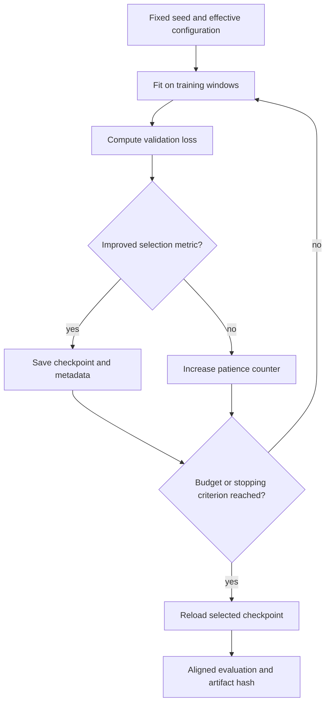

A fixed seed controls pseudorandom initialization and sampling. It does not guarantee identical floating-point results across all hardware, libraries and parallel kernels. Capture versions, threads, precision and device; use deterministic operations where supported. Do not report reproducibility as universal bitwise equality unless actually tested.

Learning curves reveal different failures. Training loss that never falls suggests learning-rate, scaling, shape or optimization trouble. Training loss falls while validation rises suggests overfitting or shift. Both losses unexpectedly near zero suggest either an easy predictable process or leakage; inspect targets and compare persistence. Abrupt NaNs require checking finite data, gradients and learning rate before trying a larger model.

# Chapter 14: Accuracy, runtime and uncertainty

For a common target set \(\mathcal T\),

\[
\operatorname{MSE}=\frac{1}{|\mathcal T|}\sum_{t\in\mathcal T}e_t^2,
\quad \operatorname{RMSE}=\sqrt{\operatorname{MSE}},
\quad \operatorname{MAE}=\frac{1}{|\mathcal T|}\sum_t|e_t|.
\]

MSE weights large errors strongly. RMSE returns to amplitude coordinates. MAE is less dominated by large residuals. If normalized MSE divides by target variance, state that denominator; “NMSE” has multiple conventions. Relative improvement over baseline \(b\) is \(100(\mathrm{MSE}_b-\mathrm{MSE}_m)/\mathrm{MSE}_b\) percent. A lower MSE is not necessarily lower fault-detection error.

Common burn-in is essential. With maximum compared lag 256, all models should be scored on zero-based target indices 256 through 23,999, yielding 23,744 targets. A shorter-lag predictor may generate earlier outputs but those should be excluded from the fair table. The saved target indices provide the check; a verbal assertion is insufficient.

Time data loading, design construction, training, inference and features separately. Warm up the inference path, run repetitions and report median plus spread. State whether inference includes constructing windows. Batched offline inference is not streaming per-sample latency. For GPUs, synchronize before and after timing because kernel launches can be asynchronous. If GPU is unavailable, show no measured GPU time.

Blockwise error variation reflects heterogeneity along one recording. A block bootstrap resamples contiguous error blocks and can give a conditional uncertainty interval along this trace; it does not create independent machines or justify population fault sensitivity. Seeds measure optimization variability. Recording-level splits measure a different source of variation. The report should not merge these into one generic error bar.

A Pareto frontier contains models for which no other evaluated model is both more accurate and cheaper under the stated cost measure. A simpler ridge predictor can be a reasonable engineering recommendation even if its MSE is slightly worse, especially when CPU latency and interpretability matter. Report the trade-off without declaring a universal winner.

# Chapter 15: Observed, predicted and residual signals

The residual is \(e_t=x_t-\hat x_t\). Its sign shows under- or overprediction at that instant. Its squared magnitude contributes to MSE. Residual RMS equals RMSE on the same segment, including any residual mean; residual standard deviation subtracts the mean and therefore differs if predictions are biased.

Plot observed, predicted and residual traces on a short declared interval. Long overlays often look like solid ink and hide phase errors. A model may approximate amplitude but lag in phase; small phase errors at high frequency can produce large MSE. A residual PSD shows what frequencies remain; a residual ACF shows temporal structure not captured by the predictor.

“Whiter” residuals can support a prediction-model adequacy argument under assumptions. It is not a proof that the original machine is healthy or that all fault information is removed. Some structured residual content may be diagnostically useful. Likewise, a visually dramatic residual may arise from model mismatch at an unusual speed.

**Worked example.** True samples `[1,-1,1,-1]` and predictions `[0.8,-0.8,0.8,-0.8]` have residuals `[0.2,-0.2,0.2,-0.2]` and MSE 0.04. A zero predictor has MSE 1. The improved score says that the periodic waveform is predictable; it does not distinguish healthy from faulty periodic behavior.

Offline spectral and envelope diagnostics may use noncausal transforms because they summarize an acquired record. If later deploying a real-time alarm, define buffer lengths, edge handling and detection delay. Do not carry an offline zero-phase analysis into an online specification without changing the claim.

# Chapter 16: Residual statistics and autocorrelation

RMS is \(\sqrt{N^{-1}\sum_n y_n^2}\), a measure of energy per sample in amplitude coordinates. Crest factor is \(\max|y_n|/\operatorname{RMS}(y)\), measuring the largest excursion relative to average energy. A zero signal has zero RMS but undefined crest factor; a documented NaN is more honest than a fabricated finite value.

With mean \(\bar y\), central moments are \(m_j=N^{-1}\sum_n(y_n-\bar y)^j\). Ordinary biased kurtosis is \(K=m_4/m_2^2\); excess kurtosis is \(K-3\). A Gaussian population has ordinary kurtosis 3, but finite samples fluctuate. SciPy's `fisher=False, bias=True` matches this raw central-moment definition. Bias-corrected estimators produce different finite-sample values. MATLAB parity requires checking the exact default convention and execution, not merely using a function named `kurtosis`.

For `[−1,1,−1,1]`, RMS=1, crest=1, ordinary kurtosis=1 and excess kurtosis=−2. For a constant nonzero signal, RMS is finite while variance and standardized kurtosis are undefined. These distinctions catch many implementation mistakes.

A common energy-normalized autocorrelation of centered \(z_n=y_n-\bar y\) is

\[
\rho[k]=\frac{\sum_{n=k}^{N-1}z_nz_{n-k}}{\sum_{n=0}^{N-1}z_n^2}.
\]

This convention has \(\rho[0]=1\) for nonconstant data and uses a fixed denominator. Dividing the numerator by the number of overlapping pairs at each lag produces a different estimator. Specify the normalization before interpreting PMI. The fixed denominator suppresses long-lag values partly because fewer pairs overlap.

Large kurtosis can indicate impulses but can also reflect noise, clipping, transients or a short segment. Compare equal lengths and operating ranges. Crest factor grows with observation opportunities, so comparing a 10-second trace against a 1-second trace without qualification is misleading.

# Chapter 17: Angular resampling

Angular resampling replaces uniform time spacing with uniform cumulative shaft-cycle spacing. It is useful when patterns repeat per revolution while speed varies. The dimensional conversion is the essential first step:

| Stated speed unit | Cycles per second \(\nu(t)\) |
|---|---|
| revolutions/minute | \(s(t)/60\) |
| revolutions/second | \(s(t)\) |
| radians/second | \(s(t)/(2\pi)\) |

Integrate \(\nu(t)\) to obtain \(q(t)=\int\nu(\tau)\,d\tau\). In sampled data, trapezoidal integration gives \(q_i=q_{i-1}+\tfrac12(\nu_i+\nu_{i-1})(t_i-t_{i-1})\). The arbitrary initial phase can be zero at the first available sample. It does not restore the unobserved interval before that sample.

Choose a grid \(q_m=q_0+m/P\), where \(P\) is samples per cycle. Interpolate vibration from monotonic observed \(q_i\) onto this grid. Output sample density is samples/cycle, not Hz. Under an assumption of one event per cycle, one-cycle lag is \(P\) output samples.

**Constant-speed example.** At 600 rpm, cycle rate is 10/s. At \(f_s=1000\) Hz, there are 100 acquired samples/cycle. Choosing \(P=100\) approximately preserves time-grid density. Choosing \(P=1000\) creates a denser interpolation but no new physical bandwidth. Choosing \(P=20\) risks aliasing angular components above 10 cycles/cycle unless adequately filtered.

**Variable-speed example.** If cycle rate increases linearly from 10 to 20/s, each fixed time window contains more cycles near its end. An order-one component \(\sin(2\pi q(t))\) becomes approximately \(\sin(2\pi q_m)\) after resampling. The interpolation error depends on source sampling, local speed, signal bandwidth and interpolation method. Validate using a known synthetic chirp before interpreting machinery indicators.

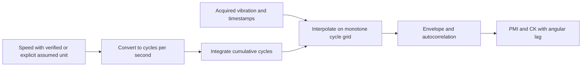

For the supplied recordings, speed units remain unknown. Analyze rpm/rps/rad/s only as labeled sensitivity scenarios; do not choose the scenario with the most dramatic PMI and call it physically correct. Negative or zero speed can break monotonicity or require a model of direction changes. An implementation should reject unsupported cases rather than silently sort samples.

# Chapter 18: Envelope, correlated kurtosis and PMI

The analytic signal of a real trace is \(a(t)=y(t)+i\mathcal H\{y(t)\}\), where \(\mathcal H\) is the Hilbert transform. Envelope magnitude is \(|a(t)|\). For a narrowband amplitude-modulated carrier, this can expose slow modulation. Finite-record FFT Hilbert transforms have edge effects; the envelope is not an independent measured channel and does not magically isolate faults in arbitrary broadband signals.

The MATLAB reference calls `envelope(d)` and then autocorrelation of the centered upper envelope. A Python Hilbert-envelope implementation is conceptually related, but numerical identity to MATLAB is unverified without live MATLAB/toolbox execution. Document endpoint handling, centering, ACF normalization and maximum lag.

For correlated kurtosis order \(M\), integer period \(T\) samples, and zero-padded shifted values, the reference's formula is

\[
\operatorname{CK}_M(T)=\frac{\sum_n\left(\prod_{m=0}^{M}y_{n-mT}\right)^2}{\left(\sum_n y_n^2\right)^{M+1}},
\]

where terms outside the record are zero. The array needs \(M+1\) columns because \(m=0,\ldots,M\). This is the implemented formula, not ordinary kurtosis. For `y=[1,2,3]`, `T=1`, `M=1`, numerator is \(0+4+36=40\), denominator is \(14^2=196\), so CK is \(10/49\). Multiplying the whole signal by a nonzero constant leaves CK unchanged. Length and period still affect it; a value is not a universal severity score.

PMI applies \(\rho/(1-\rho)\) to a selected envelope ACF coefficient. A positive periodic coefficient close to 1 produces a large PMI. Negative coefficients yield negative PMI under the literal coarse definition and should not be silently clipped. A coefficient of 1 makes the transform singular; return an explicit status or nonfinite value rather than hiding instability with arbitrary clipping.

MATLAB arrays use one-based indexing. If \(T=\operatorname{round}(f_s/f_{fault})\), `acf(T)` selects lag \(T-1\), because lag zero is the first element. The physically intended lag \(T\) is Python `acf[T]`, whereas literal MATLAB coarse indexing maps to Python `acf[T-1]`. Moreover the returned `timeindex` includes the local `max` index, creating an additional reporting offset. The refined branch takes an absolute value and has its own indexing behavior. Label faithful and corrected variants; do not “fix” the reference silently.

The source's `f_fault=1` after angular resampling means one repetition per chosen angular coordinate unit under assumptions. It does not establish a gearbox tooth count or verified crack order. The helper `toConstantSamplesPerCycle` is not included; its exact speed convention and second-output semantics cannot be inferred solely from the calling line.

# Chapter 19: Diagnosis and anomaly masking

The proposed residual mechanism is background removal. A predictor trained on a reference condition learns reproducible vibration; an unusual impact might remain in the residual. This is plausible but must be tested. The training file is a supplied reference condition, not independently verified healthy data merely because a published study used a healthy-training protocol.

Teacher-forced prediction on a fault candidate repeatedly observes past fault content. A flexible predictor may learn to predict regular impacts from the recent window, reducing both MSE and the residual feature that might have exposed them. This is anomaly masking. A simpler imperfect model can sometimes leave a more useful diagnostic residual. Therefore choose prediction and diagnostic models separately if the evidence warrants it.

A detector requires more than an indicator. It needs a threshold rule, calibration data, a defined decision unit and labels or another trustworthy validation protocol. False positives are alarms on verified normal cases; false negatives are missed verified faults. Sensitivity, specificity, precision, recall, F1 and ROC AUC require such ground truth. Recording index and file naming are not substitutes for labels.

Synthetic impulses can test whether features respond as intended. State injection amplitude, period, noise, speed assumption and random seed, and keep these experiments separate from real gearbox claims. Demonstrating sensitivity to injected impulses does not establish sensitivity to physical tooth cracks, which may have different mechanisms and confounding factors.

**Practical defense.** “We evaluate residual impulsiveness and periodicity descriptively, test feature implementations on known synthetic signals, and leave physical detection accuracy unmeasured pending labels.” This is more rigorous than calling the first half healthy and second half damaged based on a trend.

# Chapter 20: Reading the actual EDA

The audit and EDA begin with inspected recordings, including the verified 200-record complete-record fault-data package; descriptions in the prompt are independently checked rather than substituted for audit. Compare full vibration traces to see amplitude variation, then zoom to inspect oscillatory structure. Align speed below vibration, keeping units labeled “source speed units.” Use identical axis conventions where direct comparisons are intended.

Raw-to-normalized reconstruction is a numerical check: calculate \(x-(x^{raw}-\mu_*)/\sigma_*\) and inspect the maximum absolute error. A near-floating-point error supports transform consistency. It does not prove that \(\mu_*\) came from this particular excerpt or that the metadata encode physical sensor calibration.

A speed-distribution plot should show training coverage and validation coverage. A near-unity correlation between trajectories says that their shapes track closely. A histogram alone misses temporal order; a time overlay alone can hide small range differences. Use both before claiming a difficult operating-condition shift.

Rolling RMS and kurtosis require declared window lengths. A window of 1,024 samples lasts 0.32 s. A shorter window makes changes more visible but makes higher moments noisier. Overlapping rolling estimates are correlated and do not create independent replicates. Mark partial windows or use only complete windows consistently.

A spectrogram may show changing frequency content; an ACF shows recurring dependence in sample lag; a PSD summarizes average power. They answer different questions. A normalized vibration plot cannot carry m/s² labels merely because the MATLAB plotting helper does. A source-speed plot cannot carry rpm unless verified.

For each figure, ask: Which file and hash? Which sample range? Which coordinate and units? Which preprocessing? Which window, overlap or frequency scaling? Which inference is descriptive and which is causal? The figure manifest and report captions should answer these without requiring reverse engineering.


## Figure laboratory: audit and time-frequency evidence

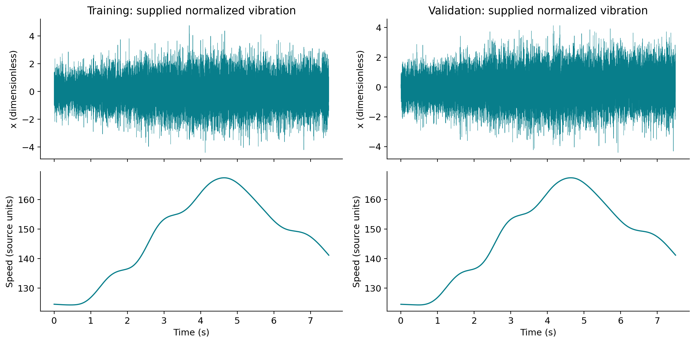

**Figure C1.** Full accessible 7.5-second training and validation records. Vibration is supplied dimensionless `x`; speed retains source units. The speed paths visibly follow similar trajectories. Different vibration realizations can share a speed path. This figure is descriptive EDA, not a fault-label or leakage determination.

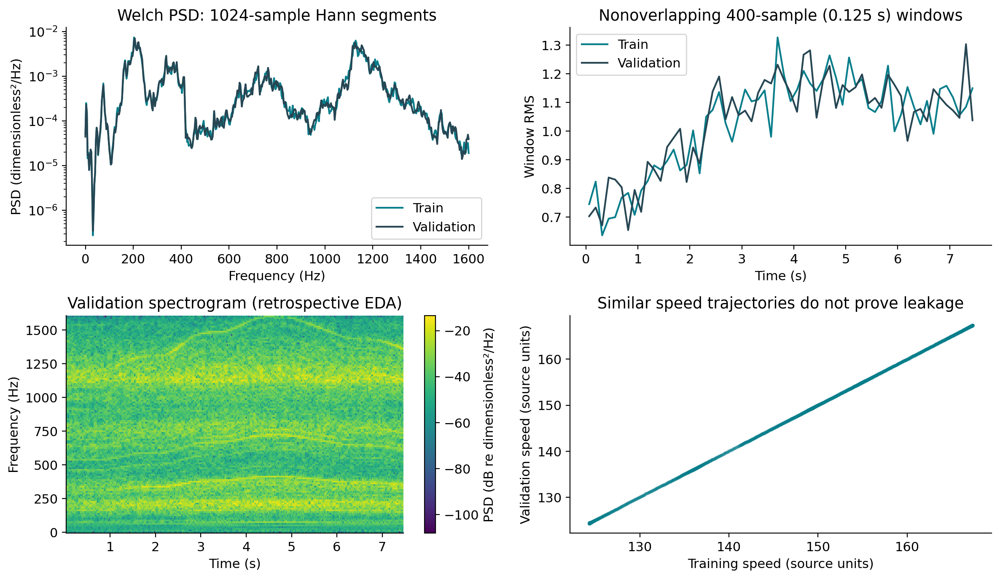

**Figure C2.** Welch PSD uses 1,024-sample segments; RMS uses nonoverlapping 400-sample windows, equivalent to 0.125 s; validation spectrogram uses 256-sample segments with 192-sample overlap. The speed scatter compares aligned time positions. A spectrogram and full-record PSD answer different questions about changing spectral structure. These retrospective transforms are not predictor inputs.

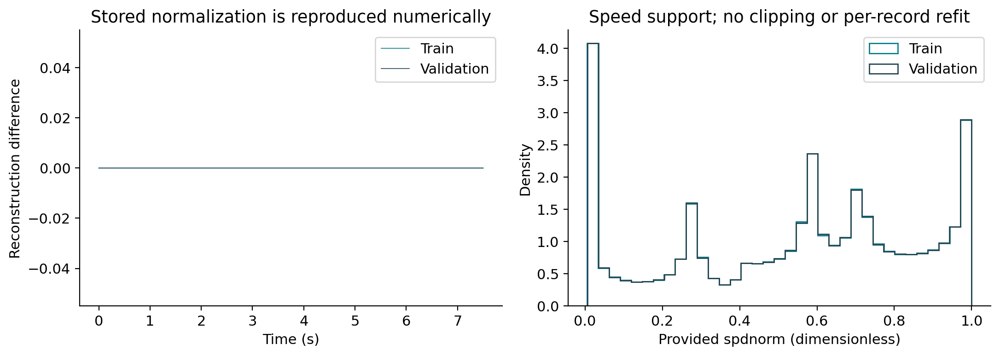

**Figure C3.** Reconstructed supplied scaling gives zero numerical difference in this execution, while normalized speed histograms show the accessible operating support. Neither panel verifies physical units. Density heights are not the probabilities of individual floating-point speed values.

# Chapter 21: Inspecting trained artifacts

A model artifact is more than a binary weight file. It must identify model kind, lag, input channels, scaling, architecture, seed, selected epoch, training configuration and package versions. Predictions require the same feature order used in fitting. Loading weights into a vaguely similar architecture is not reproduction.

For a linear model, inspect intercept, coefficient shape, regularization and interaction design. For a neural model, inspect state dictionary keys, channel widths, dilation sequence, recurrent hidden size and output head. Use only locally produced trusted pickle/joblib artifacts; loading arbitrary serialized Python objects can execute code. A PyTorch state dictionary is preferable to serializing a whole custom object, with safe loading options supported by the installed version.

Verify a round trip: predict with the fitted object, save, reload, predict the same inputs and compare within a stated tolerance. Then rescore the reloaded model on the saved target set. File checksums establish that later users loaded the same artifact bytes; prediction checks establish operational equivalence in the tested environment.

The authoritative comparison is [the saved results table](../reports/results_summary.csv), linked to per-run prediction files and configuration. The explanatory [walkthrough notebook](../notebooks/00_COMPLETE_PROJECT_WALKTHROUGH.ipynb) connects these artifacts to the code. The [final report](../reports/PROJECT_FINAL_REPORT.md) provides the scientific narrative. A checkpoint chosen by validation is a development artifact; it is not a newly independent evaluation. When discussing the “best model,” specify best by which criterion and whether the score was used in selecting it.


## Exact architecture used by this implementation

The MLP uses `Linear(L,32) → ReLU → Linear(32,1)` and ignores the speed channel. The GRU uses one unidirectional layer with input size 1 and hidden size 16, followed by `Linear(16,1)` on the final past-window state. It resets state for each window. The tensor supplied to the network is `(number_of_windows, 2, L)`, with channels supplied vibration and past normalized speed; vibration-only models explicitly select channel zero.

The TCN projects vibration to eight channels with a size-one convolution, then uses two size-three, left-padded convolutions per residual block. Dilations double. Its number of blocks is chosen to cover the declared lag. At L=32 it has four blocks and theoretical receptive field 61; L=64 has five blocks and receptive field 125; L=128 has six blocks and receptive field 253. Since the provided history is shorter than the theoretical receptive field, the additional receptive extent is left padding, not extra measured history. The scalar head reads only the final representation.

The implemented FiLM update is `h * (1 + 0.1*tanh(g(speed))) + 0.1*b(speed)`, with a separate linear speed-to-gain/offset map at each block. Each past position uses only its own known speed; it is not conditioned on target or future speed. The late-concatenation control appends the last past speed to the final feature vector. A nine-channel unconditioned TCN is a coarse capacity control, not exactly parameter matched.

The phase-rolled-speed control is explicitly an **offline noncausal control**: wrapping a whole speed record can use information unavailable at prediction time. It is excluded from the recommended causal-model ranking. Its score is evidence about an artificial conditioning experiment, not a deployable causal predictor.

The bounded neural plan uses AdamW, learning rate 0.003, weight decay 0.0001, batch size 512, at most ten epochs, patience three, gradient clipping at norm one and fixed seeds. Actual completed epochs are recorded per run. The three-seed comparison applies to L=64 TCN and L=64 speed-TCN; the MLP and GRU each have one seed, and this asymmetry must remain visible.

# Chapter 22: Interpreting controlled experiments

Ablations deliberately remove or alter one component to test a claim. For speed conditioning, compare otherwise similar models and then inspect capacity, optimization and seed effects. If a conditioned network has more parameters and longer training, attributing its full improvement to speed is unjustified.

Lag experiments should compare the same target indices. At 3,200 Hz, contexts 32, 64 and 256 are 10, 20 and 80 ms. Longer history may help periodic structure or simply increase parameter count. A ridge-AR grid partly isolates this effect; neural architecture changes introduce additional factors. Report actual tested combinations rather than implying every model used every context.

For seeds, distinguish mean±standard deviation from confidence intervals. Three initializations characterize a limited training-variability sample; they do not tightly estimate all randomness. Comparing the minimum of three conditioned seeds against one unconditioned seed favors the former through selection. Show all runs or apply the same aggregation.

For speed bins, define boundaries and report counts. Error stratification by contemporaneous speed is an analysis operation and does not imply that the model observed contemporaneous speed. If high-speed bins are harder, possible causes include frequency shifts, amplitude variation and unequal sample counts. Stratification identifies a pattern, not a causal mechanism.

Unexpected negative results deserve discussion. Speed may add little because past vibration already encodes instantaneous frequency. A small record may not train modulation robustly. Nearly identical speed paths may reduce the challenge. A more flexible model may overfit. Each is a hypothesis; additional controlled data are needed to distinguish them.


## Measured comparison from this execution

All rows below are measured **validation** scores on zero-based target indices 256–23,999 inclusive (23,744 samples), using supplied normalized vibration. They were generated on 2026-10-30. The saved run ID links architecture, seed, configuration, artifact and prediction provenance through `experiments/runs/<run_id>/`.

| Run ID | MSE | Parameters | Training-stage wall s | Full-record inference median s |
|---|---:|---:|---:|---:|
| `zero_L256_s17` | 1.104077 | 0 | 0.000366 | 0.000331 |
| `mean_L256_s17` | 1.104017 | 1 | 0.000256 | 0.000317 |
| `persistence_L256_s17` | 2.032667 | 0 | 0.000201 | 0.000224 |
| `ar_L256_s17_a1` | 0.420058 | 257 | 0.069029 | 0.006647 |
| `arx_L256_s17_a1` | 0.427821 | 259 | 0.063736 | 0.007752 |
| `lpv_L256_s17_a1` | 0.361217 | 769 | 0.765804 | 0.122543 |
| `mlp_L64_s17` | 0.450469 | 2113 | 1.489657 | 0.007496 |
| `gru_L64_s17` | 0.823606 | 929 | 12.339703 | 0.314197 |
| `tcn_L128_s17` | 0.454490 | 2425 | 26.812453 | 0.535576 |
| `speed_tcn_L128_s17` | 0.458226 | 2617 | 52.985214 | 1.259770 |

The polynomial LPV-AR surrogate has the lowest observed eligible MSE, **0.361217**, a **14.01%** reduction relative to ridge AR(256) and **67.28%** relative to zero. It is a three-basis speed-by-lag regression with 769 coefficients including the intercept, not reproduced Spa LPV-ARMA. Its public full-record inference path is slower than the ordinary ridge predictor because it builds and evaluates a larger interaction design.

The best tested TCN at L=128 has MSE 0.454490 and the corresponding speed-TCN has 0.458226, so neural speed modulation does not improve that comparison. At L=64 across three seeds:

| Family | Seeds | Mean MSE | Sample standard deviation |
|---|---|---:|---:|
| tcn | 17, 29, 43 | 0.470290 | 0.012548 |
| speed_tcn | 17, 29, 43 | 0.479215 | 0.018032 |

These initializations do not support a consistent FiLM benefit on this trace. The larger unconditioned capacity control and late-concatenation run do not establish a hidden decisive speed advantage either. The linear speed-interaction model does improve on ordinary AR; therefore the conclusion is specific: speed-dependent linear coefficients help in this bounded experiment, while this compact FiLM-TCN design and training budget do not surpass the strongest linear surrogate.

The GRU's relatively high MSE does not establish that GRUs are fundamentally unsuitable. It establishes the outcome of a small hidden-size model, one seed and the bounded training plan. A fair paper would describe that limitation before extrapolating to recurrent modeling in general. Persistence is worse than zero here, demonstrating why lagged oscillatory structure cannot be reduced to simple smoothness.

**Timing scope:** the saved `train_wall_s` is a training-stage wall clock that includes model fitting and final artifact/prediction work; it is not a pure optimizer-only kernel time. Full-record inference timing uses the public load-and-predict path, including artifact loading, window construction and prediction, after one warm-up and three repetitions. It is not a bare single-window latency. The recorded median/min/max describe the actual current-machine implementation. `nmse` is MSE divided by mean squared target amplitude, not centered target variance.

These tables are explanatory snapshots of [results_summary.csv](../reports/results_summary.csv). If you retrain or alter configuration, rebuild this documentation from the new measured outputs rather than quoting the snapshot as a new result.


## Figure laboratory: prediction and computational evidence

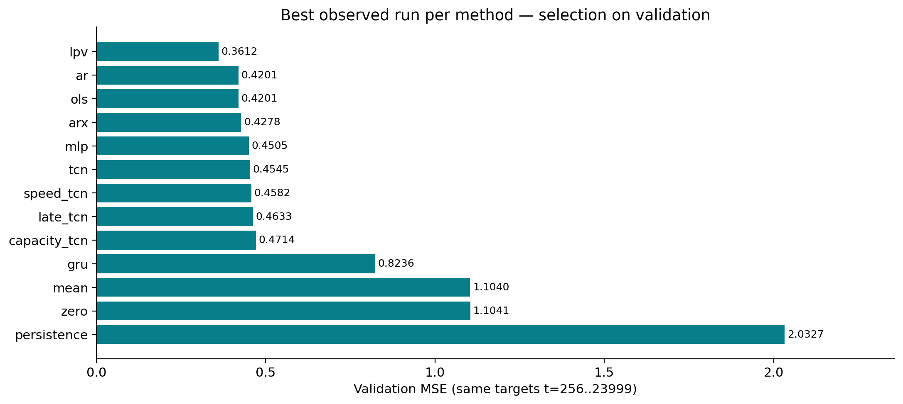

**Figure C4.** Every eligible model kind is represented by its best observed validation configuration, all on indices 256–23,999. This selection is optimistic relative to an untouched test and unequal search coverage must remain visible. The noncausal rolled-speed control is excluded. Lower is better for this prediction metric only.

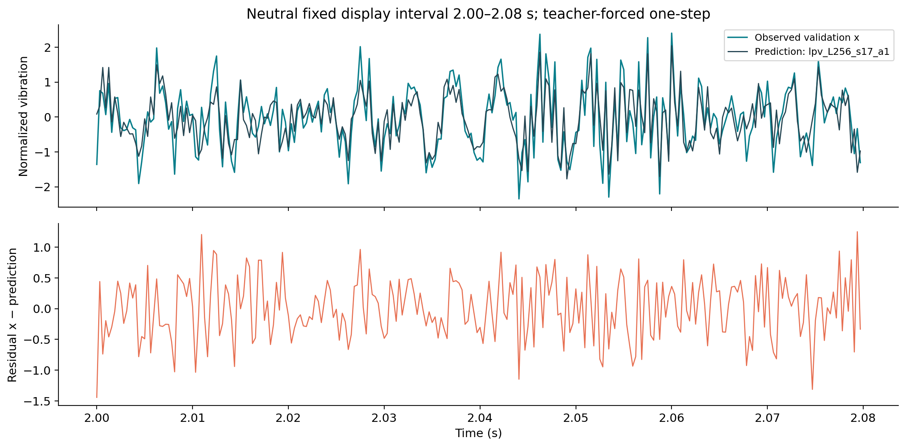

**Figure C5.** The neutral display interval is 2.00–2.08 s from the validation recording. Predictions are teacher-forced one-step values from the selected LPV-AR surrogate, not free-running forecasts. The residual lower panel is on the same normalized amplitude scale. Inspect phase and localized deviations instead of interpreting only a global MSE.

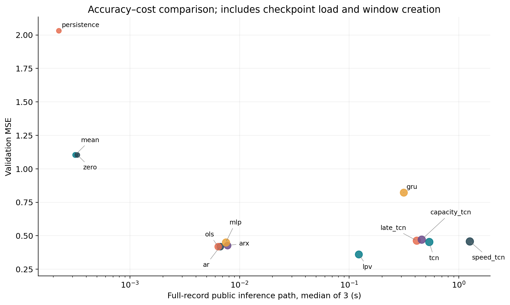

**Figure C6.** Public inference-path median of three repeats includes checkpoint load, window creation and prediction after one warm-up. The x axis is logarithmic. Marker size varies with parameter count. These are current CPU implementation measurements, not online single-sample latency or measured GPU performance.

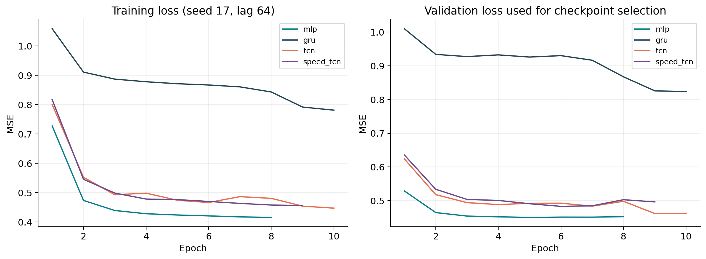

**Figure C7.** Lag-64, seed-17 models under the bounded training plan. Validation curves are used for checkpoint selection, so their minima are development outcomes. Comparing training and validation curve behavior helps distinguish optimization limitations from overfitting; it does not replace independent test evaluation.

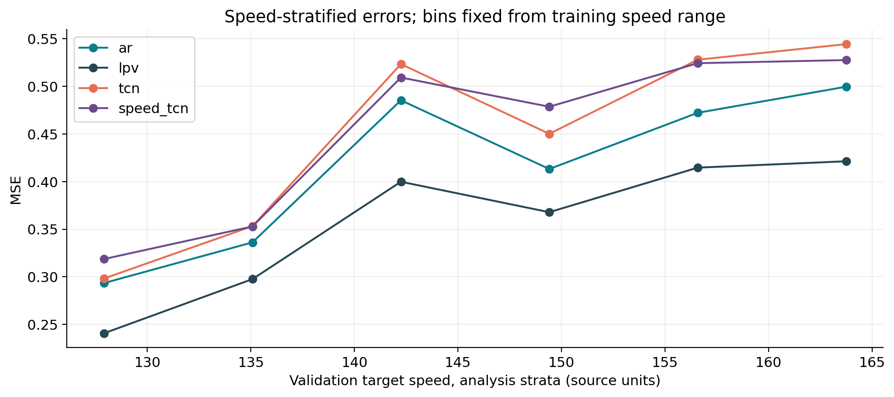

**Figure C8.** Speed bins are fixed from training's source-speed range. The validation target speed stratifies errors for analysis; models still use their declared past-only inputs. Per-bin sample counts are in `reports/speed_binned_errors.csv`. Different bins are portions of the same trace, not independent machines.

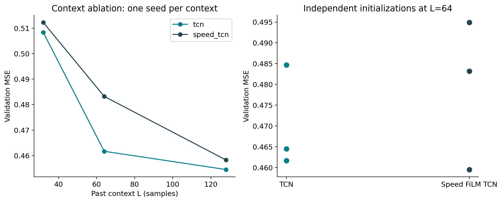

**Figure C9.** Left: one seed at each tested neural context. Right: three separate initializations at lag 64. The plots isolate different sensitivities and should not be combined into a single population confidence claim. Neither longer context nor FiLM conditioning provides a universal monotonic improvement across all runs.

# Chapter 23: Record-wise fault-candidate analysis

## 23.1 What changed when the split package arrived

The supplied complete-record package resolves the earlier file-transfer limitation. It contains twenty MATLAB parts, `sigfault1_part_001.mat` through `sigfault1_part_020.mat`, with ten records per part. Record IDs 1–10 belong to the first part; 191–200 belong to the last. There are **200 separate recordings**, each with **32,000 samples at 3,200 Hz**, or ten seconds by sample count. The aggregate contains 6.4 million vibration samples, but it is not a single 2,000-second continuous measurement.

The original fields are `t`, `fs`, `N`, `spd`, `spdnorm`, `x`, `spdmin` and `spdmax`. There is no supplied `xraw` in these fault-candidate structs. Preserve their already normalized `x` without independently standardizing each record; otherwise amplitude changes across records could be erased. The record timestamps begin at the first acquisition sample, not at an invented phase origin.

The source package describes a lossless partition by whole record. Verification checks every part's byte count and SHA-256, numeric record ranges, per-part logical hashes, total count and ordering against the manifest. The original unsplit file's listed byte hash is provenance supplied by the package; the inaccessible original bytes were not independently rehashed here. Reconstructing the same logical data need not produce a byte-identical MATLAB container because compression, headers and serialization may differ. Logical field equality is therefore a different claim from original-container byte equality.

**Engineering consequence:** stream one part or one record at a time. A memory-conscious iterator preserves the global ID, part filename and input hash while bounding array storage. There is no scientific benefit in creating one giant concatenation that invents a transition from record 10's last sample to record 11's first sample.


### Measured audit of all 200 records

The independent scientific audit is [fault_data_audit.csv](../reports/fault_data_audit.csv), and [fault_parts_verification.json](../reports/fault_parts_verification.json) records manifest/file/logical-hash validation. Every record has 32,000 samples, 3,200 Hz, first timestamp 0.0003125 s and final timestamp 10 s. The following are minima and maxima **across the 200 record summaries**, not an invented fault-class comparison:

| Audited quantity | Minimum across records | Maximum across records |
|---|---:|---:|
| Mean supplied vibration | -0.05745171803 | 0.03892663816 |
| Standard deviation supplied vibration | 0.9444259351 | 1.19012763 |
| Per-record minimum source speed | 123.6552758 | 124.3895491 |
| Per-record maximum source speed | 167.2936285 | 167.4164908 |
| Per-record minimum normalized speed | -0.009691389399 | 0.007280886813 |
| Per-record maximum normalized speed | 0.9989822835 | 1.00182217 |
| Fraction of samples outside reference speed bounds | 0 | 0.02496875 |

The pooled fraction outside reference speed bounds is **0.622453%** because all records have equal sample count. The largest per-record fraction is **2.496875%**. Maximum speed-normalization reconstruction error is zero in the computed arrays. These findings confirm a small amount of genuine extrapolation beyond `[0,1]`; retaining it is scientifically preferable to silently clipping it. None of the records contains `xraw`, so the fault vibration's original amplitude transform cannot be reconstructed from an independent raw waveform here.

The largest observed absolute supplied sample amplitude is approximately **8.253845**. That is a dimensionless normalized amplitude, not a verified acceleration or severity. Higher amplitude could reflect changing excitation or acquisition as well as a physical defect. The dataset has no explicit healthy/fault class, onset or severity field.

### Stream one record without changing its identity

```python
from pathlib import Path
from rotmach.fault_io import iter_fault_records, verify_fault_parts

parts = Path('data/raw/sigfault1_parts')
verification = verify_fault_parts(parts)
assert verification['status'] == 'PASS'
assert verification['record_total'] == 200
# Verification has just completed; avoid needlessly repeating it in the iterator.
record = next(iter_fault_records(parts, verify=False))
assert record['global_record_id'] == 1
assert record['record_id'] == 'fault_candidate_record_001'
assert record['N'] == 32000
assert record['source_part'] == 'sigfault1_part_001.mat'
```

`verify=False` is appropriate only after the same package was verified and remains unchanged. It is not a way to accept corrupted input. The iterator preserves source fields and adds provenance; it does not assign a health label or rescale vibration. For an unknown or changed package, keep verification enabled.

## 23.2 Causal inference without artificial boundaries

All principal predictors remain fitted to `sigtrain`; none is retrained on fault candidates. For each new record, build its own past windows and reset recurrent state. The common excluded warm-up is 256 samples, leaving zero-based target indices **256–31,999**, **31,744 retained samples per record**, and 6,348,800 retained target positions across the 200 recordings. That total counts positions, not independent trials.

The retained sample-count duration is (31744/3200=9.92) s. Last retained timestamp minus first retained timestamp is one sample interval smaller. Compute raw and residual features over exactly this same segment. A shorter-lag model may be able to predict earlier samples, but those extra targets are excluded from the fair fault-candidate comparison, as they are from validation.

A correct per-record inference procedure is:

1. Read and validate one complete record and its source identity.
2. Build past-only inputs from that record alone.
3. Load the already trained reference model and compute one-step predictions.
4. Remove equal burn-in from truth, residual, time and speed.
5. Calculate features and retain validity warnings.
6. Save a compact summary row before releasing large intermediate arrays.

The teacher-forced protocol gives a predictor actual prior vibration from the candidate recording. It therefore measures local one-step predictability under the reference-trained mapping. It does not simulate an entirely reference-driven free-running model. This matters because a recurring candidate pattern can itself become predictable after several observed cycles.

## 23.3 Read the long-format tables correctly

The time-domain table is [fault_record_features.csv](../reports/fault_record_features.csv). It identifies global `record_id`, `model_id`, model `kind`, retained sample count, burn-in, RMS, crest factor, kurtosis, source-speed summary, part filename, input SHA-256 and measured computation times. A row named `raw` describes supplied normalized vibration, not a newly recovered unnormalized sensor trace.

One record appears once per selected predictor and once for raw features. Repeated appearances are paired measurements on the same physical recording, not independent new cases. For a model-to-raw ratio, join by global record ID, verify equal retained length and then divide. A pooled comparison that drops IDs can accidentally pair different operating conditions.

The angular table is [fault_angular_features.csv](../reports/fault_angular_features.csv). It additionally records the assumed speed unit, angular density, output length, CK order one, literal/coarse-reference PMI, scientifically corrected PMI, selected ACF coefficient and lag, and interpolation/edge diagnostics. Invalid or insufficient-period results must remain explicit rather than being replaced with convenient zeros.

Each table's interpretation is constrained by provenance. `record_id=120` means the 120th source record in preserved order; it does not mean severity level 120 or faulty class 1. Part numbers describe storage boundaries only. They are never training/evaluation health labels.

## 23.4 Compare prediction and diagnostic behavior separately

Residual RMS squared is candidate-record one-step MSE on the common segment. It evaluates predictability under the fixed reference-trained model. Crest factor, kurtosis, CK and PMI emphasize different kinds of structure. Their rankings need not match the MSE ranking, and none becomes a ground-truth diagnosis solely because it changes sharply.

A model with low residual RMS can leave only scattered large deviations, increasing crest factor. Another model can leave more total energy but reduce peak prominence. A high-capacity model may predict periodic anomalous content and reduce PMI. Conversely, model mismatch at a particular speed can create structured residuals even without a verified physical fault. The comparison must therefore show several indicators and speed summaries rather than selecting whichever feature makes the preferred model look best.

The neutral representative-record policy uses fixed source IDs or evenly spaced indices selected before inspecting dramatic effects. In an overlay, show raw and residual curves over the same interval and the same amplitude coordinates. In trend plots, all records should be visible. Do not label an apparent first-half/second-half difference as healthy/faulty unless acquisition documentation establishes it.

## 23.5 Speed assumptions and interpolation sensitivity

Three explicit hypotheses are considered: supplied speed in rpm, revolutions/s, or radians/s. Converting each to cycles/s creates different angular coordinates. They are not three equally measured physical truths, and selecting the most dramatic PMI would be post hoc model selection on an unverified coordinate. The correct unit still requires source confirmation.

Use consistent assumed modulation order and density policy within each branch. Compare raw and residual under the same branch; report angular length and interpolation error. The output density is samples/cycle. Increasing it can reduce one downsampling concern, but linear interpolation still changes broadband structure and cannot recover unknown intersample behavior. A round-trip error measures the change induced by the resampling path, not error against an unobserved continuous signal.

Literal/reference and corrected PMI differ because ACF lag zero occupies element zero in Python and element one in MATLAB. In an angular grid with (P) samples/cycle, physically intended order-one lag is (P); the literal MATLAB coarse selection maps to lag (P-1). An observed feature difference might come from this indexing choice rather than from machinery physics. Keep variants visible in sensitivity tables.

## 23.6 What the real study can and cannot establish

The real-data analysis can establish that reference-trained models yield particular record-wise residual statistics; that features differ across records and models; that some variation is associated with speed or source index; and that angular assumptions alter indicators. Paired comparison controls each recording's source identity, but it does not control every unmeasured load, acquisition or health variable.

It cannot establish physical tooth-crack sensitivity, specificity, F1, ROC AUC or severity accuracy because no verified health/severity labels are supplied. It cannot establish a known onset at record 101 because a plot changes there. It cannot identify rpm as the correct source speed unit by feature appearance. The separate prediction recommendation remains based on validation; a separate diagnostic recommendation must be limited to observed indicator behavior until labels become available.

## 23.7 Future labeled evaluation

When verified labels arrive, retain their acquisition provenance and define the decision unit as a record or another justified independent segment. Choose thresholds on permitted calibration records, then evaluate on untouched labeled records. Avoid optimizing a threshold on all 200 cases and reporting its apparent separation as independent detection performance. Consider operating-condition-stratified false alarms and detection delay, not only an aggregate AUC.

The appropriate next measurement is documentation and independent labeled data, not a more elaborate feature chart. Current descriptive findings remain useful because the complete record-wise provenance makes later label attachment and reanalysis possible without inventing earlier evidence.

## Observed reference/validation diagnostic sensitivity

The accessible validation trace supplies a reference diagnostic example alongside the separately analyzed 200 fault-candidate records. The common segment is again indices 256–23,999. From [signal_statistics.csv](../reports/signal_statistics.csv):

| Series | RMS | Crest factor | Ordinary biased kurtosis |
|---|---:|---:|---:|
| Supplied training vibration | 1.042772 | 4.568726 | 3.251842 |
| Supplied validation vibration | 1.050751 | 4.192664 | 3.188254 |
| LPV-AR(256) validation residual | 0.601014 | 4.012884 | 3.143244 |

The residual RMS is 57.20% of the supplied validation RMS. This follows from its prediction MSE and indicates removal of predictable amplitude, not improved fault sensitivity. Crest factor and kurtosis decrease slightly rather than exposing a dramatic impulsive pattern. No fault state is known for this validation trace, so neither direction can be scored as diagnostic success or failure.

The [angular-unit sensitivity table](../reports/angular_unit_sensitivity.csv) separately evaluates rpm, radians/s and revolutions/s assumptions on accessible raw/reference and residual series. Physical speed units and one-cycle modulation order are explicitly marked unverified. To avoid requested angular density below the maximum local input density in this illustration, the assumed-unit branches use 2,048, 256 and 32 samples/cycle respectively. These grids are not interchangeable physical confirmations.

For supplied validation vibration, corrected PMI is approximately 0.08461 under the rpm scenario, 0.06839 under radians/s, and 0.18852 under revolutions/s. The LPV residual's corresponding values are approximately 0.04015, 0.04695 and 0.04105. Literal MATLAB lag indexing gives different values; for the rpm residual example it gives approximately 0.04825 rather than 0.04015. These changes demonstrate meaningful sensitivity to coordinates and indexing. They cannot identify the correct speed unit or establish a defect order.

Linear interpolation's measured round-trip RMSE is about 22–30% of the source RMS in these cases. A denser angular output prevents one obvious downsampling choice but does not undo the interpolation's effect on this broadband signal. Round-trip error is a sensitivity diagnostic rather than error against an unknown continuous ground truth. Accordingly, the angular numbers should be interpreted as an explicit implementation/assumption study, not precision physical order-domain evidence.


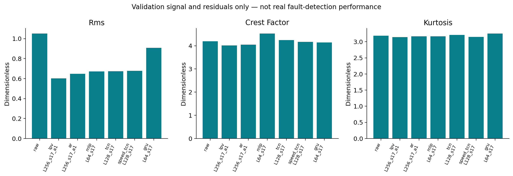

**Figure C10.** Accessible validation only, with equal 23,744-sample segments across models. Reduced RMS is expected from improved prediction; increased impulsiveness would need separate diagnostic interpretation. No values are physical fault-detection accuracy.

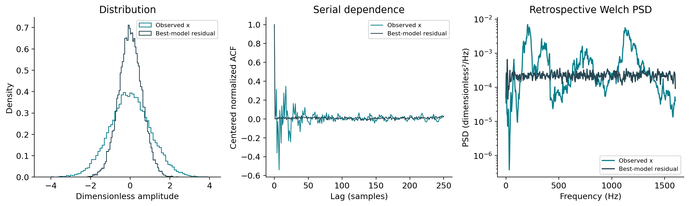

**Figure C11.** Histogram, centered energy-normalized ACF through lag 250, and Welch PSD of validation signal versus the selected-model residual. Remaining temporal structure is evidence about model adequacy on this trace. It cannot alone establish a physical defect.

<!-- MEASURED_FAULT_RESULTS_START -->
## Measured full fault-candidate study

The completed study contains **200 separate recordings**, **13 frozen validation-selected causal predictors**, **2,800 raw/residual time-feature rows**, and **8,400 angular-sensitivity rows**. Every scalar comparison uses indices 256–31,999, exactly 31,744 values per recording. Separate processing does not itself prove statistical independence of acquisitions; acquisition-order semantics are unknown.

| model_id             |   records |   median_rms |   median_residual_raw_rms_ratio |   median_crest_factor |   median_kurtosis |
|:---------------------|----------:|-------------:|--------------------------------:|----------------------:|------------------:|
| lpv_L256_s17_a1      |       200 |     0.623974 |                        0.588109 |              4.908411 |          3.272660 |
| ar_L256_s17_a1       |       200 |     0.665676 |                        0.630237 |              4.818784 |          3.295679 |
| ols_L256_s17         |       200 |     0.665687 |                        0.630243 |              4.818087 |          3.295630 |
| arx_L256_s17_a1      |       200 |     0.666277 |                        0.631446 |              4.812602 |          3.298296 |
| speed_tcn_L128_s17   |       200 |     0.680298 |                        0.645790 |              4.826195 |          3.289983 |
| tcn_L128_s17         |       200 |     0.681158 |                        0.647383 |              4.844180 |          3.322133 |
| mlp_L64_s17          |       200 |     0.681743 |                        0.648656 |              4.795177 |          3.277209 |
| late_tcn_L64_s17     |       200 |     0.688605 |                        0.653663 |              4.868368 |          3.304069 |
| capacity_tcn_L64_s17 |       200 |     0.695132 |                        0.657809 |              4.858827 |          3.292343 |
| gru_L64_s17          |       200 |     0.913906 |                        0.871571 |              5.011131 |          3.412047 |
| zero_L256_s17        |       200 |     1.053410 |                        1.000000 |              4.814118 |          3.391280 |
| raw                  |       200 |     1.053410 |                        1.000000 |              4.814118 |          3.391280 |
| mean_L256_s17        |       200 |     1.053415 |                        0.999985 |              4.814454 |          3.391280 |
| persistence_L256_s17 |       200 |     1.493909 |                        1.426888 |              5.118118 |          3.562371 |

These are medians of record-level descriptors, not classification scores. The paired ratio divides each model residual RMS by that same record's raw RMS before taking the median. Zero prediction has the same descriptors as raw, an implementation sanity check. Candidate-record prediction errors were not used to reselect the primary model; the recommendation remains based on the original validation protocol.

### Post hoc source-order observation, without physical labels

The all-record plot shows an amplitude change near source ID101. The following partition was examined **after viewing the trend** and has no known class meaning; it is not a fault-label assignment, calibrated threshold or independent detection experiment.

| model_id        | post_hoc_source_partition   |      rms |   kurtosis |   mean_speed_source_units |   speed_std |
|:----------------|:----------------------------|---------:|-----------:|--------------------------:|------------:|
| lpv_L256_s17_a1 | source IDs 101–200          | 0.676885 |   3.340254 |                143.378533 |   13.999946 |
| lpv_L256_s17_a1 | source IDs 1–100            | 0.581834 |   3.202482 |                143.376490 |   14.000718 |
| raw             | source IDs 101–200          | 1.141549 |   3.467404 |                143.378533 |   13.999946 |
| raw             | source IDs 1–100            | 0.993399 |   3.310569 |                143.376490 |   14.000718 |

Raw and residual RMS differ between these provenance groups while the coarse speed moments are similar. Similar moments do not establish identical operating histories or exclude load, acquisition, preprocessing or health changes. Source documentation is required to interpret the shift. Neither accuracy nor an onset claim can be inferred from this descriptive partition; it was not used to train or select models.

### Physical-unit and PMI-indexing sensitivity on all records

| model_id        | speed_unit_assumption   |   ck_order1 |   pmi_faithful_reference |   pmi_scientifically_corrected |   roundtrip_rmse_fraction_of_source_rms |
|:----------------|:------------------------|------------:|-------------------------:|-------------------------------:|----------------------------------------:|
| lpv_L256_s17_a1 | rad_s                   | 1.82325e-05 |                0.0453168 |                      0.0488183 |                                0.251704 |
| lpv_L256_s17_a1 | rpm                     | 2.30612e-05 |                0.0894128 |                      0.0870028 |                                0.300441 |
| lpv_L256_s17_a1 | rps                     | 2.33043e-05 |                0.0523959 |                      0.0520566 |                                0.320434 |
| raw             | rad_s                   | 1.92645e-05 |                0.101228  |                      0.10036   |                                0.244736 |
| raw             | rpm                     | 2.27428e-05 |                0.100186  |                      0.0971572 |                                0.292669 |
| raw             | rps                     | 2.57445e-05 |                0.184264  |                      0.18848   |                                0.311116 |

Values above are medians across all 200 records under three **unverified** speed-unit interpretations and assumed modulation order one. They do not establish a known shaft or defect order. A different CK/PMI ranking from the MSE ranking shows that the objectives differ; it does not identify a physically superior detector. Interpolation error remains appreciable and is itself part of the sensitivity analysis.

The inspected normalized speed range is **-0.0096913894 to 1.0018221697**. **0.622453%** of all speed samples lie outside the supplied reference interval; no clipping or per-record normalization was introduced. There are no health-state, severity or onset fields in the inspected eight-field structs.

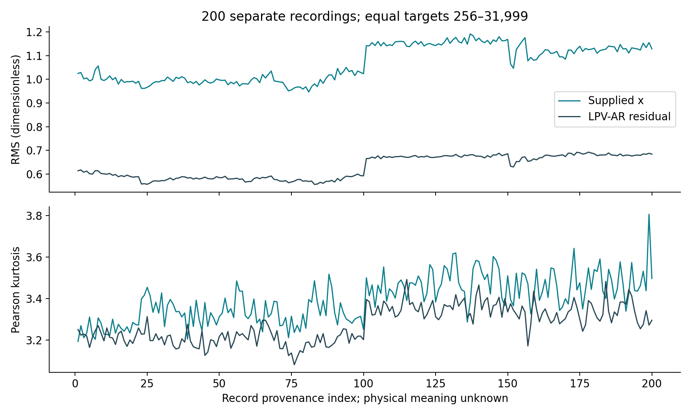

*The horizontal coordinate preserves source order, not a validated progression of damage. Identical burn-in is applied to every raw/residual trace.*

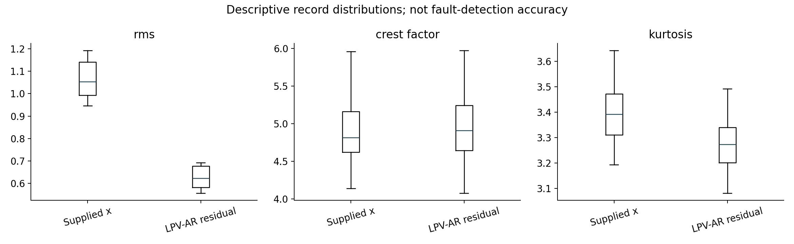

*These distributions describe 200 recordings. Suppressed fliers in a box plot are not removed from the CSV or summary statistics.*

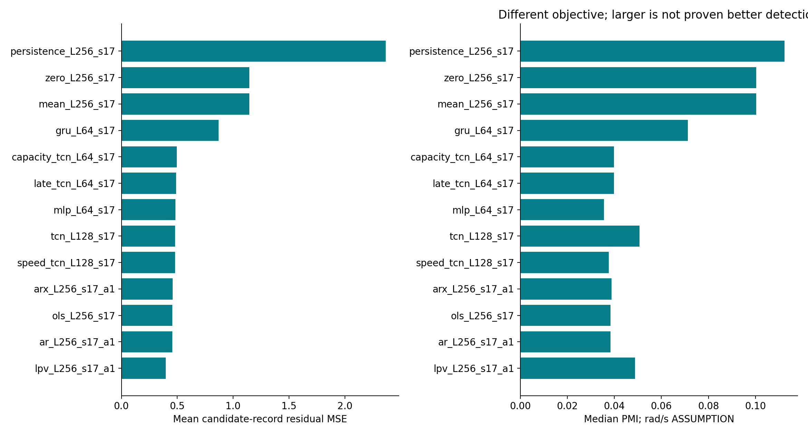

*Candidate-record prediction MSE and assumption-based PMI are distinct descriptors; larger PMI is not verified physical detection success.*

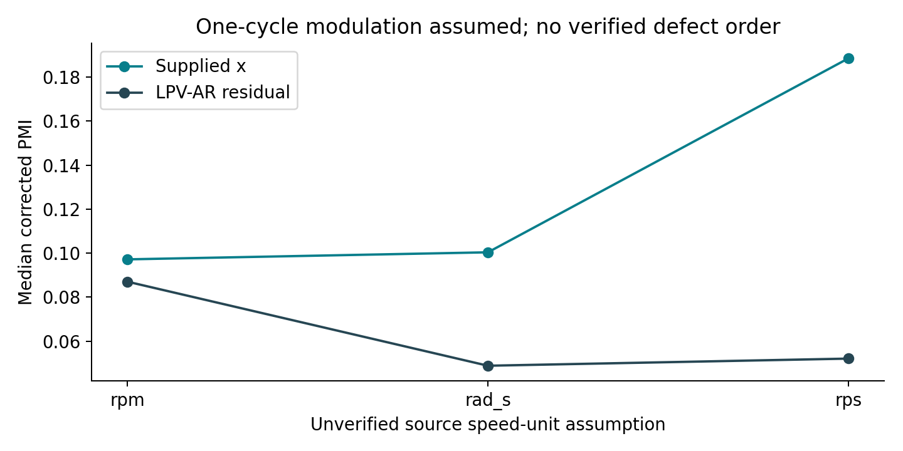

*The chosen unit changes the angular grid, period and resulting PMI. No unit is selected merely because its plot is more separated.*

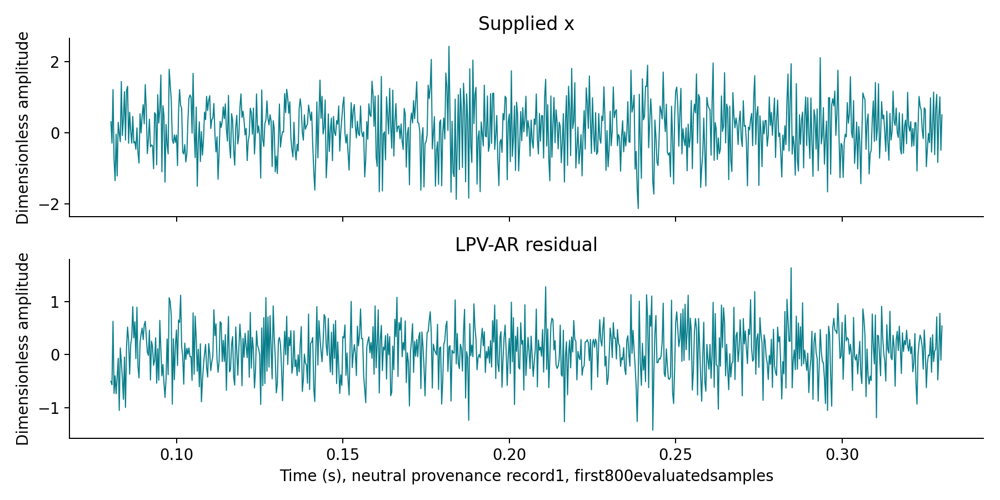

*Provenance record 1 is fixed by the neutral selection policy, not selected for dramatic appearance.*

The full numerical evidence is [fault_record_features.csv](../reports/fault_record_features.csv), [fault_angular_features.csv](../reports/fault_angular_features.csv), [paired summary](../reports/fault_paired_summary.csv), [speed/index associations](../reports/fault_feature_correlations.csv), and [study plan](../reports/fault_study_plan.json). Record IDs 1, 50, 100, 150 and 200 have retained traces; all 200 have restartable scalar-feature caches. No fault data were used for model fitting or hyperparameter tuning.

<!-- MEASURED_FAULT_RESULTS_END -->

# Chapter 24: Reproduction on a local machine

The release separates three activities: checking packaged predictions, loading trained checkpoints for fresh inference, and retraining. They have different runtime and evidence. Loading an existing table is not recomputing the underlying model; reloading a checkpoint and rescoring is a stronger operational check; retraining tests sensitivity to environment and stochastic optimization.

Create a Python virtual environment and install the project's tested requirements. Place the original MAT files in `data/raw/`; respect source-data redistribution restrictions. Use the same normalized fields, preserve hashes and keep outputs outside raw data. Local paths should use `pathlib.Path`, with no cloud-specific absolute directories required.

The exact working commands and platform caveats appear in [the cross-platform reproduction guide](reproduce_windows_linux_macos.md). The primary CPU replay is `python reproduce_all.py --level standard --data-dir data/raw --device cpu`; full retraining uses `--level full`. A quick audit/checkpoint smoke uses `python reproduce_minimal.py --data-dir data/raw`. Windows PowerShell uses a different activation path from Unix shells; a virtual environment can also be used by invoking its Python interpreter explicitly. Windows and macOS commands are provided for reproduction but only the current Linux execution can be empirically verified here.

Do not install CUDA merely to inspect a CPU-trained checkpoint. CPU inference is the reproducible default. GPU results require compatible hardware, driver and PyTorch build and should be separately labeled; absent GPU measurements cannot be estimated and reported as measurements.

Measure the actual full training time on the available machine before quoting resource requirements. Storage includes checkpoints, predictions and figures, not just source files. Preserve a source-only package if raw-data distribution permission is uncertain.

# Chapter 25: Notebook, package and configuration

The notebook is an explanatory orchestration layer. Production algorithms belong in importable modules so the CLI, tests and notebook execute one implementation. A notebook-only feature formula that differs from `diagnostics.py` would create two competing definitions and undermine reproducibility.

Run the notebook after installing the package or exposing `src` on the import path. Its first cells identify the project root relative to the notebook, load configuration and report versions. Later cells should use cached checkpoints for a quick walkthrough and explicit opt-in training for heavier reproduction. Every major cell should explain shapes, units and why the operation is scientifically justified.

“Restart Kernel → Run All” tests hidden-state independence. A notebook that only runs after manually executing cells out of order is not reproducible. Avoid interactive prompts and unsafe unconditional retraining. Check important notebook tables against official CSVs so a stale embedded result cannot silently disagree with the report.

Configurations are scientific records, not decoration. Preserve contexts, penalties, seeds, epochs, optimizer, clipping, checkpoint policy, common evaluation indices, conditioning mode, diagnostic conventions and speed assumptions. Save the resolved configuration alongside every run. Changing a global YAML after training must not rewrite the historical record of what produced a checkpoint.

# Chapter 26: Bias, limits and research priorities

Two short recordings provide rich sample-level structure but limited independent operating-condition coverage. Adjacent windows share almost all their samples. A million arithmetic operations on those windows do not manufacture a million independent experiments. The study is a controlled comparison on supplied traces, not a broad field-deployment validation.

Other limits are unknown physical speed units, unverified healthy status of the reference trace, unknown health/severity labels for the now accessible fault candidates, absent independent test files, incomplete live MATLAB parity and limited accessible paper methods. Model selection on validation adds optimism. Small neural networks reduce computational cost, not all overfitting risk.

Priorities for future data are verified speed units and shaft definition; independent reference recordings with different speed schedules; physical fault labels with acquisition provenance; untouched test data; and controlled benchmark details for Spa LPV-ARMA. More elaborate neural models are lower priority until these foundations are resolved.

Failure modes include sensor drift, changing load, speed extrapolation, acquisition clipping, missing samples and a defect signal that the teacher-forced model learns to predict. Deployment should monitor data validity and conditioning range, not only residual magnitude. Any real-time alarm also needs detection-delay, false-alarm and safety requirements beyond this course comparison.

# Chapter 27: Reading the lecturer's article critically

The course anchor is Chen, Li, Jiang, Gong and Zhou, “Sparse LPV-ARMA model for non-stationary vibration representation and its application on gearbox tooth crack detection under variable speed conditions,” *Mechanical Systems and Signal Processing* 224, 112161 (2025), DOI `10.1016/j.ymssp.2024.112161`. The PDF citation establishes the course's source reference. Access status and independent metadata verification are documented in the research matrix.

Read in layers. First identify the physical problem and data protocol. Next identify the model: how coefficients depend on speed, which past innovations are used, what basis functions are chosen and what sparsity penalty is optimized. Then inspect estimation, validation and residual-diagnostic definitions. Finally ask whether supplied data, normalization and target samples actually match.

An exact benchmark needs enough detail to reproduce basis orders, model orders, innovation recursion, regularization, fit procedure, train/validation split, burn-in and metric scaling. If those are unavailable, implement an explicitly related LPV-AR surrogate and explain the missing parts. Do not copy a graph's MSE or compare another operating condition's number as though it were a matched experiment.

The course expectation that ML might outperform a conventional model is a motivation, not evidence of success. A fair negative result can reveal that a compact linear model fits this particular data regime well. A low neural MSE alone does not disprove a structured model's diagnostic advantages.

# Chapter 28: Worked defense questions

**Why use supplied normalization?** It preserves comparability across accessible files and avoids fitting a different scale per recording. We independently reconstruct the first-entry transform. We do not claim that stored scale statistics came from only the supplied excerpt.

**Why is a zero baseline meaningful?** Provided normalized vibration has a reference center near zero, so it measures how much a predictor improves over ignoring history. The empirical training-mean baseline is separate because the excerpt's mean need not be zero.

**Why does persistence sometimes fail?** An oscillation can change sign rapidly. At half-period separation, the previous value may be a poor predictor despite strong deterministic dependence at longer lags. AR coefficients can combine lagged samples to recover phase information.

**What makes the TCN causal?** Its input ends at \(t-1\), its temporal operations are checked for permitted dependence, and future-perturbation tests verify earlier predictions do not change. The architecture name alone is insufficient.

**Does speed improve prediction?** Consult the saved controlled comparison. A result must include model capacity, common targets and seed variability. Do not promise a benefit before checking the observed table.

**What is the novel contribution?** The project evaluates compact speed-conditioned causal prediction and residual analysis in a controlled experiment. It does not claim to invent FiLM, TCN or LPV modeling.

**Why no ROC AUC?** The supplied accessible files contain no verified fault labels, and the large candidate file is not readable here. Assigning labels from record order would invent ground truth.

**Why not claim to beat Spa LPV-ARMA?** The implemented LPV-AR surrogate lacks a reproduced innovation model and matched protocol. A comparison to ridge only supports a comparison to ridge.

**Why three seeds do not give three machines?** Seeds change optimization on the same data. Independent machines or recordings represent different uncertainty. Both matter, but they answer different questions.

**What does PMI equal to 10 mean?** Under the selected formula it implies \(\rho=10/11\), provided the result is valid and definitions match. It does not mean ten faults, ten cracks or ten-percent damage.

# Chapter 29: Glossary and sources

| Term | Practical meaning |
|---|---|
| Causality | a prediction uses only information available by its declared decision time |
| Context / lag window | previous samples supplied for one target |
| Teacher forcing | using actual past observations for successive one-step predictions |
| Innovation | unpredictable component under a specified stochastic model |
| Residual | observed value minus the chosen model's prediction |
| LPV | linear in dynamic variables with parameters scheduled by an operating variable |
| ARX | autoregression with external input |
| FiLM | learned feature-wise gain and offset conditioning |
| Receptive field | input positions capable of influencing an output |
| Order | cycles per shaft revolution under a defined shaft coordinate |
| Envelope | analytic-signal magnitude, often useful for modulation |
| ACF | normalized or unnormalized correlation across lags; convention must be stated |
| Burn-in | initial target samples excluded for history/warm-up fairness |
| Embargo | excluded temporal gap between fit and holdout windows |
| Ablation | controlled component removal or alteration |
| Extrapolation | operation outside observed conditioning or feature range |
| Checkpoint | saved fitted model state plus reconstruction metadata |
| Provenance | traceable record of source, transforms, configuration and outputs |
| Validation | development evaluation that may influence selection |
| Test | an independent evaluation reserved from model development |

The [literature matrix](../research/literature_matrix.csv) and [research synthesis](../research/research_synthesis.md) record what sources were actually accessible and whether full methods, abstracts, metadata or repository implementations were consulted. The TCN discussion follows the general causal-convolution framework of Bai, Kolter and Koltun (2018), arXiv:1803.01271; GRUs originate in Cho and colleagues' 2014 sequence-modeling work, which is not a gearbox study. The course's Chen article motivates speed-dependent modeling. Spectral-kurtosis background is adjacent to, not interchangeable with, this script's CK and PMI. Cite the research files for verified records and source access limits.

A source teaching a general algorithm does not establish that algorithm's accuracy on these machinery files. The experimental registry supplies that evidence. A course PDF stating the data match a paper does not by itself establish identical preprocessing or a fair numerical benchmark.

# Chapter 30: Appendix: equations and code navigation

The essential chain is

\[
\text{past window}\rightarrow\hat x_t\rightarrow e_t\rightarrow
\{\mathrm{MSE},\mathrm{RMS},\mathrm{CF},K,\mathrm{CK},\mathrm{PMI}\}.
\]

Each arrow introduces assumptions. Window construction introduces indexing and availability. Prediction introduces fitted parameters and selection. Residual features introduce normalization, length, envelope and lag conventions. Angular features additionally require speed conversion and interpolation.

| Source area | What to inspect | What can go wrong |
|---|---|---|
| `src/rotmach/io_matlab.py` | struct loading and record boundaries | flattening separate records; unsupported format |
| `src/rotmach/fault_io.py` | complete-part hashes, logical hashes and global IDs | missing, modified or misordered parts |
| `src/rotmach/fault_study.py` | reference-model reuse and paired record-wise analysis | retraining on candidates; invented labels; unmatched segments |
| `src/rotmach/windows.py` | oldest-to-newest windows and target indices | including target; off-by-one alignment |
| `src/rotmach/models.py` | architecture and conditioning | wrong channels; inadequate receptive field |
| `src/rotmach/experiment.py` | fitting, checkpoint selection and inference | inconsistent preprocessing; selected-seed bias |
| `src/rotmach/diagnostics.py` | RMS, kurtosis, CK and PMI | convention mismatch; zero denominators |
| `src/rotmach/angle_resample.py` | explicit speed units and cycle grid | wrong physical conversion; interpolation aliasing |
| `src/rotmach/spectral.py` | amplitude scaling | odd-length last-bin error; PSD/amplitude confusion |
| `tests/` | analytic, causal and artifact checks | trivial tests that never exercise the claim |
| `experiments/` | run configurations and provenance | stale or incomplete registry |
| `reports/` | machine-readable and narrative outputs | tables inconsistent with checkpoints |

## A final hand calculation

Let truth be `[2,4,6]` and prediction `[1,5,5]`. Residual is `[1,-1,1]`, MSE=1, RMSE=1 and MAE=1. Residual mean is 1/3 and biased variance is 8/9, so standard deviation is approximately 0.9428. The identity \(\mathrm{MSE}(e)=\operatorname{Var}(e)+\bar e^2\) gives \(8/9+1/9=1\). This explains why residual RMS and standard deviation differ in a biased predictor.

## Self-assessment

Before presenting, construct one real window by index; explain why validation is provisional; derive the ridge normal equations; calculate the model's actual receptive field; name the speed-unit conversion you used; demonstrate a saved-model reload; and point to the exact table behind each headline number. If any answer relies on an unverified assumption, state it explicitly.

The study's strongest outcome is an auditable comparison whose limits are visible. Correct code, honest negative results and reproducible artifacts are more valuable than unsupported certainty.

## Laboratory exercise: why persistence can be worse than zero

Consider a zero-mean sinusoid \(x_t=A\sin(\omega t)\), with \(\omega\) radians per sample. The zero predictor has mean squared error \(A^2/2\), averaging over complete cycles. Persistence error is

\[
x_t-x_{t-1}=2A\sin(\omega/2)\cos(\omega t-\omega/2),
\]

so its mean square is \(2A^2\sin^2(\omega/2)=A^2(1-\cos\omega)\). The persistence-to-zero MSE ratio is \(2(1-\cos\omega)\). At low frequency, this is small; at a quarter of sampling frequency, the ratio is two; near Nyquist it approaches four. This analytic example explains how a highly predictable oscillation can make persistence a poor baseline. The actual gearbox trace is not one perfect sine, so this is an explanation of a mechanism, not a fitted physical model.

```python
import numpy as np
n = np.arange(4096)
x = np.sin(2*np.pi*0.25*n)
zero_mse = np.mean(x[1:]**2)
persistence_mse = np.mean((x[1:]-x[:-1])**2)
print(zero_mse, persistence_mse)  # approximately 0.5 and 1.0
```

## Laboratory exercise: test the feature definitions directly

```python
import numpy as np
from rotmach.diagnostics import signal_features, correlated_kurtosis
y = np.array([-1., 1., -1., 1.])
f = signal_features(y)
assert np.isclose(f['rms'], 1)
assert np.isclose(f['crest_factor'], 1)
assert np.isclose(f['kurtosis'], 1)
assert np.isclose(correlated_kurtosis(np.array([1.,2.,3.]), 1), 10/49)
```

These hand-computable cases are stronger tests than comparing a Python routine with another Python routine that makes the same indexing mistake. Add a scale-invariance check for CK by multiplying the input by ten; its value should remain the same under this exact formula. Add zero-input checks and confirm undefined statistics have explicit NaN/status behavior.

## Laboratory exercise: explicit-unit constant-speed resampling

```python
import numpy as np
from rotmach.angle_resample import angle_resample
t = np.arange(2001)/1000
speed_rpm = np.full(t.shape, 600.)
cycles = 10*t
y = np.sin(2*np.pi*cycles)
r = angle_resample(y, t, speed_rpm, unit='rpm', samples_per_cycle=100)
expected = np.sin(2*np.pi*r['cycles'])
assert np.max(np.abs(r['signal']-expected)) < 1e-10
```

This constructed input has exactly 100 time samples per revolution and a grid-aligned ten-revolution-per-second waveform. The tiny error follows from the special aligned case and is not an accuracy claim for arbitrary variable-speed vibration. Change the speed smoothly, generate the waveform from its integrated cycles, and compare interpolation error. Then deliberately supply `unit='rps'` with the same numeric values and observe how cycle count changes. The code remains numerically executable while representing the wrong physical coordinate: numerical success alone does not verify units.

## Laboratory exercise: inspect one real prediction window

```python
from pathlib import Path
import numpy as np
from rotmach.io_matlab import load_records
from rotmach.windows import make_windows
record = load_records(Path('data/raw/sigtrain.mat'))[0]
X, y, indices = make_windows(record, 64, kind='ar')
assert indices[0] == 64
assert np.array_equal(X[0], record['x'][:64])
assert y[0] == record['x'][64]
assert X.shape == (24000-64, 64)
```

Now change only samples after a target, rebuild windows and compare that target's input. The unchanged past window is the foundation of the neural model's causal contract. Further tests must also inspect convolution orientation and any speed transformation; correct window indexing alone cannot excuse a later future-looking feature.
