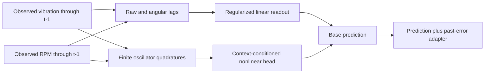

# A graduate study guide to causal gearbox vibration modelling

MECG 7780 Engineering Data Analytics. This guide accompanies the DHON code and executed notebooks. For the current measured results, see the [research report](final_course_report.md) and [reproduction summary](reproduction_summary.md).

## Reading map

1. [Research question](#1-research-question)
2. [Gear kinematics and vibration](#2-gear-kinematics-and-vibration)
3. [From time series to spectra](#3-from-time-series-to-spectra)
4. [Forecasting and innovations](#4-forecasting-and-innovations)
5. [Data and experimental integrity](#5-data-and-experimental-integrity)
6. [EDA and feature design](#6-eda-and-feature-design)
7. [Conventional models](#7-conventional-models)
8. [Learning baselines](#8-learning-baselines)
9. [Oscillator derivation](#9-oscillator-derivation)
10. [Learning oscillator parameters](#10-learning-oscillator-parameters)
11. [Guarded model selection](#11-guarded-model-selection)
12. [Causal residual correction](#12-causal-residual-correction)
13. [Prediction metrics and uncertainty](#13-prediction-metrics-and-uncertainty)
14. [Angular PMI and fault assessment](#14-angular-pmi-and-fault-assessment)
15. [Robustness and ablation](#15-robustness-and-ablation)
16. [Computational engineering](#16-computational-engineering)
17. [Reproduction walkthrough](#17-reproduction-walkthrough)
18. [Defence preparation and glossary](#18-defence-preparation-and-glossary)

## 1. Research question

The project estimates the next vibration value during speed variation. When the forecast is constructed from ordinary healthy dynamics, systematic residual patterns may provide diagnostic information on an unseen acquisition. The research hypothesis has two parts. First, explicit shaft phase may reduce the burden on a short-data regression model. Second, allowing the oscillator phase and memory to adapt by gradient descent might improve accuracy while retaining periodic impulsive signatures. The first hypothesis can be supported by fixed physics features. The second requires matched fixed and trainable controls and evidence from the oscillator state computation itself.

The course calls for MSE, CPU/GPU time, diagnostics, a report, and two presentations. Performance and novelty are distinct assessed criteria. For prediction, a lower standardized MSE means smaller squared errors on the same targets. For diagnosis, the relevant property is how consistently residual features separate genuinely identified conditions or detect controlled injected defects. A predictor that fits periodic impacts too well may remove diagnostic evidence while improving MSE. This is why the experiment keeps separate metrics and gives the strongest archived predictor its own comparison.

**Self-check.** What is a fair claim if DHON outperforms a refitted conventional model but trails an archived DHON checkpoint? It improves on that conventional refit for these targets. A claim of overall or archived improvement would require evidence against the stronger comparator.

## 2. Gear kinematics and vibration

Define shaft speed $n$ in revolutions per minute (RPM), shaft phase $u$ in revolutions, and sample frequency $f_s$ in Hz. One gear of $Z$ teeth brings $Z$ teeth past the mesh during one revolution of that gear. The associated mesh frequency is $f_m=Zn/60$ Hz. In this dataset the mesh reference uses $Z=37$. For 124.32 and 167.33 RPM the predicted first mesh harmonic is about 76.67 and 103.19 Hz, respectively. The shaft repetition frequencies are approximately 2.07–2.79 Hz. A 10-second record contains roughly two dozen shaft rotations. A 7.5-second record can identify a coarse order signature, with limited independent evidence across operating trajectories.

Vibration recorded by an accelerometer reflects forces, local support stiffness, machine structure, and the transfer path to the sensor. A periodic stiffness variation modulates the tooth-contact force. A localized defect can evoke short broadband pulses at a fixed angular position. Each pulse excites structure differently depending on force and instantaneous speed. Multiplying a mesh carrier by a slowly changing envelope produces spectral lines around it. For example, multiplication of $\cos(37\theta)$ by $1+a\cos(\theta)$ creates 36th and 38th shaft-order terms with coefficient $a/2$. Peaks near mesh orders can have several causes, so this identity motivates sideband candidates and does not identify a localized crack.

An order-locked component changes Hz in proportion to $n$. A fixed-Hz component stays approximately at constant Hz. A structural interpretation of a repeatable fixed-Hz peak would require stronger modal evidence than this dataset supplies. The convention used by each archive matters whenever it reports mesh cycles, shaft rotations or the rotation of a different gear.

**Self-check.** At 150 RPM, what is the 7th mesh harmonic? $7\cdot37\cdot150/60=647.5$ Hz. Is 259 the shaft frequency in Hz? It is the shaft order, the ratio of the harmonic frequency to the shaft frequency.

## 3. From time series to spectra

At 3,200 Hz, the sample interval is 0.3125 ms and the absolute Nyquist frequency is 1,600 Hz. Frequencies above Nyquist fold into the observed band unless suppressed before sampling. The rate only gives an upper bound on meaningful bandwidth. Instrument filtering and acquisition electronics can reduce it. A candidate harmonic should remain below a conservative margin across the speed range and the declared stress scenarios. For example, the 15th mesh harmonic reaches about 1,548 Hz at 167.33 RPM. It falls outside the 0.475-times-sample-rate margin even at ordinary peaks.

A finite FFT regards its segment as periodic. A sinusoid between bins spreads energy, and a multi-second chirp spreads over many bins. A taper reduces boundary discontinuities at the cost of widening peaks. Welch PSD averages overlapping, tapered segments, and describes energy per Hz. An STFT provides time localization by applying the window at many time offsets. Window duration is a compromise between tracking speed variation and resolving nearby lines. Overlay the theoretical mesh trajectory on the STFT and inspect whether a ridge follows it over the whole speed excursion.

The order-domain representation builds the shaft phase from speed and samples the vibration on uniform angular positions. Then a sinusoid at shaft order $o$ has the form $A\cos(2\pi o u+\phi_0)$. An angular FFT uses cycles per revolution. A high angular grid density preserves the resolved order bandwidth from the input, but interpolation creates no additional independent observations or physical bandwidth. The analytic signal uses the Hilbert transform, and its magnitude gives an envelope. It is common to inspect the envelope order spectrum for recurring pulses. Direct use of a symmetric window or whole-record Hilbert transform as a predictor regressor would include future data; either is appropriate after the residual stream has been formed for offline analysis.

```python
import numpy as np
from scipy.signal import welch

fs = 3200
time_s = np.arange(fs) / fs
carrier = np.cos(2 * np.pi * 92.5 * time_s)
freq_hz, psd = welch(carrier, fs=fs, nperseg=1600)
print(freq_hz[np.argmax(psd)])
```

**Self-check.** Why can the same physical mesh harmonic yield a broad peak in Hz and a narrow one in the order spectrum? Changing speed warps the time phase; resampling by measured rotations undoes that warp to the accuracy of the tachometer and interpolation.

## 4. Forecasting and innovations

A stationary mean and covariance require a stable mean and lag-dependent covariance across shifts in time. Variable speed drives changing lag relationships even if the excitation is roughly stationary in shaft angle. Estimating a fixed AR model implicitly averages those relationships over the training profile. A scheduling variable can alter the coefficients with operating condition.

At time $t$, the predictor uses vibration up to $t-1$ and an RPM history ending there. After observing $x[t]$, the residual $e[t]=x[t]-\widehat{x}[t]$ is available for later prediction. This distinction allows causal proxy innovation lags and residual correction. In a one-step forecast, previous vibration values are observations. An open-loop simulation instead feeds back its own predicted samples. The one-step error therefore gives no guarantee that an autoregressive recurrence will be stable in simulation.

PACF is a measure of correlation at a lag after adjustment for intermediate lags under a stationary linear model. A residual ACF with peaks at regular mesh or shaft lags suggests systematic structure. The sign runs test emphasizes clustered signs, useful when a residual has a bias that changes over time. Its asymptotic null assumes independence, so it supplements other diagnostics and cannot certify the residuals as white.

**Self-check.** If $e[t-1]$ contains $x[t-1]$, is it legal for predicting $x[t]$? Yes, provided the residual and its proxy coefficients were computed using information known when those terms would be available.

## 5. Data and experimental integrity

The original data names and checksums are recorded under the run’s `tables` directory. The primary train and validation arrays each supply 24,000 samples. The 20 development fault parts reassemble into 200 records of 32,000 samples. Data hashes identify the exact files. The audit also tests field shapes, sample spacing, finite values and normalization reconstruction. In the designated files the same stored vibration scale relates stored $x$ to $x_{raw}$ by $x_{raw}=\mu+\sigma x$. A new per-record scale would change fault amplitudes and undermine the diagnostic comparison. The project reports MSE on the original stored standardized vibration. The raw calibration does not establish velocity, displacement, acceleration or engineering units independently of the instrumentation metadata.

Fault record positions are one-based for compatibility with the source ordering. Prediction target indices are zero-based. Fault record 61 begins with the complete training record, and record 63 begins with the complete development validation record, matching both vibration and RPM. This overlap excludes those acquisitions from group performance summaries even if one scores only their tails. Logs identify both records and retain diagnostic values. Exact/near checks describe the comparisons performed; shared physical acquisition histories can remain unknown without original IDs.

The official target mask is $[1792,24000)$ and contains 22,208 targets. Within training, held-out guarded windows are $[4800,7200)$, $[11200,13600)$, and $[18400,20800)$. Training after a held-out block begins in a new segment or uses independent finite-lag support strictly beyond the guard, depending on model. Computing a centered filter, learning a scaler across the full record before folding, or carrying hidden state across the held-out interval can leak future validation data into fit rows even when the row labels themselves are excluded.

**Self-check.** Why is substituting record 84 for `sigvalid` unfair? Choosing its phase/window by published-MSE agreement would condition the benchmark on held-out outcomes and change the data. The result would be a retrospective search finding with a different interpretation.

## 6. EDA and feature design

Start with the vibration and speed traces, check the time coverage and look for rapid changes. A moving amplitude summary illustrates nonconstant energy but can lag either the force changes or the chosen window. Compare the PSD across stationary-looking portions for consistent bands. On the speed-conditioned spectrogram, label 37th-order harmonics at their predicted instantaneous frequencies. If a ridge intersects a fixed band at only one speed, an order model and a resonant feature are plausible candidate explanations with different transfer behavior.

Angle lags use phase differences measured in revolutions. For a history of $c$ mesh cycles with mesh order 37, the largest angular offset is $c/37$ rotations. Covering eight cycles at minimum supported 100 RPM and 3,200 Hz consumes about $8\cdot60\cdot3200/(37\cdot100)=415$ time samples, plus interpolation margin. This calculation is an engineering constraint on guard and reset. The model uses only queries far enough back to ensure both interpolation endpoints precede the target. In contrast, EDA may interpolate the entire trace after acquisition to expose prominent orders.

An EDA-supported hypothesis should map to a model contrast. If mesh locking improves prediction, compare a bank or angular history with a vibration-only candidate. If adding fixed-Hz oscillators helps, compare a mixed bank with a matched order-only bank. Track both accuracy and the shift in diagnostic features so that a more powerful model does not erase defects by design. A peak observed once establishes a candidate feature. It does not estimate a mechanical parameter.

**Self-check.** Which observable separates fixed Hz from mesh order? The frequency change relative to RPM over repeated operating conditions. One wideband PSD alone cannot separate them.

## 7. Conventional models

An AR($p$) predictor is $\widehat{x}[t]=\sum_{i=1}^{p}a_i x[t-i]$. For integrated series define $d[t]=x[t]-x[t-1]$. Fit the analogous regression to $d[t]$ and invert it as $\widehat{x}[t]=x[t-1]+\widehat{d}[t]$. This ARI case has an explicit one-step anchor. An ARIMA proxy additionally regresses on lagged residuals from a higher-order AR approximation to the innovations. Conditional two-stage fits can have different estimates and state handling from likelihood ARIMA.

For LPV-ARMA, let $s[t-1]$ denote normalized speed. A row in a lag-major design for lag $i$ is the set of products $x[t-i]g_p(s[t-1])$. Summing over lag $i$ and basis index $p$ constructs a speed-dependent AR predictor. Appending products of earlier stage-I innovations with the same basis gives stage II. The frozen first stage computes proxy residuals as observations arrive. Replacing those residuals by feedback from the second stage would change the fitted model.

The paper uses $N\log(\operatorname{MSE})+2d$ as a Gaussian AIC comparison after accounting for the common sample set; $d$ counts estimated terms according to the fitted model. Lower AIC favors accuracy with a complexity penalty. Its use in this project screens a finite local order grid. Monomials and shifted Legendre polynomials span the same degree space, subject to consistent scaling and full rank. L1 regularization is coordinate-dependent, so their sparse supports can differ even when unpenalized predictions agree.

To fit LASSO with $u=v$ as a variable split, solve

$$\min_u \frac{1}{2N}\Vert Xu-y\Vert_2^2+\lambda\Vert v\Vert_1.$$

Scaled ADMM alternates a linear solve for $u$, soft threshold of $u+d$ for $v$, and a dual update $d\leftarrow d+(u-v)$. The primal residual measures disagreement between $u$ and $v$, and the dual residual reflects movement of the soft-thresholded vector. Independent solver tests need the same objective scaling and feature normalization. After support selection, rank-aware least squares refits selected columns; refitting can remove shrinkage and increase variance when support is unstable. LPV per-speed and innovation stability require separate analysis for free-running use.

**Self-check.** The same two algorithms fit identical dense coefficients in different polynomial bases. Why can their sparse models differ? Sparsity counts the nonzero coordinates of the chosen basis, and the L1 penalty depends on how those coordinates represent the function.

## 8. Learning baselines

Ridge regularization penalizes the squared coefficient norm, making a large lag design more robust to collinearity at the expense of some shrinkage. A fixed physics linear comparator adds angular and quadrature features but optimizes a linear readout. NG-RC constructs a delay embedding and deterministic nonlinear products, followed by ridge estimation. Feature normalization and group penalties control the scale of lag, phase and cross-product terms. These approaches are simpler to diagnose than an unrestricted nonlinear network and useful for testing whether a dense neural head contributes enough to justify its cost.

An MLP applies learned affine maps and nonlinear activation to a window of lags. It can represent nonlinear dependence without recurrent state, but lacks a built-in rotational interpretation unless the input carries phase information. A TCN uses time-ordered dilated convolutions. A causal kernel with width $k$ and dilation $d$ uses samples no later than its output row. With one layer per dilation $d_\ell$, the receptive field is $1+(k-1)\sum_\ell d_\ell$. Use this field plus explicit input shift to find the earliest available target. A GRU or LSTM carries a recurrent state with reset and bounded-history requirements. The delivered comparisons are listed in the [measured model table](../outputs/runs/development/metrics/summary.csv).

**Self-check.** Can a powerful dilated convolution still leak? Yes. Symmetric padding or same-row target inclusion defeats causality even when all kernels are finite.

## 9. Oscillator derivation

A stable damped complex component uses decay $\rho_k=\exp(-1/\tau_k)$, state memory $M$, and carrier $\phi_{k,t}$. For order locking, $\phi_{k,t}=2\pi o_k u_t$. For a structural-frequency candidate, $\phi_{k,t}=2\pi f_k t/f_s$. At prediction time integrate speed by a left step, $u_t=u_{t-1}+n_{t-1}/(60f_s)$. Demodulate observed $x_s$ by $q_s=x_s\exp(-i\phi_s)$. Define $E_t=\sum_{j=1}^M\rho^{j-1}q_{t-j}$. One internal step adds the new $q_t$ after prediction and removes the oldest contribution:

$$E_{t+1}=\rho E_t+q_t-\rho^M q_{t-M}.$$

The remodulated analytic quadrature is $h_t=2E_t\exp(i\phi_t)/Z$ with $Z=\sum_{j=1}^M\rho^{j-1}$. The factor two is the usual recovery factor for one side of a real sinusoid. At finite memory the counter-rotating component is generally not exactly zero. For any bounded input, the magnitude of $h_t$ is at most $2\max_j|x_{t-j}|$. Shifting every phase by a common constant multiplies $E_t$ and the carrier by inverse factors, leaving $h_t$ unchanged. This makes record-origin phase a numerical convention instead of a feature.

The differentiable implementation multiplies carrier and real observations, uses zero-padded linear convolution along time, delays the filtered series one sample, and remodulates. Conceptually the state tensor is $[N,K,D,2]$ for samples, oscillators, decay bank and quadrature. Padding must cover at least $N+M-1$ values so circular convolution does not wrap. In the recurrence, skipping the oldest-term subtraction would produce an IIR state with infinite dependence and invalidate the finite guard.



The slide deck contains an editable diagram fallback. The linear readout maps engineered features to a base forecast. The constrained oscillator state influences the nonlinear head, whose contribution is bounded by a gate. The diagnostic path operates on residuals after prediction. Inspect [the predictor](../src/gearbox_dhon/dhon.py), especially `oscillator_states`, `oscillator_recurrence` and `DHON.predict`.

**Self-check.** Which signal appears with weight one in $E_t$? The most recent observed sample $q_{t-1}$. If $q_t$ appears before emitting the forecast, the predictor leaks.

## 10. Learning oscillator parameters

A useful differentiable map from scalar parameter $b$ to physical memory is $\tau=\tau_{min}+(\tau_{max}-\tau_{min})\operatorname{sigmoid}(b)$. This maintains finite positive memory while allowing differentiable changes. A bounded detuning uses a hyperbolic tangent times a maximum offset. It should be read as flexibility around a prior carrier. Rotation speed calibration or model errors may also explain the fitted shift, so it does not imply fractional teeth or a directly measured resonance.

The derivative of $\rho=\exp(-1/\tau)$ with respect to $\tau$ is $\rho/\tau^2$. Consequently the unnormalized $j$th exponentially weighted term changes in proportion to $(j-1)/\tau^2$. To differentiate the normalized effective weights $w_j=\rho^{j-1}/Z$, use
$$\frac{\partial w_j}{\partial\tau}=\frac{w_j}{\tau^2}\left((j-1)-\sum_\ell w_\ell(\ell-1)\right).$$
Longer lags relatively gain weight and the sum of weight gradients is zero. For detuning, differentiating the phase difference gives a factor proportional to the intervening rotational angle, so the optimizer has weak geometric leverage when the history is very short. A prior term limits parameter drift where angle and loss supply little evidence.

A proper gradient test uses float64 and compares autograd with a small central difference or analytic response. Check that fitted physical parameters change during optimization and that states remain causal using prefix perturbations. A performance ablation must start from a matched architecture and optimization budget and include a frozen training control. A neural readout trained on cached numerical states changes weights downstream while leaving its oscillator geometry fixed. The archive replay and new training code therefore have different evidentiary roles.

**Self-check.** If all learned memory scales move by only a few samples, is differentiability established? Parameter change and verified gradients support differentiability. Improvement requires the separate performance control and enough evidence to distinguish it from variation.

## 11. Guarded model selection

The data comprise one short official fitting record. A random assignment of neighboring windows to folds places nearly identical raw signals on both sides. The guarded-block protocol removes source samples around and inside validation intervals from the fit sets and preserves state resets. The held-out validation predictor can use actual earlier samples when they are available at forecast time. Selection is on these three training folds. The complete designated training signal is then used for final fit with the selected configuration.

A candidate trades off clean MSE, stress sensitivity, preservation of known injected pulses, and complexity. The archived correction and physics anchors motivate candidate values. Discrete candidates change feature geometry or head width; continuous optimization learns eligible decay or phase parameters within constraints. The trial rankings, fold outputs, fit seeds and selection record trace the actual finite search. The finite design can miss a better option and the chosen utility reflects explicit priorities. A large number of trial rows does not convert one acquisition into independent samples.

**Self-check.** Why might training-fold rankings disagree with development MSE? Fold trajectories cover different speed ranges, the objective includes more than MSE, and the model is refitted on a different amount of data before scoring development.

## 12. Causal residual correction

Let $p^0_t$ be the base prediction and $e^0_t=x_t-p^0_t$. The optional adapter averages previous clipped base residuals with normalized weights $w_j$ and gain $g$. Its output is $p_t=p^0_t+g\sum_{j=1}^{M_c}w_j\operatorname{clip}(e^0_{t-j},-c,c)$. The archive uses a 1,024-sample correction memory, 640-sample time constant, 1.75 clip value and 0.5 gain. A slowly changing bias in the base prediction can then be estimated from reliable past responses. The sliding correction may also react to a cluster of defect pulses. Clipping limits their influence but does not make the filter fault-invariant.

If the base model has dependency $H$, then an adapter using residuals as old as $M_c$ can require $H+M_c$ observations. In this DHON experiment the base history is bounded by 768 and the adapter by 1,024, resulting in the 1,792-sample scoring start. For a model with a larger requirement every fair comparator would need a recomputed common score mask.

**Self-check.** What test separates correction benefit from architecture benefit? Compare the old and new model with correction off, and apply the same correction to each base forecast. Also report the regression or neural contribution under that fixed correction.

## 13. Prediction metrics and uncertainty

At fixed aligned indices with error $e_t$, MSE is $N^{-1}\sum e_t^2$, RMSE is its square root, and MAE is $N^{-1}\sum|e_t|$. Bias is the signed average. $R^2=1-\mathrm{MSE}/\operatorname{Var}(x)$ with population variance over scored values. A large shock contributes quadratically to MSE and linearly to MAE. Compare residual ACFs and spectral densities to determine which physical structure survives modelling.

For two forecast vectors, pair their errors at exactly the same target. The signed difference is $d_t=e^2_{new,t}-e^2_{ref,t}$. A negative mean favors the new model. A moving-block bootstrap samples contiguous groups of these paired differences to retain local dependence. In this project a block of 640 samples equals 0.2 s. More than one block choice would be useful for sensitivity because slow speed changes and longer-period effects can span multiple chosen blocks. Temporal resampling on one validation record cannot establish operating-condition or acquisition population generalization.

**Self-check.** If a block-bootstrap interval spans zero, can the observed run still have lower MSE? Yes. The observed mean is a fact for that exact record. The interval describes how the difference varies under this dependence-aware resampling model.

## 14. Angular PMI and fault assessment

In a rotating system, a tooth-localized event repeats by phase. After computing a residual, estimate its analytic envelope $a_j$ on uniform angle spacing and center it as $b_j=a_j-\bar{a}$. The finite autocorrelation ratio is
$$r(k)=\frac{\sum_{j=0}^{J-k-1}b_jb_{j+k}}{\sum_{j=0}^{J-1}b_j^2}.$$
If $T$ angular points represent a turn, the mathematical one-turn measure is $\mathrm{PMI}=r(T)/(1-r(T))$. The MATLAB code gets the ACF in a one-based array whose first element holds lag zero. It indexes the array at $T$, corresponding to lag $T-1$. The Python pipeline preserves that literal choice as primary and reports the corrected choice separately. A centered constant envelope makes the ACF normalization undefined. Report that record as invalid, rather than replacing its outcome with an apparent clean score.

Higher B-versus-A PMI can be summarized by median gaps and conditional AUC. AUC is the probability a randomly chosen B score exceeds a randomly chosen A score, with half credit for ties. Precision and recall at threshold require true classes and a threshold determined separately. Fault labels, health calibration, and original acquisition identities are unavailable. Consequently the conditional AUC is evidence of index-group separability, with potential dependence and metadata limitations. The blind command preserves technical freeze and numerical-overlap checks. Its pending datasets are a distinct part of the study.

**Self-check.** Why can the raw vibration have weak group separation even when a residual has large separation? Mesh tones and variable amplitude can dominate the raw envelope; subtracting predictable healthy structure can emphasize recurring impacts. Model artefacts or differences in acquisition can also alter PMI, so authoritative labels remain necessary.

## 15. Robustness and ablation

In RPM stress analysis, change one or more characteristics of the observed speed channel while preserving the same vibration targets and record. Bias changes order-to-time transport systematically, jitter perturbs phase increments, and latency changes alignment in accelerating segments. An angular diagnostic can also receive corrupted speed. Keep inference-only speed errors and diagnostic-speed errors distinct so that an observed PMI drop is attributable to the right stage.

For synthetic impacts, add a known train of angularly timed damped pulses to the same measured vibration. Predict clean and perturbed versions independently with the same checkpoint. The difference in residuals can be compared against the injected signal using amplitude or energy ratios, correlation, and PMI shift. An energy ratio above one may reflect a spurious amplification by the predictor. A low NMSE need not correspond to threshold sensitivity at unknown real defect severity. Random or deliberately aperiodic impulses serve as a check against treating any impulsive event as a recurring gear fault.

An ablation changes one mechanism within a controlled family. Retraining a no-oscillator model addresses dependence on features. Setting the trained features to zero would instead test sensitivity to a distribution shift. Compare fixed versus trainable dynamics within one bank, and adapter off versus on with matched checkpoint and arithmetic. Hold strict causality, the same mask, and common uncertainty method across all rows.

**Self-check.** Why is an injection sensitivity test scientifically useful even without labels? It provides an exact perturbation target and a paired estimate of distortion. It does not manufacture experimental label provenance.

## 16. Computational engineering

A model uses arithmetic for feature construction, inference and optional diagnostics. Parameter count alone misses construction of angular queries, polynomial design products, or Fourier transforms. For a stage with $P$ basis terms and $p$ lags, naive LPV design has $NpP$ entries. Column dimension matters for rank-aware least squares. For oscillator convolution, complex FFTs can operate over a full block with roughly $O(N\log N)$ work per active carrier and bank. A direct finite recurrence is a useful numerical check and possible streaming primitive, with a ring buffer or equivalent history storage.

The benchmark repeats forecasts of the same record, observes wall-clock time, and records CPU library thread counts. Short workloads can be affected by process scheduling. The 95th percentile of seven measured repeats is a descriptive statistic with low resolution. GPU measurement requires an available CUDA backend, device synchronization and a stated host transfer policy. A fast block can have a low ratio to recorded duration while failing a real streaming 0.3125 ms deadline partitioned per sample. State and FFT implementations need separate measurements for such a claim.

**Self-check.** Why time loaded models after one cold call? The first call may initialize library state or caches. Keeping cold and warm measurements visible clarifies the operating mode and how reproducible the speed is.

## 17. Reproduction walkthrough

Follow the [README](../README.md) for Linux and PowerShell. Keep raw data outside the project or in the untracked raw directory. The hash-based freeze is meant to identify an exact run, code revision, and acquisition input. After extracting the project, run the suite and checkpoint replay first. The notebooks can reproduce metric tables without a full refit, and reuse the same source as the numerical scripts. Full execution starts a new run and uses the recorded reference arrays to reproduce available archived controls. A size or platform change should be written as a new run. The frozen command verifies all hashes before evaluating any withheld record and requires a fresh output location.

If loading a real MAT file fails, inspect the availability report and check the MAT variable name, complete numbered parts and recorded duplicate-file versions. If the model rejects speed outside its configured finite-context or Nyquist range, record the OOD failure and preserve the original policy. If CUDA is unavailable, use the CPU track and record GPU status instead of comparing CPU against an estimate. If a resume rejects a changed fingerprint, use a new run ID so that mixed algorithms and evidence cannot share the same result directory.

**Self-check.** Which values can be recomputed without the raw inputs? The shipped development target and prediction arrays support score arithmetic and most report figures. Independent checkpoint replay needs the actual MAT acquisitions. Independent model fitting and frequency analysis also need the source data.

## 18. Defence preparation and glossary

**What is novel in the submission?** The oscillator feature computation participates in backpropagation, with physically interpretable decay and frequency parameters under explicit bounds. Existing sample and model evidence can evaluate whether this structural novelty is useful without making a literature-first claim.

**Why can the paper result be lower on its validation?** The published setting and reproduced conditional forecast differ in speed availability, acquisition phase and possibly solver/support settings. The primary comparison fixes actual instructor targets, score mask and information set.

**What evidence would most strengthen the result?** Additional independent acquisitions with authoritative gear condition and rig metadata, representative speed trajectories, trusted MATLAB golden outputs, and a representative device and streaming benchmark. A genuinely blind evaluation must retain the frozen policy.

| Term | Meaning here |
|---|---|
| ACF | Finite or model-based correlation across lags |
| ADMM | Alternating direction method of multipliers used for L1 estimation |
| DHON | Physics-informed differentiable harmonic oscillator neural network |
| Guard | Withheld sample margin around a fit-fold validation block |
| Innovation | One-step unpredictable component, here estimated by a proxy when used as a regressor |
| LPV | Linear parameter varying, with coefficients scheduled on speed |
| MSE | Mean squared error computed on identical targets |
| NG-RC | Next-generation reservoir computing with explicit delay and nonlinear feature library |
| Order | Oscillation cycles per shaft revolution |
| PMI | Periodic modulation intensity of a centered analytic envelope |
| RTF | Measured runtime divided by record duration |
| Warm-up | Initial observations accumulated before the declared scoring mask |

Read the [course report](final_course_report.md) for the exact run-specific conclusions. See the [decisions](assumptions_and_decisions.md) and [checklist](../outputs/final/completion_checklist.md) for verified scope and open checks.

## References for study

- MECG 7780, *Time Serial Dependency Modeling via Advanced Machine Learning Algorithms*, instructor course brief and supplied `fdt_featcal.m`.
- Y. Chen, *Vibration-based fault detection and severity assessment for fixed-axis gearboxes*, doctoral thesis, 2020. Consult the project source audit for the title as supplied and relevant chapter and page references.
- Chen et al., *Sparse LPV-ARMA model for non-stationary vibration representation and its application on gearbox tooth crack detection under variable speed conditions*, Mechanical Systems and Signal Processing, DOI 10.1016/j.ymssp.2024.112161. See §§2–5 and Appendix A and the source audit for exact title, conventions and experimental details.

## Technical appendices

These implementation chapters consolidate the derivations and measured evidence for offline study.

## Appendix A — From the EDA archive to a causal feature test


### Primary sources and protocol

1. MECG 7780 Engineering Data Analytic, *Course Project*, pp. 1–2. The brief specifies causal sample prediction from past vibration, MSE, CPU and GPU efficiency, and fault detection with an angular PMI reference. It lists the 8-minute progress talk for November 4, 2026 and the blind-data release, report and 12-minute final talk dates in December 2025. The inconsistency is unresolved and each date remains as written.
2. Y. Chen, Z. Li, Y. Jiang, D. Gong and K. Zhou (2025), *Sparse LPV-ARMA model for non-stationary vibration representation and its application on gearbox tooth crack detection under variable speed conditions*, Mechanical Systems and Signal Processing 224, 112161. §§3.1–3.3, Eqs. (1)–(5) describe projection, predictor regression and coefficient estimation. §3.4, Eqs. (16)–(21) defines the residual/angle/envelope PMI procedure. §5.1 and Figs. 11–13 establish the measured x-axis vibration, helical 37/20 gear-pair geometry, encoder and sampling protocol. §§5.2–5.3, Tables 5–6 and Figs. 17–20 are external model and diagnostic comparators. [DOI](https://doi.org/10.1016/j.ymssp.2024.112161)
3. Y. Chen (2020), *Vibration-based fault detection and severity assessment for fixed-axis gearboxes*, PhD thesis, University of Alberta. §2.2.3, p. 45, Eqs. (2.7)–(2.8) defines the centered Hilbert-envelope PMI. §3.3.3, pp. 99–102, Figs. 3.20–3.23 confirms the encoder on the 37-tooth input shaft and speed plotted as Hz = RPM/60. The thesis example uses 6.5-second records and 6.4 kHz, a separate analysis from the 2025 paper's 7.5-second, 3.2 kHz one. §3.3.3.1 discusses sparse FP-AR model selection by CV and the one-standard-error rule. §4.2, pp. 116–124 treats time-varying FP-AR construction and model evaluation.

### Uploaded EDA archive

The supplied archive's README, executed notebook source, technical report, `results/summary.json` and relevant method-specific CSVs were inspected. The notebook implements data checks, local stationarity screens, STFT ridge search, angular resampling, direct demodulation, ACF, guarded CV for scheduled ridge AR, innovation features, stress/pulse controls and wavelet/extra family screens. Members were checked for unsafe paths and unsupported file types before read-only extraction to a working reference folder. Archived `sigtrain.mat` and `sigvalid.mat` are byte-identical to the uploaded raw files, as are the copies in the DHON/NG-RC archive. The optional earlier Adaptive Compact archive and retrospective validation-window archive were absent. External PDF and archive members are catalogued by SHA-256 in the run's intake tables.

| Archived evidence | Independent check | Method or scope difference |
|---|---|---|
| Training speed 124.32–167.33 rpm, 37/20 tooth count and order conversion | Range 124.322840–167.333518 rpm, mesh 76.66575–103.18900 Hz, 18.4301 input rotations in training and 23.865–23.880 in 10-second records | Independently integrated recorded speed and read both primary sources. |
| Fourth mesh harmonic ridge correlation 0.9992 | Correlation 0.9869, median absolute offset 0.744 Hz, 160× angular peak/local median at order 148 | Local 0.32-second Hann STFT peak search without the archive's dynamic smoothness penalty. Correlation is conditional on restricting the search to a neighborhood of the proposed track. Angular concentration strengthens the evidence. |
| RPM and RMS rise together; several order amplitudes respond differently | Nonoverlapping 0.25-second block RPM/RMS correlation 0.927; per-turn projections and moving-block intervals measured | Small within-record windows share one imposed speed/load profile. Between-run inference is unsupported. |
| Broad region near 1.1 kHz and potential fixed-frequency component | 31.3% of Welch power in 1.0–1.2 kHz. A fixed 1100 Hz quadrature gave MSE 0.46230 versus 0.46153 for the guarded LPV-AR24 comparator | Broadband energy alone is insufficient to identify a structural mode. The same band contains moving orders at some speeds. |
| Archived best screened LPV + mesh + harmonic + MA had CV MSE 0.38641 and official MSE 0.34325 | Archived numbers recorded for provenance. Independently added 148 and 259 order quadratures to LPV-AR24 and measured a guarded mean of 0.43803, versus 0.46153 without them | The screen changes AR order and uses two fixed quadrature groups, with no innovation stage. It assesses an incremental physical hypothesis, with the model comparison evaluated elsewhere. |
| Candidate health index information | No confirmed labels. Entire overlapping acquisitions 61 and 63 identified by exact vibration and speed matches | The archive's EDA never fit using candidate fault waveforms. This study independently inspects their data integrity and overlap. |

### Speed phase and paper MSE

The paper's Fig. 13(c) begins around 140 on its plotted speed axis, falls toward 124, then rises. The uploaded validation begins at 124.551 rpm and follows nearly the same phase as training. The plot labels the values as Hz, yet 124–167 revolutions per second would imply a 4.6–6.2 kHz gear-mesh fundamental, beyond the 1.6 kHz temporal Nyquist limit. Thesis Fig. 3.23 explicitly puts the shaft near 2–3 Hz. The 37× RPM/60 interpretation is also consistent with the measured moving spectral ridges. The supplied validation and paper segment have different trajectories. Given the absent original 20-second record and the missing optional scan archive, candidate-window MSEs from the retrospective study are prior claims. The official comparison retains the uploaded validation input and exact target mask. The published test MSE and runs-test values describe the benchmark reported by the publication.

## Appendix B — Conventional design, solver, and replay walkthrough


The target is the standardized vibration sample at index $t$. Vibration history and scheduling speed end at $t-1$ for every native comparison. Published validation values describe the second 7.5 s segment of a healthy acquisition selected for the paper. The supplied development record starts near 124.6 RPM. The external plots show a different speed phase (Chen et al., 2025, §5.1 and Fig. 13(c)). The run uses the supplied development record once, with target indices 1,792 through 23,999 inclusive.

### Differencing and integration

For $d_t=x_t-x_{t-1}$, the integrated autoregression predicts $\hat x_t=x_{t-1}+\sum_i a_i d_{t-i}$. An ARI(275,1) uses 275 coefficients. The native conditional ARIMA uses 285 differenced lags and five lagged innovations from a separately fitted AR(310) on the differences. The first difference depends on one earlier raw vibration sample. The 315-lag innovation history therefore has a raw support of 316 vibration samples including $t-316$. The archived ARIMA additionally uses an invertible recursive innovations filter from the beginning of each record. Its published order split and exact initialization were unavailable. The native coefficients have a maximum characteristic root magnitude of 0.9620 for the moving-average part, and the native forecast uses explicit finite proxy innovations.

### Speed scheduling and lag design

Let $w_{t-1}=(n_{t-1}-n_\mathrm{lo})/(n_\mathrm{hi}-n_\mathrm{lo})$ with calibration extrema carried in the training MAT metadata and checkpoint. A row of the LPV-AR design is

$$X_t=[x_{t-1}(g_0,\ldots,g_{P-1})(w_{t-1}),\dots,x_{t-a}(g_0,\ldots,g_{P-1})(w_{t-1})].$$

The stage-II row appends analogous columns for $e^{(1)}_{t-j}$, where $e^{(1)}_s=x_s-\hat x^{(1)}_s$ is the completed stage-I forecast error. Replacing those regressors with errors from the final stage-II output produces a different estimator. With $(a_1,a_2,b)=(240,135,75)$ the strict sparse cascade accesses at most $\max(a_2,a_1+b)=315$ past samples. The 1,792-sample guard covers both the cascade and the differenced models. The training MAT speed scaling is verified and reused unchanged. The supplied vibration has already been standardized.

The dense and new sparse LPV fits use $g_j(w)=P_j(2w-1)$, with eight Legendre terms per lag including the constant term. The archive uses monomials for its sparse checkpoint. The two complete polynomial bases span the same space, while LASSO sparsity is coordinate-dependent. The intercept convention is zero intercept with a constant term in each coefficient curve. The code leaves columns at their design scale, so regularization reflects both the lag and Legendre coordinate.

### Identification

The candidate AR orders are 96, 160, 220, 240 and 260. Stage II considers AR orders 55, 80, 110 and 135 and MA orders 30, 50, 65 and 75. Within each split all candidates use identical rows in the AIC formula $N\log(\mathrm{MSE})+2d$. The scan uses shared Gram statistics in Legendre coordinates plus a factor-diagonal conditioning check. It falls back to a rank-aware least-squares solve when required. Final dense and sparse support refits use rank-revealing QR with no explicit matrix inverse.

Within each guarded training fold both the order scan and stage-I proxy coefficients are estimated from permitted training rows. A validation row can use the measured validation vibration through its previous target as teacher-forced one-step prediction. Training feature histories never enter the held-out target interval. The LASSO solves $\|X\beta-y\|_2^2/(2N)+\lambda\|\beta\|_1$. The matching unnormalized penalty is $N\lambda$. ADMM alternates a Cholesky least-squares update, soft thresholding and a scaled multiplier update. The convergence tests combine absolute/relative primal and dual residuals with a dual-feasible objective gap. Grid values are fractions of the fold-specific $\|X^\top y/N\|_\infty$ and span 0.1 to 0.002. The largest converged penalty fraction whose mean fold loss is within one sample standard deviation of the minimum mean is selected. QR refits the retained support afterward.

All 36 guarded ADMM paths at the evaluated penalty points converged. The selected full fits retain 475 of 1,920 stage-I coefficients and 365 of 1,680 stage-II coefficients. Deployment uses 840 active coefficients for the complete cascade. The stage-I and stage-II normalized objective gaps are $1.17\times10^{-5}$ and $4.44\times10^{-6}$. The stage-II AIC optimum lies on the upper edge of both declared ARMA grids. Wider ranges are a remaining sensitivity check. Dense-proxy stage II uses orders $(110,65)$, so the dense and sparse benchmarks differ in order, fitted coefficients and proxy rank.

### Historical random-row diagnostic

A separate current-RPM fit uses five shuffled folds at the verified archived orders 240 and (110, 65), a common start of 316, and eight shifted Legendre coordinates. It reuses the training-only proxy fitted to the whole training record for stage II. Row overlap and proxy estimation cross random fold boundaries. Its CV scores describe the historical tuning procedure and cannot support a generalization claim. The supplied validation remains external to that identification step. A one-SD, converged ADMM selection and QR refit retain 1,199 stage-I and 737 stage-II terms. This experiment uses the same supplied signals and a declared basis interpretation, with finite grids and frozen archived order candidates.

The exact same bounded search with printed monomials retains 120 stage-I and 52 stage-II terms and scores 0.424537 and 0.439783. Lower-penalty monomial candidates often run into the 800-iteration fold limit and are excluded. This controlled stress shows the joint effect of a basis-dependent penalty and numerical convergence. The selected monomial supports passed the stated criteria, and the result cannot establish that a wider monomial search or changed solver tolerance has the same performance.

### Development results and reconciliation

| Model | Published Table 6 | Archived replay, start 316 | New random-row fit, start 316 | Native strict, start 1,792 |
|---|---:|---:|---:|---:|
| ARI | 0.3658 | 0.415816 | — | 0.425069 |
| ARIMA | 0.3671 | 0.415719 | — | 0.425223 |
| Sparse LPV-AR | 0.2911 | 0.340886 | 0.341468 | 0.381496 |
| Sparse LPV-ARMA | 0.2893 | 0.336901 | 0.334422 | 0.371406 |
| Dense LPV-AR | — | — | — | 0.344585 |
| Dense LPV-ARMA | — | — | — | 0.330781 |

At start 1,792, the archived sparse LPV-ARMA scores 0.345151 with its original current-speed schedule. Recomputing the score with the same coefficients and speed delayed by one sample gives 0.345133. The maximum forecast change is 0.002285. On this record, the observed difference between archived and native sparse methods therefore comes chiefly from model identification, basis and penalty choices. The strict dense fit outperformed the strict sparse cascade. The native one-SD sparse support is smaller than the archived or published support, and a conservative penalty may reduce predictive flexibility. A guarded one-record CV and sparse-basis dependence are material differences from the historical random-row convention.

The published sparse LPV-ARMA runs-test $p=0.6233$ is close to 0.60410 from the new historical-convention fit and differs from 0.05460 in the current-speed archival replay, both starting at 316. The new fit still exceeds the published MSE by 0.0451 on the supplied segment. This test uses runs of residual signs and checks a limited aspect of serial dependence. Segment phase, speed conditions, residual sampling and coefficient differences all warrant scrutiny. The optional retrospective validation-window archive and original 20 s source acquisition were unavailable. The prior simulation discrepancy, including 0.52423 measured archived MSE versus 0.3570 in the paper and weak F1 discrimination, is historical evidence and was not rerun for this project.

The polynomial basis wording and displayed monomials appear on paper p. 3 around Eqs. (1)–(3). The two-stage identification is in §3.2, Eqs. (7), (9)–(10) on pp. 5–6 and the ADMM details in Appendix A, pp. 19–20. Experimental design and published values are in §§5.1–5.2 and Tables 5–6, pp. 14–17. Chen's 2020 thesis discusses PMI in §2.2.3, pp. 45–50 and sparse FP-AR selection in §§3.2.2–3.2.3, pp. 76–79.

Use the shared prediction and metrics artifacts to verify the reported numbers. The comparison table is in `tables/lpv_paper_comparison.csv` under the development run. CSV order scans, full solver diagnostics, unit tests and causal perturbation checks show the decisions from data to prediction. Batch timing covers the complete forecast on a 24,000-sample record including warm-up. It does not establish sample-by-sample streaming latency.

From the repository root, run the independent publication-convention diagnostic with:

```bash
python scripts/paper_row_diagnostic.py --data-dir data/raw --run-dir outputs/runs/paper_diagnostic --basis legendre
```

For the causal comparison, run `python scripts/reproduce_baselines.py --data-dir data/raw --run-dir outputs/runs/conventional`. Add `--reuse` to replay its existing conventional parameters and regenerate predictions and figures. The CPU measurements in `metrics/conventional_timing.csv` report one warm-up call followed by seven repeats at one BLAS thread. The batch reference preserves zero sparse coefficients in a dense matrix layout, so its measured cost does not directly express sparse implementation potential.

## Appendix C — Comparator models and controlled feature tests


The comparison estimates one-step prediction error on the course development record. The target is the standardized vibration sample \(x_t\). Every newly fitted comparator uses measured vibration and RPM through \(t-1\), resets per acquisition and reports MSE on the same 22,208 zero-based indices \([1792,24000)\). The vibration- and speed-informed families quantify whether load/speed information or structured features help under the task's actual information set.

### From observation to regressor

Let \(v_t=(x_{t-1},\ldots,x_{t-L})\). Persistence sets \(\hat{x}_t=x_{t-1}\), a test of local smoothness at 3.2 kHz. Ridge AR models learn one intercept and \(L\) delay weights. For LPV ridge, let \(q_t=(n_{t-1}-145)/25\), where speed is in RPM. The numbers 145 and 25 define fixed basis coordinates in engineering units. The row contains \(v_t\), \(q_t\), the backward 32-sample RPM change divided by 25, and \(T_j(q_t)v_t\) for Chebyshev polynomials \(T_j\) up to the selected order. An interaction such as \(q_t x_{t-2}\) lets the second delay's weight change with speed. Each row is formed before seeing \(x_t\) or \(n_t\).

The linear physics comparator adds fractional angular vibration lags at mesh-cycle multiples \(\{1,2,3,4,6\}/37\) and at 0.25 and 0.375 shaft revolutions, with speed interactions. Integrating RPM through \(t-1\) yields the available target phase. Interpolation uses past vibration samples bracketing the desired phase. The input history is capped at 768 samples. When very low RPM would require a longer history, the wanted phase is clipped to the oldest admissible phase. An optional fixed short quadrature bank estimates complex order responses at 37, 74, 111, and 148 using 96 prior samples and exponential sample weights with a 28-sample scale. This is a causal FIR representation with specified frequency axes. The readout can select fixed order structure, while DHON adjusts oscillator parameters through its training objective.

Each feature column is centered and scaled using the permitted fold-fit rows. Define \(Z\) as the standardized design matrix and \(y\) as corresponding vibration targets. Centering the design yields the unpenalized intercept \(\bar y\). The coefficient vector solves
\[
\min_w \frac12\|Zw-(y-\bar y)\|_2^2+
\frac12\sum_j\lambda_jw_j^2 .
\]
Cholesky solves the positively regularized system without an explicit inverse. The folds and final fit use the same mathematics and refit their own scales.

### Explicit nonlinear delays

NG-RC learns a regularized linear readout of a nonlinear library. A short delay basis consists of lags 1, 3, 6, 11, 18, 25, 34 and 48. A quadratic library takes its 36 upper-triangular products including self-products. The cubic starting library multiplies the short delays by 32-sample past energy and, where selected, adds order quadrature × energy, two-component squared order magnitude and order energy × selected delays. The library avoids an unrestricted cubic expansion of all temporal lags. The search varies temporal span, polynomial degree, order and angle structure, ridge strength and a separate penalty multiplier for the polynomial block. No random recurrent reservoir is used. The archived NG-RC replay uses its own archived feature definitions and checkpoints and is reported separately.

### Generic neural controls

The MLP receives \([N,L]\) lag input for \(N\) targets and \(L\) lags, or \([N,L+2]\) with RPM and its backward change. The predictor is a ridge-initialized frozen linear skip plus \(w_2^\top\tanh(W_1 z+b_1)+b_2\). The hidden readout starts at zero and is trained by AdamW using MSE. This supplies a strong linear initialization to study what generic nonlinear capacity adds. The MLP forms no explicit order or angular features.

The temporal convolutional network (TCN) consumes \([1,C,N]\) channels of strictly prior-sample vibration and, for the speed-informed variant, RPM. A pointwise map projects the channels into a compact latent width. Four left-padded convolutions at dilations 1, 3, 9 and 27 each add a tanh-transformed causal residual to the latent time series. A pointwise readout predicts one sample per target. With kernel length \(k\), the raw history is \(1+(k-1)(1+3+9+27)\), giving 81 or 161 samples for the tested kernel sizes. During training each minibatch is a contiguous target chunk preceded by its full receptive field. The loss indexes only the target chunk. The TCN tests nonlinear temporal features with shared weights and bounded context. The comparator search covers one feed-forward and one convolutional neural family. GRU and LSTM adaptation were outside this finite comparator run.

### Validation under autocorrelation

Fold-selection ranges are \([4800,7200)\), \([11200,13600)\), and \([18400,20800)\) inside `sigtrain`, using a 1,792-sample guard on both sides of each test interval. The longest comparator raw support is 768 samples. Training rows after a fold cannot see that fold's held-out samples through their lag or network receptive fields. The TCN receives no acquisition-spanning recurrent state and therefore cannot carry hidden state across a held-out interval during training. During fold scoring all models can use measured observations earlier than each evaluation target.

For each family the lowest mean MSE across these three guarded folds selects the configuration. The selected model is subsequently refit on `sigtrain` using the common target start. The supplied `sigvalid` scores are development results on a separate acquisition segment used for course comparison. Comparing three overlapping-window folds provides a finite sensitivity check. It does not estimate generalization over an entire gearbox population.

### Reconstructing an individual feature and score

For \(t=1792\), a two-lag AR uses \(x_{1791}\) and \(x_{1790}\). Its speed-informed extension uses \(n_{1791}\). The angular extension estimates the usable phase at 1792 by accumulating speed increments through 1791 and locates earlier observations by fixed phase subtraction. In `gearbox_dhon.comparators.feature_matrix` the first columns are always the dense lag vector, so checking row order against the raw samples verifies target alignment before examining any fit error. For any prediction NPZ key, check its unscored prefix, subtract its scored suffix from the target record and average squared errors over the fixed mask. Per-record predictions contain the original acquisition indices so speed, time, and residual structure are aligned by construction.

The companion `metrics/comparators.csv` lists training and development MSE, mean guarded-fold MSE, secondary metrics, parameter total, model size, final fit time, and seven warmed inference timings summarized by median, IQR and p95. Per-fold configurations and scores are in `search/comparators_folds.csv`; the epoch losses are in `search/comparators_learning_curves.csv`. The `checkpoints/comparator_*.npz` files store coefficient/weight arrays and scaling parameters without serialization code objects. The single-load inference API supports alternate records with finite positive RPM and the same sample rate. The reference notebook recomputes MSE from the emitted predictions to check reported values.

Ridge and feature construction use CPU float64 arrays and SciPy linear algebra. Neural inference uses PyTorch float32 activations with NumPy preprocessing. Timings measure batched inference from an in-memory record and include feature generation, so they compare user-visible prediction cost. Timing on a single 7.5-second record does not establish closed-loop streaming deadline compliance.

### What the guarded comparisons support

The recorded search evaluated 69 candidate configurations and completed 207 fold scores with one CPU thread. Those scores chose nine deployable checkpoints with exact recomputed development predictions. The completed full comparator stage took 160.7 s, including final fits, checkpoint replay checks and warm prediction timing. The nine development MSEs in ascending order are fixed physics linear 0.376432, NG-RC 0.376930, RPM-conditioned ridge 0.383354, ridge AR 0.437474, vibration MLP 0.450408, RPM MLP 0.456610, RPM TCN 0.475057, vibration TCN 0.475430, and persistence 2.087465. Check definitions and timing summaries in the machine-readable outputs.

Adding angular lags and order features as a group lowered all 36 matched NG-RC fold scores, with a mean MSE change of −0.019278. Within the tested delay library, adding cubic terms gave a mean change of +0.000647, and the fold-selected NG-RC retained the quadratic library. The fixed FIR order bank added to the linear angular model had a mean change of −0.002637 across 12 matched scores, with changes of both signs. These outcomes support speed-aware physical representation for this record and offer limited evidence for widening the polynomial degree.

Adding prior RPM improved the mean matched training-fold MSE by 0.001323 for the MLP and 0.012266 for the TCN. On supplied validation, it changed selected-model MSE by +0.006202 for the MLP and −0.000373 for the TCN. The guarded-fold gains did not reliably transfer to the supplied development acquisition. The matched differences are descriptive across correlated folds and grid entries. The calculation is reproducible with `python scripts/compare_features.py --run-dir outputs/runs/development`.

## Appendix D — Implemented oscillator and optimization derivation


### Information and units

Let $x_t$ be the supplied standardized acceleration, $n_t$ the measured shaft speed in revolutions per minute, and $f_s=3200$ Hz. The predictor at index $t$ observes vibration and speed through $t-1$. The shaft angle in turns satisfies $u_0=0$ and

$$
u_t = u_{t-1} + \frac{n_{t-1}}{60f_s}.
$$

This left-step rule follows from predicting the next phase under constant last observed speed. The archived encoder instead uses a trapezoidal phase at each observed sample and extrapolates its next step using lag-1 RPM. The two conventions are close for smooth speed but yield different angular features and checkpoints. The course error is standardized sample MSE on indices 1792 through 23999 inclusive, evaluated with measured past vibration.

A 37-tooth gear meshing at $n/60$ shaft revolutions per second gives 37 contacts per revolution and $37n/60$ Hz. Harmonic $k$ gives $37k$ cycles per revolution. An order-locked carrier uses $\phi_{k,t}=2\pi o_k u_t$. A fixed-frequency carrier uses $\phi_{k,t}=2\pi f_k t/f_s$. The fixed centers 1080 and 1125 Hz probe a repeatable spectral region. Their trial performance can qualify that hypothesis. A fixed center does not identify a mechanical mode. Detuning is dimensionless order displacement for the first family and Hz for the second.

### Finite oscillator

The state takes a weighted average of each past measurement after rotating its phase into the target frame:

$$
h_{k,m,t}=\frac{2}{Z_{k,m}}\sum_{j=1}^{M}\rho_{k,m}^{j-1}x_{t-j}
     \exp\left(i(\phi_{k,t}-\phi_{k,t-j})\right),\quad
\rho_{k,m}=e^{-1/\tau_{k,m}},\quad
Z_{k,m}=\sum_{a=0}^{M-1}\rho_{k,m}^{a}.
$$

Here $m$ indexes memory scales, $M$ counts samples, and $\tau$ is a statistical memory constant in samples. To see the factor 2, write a real harmonic as the sum of positive and negative carriers: $x_s=A\cos(\phi_s+\gamma)=(A/2)(e^{i(\phi_s+\gamma)}+e^{-i(\phi_s+\gamma)})$. Demodulation by $e^{-i\phi_s}$ puts the first term at zero phase rate and moves the second to a negative double-carrier term. With averaging over enough periods at an adequately sampled carrier, the second term is attenuated. Reducing memory allows faster response at the cost of a broader filter and incomplete negative-carrier rejection. The phase origin cancels in $\phi_t-\phi_s$. The state bound is $|h_{k,m,t}|\le 2\max_{1\le j\le M}|x_{t-j}|$, even for adversarial bounded samples. The deployed teacher-forced one-step model uses measured past samples. Its learned readout does not have a free-running stability guarantee.

For numerical verification define $z_{k,t}=x_t e^{-i\phi_{k,t}}$ and $q_{k,m,t}=\sum_{j=1}^M\rho^{j-1}z_{k,t-j}$. Reindexing the sum yields

$$
q_{t+1}=\rho q_t+z_t-\rho^M z_{t-M},\qquad h_t=(2/Z)e^{i\phi_t}q_t,
$$

with $z_t=0$ before acquisition start. The implementation performs the same linear convolution using a zero-padded PyTorch FFT, shifts by one target index, and rotates back. The explicit recurrence and independent float64 direct sum agree on impulse, chirp, fixed-Hz and zero fixtures. FFT execution may introduce roundoff from the full batch, so future perturbation is tested within a numerical tolerance. The learned branches never convert physical coefficients or oscillator states to NumPy during updates.

Constrained carriers are $o_k=37k+0.75\tanh(a_k)$ and $f_k=f_{0,k}+24\tanh(a_k)$, with $a_k=0$ initially. Each memory parameter satisfies $\tau=4+380\sigma(b)$. Frequency bounds are checked against $0.475 f_s$ for the entire record at the allowed detuning. RPM is required to be at least 100, which also bounds raw history for angular interpolation. Optimized detuning represents model flexibility. It does not imply a tooth-count change, and the optimized memory is not a mechanical damping ratio.

### Feature construction and head

Let $s_t$ be lag-1 speed centered by fit-set range midpoint and divided by its half-range, then clipped to $[-1.2,1.2]$. The context $c_t$ concatenates $s_t$, a 48-sample vibration RMS, and optionally the lag-1 versus lag-33 RPM change in the same scale. For angular lags start at $u_{t-1}$ and query $u_{t-1}-j/(37P)$ for $j=1,\dots,PC$, with $P$ grid points per mesh and $C$ mesh cycles. Both interpolation endpoints precede the target. Proxy innovations use measured vibration minus a separately fitted LPV ridge AR model. The first stage uses only permitted fit blocks, and its innovation at $t-j$ depends on no later vibration than $x_{t-j}$.

A design row $z_t$ contains an intercept, the raw and angular lags, proxy innovation lags, context and flattened oscillator quadratures. For the linear branch the design expands into products with Legendre polynomials evaluated at $s_t$, from degree zero up to the configured degree. It is scaled by training-only column standard deviations with a lower floor. Let $L_t$ denote this expanded row and write $\hat{x}_t^0=L_t^T w + g H_t$. The neural branch computes normalized memory weights $\pi_{k,m,t}=\operatorname{softmax}_m(Ac_t+b)$ and gain $1+0.25\tanh(Bc_t+b')$. It combines $\sum_m\pi_{k,m,t}h_{k,m,t}$, applies gain per oscillator, and concatenates the resulting quadratures with $c_t$. A linear–SiLU–linear–tanh head returns $H_t$ in $(-1,1)$. The configured gate $g$ bounds the nonlinear correction. The linear branch can still assign distinct weights to each decay and quadrature.

The array of oscillator features has shape $[T,K,D,2]$ after the reset context, with $T$ targets, $K$ carriers and $D$ memory scales. The neural branch sees $2K+\dim(c_t)$ columns after mixing, while the linear branch sees all $2KD$ quadratures at each speed polynomial degree. All learned state settings are stored with the numeric weight arrays in NPZ and loaded with pickle disabled.

### Training and adaptation

1. Split raw training into separate fit blocks and derive speed scale within the fold. Fit an LPV ridge proxy AR, freeze its weights, and construct the deterministic finite-history arrays for each block.
2. Initialize the readout by ridge. In eligible variants add every fifth target from fit-only RPM variants at ±0.75% bias. Add paired feature differences for synthetic 520 and 700 Hz decaying transients with a zero target, which penalizes prediction of pulse content. Estimate both the feature scale and pulse penalty on permitted raw fit segments. The paired penalty applies to initialization.
3. Run AdamW updates. Hold physical settings fixed for the first two epochs, then differentiate a mean squared error plus prior penalty toward nominal carrier and decay settings. Optimize readout and head jointly with the enabled physical parameters at distinct learning rates. No target held out for the fold enters an optimizer step. Log physical parameters and gradient norms per epoch.
4. Compute the optional clipped, finite-memory correction from base residuals. For $e^0_t=x_t-\hat{x}^0_t$, let $c_t=\operatorname{clip}(e^0_t,-C,C)$. The corrected prediction is $\hat x^0_t+g_c\sum_{j=1}^{M_c} w_j c_{t-j}$, with $w_j=e^{-(j-1)/\tau_c}/\sum_a e^{-a/\tau_c}$. Default $C=1.75$, $\tau_c=640$, $M_c=1024$, $g_c=0.5$. The adapter never sees $e_t^0$ before predicting $x_t$. The adapter is measured separately from oscillator learning.

At 100 RPM, the longest configured eight-mesh-cycle interpolation spans at most $\lceil8(60 f_s)/(37\cdot100)\rceil+2 = 418$ past samples at 3200 Hz. The longest oscillator uses 512, the largest raw lag bank 192, and nested proxy innovations use up to $256+24=280$. All fit blocks reset with 768 discarded samples, so the 1024-sample adapter has full compatible past at index 1792. Every held-out interval gets a 1792-sample guard to either side. Training and evaluation raw support is disjoint, including prior innovations and later fit blocks. Full-record FFT inference exploits batch numerics, and its measured batch time does not demonstrate per-sample real-time performance.

### What changed from the archive

The archived head learns mixing weights over oscillator states precomputed using NumPy/SciPy, with externally searched carriers and decays. Here the state itself depends on continuous learned parameters in the PyTorch graph, and the archive's fixed-state concept is retained as a capacity-matched control. Other changes include left-step phase, a slightly older angular-grid endpoint, fold-specific bounded speed scaling, a full-batch AdamW refinement and a finite train-only paired ridge augmentation. Inference stores both base and adapted series to identify correction gains. The study compares complete model implementations and a controlled retrained fixed/learnable DHON contrast. Only the latter controls architecture and geometry at the state-learning comparison.

## Appendix E — Detailed diagnostic verification and perturbations


### 1. Compare raw vibration with forecast residuals

A local tooth crack can generate a transient when the affected tooth enters mesh. At approximately constant shaft speed, impacts arrive at nearly constant time spacing. Under variable speed, the time spacing changes while the impact angle remains approximately fixed. A shaft-relative analysis tests for this periodicity without requiring the same number of time samples per rotation. Chen et al. (2025), §3 and Eqs. (16–21), motivate PMI with an envelope correlation at the crack period. Chen (2020), §2.2.3, p. 45 and Eqs. (2.7–2.8), explicitly centers the envelope before computing the ratio. Positive PMI can also arise from healthy periodic modulation, so the signal statistic needs an independent calibration and verification record before it can support a fault declaration.

For each record, first predict vibration from measured samples and speed through time index $t-1$. The observed target gives $e_t=x_t-\widehat{x}_t$. Compute diagnostic features on the common slice $t\in[1792,N)$ for every forecast residual and for the raw signal. For the development fault collection this gives 30,208 time samples per record at 3,200 Hz. The order transform is offline. Its interpolation endpoints and full-segment FFT may depend on later samples within the diagnostic slice. Neither is an input to the predictor.

### 2. Trace the units from time to angle

Let $n_i$ be the measured tachometer speed in revolutions per minute. The trapezoidal integral

$$
u_i=u_{i-1}+\frac{n_{i-1}+n_i}{120}(t_i-t_{i-1})
$$

is in revolutions. Set $u_0=0$ at the first retained sample and use linear interpolation to obtain a vibration series $x_\theta$ on a uniform grid $m/S$, $m=0,1,\ldots,\lfloor S u_{N-1}\rfloor$. The grid ends inside the measured interval. At 150 rpm and 3,200 Hz, the time series contains 1,280 measured samples per revolution. At 167.4 rpm, it contains about 1,147. The 2,048-point grid keeps angular Nyquist above the acquisition's highest resolvable order across the observed speed range and preserves an interpolation-friendly interval. It adds no frequency information. A 1,024-point grid can fold measurable orders above 512, and a 512-point grid puts order 259 above its Nyquist. Compare the 1,024, 2,048 and 4,096-point grids on fixed representative raw records 1, 100, 101 and 200 in [angular_resolution_sensitivity.csv](../outputs/runs/development/metrics/angular_resolution_sensitivity.csv). Those cases illustrate sensitivity while keeping resolution fixed for every predictor.

A constant offset in grid angle changes the phase origin of a spectrum but preserves the lag for one measured-shaft turn. Using shaft angles also permits a residual amplitude spectrum in units of dimensionless vibration per order bin. The project uses a one-sided Hann-corrected amplitude spectrum. Its FFT magnitude is divided by the window sum and interior bins are doubled. Acceleration can broaden resonance features in order even after resampling. Finite-grid interpolation attenuates high orders, the Hann window spreads off-bin energy, and acquisition at 3,200 Hz has already limited the time-domain bandwidth to 1,600 Hz.

### 3. Derive periodic modulation intensity

Write $a_j=|x_\theta(j)+\mathrm i\mathcal Hx_\theta(j)|$ for the envelope and $b_j=a_j-\bar a$ for its centered version. Use

$$
R_b(k)=\sum_{j=0}^{M-1-k}b_jb_{j+k},\qquad
r(k)=\frac{R_b(k)}{R_b(0)},\qquad
\operatorname{PMI}(k)=\frac{r(k)}{1-r(k)}
                      =\frac{R_b(k)}{R_b(0)-R_b(k)}.
$$

There are $M-k$ valid products at lag $k$. Divide by the same total centered envelope energy $R_b(0)$ at each lag. Dividing by $M-k$ at one lag and by $M$ at the other would define a different finite-record ACF. A negative finite-record score means the selected lag had negative centered correlation. A constant envelope or an inadequate record span yields an explicitly invalid score. An unrelated 0.63-revolution lag is recorded as a diagnostic control.

For the envelope $[5,3,5,3]$, centering yields $[1,-1,1,-1]$. Then $R_b(0)=4$, $R_b(1)=-3$, and $R_b(2)=2$. The PMI values are $-3/7$ and $1$. Even the perfectly repeated period-two pattern gives $r(2)=1/2$ because the truncated sum contains two products. This example shows why comparison masks and episode duration affect PMI.

### 4. Instructor source and Python modes

The uploaded `fdt_featcal.m` has SHA-256 `6c1206b0cb7e1098b6b9b52cf437e2ba5097e05334e9c00cee51e5fc8fabbf06`; the copies in the EDA and DHON archives are byte-identical. Its top-level script computes RMS, `peak2rms`, default `kurtosis`, `toConstantSamplesPerCycle`, first-shift `CorrKurt`, and `PMIca(resp,fsp,1,false)`. The first-shift correlated kurtosis is $\sum_j y_j^2 y_{j-T}^2/(\sum_j y_j^2)^2$ with zero padding before the record. Time-domain kurtosis uses the biased Pearson form, for which a Gaussian population has kurtosis three.

In the default analytic `envelope(d)` algorithm, the mean is subtracted before the analytic envelope is built and then added to the upper envelope. The following call to `autocorr(yupper-mean(yupper),\dots)` removes that added offset. The autocorrelation uses a common variance denominator and `acf(1)` represents lag zero. In the coarse `PMIca` branch, `ran=0` so `acf(round(fs/f_fault))` selects lag $T-1$. At 2,048 points per revolution and one impact order it selects lag 2,047. The associated `timeindex` output is unused by the top-level call. [MATLAB envelope](https://www.mathworks.com/help/signal/ref/envelope.html) · [MATLAB autocorr](https://www.mathworks.com/help/econ/autocorr.html) · [MATLAB kurtosis](https://www.mathworks.com/help/stats/kurtosis.html)

| Output | Envelope input | Angular lag | Use |
|---|---|---:|---|
| `pmi_course` | Remove signal mean before Hilbert magnitude | $T-1$ | Instructor-literal source indexing |
| `pmi_lag_corrected` | Same preprocessing | $T$ | Isolate the indexing effect |
| `pmi_math` | Hilbert magnitude of delivered signal | $T$ | Thesis Eq. (2.7) input and one exact revolution |
| `pmi_unrelated_0p63_rev` | Same preprocessing as course mode | $\operatorname{round}(0.63T)$ | Check lag specificity |

Development parity status is **PARTIAL**. The source and analytic fixtures verify intended conventions. `toConstantSamplesPerCycle`, the MATLAB runtime and reference output arrays were unavailable. Python's trapezoidal integration and interpolation are explicit alternatives to the missing helper. Exact equivalence needs instructor output for the same residuals, the angular grid, the upper envelope and the returned coefficient arrays. The separate `pmi_lag_corrected` column makes it possible to distinguish one-index sensitivity from DC preprocessing and grid sensitivity.

### 5. Interpret and verify group separation

The supplied collection has 20 numbered parts and 200 records. Records 61 and 63 have full joint vibration and speed overlap with official training and validation at offset zero. Their time and diagnostic rows remain in the output, with eligibility disabled. Group A comprises eligible records with index at most 100 and group B comprises eligible records above 100. The paper's parameters describe its published collection. The supplied MATLAB structs and separate attachments do not carry authenticated health labels or acquisition genealogy. A/B separation and bootstrap intervals refer only to the index groups. Bootstrap resamples records within each group and treats available IDs as independent units, an assumption that unknown acquisition grouping can violate. No normalization, threshold, confusion matrix, or sensitivity/specificity is fitted from provisional labels.

For a fixed score $s$, the reported descriptive rank AUC is
$P(s_B>s_A)+\frac12P(s_B=s_A)$, always with B higher. For the raw measurement the direction is therefore allowed to be below one-half. Compare this statistic with the signed median gap and separation margin $\min_B s-\max_A s$, which shows whether all available records separate under this ordering. The margin can change even when rank AUC is one. It is sample-specific, in units of PMI, and is not an operating margin for a qualified detector. Crest factor, kurtosis and alternate PMI lags expose whether separation is more specific than simple impulsiveness.

### 6. Stress testing and impulse preservation

Use the frozen model on the actual supplied validation record. The speed battery repeats the archive's six fractional RPM biases ($\pm0.5\%$, $\pm1\%$, $\pm2\%$) and three normalized smooth jitter levels (0.1%, 0.3%, 0.6%), with seed 303. Add quantization to 1 rpm, a 40 ms sensor delay, 40 ms hold-last-value dropout, and 0.3% independent white jitter. The experiment distinguishes errors injected into the model's RPM history, errors confined to diagnostic angular resampling, and errors applied at both stages. Forecast MSE remains referenced to the original observed vibration. A separate model-input vibration noise condition uses standard deviation 0.05 on the standardized vibration scale. Computed speed derivative sign is used for descriptive acceleration-stratified errors. For startup sensitivity, reset at 512, 1,024 and 1,792 samples before fixed target anchors 8,000 and 16,000. Report how many of the next 800 predictions are finite. Compare prediction deltas only where estimates exist; a shorter available history cannot silently shrink the reported MSE mask.

In the paired injection battery, define $d_t$ as a damped sinusoid after crossing selected shaft phase. Its carrier, amplitude, phase and decay are varied, with the archived cases’ 18 ms window or the additional cases’ 25 ms window, optional per-turn amplitude modulation and two speed sensor perturbations. Aperiodic controls retain similar event count and change the angle from one turn to the next. Each injection case is paired with a no-injection prediction under the same RPM error. For a frozen predictor $f$, the residual increment is

$$
\Delta e=(x+d-f(x+d))-(x-f(x))=d-\Delta\widehat{x}.
$$

Report distortion $\|d-\Delta e\|_2^2/\|d\|_2^2$, energy retention $\|\Delta e\|_2^2/\|d\|_2^2$, correlation between $d$ and $\Delta e$, and residual PMI change. High correlation can coexist with a residual increment of the wrong magnitude. Positive PMI response can coexist with a weak waveform correlation. Compare the joint behavior and record the raw-signal PMI change to see if filtering amplifies or suppresses the diagnostic shift. The injection amplitudes are standardized illustrative perturbations, rather than calibrated tooth crack sizes.

### 7. Replay the diagnostic calculations

Use `python -m gearbox_dhon.cli faults --data-dir data/raw --run-id development --device cpu` from the installed project after model fitting. This recomputes group metrics from the source records and frozen development checkpoints. The complete per-record table carries eligibility, model, group, PMI variants, time indicators and MSE. [fault_per_record.csv](../outputs/runs/development/metrics/fault_per_record.csv) · [fault_group_summary.csv](../outputs/runs/development/metrics/fault_group_summary.csv)

The four representative acquisitions have full aligned arrays under NPZ keys `{id}:t`, `{id}:rpm`, `{id}:index`, and `{id}:{model}:{feature}`. Saved per-record forecasts and residuals in this file are float32 for display. All scored metrics are computed before that display serialization. Per-record diagnostics for other IDs are replayable from the model and source files. [fault_representative_traces.npz](../outputs/runs/development/predictions/fault_representative_traces.npz)

Test isolated fixtures with `python -m pytest -q tests/test_faults.py`. The variable-speed order fixture integrates a linear RPM ramp and checks a 37th-order peak. The amplitude-modulated carrier fixture tests MATLAB mean handling and analytic PMI, while the periodic versus random angle pulse fixture tests specificity. New blind inputs require a previously frozen manifest and run through the blind CLI with overlap checks. Verified labels and an independently defined calibrated threshold are needed before reporting fault classification accuracy.

### Self-check

1. Why can the same crack be periodic in angle while its interval in seconds changes? A fixed tooth angle corresponds to one shaft revolution, whose time duration decreases as RPM increases.
2. Why does the coarse reference select $T-1$? Its first array element is at MATLAB index one, but represents lag zero. Index $T$ therefore corresponds to lag $T-1$.
3. Why might improving forecast MSE reduce PMI discrimination? Better fit can predict both normal structure and part of a genuine impulse's continuation. Use the paired residual increment to measure this effect.
4. How should a rank AUC of one be stated for these uploads? It describes full rank separation of groups A and B in this checked collection. Metadata and independent calibration are necessary to validate the classes and operating threshold.

### 8. Development results

The completed run produced 800 diagnostic rows from 200 records and four signal types. The table uses the 98 and 100 eligible records in groups A and B, respectively. Model residual and raw tables share the same 30,208 target samples per record.

| Signal | Median PMI A | Median PMI B | B−A median gap | Sample separation margin | Conditional AUC |
|---|---:|---:|---:|---:|---:|
| Raw vibration | 0.09714 | 0.08855 | −0.00859 | −0.11882 | 0.36429 |
| Learned DHON residual | 0.02893 | 0.13558 | 0.10664 | 0.05855 | 1.00000 |
| Strict Spa LPV-ARMA residual | 0.04014 | 0.11270 | 0.07255 | 0.01940 | 1.00000 |
| Corrected archive DHON residual | 0.02805 | 0.13379 | 0.10574 | 0.05746 | 1.00000 |

All three residuals separate the provisional groups at the literal and mathematical lags. The paired record bootstrap estimates a median-gap advantage of 0.03409 for learned DHON over strict Spa LPV-ARMA on these data, 95% interval [0.02978, 0.03838]. The analogous gap difference against corrected archive DHON is only 0.00091, interval [−0.00191, 0.00403]. At the unrelated 0.63-revolution lag, the learned and archived DHON residuals have conditional AUC 0.5180 and 0.5089. The choice of rotational lag materially affects their group separation. [Group table](../outputs/runs/development/metrics/fault_group_summary.csv) · [PMI figure](../outputs/runs/development/figures/fault_pmi_groups.png) · [Paired audit](../outputs/runs/development/metrics/fault_verification.json)

Of the 13 predictor-RPM stress scenarios, the 2% high RPM bias causes the greatest MSE in each model. The worst MSE is 0.47282 for learned DHON, 6.55481 for strict Spa LPV-ARMA and 0.45255 for corrected archive DHON. This perturbation places about 14.7% of scheduled speeds above the frozen normalization maximum, at up to 170.67 rpm versus 167.34 rpm in the training schedule bounds. The sparse model uses an unconstrained polynomial scheduling basis, so extrapolation is a relevant limitation for that fitted model. Diagnostic-only RPM errors leave prediction MSE fixed by construction and change the measured period through the angular grid. [Stress table](../outputs/runs/development/metrics/rpm_stress.csv) · [Stress figure](../outputs/runs/development/figures/rpm_stress_pulses.png)

Learned DHON raises residual PMI in 13 of 15 periodic injection cases, compared with 9 for Spa LPV-ARMA and 11 for the corrected archive. The largest median waveform correlation with the injected pulse comes from Spa LPV-ARMA at 0.632, followed by learned DHON at 0.537 and the corrected archive at 0.527. These criteria measure distinct aspects of the residual. The archived predictor has the lower clean and stressed MSE of the two DHONs. The higher count of positive PMI changes for the learned model comes from one test record and a finite stress design. [Robustness summary](../outputs/runs/development/metrics/robustness_summary.csv) · [Injection table](../outputs/runs/development/metrics/pulse_preservation.csv)

The independent audit recomputed the 16 rank summaries, checked alignment across all 800 rows, replayed 16 PMI estimates from the stored representative traces and verified all three robustness summaries. The largest absolute PMI difference from diagnostic trace serialization was $1.21\times 10^{-9}$. Use `python scripts/audit_faults.py` from the installed project to rerun this audit. [Audit output](../outputs/runs/development/metrics/fault_verification.json)

## Appendix F — Reading the measured DHON contrasts


The guarded design completed all 21 configurations and 63 fold evaluations. Their cumulative measured elapsed time was 213.25 s on the shared one-thread CPU execution setup. Mean clean fold MSE for the selected expanded short-memory model was 0.352115 with sample fold SD 0.08104. The selected fit has 12 mesh orders, three memory scales initialized at 8, 32 and 128 samples, a 512-sample oscillator horizon, 96 vibration lags, 16 angular points per mesh across eight cycles, 24 proxy innovations following an LPV-AR(256) stage, and an eight-unit head. The alternative uses five mesh orders and two fixed-Hz carriers. See [search results](../outputs/runs/development/search/dhon_ranking.csv) and [frozen selection](../outputs/runs/development/search/dhon_selection.json).

### Accuracy and attribution

All following MSE values use 22,208 standardized validation samples and lag-1 vibration and speed. Reporting native baselines with their archived sampler settings alongside same-mask controls preserves the actual prediction comparison. The experiment treats official validation as development evidence.

| DHON variant | MSE, base | MSE, adapted | Trainable coefficients |
|---|---:|---:|---:|
| Jointly learnable, primary | 0.332654 | **0.318626** | 1,445 |
| Decay only, matched | 0.332684 | 0.318653 | 1,433 |
| Frequency only, matched | 0.332770 | 0.318746 | 1,409 |
| Fixed physical state, matched | 0.332798 | 0.318773 | 1,397 |
| Linear readout, fixed state | 0.333468 | 0.319213 | 972 |
| Compact mixed-bank alternative | 0.344997 | 0.338247 | 1,255 |

The strict Spa LPV-ARMA benchmark scored 0.371406, so the primary reduces MSE 14.21% on the supplied validation segment. The best reproduced expanded archive DHON with correction scored 0.316889, leaving the proposed model 0.001737 absolute MSE (0.55%) behind. The reported prior-ancestor correction result 0.316445 remains an external archive claim if its weights are unavailable. The paper’s 0.2893 refers to its own segment and serves as context. See [DHON measures](../outputs/runs/development/metrics/dhon_metrics.csv), [verified conventional measures](../outputs/runs/development/metrics/conventional_metrics.csv) and [archive checkpoint replay](../outputs/runs/development/metrics/archive_replay.csv).

The optimizer changed every enabled carrier, with orders shifting by −0.04361 to +0.04372. Across carriers, final memory ranges were 7.83–8.11, 30.62–33.54 and 123.55–133.03 samples. Final automatic differentiation norms were 0.000270 for carrier parameters and 0.000657 for decay parameters. The matched fixed-state model scored 0.000148 higher MSE than the learned-state model, a 0.046% difference. The adapter effect on the learned model was 0.014029, about 95 times the physical-learning difference. This provides direct verification of state learning, with small incremental accuracy benefit under these settings. The matched decay-only result was closer to the joint result than the frequency-only result. See [state trajectories](../outputs/runs/development/search/primary_dhon_learning.json).

### Physics and robustness

The stage-A design illustrates a sequence of observed associations under a common fold objective. Lag history with local RMS yielded 0.4624 mean fold MSE, adding RPM conditioning yielded 0.4310, and adding the angle grid yielded 0.3987. The broader geometry with mesh states and proxy innovations yielded 0.3758 for its linear control. That latter change bundles factors. In a same-geometry focused joint comparison, removing the innovations raised mean MSE from 0.3654 to 0.3912. Removing acceleration moved it to 0.3654 at four digits. The selected short-memory expanded model beat the longer-memory expanded joint configuration in mean clean fold MSE (0.3521 vs 0.3535), but width and ridge penalty also differed. Within focused configurations, the fixed-Hz-only model yielded 0.3709 versus 0.3654 for the mixed bank. This identifies useful feature interactions and confines inference about individual effects to matched contrasts.

The primary’s development stress MSE was 0.4181 on the specified ±1.2% bias with jitter, versus 0.3186 under clean RPM. The compact alternative scored 0.3992 under the same stress and gave lower pulse distortion (0.6134 vs 0.7619). Its clean MSE rose by 0.0196. A reserve option for RPM uncertainty merits independent confirmation. For the primary, the residual pulse projection onto the injected waveform was 1.0642; the prediction still changed substantially in other directions. Both metrics are needed to interpret pulse response. The fixtures model short decaying bursts at specified angular phases and cannot establish detection sensitivity. See [robustness metrics](../outputs/runs/development/metrics/dhon_validation_robustness.csv).

The three chronological blocks scored MSE 3.7598, 1.6508 and 0.3354. This is a large failure under short initial fit windows, which can make the RPM-conditioned model extrapolate from a narrow speed range with few data. Training information on both sides of evaluation explains why the blocked fold estimate addresses interpolation within the training acquisition. The chronological check addresses generalization across its successive operating regimes. Auxiliary speed coverage calculations and independent acquisitions would be needed to establish exactly which covariate changes drive failure. See [chronological diagnostics](../outputs/runs/development/search/dhon_chronological.csv).

Median CPU inference during individual runner timing was 0.222 s for 7.5 s of input for the primary and 0.154 s for the compact model, with both including feature generation and adapter. Shared-host contention was visible in some timing rows. Refer to the separate benchmark for consistent repeated comparisons across models. This batch throughput does not certify an online 0.3125 ms sample deadline. CUDA was unavailable with the installed CPU PyTorch build.

### Replication and pulse sensitivity

The five primary initializations scored 0.318623947–0.318625568 on the same validation targets. This stability across the tested optimizer starts reflects a shared deterministic ridge initialization. It provides no estimate of variability across acquisitions. See [primary fit seeds](../outputs/runs/development/metrics/dhon_metrics.csv) and [supplemental seeds](../outputs/runs/development/metrics/dhon_supplemental_seeds.csv).

The supplemental 12-condition pulse grid crosses 430, 930 and 1100 Hz, two amplitudes and two shaft phases, at 3.5 ms decay. Primary adapted residual pulse correlations ranged from 0.509 to 0.770, and projection ranged from 0.493 to 1.233. Matched fixed-state metrics were nearly identical. The compact alternative ranged from 0.554 to 0.814 in correlation. The adapter changes the shape measures only slightly across these tests. This fixture family exposes material waveform sensitivity even when the designated 930 Hz projection exceeds one. See [pulse grid](../outputs/runs/development/metrics/dhon_pulse_grid.csv).

Timing-specific controls were developed and reported separately. A supplied-record suffix perturbation of acceleration and RPM changed earlier predictions by at most \(1.21\times10^{-6}\), and truncated-prefix inference agreed within \(1.08\times10^{-6}\). Checkpoint reload and inference after another record were numerically identical. Six unit tests cover float64 summation versus FFT and recurrence, gradcheck, interpolation, guarded support, adapter response, learning and replay. See [development numerics](../outputs/runs/development/metrics/dhon_development_verification.json).
