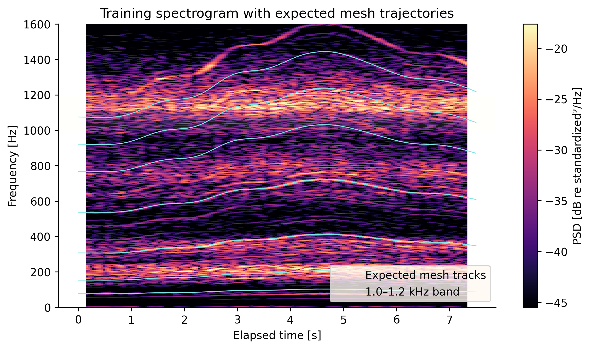
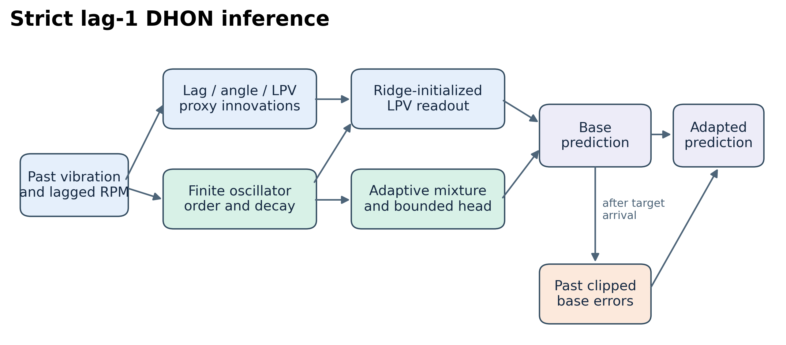
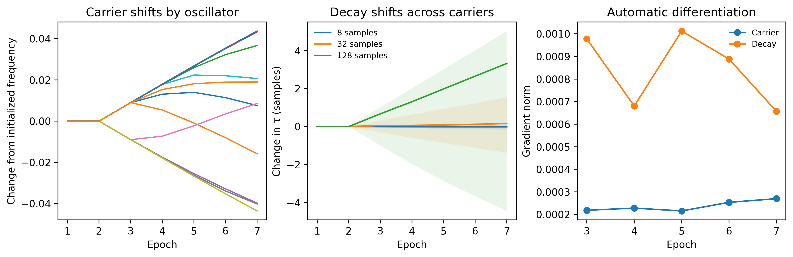
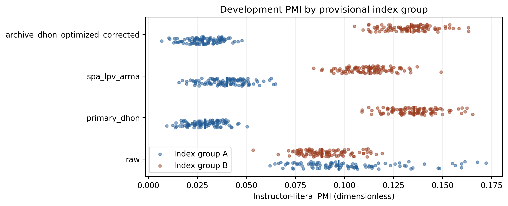

# Abstract

This study tests whether speed-conditioned differentiable oscillator states improve causal unit-step prediction of gearbox vibration while preserving periodic residual signatures. The predictor uses known vibration and RPM through the preceding sample. On 22,208 common development targets, the train-fold-selected DHON had standardized MSE **0.318626**, a **14.21%** reduction over the strict sparse LPV-ARMA refit (0.371406). It was **0.55%** above the independently replayed archived corrected DHON checkpoint (0.316889) and **0.69%** above the strongest archived saved forecasts (0.316445). The adapter reduced the new model's error by 0.014029, compared with 0.000148 for learning the oscillator parameters relative to the matched frozen oscillator. The study verifies numerical differentiability and reports development-only diagnosis using provisional index groups. Independent test files and confirmed acquisition condition labels were absent.

**Keywords** Gearbox vibration, order tracking, causal prediction, differentiable oscillator, LPV-ARMA, periodic modulation intensity

# 1. Engineering objective

Variable shaft speed warps the time-domain vibration signature generated by mesh forces and local faults. A statistical predictor can follow those changing dynamics either by treating speed as a scheduling variable or by using directly interpretable shaft phase. The study tests both methods. The primary outcome is one-step MSE on the designated development sequence. The downstream outcome is how consistently angular-domain residual diagnostics distinguish observed index groups and respond to known pulse perturbations. The analysis does not infer health labels from file ordering.

# 2. Physical basis and related work

Chen et al. (2025, §§3–5) expand AR and MA coefficients in speed basis functions and estimate a sparse two-stage predictor. Their angular PMI relates envelope auto-energy to shaft-period repetition. Chen (2020, §2.2.3) defines the centered envelope formulation. The experiment in the article uses an encoder on the input shaft with a 37/20 tooth pair and measures the x-axis vibration. The new architecture retains physical carrier priors and explicitly trains damped state parameters through the computation graph.

# 3. Dataset and training-only exploratory evidence

The audit confirms 24,000 samples each in training and development at 3.2 kHz and 200 ten-second development fault candidates. Whole-record matches at offset zero identify acquisitions 61 and 63 as repeats of the training and validation prefixes, respectively. The complete overlapping acquisitions are excluded from index-group summary metrics. Scoring uses original standardized vibration and the fixed mask [1792, 24000). Raw conversion metadata reconstructs stored raw channel-one amplitude, but its calibrated engineering units remain unidentified.

Training covered 124.323–167.334 RPM. The 37-tooth mesh fundamental therefore moved from 76.666 to 103.189 Hz. Order 148 showed a 0.744 Hz median ridge discrepancy and an angular PSD peak about 160 times its local median. The 1.0–1.2 kHz region contained 31.3% of the training Welch power. A guarded LPV-AR24 screen moved from 0.46153 to 0.43803 when adding order 148 and 259 quadratures. Adding a standalone 1,100 Hz quadrature produced 0.46230. The evidence supports order-locked features and does not identify a structural mode from a broad band.

# 4. Conventional benchmark

A causal LPV-ARMA predicts from lagged vibration and lagged first-stage proxy innovations, both modulated by an eight-term speed basis. The strict course refits use prior RPM, AIC to screen finite order grids, and L1 support selected by ADMM and a guarded one-standard-deviation rule. Support is then refitted via rank-aware least squares. An ARI baseline fits lagged first differences, and the conditional ARIMA uses lagged proxy innovations. Dense LPV counterparts help expose the cost of sparsity on this short acquisition. The strict dense two-stage comparison scored 0.330781, closer to the new DHON than the strict sparse fit.

The verified original coefficient archive with current scheduling has a historical-mask MSE of about 0.336901 on the supplied validation. On the shared mask the archive coefficient replay is a current-speed reference. Chen et al.'s Table 6 gives 0.2893 for their test. Figure 13(c) starts at a different speed phase from the course input. The original acquisition and retrospective-window archive were unavailable. The analysis retained the designated course segment and did not reconstruct a preferred replacement by searching test windows.

# 5. Proposed DHON

The model integrates observed speed to predict shaft phase in revolutions, $u_t=u_{t-1}+n_{t-1}/(60 f_s)$. A carrier at order $o$ has phase $2\pi o u_t$. Each oscillator demodulates the known measurements into a fixed complex frame, applies normalized finite exponential memory, delays one sample, and remodulates into target phase. For $q_t=x_t\exp(-i\phi_t)$, the equivalent finite recurrence is

$$E_{t+1}=\rho E_t+q_t-\rho^M q_{t-M},\qquad
 h_t=\frac{2E_t\exp(i\phi_t)}{\sum_{j=1}^M\rho^{j-1}}.$$

Here $M$ is the finite state memory and $\rho=\exp(-1/\tau)$, with $\tau$ measured in samples. The implementation uses complex linear convolution in PyTorch. Bounded continuous parameters govern decay and detuning. The learned head uses causal context to mix the bank of quadrature features. A regularized speed-conditioned linear readout uses vibration lags, angle lags, proxy innovations and energy. The optional adapter adds a weighted history of clipped base residuals only after their targets arrive. The base context is bounded by 768 samples and the adapter by another 1,024.

# 6. Optimization and comparisons

Three validation blocks inside the training record were evaluated with 1,792-sample separation on both sides and record/segment resets. The DHON design scored 21 configurations comprising 63 guarded rows. It used a utility combining clean error, stress error and injected-pulse distortion. The selected trial was **expanded short tau**, with fold utility 0.406003. Its base geometry used 12 mesh-locked orders, 512 oscillator samples, 96 direct lags and 16 samples per mesh cycle over 8 cycles. The alternative traded clean MSE for a more compact representation and a lower measured RPM stress and synthetic pulse score. The earlier-only chronological folds returned MSE 3.75985, 1.65084 and 0.33538. This large early error indicates weak extrapolation when training covers less of the speed trajectory. Trial-level arrays and chronological outcomes are in the search directory.

A separate train-fold comparison covered ridge AR, speed-conditioned LPV ridge, a fixed-physics linear readout, polynomial NG-RC, MLP and TCN variants. The old DHON/NG-RC checkpoint forecasts were independently reconstructed from numeric arrays. The best original ancestor provides matched forecast vectors but no corresponding complete checkpoint. Its metric was recomputed using the same 22,208 targets.

# 7. Results

## 7.1 Development prediction

| Model | Targets | MSE | MAE | Bias |
| --- | --- | --- | --- | --- |
| primary dhon | 22208 | 0.318626 | 0.449037 | -0.003755 |
| alternative dhon | 22208 | 0.338247 | 0.462787 | 0.005736 |
| dhon matched fixed | 22208 | 0.318773 | 0.449126 | -0.003745 |
| dhon matched linear | 22208 | 0.319213 | 0.449507 | -0.003564 |
| spa lpv arma | 22208 | 0.371406 | 0.483517 | -0.008890 |
| lpv arma dense | 22208 | 0.330781 | 0.458267 | -0.008440 |
| archived spa lpv arma | 22208 | 0.345151 | 0.466209 | -0.002634 |
| physics linear | 22208 | 0.376432 | 0.487596 | 0.004488 |
| ngrc | 22208 | 0.376930 | 0.487993 | 0.003916 |
| tcn rpm | 22208 | 0.475057 | 0.547844 | 0.024603 |
| archive dhon optimized corrected | 22208 | 0.316889 | 0.447911 | -0.002539 |
| archive ngrc optimized corrected | 22208 | 0.317788 | 0.448410 | -0.003392 |
| archive dhon tau context extended gated corrected | 22208 | 0.316445 | 0.448727 | -0.004849 |

Table 1. Standardized target errors on a common mask. The archived conventional coefficients used current RPM. Strict estimates used previous RPM.

| Reference | Paired difference | 95% low | 95% high |
| --- | --- | --- | --- |
| spa lpv arma | -0.052780 | -0.059294 | -0.046986 |
| archive dhon tau context extended gated corrected | 0.002181 | -0.000057 | 0.004530 |

Table 2. New DHON minus comparator squared error, with 2,000 moving-block bootstrap draws of paired 640-sample blocks. These intervals describe within-record uncertainty. They do not represent new-acquisition uncertainty.

## 7.2 Effect of learning and adaptation

| Model | Adapted MSE | Base MSE | Parameters |
| --- | --- | --- | --- |
| primary dhon | 0.318626 | 0.332654 | 2213 |
| alternative dhon | 0.338247 | 0.344997 | 1831 |
| dhon matched fixed | 0.318773 | 0.332798 | 2213 |
| dhon matched decay only | 0.318653 | 0.332684 | 2213 |
| dhon matched frequency only | 0.318746 | 0.332770 | 2213 |
| dhon matched linear | 0.319213 | 0.333468 | 1788 |

Table 3. A matched encoder and scoring policy allow comparison of fixed and learned physical parameters. The alternative differs in geometry.

The new primary reduced MSE by 0.000148 relative to the matched fixed-state model, about 0.046%. Removing the slow adapter raised MSE by 0.014029, or 4.22% of the base error. State gradients and parameter motion establish differentiable state learning, but the development error change due to learning is small. Fitted order offsets ranged from −0.04361 to +0.04372 order. The three memory banks occupied 7.83–8.11, 30.62–33.54 and 123.55–133.03 samples. The offsets and memories are model parameters and do not measure mechanical damping or changes in tooth count. The strongest archived reference remains ahead. A compact alternative with 1831 deployed numeric parameters versus 2213 also scored 0.338247, exposing the trade-off between clean error and feature cost.

## 7.3 Provisional diagnostics and robustness

PMI normalizes centered analytic-envelope correlation at one turn. A 2,048-sample angular grid gives lag 2,047 under the literal MATLAB index and 2,048 under the mathematical correction. The input labels describe index groups A and B only. The scope is threshold-free within this development corpus. Predictor RPM corruption and diagnostic RPM corruption are measured separately. Controlled damped pulse injections assess retention by residual differences, with aperiodic scenarios as negative controls. Exact MATLAB end-to-end parity requires its angle helper or golden outputs.

| model | n_A | n_B | median_A | median_B | conditional_auc_B_high |
| --- | --- | --- | --- | --- | --- |
| raw | 98 | 100 | 0.097142 | 0.088550 | 0.364286 |
| primary dhon | 98 | 100 | 0.028935 | 0.135579 | 1.000000 |
| spa lpv arma | 98 | 100 | 0.040144 | 0.112696 | 1.000000 |
| archive dhon optimized corrected | 98 | 100 | 0.028055 | 0.133790 | 1.000000 |

Table 4. Descriptive PMI group summaries where computed. AUC refers to B having a higher score than A and cannot be interpreted as verified fault-classification accuracy.

| model | mse_clean | rpm_mse_worst | median_periodic_pulse_corr | periodic_pmi_positive | periodic_pmi_cases |
| --- | --- | --- | --- | --- | --- |
| primary dhon | 0.31863 | 0.47282 | 0.53735 | 13 | 15 |
| spa lpv arma | 0.37141 | 6.55481 | 0.63193 | 9 | 15 |
| archive dhon optimized corrected | 0.31689 | 0.45255 | 0.52738 | 11 | 15 |

Across thirteen controlled predictor RPM stress cases, a +2% systematic speed bias produced the maximum observed MSE for the primary, strict sparse and replayed archive DHON controls. Pulse recovery and PMI response vary across injection scenarios. The pulse projection and correlation tables quantify this variation without equating synthetic amplitude to physical crack severity.

## 7.4 Computational cost

| Model | Record | Median (s) | IQR (s) | RTF |
| --- | --- | --- | --- | --- |
| primary dhon | development 7p5s | 0.27827 | 0.00805 | 0.03710 |
| primary dhon | candidate 10s | 0.34955 | 0.03405 | 0.03496 |
| spa lpv arma | development 7p5s | 0.04313 | 0.00081 | 0.00575 |
| spa lpv arma | candidate 10s | 0.06605 | 0.00374 | 0.00661 |
| archive dhon optimized corrected | development 7p5s | 0.14013 | 0.01368 | 0.01868 |
| archive dhon optimized corrected | candidate 10s | 0.18888 | 0.00284 | 0.01889 |

Table 5. In-memory batch inference on CPU, including model feature construction. Each displayed repeat uses a single library thread. RTF is runtime divided by recording duration. A low batch RTF alone does not establish 0.3125 ms per-sample streaming deadlines. GPU available to the tested build was False. Training and component fit measurements are separate in model-level tables.

# 8. Verification and limitations

Tests cover finite history and reference recurrence, actual parameter gradients, alignment, solver parity, PMI and record reset fixtures, guarded folds, and checkpoint round trips. The audit and notebook logs provide the exact recorded verification scope. The speed and vibration window checks exclude exact overlaps, while unavailable original acquisition metadata limits stronger claims of independence. Independent prediction and fault inputs were unavailable, so no blind scores are reported. The project also lacks the original checkout needed to reproduce the strongest archived saved forecasts from coefficients. The mixed 2025/2026 course dates are preserved as published.

# 9. Conclusion

The study demonstrates a causal, finite-history DHON whose speed-linked oscillator state participates in backpropagation. Its forecast is stronger than the newly fitted conventional and learned comparators in this run, but weaker than the strongest archived corrected anchors. The adapter provided the largest demonstrated design gain. The diagnostic findings describe development index groups and controlled perturbations. More labelled acquisitions and the frozen test protocol are required to establish transfer and operational fault detection.

# References

1. MECG 7780, *Time Serial Dependency Modeling via Advanced Machine Learning Algorithms*. Instructor course brief and supplied `fdt_featcal.m`.
2. Y. Chen, Z. Li, Y. Jiang, D. Gong and K. Zhou. “Sparse LPV-ARMA model for non-stationary vibration representation and its application on gearbox tooth crack detection under variable speed conditions.” *Mechanical Systems and Signal Processing* 224, 112161 (2025). [DOI](https://doi.org/10.1016/j.ymssp.2024.112161)
3. Y. Chen. *Vibration-based fault detection and severity assessment for fixed-axis gearboxes*. PhD thesis, University of Alberta (2020). pp. 45, 99–102, 116–124.
