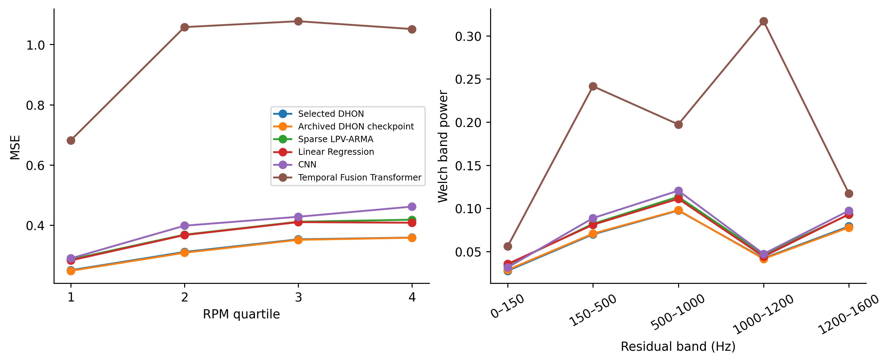
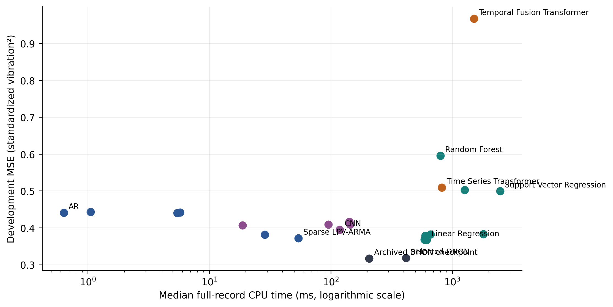
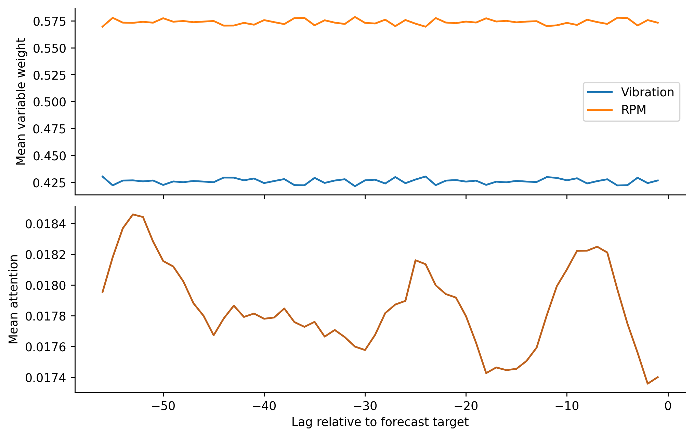

# How to use this companion

Start with the results chapter to see the measured ranking and scope. Read the experimental protocol
before interpreting any score. The model chapters connect equations to actual source components and
candidate settings. The matched-analysis notebooks independently recalculate evidence from stored arrays.
See the bundled prior DHON report and textbook for the original source audit, course slides and raw-file
provenance. This follow-up adds the measured family comparisons and maintains the original physics model
as the principal research hypothesis.


# Results and interpretation

The selected DHON replay scored **0.318626** on 22,208 official development targets. The strongest newly
tuned model on this record was **Linear Regression** (0.367386).
**Lasso Regression** had the lowest comparable guarded-training MSE among newly tuned families
(0.405680), then scored 0.378298 on official development. This difference
between rankings is important because selecting across families with official validation would use the
development acquisition as tuning data. CNN was the best of the matched patched neural group
on this development record (0.394638).

All 21 requested families are in the table. Nineteen had a new guarded search and full-training fit.
The two sparse LPV methods had fresh coefficient refits on prior guarded supports. The three DHON
references are the previous primary checkpoint, the strongest runnable archived checkpoint, and the
strongest saved archived forecasts. The primary scored 14.21% lower MSE
than sparse LPV-ARMA. The replayable archived checkpoint (0.316889) and forecast-only anchor
(0.316445) remain lower than primary DHON. The external published LPV-ARMA value 0.2893
comes from a different segment and is not in this ranking.

| Model | Guarded MSE | Train MSE | Dev MSE | Dev MAE | CPU ms |
| --- | --- | --- | --- | --- | --- |
| Archived DHON forecasts | — | — | 0.31644 | 0.44873 | — |
| Archived DHON checkpoint | — | 0.29733 | 0.31689 | 0.44791 | 207.44179 |
| Selected DHON | — | 0.29554 | 0.31863 | 0.44904 | 416.15648 |
| Linear Regression | 0.43945 | 0.34699 | 0.36739 | 0.48235 | 615.64063 |
| Ridge Regression | 0.41350 | 0.34903 | 0.36806 | 0.48273 | 591.20492 |
| Sparse LPV-ARMA | — | 0.34776 | 0.37141 | 0.48352 | 54.26129 |
| Lasso Regression | 0.40568 | 0.36047 | 0.37830 | 0.48944 | 600.37304 |
| Sparse LPV-AR | — | 0.34899 | 0.38150 | 0.49046 | 28.63666 |
| Elastic Net | 0.40578 | 0.36426 | 0.38220 | 0.49192 | 663.94124 |
| NARX | 0.43092 | 0.32596 | 0.38315 | 0.49199 | 1802.73655 |
| CNN | 0.44371 | 0.35289 | 0.39464 | 0.49736 | 118.68891 |
| MLP | 0.45115 | 0.35506 | 0.40642 | 0.50532 | 18.74918 |
| TCN | 0.44057 | 0.37900 | 0.40858 | 0.50517 | 144.74637 |
| LSTM | 0.43145 | 0.38743 | 0.40881 | 0.50725 | 95.82076 |
| GRU | 0.43708 | 0.39560 | 0.41606 | 0.51069 | 142.08527 |
| ARIMA | 0.46456 | 0.43388 | 0.44007 | 0.52543 | 5.45447 |
| AR | 0.46189 | 0.43255 | 0.44057 | 0.52564 | 0.63391 |
| ARMA | 0.46332 | 0.43323 | 0.44171 | 0.52621 | 5.72670 |
| ARX | 0.46121 | 0.43244 | 0.44320 | 0.52731 | 1.04989 |
| Support Vector Regression | 0.49981 | 0.43139 | 0.49937 | 0.56244 | 2482.01270 |
| Gradient Boosting | 0.48853 | 0.31436 | 0.50251 | 0.56380 | 1263.14689 |
| Time Series Transformer | 0.51531 | 0.47816 | 0.50939 | 0.56518 | 819.28630 |
| Random Forest | 0.57588 | 0.35777 | 0.59516 | 0.61099 | 797.62165 |
| Temporal Fusion Transformer | 0.95592 | 0.92134 | 0.96710 | 0.77723 | 1510.98496 |

Guarded rows are **378** across the new experiments (attention: 12 fold rows; neural: 45 fold rows; statistical: 147 fold rows; tabular: 174 fold rows), including candidates
retained as evidence but excluded by solver or inversion checks. Sparse LPV guarded comparisons refer
to the earlier experiment and are left blank in this column. CPU time is the median of seven calls on
a 7.5-second record from a loaded predictor. Fault diagnostic computation ran separately on the shared host during the benchmark. Train MSE is an in-sample diagnostic and is not a
generalization estimate.

## Paired error and operating conditions

| Comparator | MSE minus DHON | 95% low | 95% high |
| --- | --- | --- | --- |
| Linear Regression | 0.048760 | 0.043159 | 0.054206 |
| Sparse LPV-ARMA | 0.052780 | 0.046986 | 0.059294 |
| CNN | 0.076012 | 0.066889 | 0.087096 |
| Archived DHON forecasts | -0.002181 | -0.004530 | 0.000057 |

Intervals use the predeclared 640-sample moving-block design. The CSV also contains sensitivity to block
lengths of 320 and 1,280 samples. Confidence estimates are for this acquisition and comparisons are
exploratory across multiple families.




## What the model ranking suggests

- The selected physics-aware Linear and Ridge regressions are stronger than classical lag-only AR,
  conditional ARMA or additive ARX on official development. These differences combine representation
  and estimation. A time-only method can be cheaper and useful when RPM is absent.
- The guarded Lasso and Elastic Net performed strongly on the internal folds. The best official
  development score came from a different regularization choice and feature library. Fit on one
  acquisition and evaluate on another before attributing performance to shrinkage alone.
- The selected NARX adds a tanh residual learner to a physics-conditioned ridge predictor.
  Its development score does not establish a gain from nonlinearity over the independently tuned
  linear/ridge models. The exact selection metadata distinguish their input libraries and regularization.
- The matched five-neural-model suite preserves a raw-lag shortcut across heads. Transformer and TFT
  use distinct configurations and training row strides. Their errors show limited performance under these
  specific configurations and resource budgets. TFT performs poorly even in-sample, so the result
  does not establish an architecture-wide generalization penalty or a definitive upper performance limit.
- Prior DHON controlled comparisons isolated an adapter benefit (+0.014029 MSE when removed)
  and a much smaller learned-state benefit (0.000148 over fixed oscillator states). Those controls
  are stronger attribution evidence than rank-based comparisons with unrelated model families.





## Inference trade-offs and operating variation

The table gives the empirical non-dominated rows for clean development error and loaded CPU batch time.
A row is dominated if another runnable model is at least as accurate and fast with a strict advantage
on either metric. Forecast-only archived arrays have no latency and are excluded.

| Model | MSE | Median CPU ms |
| --- | --- | --- |
| AR | 0.44057 | 0.63391 |
| ARIMA | 0.44007 | 5.45447 |
| MLP | 0.40642 | 18.74918 |
| Sparse LPV-AR | 0.38150 | 28.63666 |
| Sparse LPV-ARMA | 0.37141 | 54.26129 |
| Archived DHON checkpoint | 0.31689 | 207.44179 |

The following regional winners are descriptive. It is invalid to pick a different predictor for each
validation stratum and then report the resulting composite as independent performance.

| Operating region | Lowest MSE among new fits | MSE |
| --- | --- | --- |
| chronological_block_1 | Ridge Regression | 0.27837 |
| chronological_block_2 | Linear Regression | 0.33707 |
| chronological_block_3 | Linear Regression | 0.42428 |
| chronological_block_4 | Linear Regression | 0.39904 |
| chronological_block_5 | Linear Regression | 0.39912 |
| chronological_block_6 | Linear Regression | 0.36429 |
| nonrising_rpm | Linear Regression | 0.38305 |
| rising_rpm | Linear Regression | 0.35647 |
| rpm_quartile_1 | Ridge Regression | 0.28254 |
| rpm_quartile_2 | Linear Regression | 0.36738 |
| rpm_quartile_3 | Linear Regression | 0.41032 |
| rpm_quartile_4 | Linear Regression | 0.40839 |

## Fault diagnostics and robustness

The fixed screen used one record every five in MATLAB order, plus the separately documented overlap audit record 63. Raw vibration and all 23 runnable predictors share the subset. A separate scan used all 200 records for the previous DHON, replayable archived DHON, sparse LPV-ARMA and lowest-guarded-MSE new model (Lasso), plus raw. The A/B index grouping is provisional. Acquisitions 61 and 63 are excluded from the summaries.

### Screen diagnostics

| Signal/model | Median A | Median B | B−A | Conditional AUC |
| --- | --- | --- | --- | --- |
| raw | 0.1048 | 0.0849 | -0.0199 | 0.2579 |
| AR | 0.0742 | 0.1104 | 0.0362 | 0.9947 |
| ARMA | 0.0723 | 0.1077 | 0.0354 | 0.9947 |
| ARIMA | 0.0735 | 0.1097 | 0.0362 | 0.9974 |
| ARX | 0.0750 | 0.1099 | 0.0348 | 0.9947 |
| Sparse LPV-AR | 0.0337 | 0.1035 | 0.0698 | 1.0000 |
| Sparse LPV-ARMA | 0.0404 | 0.1050 | 0.0646 | 1.0000 |
| Linear Regression | 0.0343 | 0.1130 | 0.0788 | 1.0000 |
| Ridge Regression | 0.0350 | 0.1114 | 0.0763 | 1.0000 |
| Lasso Regression | 0.0373 | 0.1162 | 0.0789 | 1.0000 |
| Elastic Net | 0.0374 | 0.1158 | 0.0784 | 1.0000 |
| Support Vector Regression | 0.0429 | 0.1032 | 0.0603 | 1.0000 |
| Random Forest | 0.0610 | 0.0917 | 0.0308 | 0.9632 |
| Gradient Boosting | 0.0387 | 0.0941 | 0.0553 | 1.0000 |
| NARX | 0.0345 | 0.1112 | 0.0767 | 1.0000 |
| MLP | 0.0545 | 0.1078 | 0.0533 | 1.0000 |
| LSTM | 0.0579 | 0.1059 | 0.0480 | 1.0000 |
| GRU | 0.0553 | 0.1059 | 0.0506 | 1.0000 |
| CNN | 0.0461 | 0.0968 | 0.0507 | 1.0000 |
| TCN | 0.0548 | 0.1062 | 0.0514 | 1.0000 |
| Time Series Transformer | 0.0831 | 0.1268 | 0.0437 | 0.9921 |
| Temporal Fusion Transformer | 0.0798 | 0.0837 | 0.0039 | 0.5737 |
| Selected DHON | 0.0294 | 0.1356 | 0.1062 | 1.0000 |
| Archived DHON checkpoint | 0.0284 | 0.1307 | 0.1023 | 1.0000 |

### Full diagnostics

| Signal/model | Median A | Median B | B−A | Conditional AUC |
| --- | --- | --- | --- | --- |
| raw | 0.0971 | 0.0885 | -0.0086 | 0.3643 |
| Sparse LPV-ARMA | 0.0401 | 0.1127 | 0.0726 | 1.0000 |
| Lasso Regression | 0.0372 | 0.1192 | 0.0820 | 1.0000 |
| Selected DHON | 0.0289 | 0.1356 | 0.1066 | 1.0000 |
| Archived DHON checkpoint | 0.0281 | 0.1338 | 0.1057 | 1.0000 |

Compute angular position by trapezoidal RPM integration, then interpolate residuals onto a 2,048-point/revolution grid. The Hilbert envelope is centered. For centered envelope $b$, the finite sample ratio is $r(k)=\sum_j b_jb_{j+k}/\sum_j b_j^2$ and PMI is $r/(1-r)$. The primary mode uses the instructor's lag-2,047 indexing and the mathematical correction uses lag 2,048. The unrelated 0.63-turn lag is a specificity check. Scores are threshold-free because no confirmed label or calibration file was available.

The stress comparison applies six fixed RPM perturbations separately to the predictor and the diagnostic angle reconstruction, and jointly to both. Pulse trials compare paired residuals with and without synthetic periodic and aperiodic injections. These controlled inputs probe sensitivity and preservation, with limited evidence about actual crack severity.

| Model | Clean MSE | Mean stress MSE | Worst MSE |
| --- | --- | --- | --- |
| Selected DHON | 0.3186 | 0.3731 | 0.4728 |
| Archived DHON checkpoint | 0.3169 | 0.3642 | 0.4525 |
| Sparse LPV-ARMA | 0.3714 | 1.4351 | 6.5548 |
| Lasso Regression | 0.3783 | 0.3987 | 0.4356 |
| Linear Regression | 0.3674 | 4.2103 | 21.8794 |
| Ridge Regression | 0.3681 | 0.3911 | 0.4333 |
| CNN | 0.3946 | 0.3988 | 0.4120 |
| Temporal Fusion Transformer | 0.9671 | 0.9674 | 0.9710 |

Linear Regression and Ridge selected the same physics library. Their clean errors were 0.367386 and 0.368059, while their worst errors were 21.879433 and 0.433301. The matched library and large divergence under stress support regularization as a practical robustness control on this acquisition. It does not prove either model is robust to all out-of-distribution sensor failures.

| model | kind | cases | positive pmi | median correlation | median pmi delta | median energy retention |
| --- | --- | --- | --- | --- | --- | --- |
| Sparse LPV-ARMA | periodic | 4 | 2 | 0.6801 | 0.0005 | 1.2294 |
| Sparse LPV-ARMA | aperiodic | 2 | 2 | 0.7289 | 0.0007 | 0.9285 |
| Lasso Regression | periodic | 4 | 4 | 0.7206 | 0.0007 | 1.1819 |
| Lasso Regression | aperiodic | 2 | 2 | 0.7712 | 0.0006 | 0.9050 |
| Selected DHON | periodic | 4 | 4 | 0.5722 | 0.0020 | 1.6804 |
| Selected DHON | aperiodic | 2 | 1 | 0.6102 | 0.0002 | 1.2656 |
| Archived DHON checkpoint | periodic | 4 | 3 | 0.5672 | 0.0021 | 1.7413 |
| Archived DHON checkpoint | aperiodic | 2 | 1 | 0.6120 | -0.0000 | 1.2814 |

## Scope of verification

Retain all target predictions for independent numerical rescoring, and all numeric checkpoint arrays
for independent replay. The shared causal perturbation changes RPM and vibration together at scoring
index 12,375. Forecasts through that target must agree with the original record within numerical
tolerance. The frozen run records checkpoint hashes and preserves the target and input ordering.
Blind results are reserved for sigtest and sigfault2. A missing-input preflight records their availability.
No diagnosis threshold or blind score is inferred from the development results.


# Experimental area and scoring contract

The applied question is whether a physical model can predict a new measured gearbox vibration sample after the preceding sample has arrived. The operating condition varies in shaft speed. Historical vibration is the response history. Speed is an observed scheduling or exogenous covariate. These are prediction models under observed history. Closed-loop simulation would feed future forecasts back into the lag buffer and has a different error process.

The 37-tooth input gear rotates at approximately 124–167 RPM. Its first mesh harmonic varies from about 76.7 to 103.2 Hz. At 3.2 kHz this is roughly 31–42 samples per mesh cycle, so a fixed 37-sample delay slides through the feature across the RPM profile. Angular lags address this problem by measuring distances in revolutions. A fixed order yields a time-varying frequency. A fixed-Hz spectral component follows the same clock at every RPM, and a concentration of energy near one frequency alone does not identify a structural resonance. The prior project contains the source audit, order-tracking EDA, and acquisition manifests.

## Target definition and masks

The train and official development records each contain 24,000 vibration/RPM pairs at 3,200 Hz. The experiment predicts $x_t$ using measurements at indices up to $t-1$. Some methods intentionally use a subset, such as AR without RPM, to test whether speed adds predictive information. None receives target RPM, future acceleration, or a vibration label outside its fit partitions. The model groups have comparable access to permissible data, and feature and tuning budgets vary by family. This is a comparison of defined pipelines rather than an architecture-only randomized experiment.

Score exactly $1792\le t<24000$, giving 22,208 targets per method. Offsets are zero-based. Use measured previously arrived vibration, including within a validation block. Reset fitted state at an acquisition boundary and recompute from observed within-record context. The stored vibration standardization is kept fixed. Input scaler estimates for applicable algorithms come from the fit slice or full designated training record. No new validation target centering is applied. Time-domain spectral plots and offline PMI may observe the entire completed residual sequence.

## Guarded selection, fitness and scope

Take three contiguous blocks from the training acquisition, [4800, 7200), [11200, 13600) and [18400, 20800). For a held interval [a,b), retain [0,a−1792) and [b+1792,24000) for fit. Build complete local windows independently in each fit slice. The history reaching backward from a held target is legal at one-step evaluation. The observation may already be recorded in the validation block, while its target was withheld from fit. This design controls direct sample overlap at the boundaries. It does not make the three blocks independent experiments. The earlier DHON project additionally tested earlier-only chronological folds, which exposed errors under extrapolative speed regimes. That result is important context alongside the expanded blocked search.

Most candidate sets minimize equally weighted fold MSE within their model family. Some statistical configurations require invertible innovation recursion and the shrinkage solvers prefer all-fold convergence. The final statistical filters, tree ensembles, shallow regressions, sequence nets and attention models were fitted on the whole designated training record after this screening. The LPV sparse supports were selected in the prior guarded ADMM experiment and refitted by QR in this study. Previous selected DHON and archive weights remain frozen. Different selection objectives are recorded, including the earlier DHON's robustness and pulse-distortion utility. A favorable development score describes the observed set, not a new independently selected model.

Candidate datasets for the diagnostics contain repeated recordings. Records 61 and 63 match the beginning of the official training and development records in both vibration and RPM. They are retained in inventories and omitted from score distributions. Groups A and B refer to the file indexing rule. Their unknown condition and acquisition identities prevent verified fault classification claims. Blind vibration and fault files are handled by a separate inference-only entry point after a hash-checked freeze.

## Error and uncertainty

With $e_t=x_t-\widehat{x}_t$, use $\mathrm{MSE}=\operatorname{mean}(e_t^2)$ and $\mathrm{RMSE}=\sqrt{\mathrm{MSE}}$. A signed average identifies residual bias and MAE gives a quantity less dominated by large errors. $R^2=1-\mathrm{MSE}/\operatorname{Var}(x)$ on the same scored targets. A large $R^2$ does not imply white residuals. Sign runs assess runs of positive and negative residuals, and residual ACF and Ljung–Box are descriptive misspecification checks. Residual Welch band powers indicate where the errors remain, with 1,024-sample windows and 3.125 Hz bin spacing. Integrated band powers and full-record MSE need not agree exactly because window averaging, tapering, and detrending change weighting.

To compare $A$ and $B$, form $D_t=e^2_{A,t}-e^2_{B,t}$. Negative mean favors $A$. Bootstrap entire contiguous blocks of **paired** $D_t$, using 2,000 replicates at lengths 320, 640 and 1,280 samples. These are 0.10, 0.20 and 0.40 seconds. Paired resampling preserves the alignment of hard and easy targets for the two methods. The intervals describe sensitivity within one record and do not establish transfer to other acquisitions. They are exploratory across the many models and not adjusted for family-wise coverage. RPM quartiles and a 64-sample prior speed direction serve as descriptive operating strata. Differences across strata may reflect a shared speed/time/loading trajectory.

## Timing and deployability

The comparison makes seven full-record in-memory calls for each loaded predictor with one CPU computation thread. Times include feature/window construction and forward prediction. The median, IQR and approximate tail describe this run on the recorded CPU. The model-family fit timers include final fitting as named, with guarded search separate. Workspace sharing and latency distribution state can affect both classes of timings. Parameter counts represent fitted weights or deployed internal arrays according to family and are meaningful only with that definition, especially for support vectors and tree split/leaf storage. NPZ bytes compare compressed saved artifacts. Batch real-time factor divides wall seconds by 7.5 seconds of observed signal. Successful batch processing below the record duration does not demonstrate a 0.3125 ms per-sample streaming deadline. GPU comparisons require an actual available supported device.

## Worked questions

1. At 150 RPM, what is the harmonic frequency of order 148? It is $148\times2.5=370$ Hz. At 160 RPM it rises to about 394.67 Hz. A conditioning variable or angle representation can shift the model feature with it.
2. Why can a lower MSE disagree with a better fault score? Predicting some impacts well can remove them from the residual. Conversely, an ordinary bias can inflate envelope features without helping fault detection. Compare recurrence at the physical shaft lag and use synthetic impulse differences with a known injected target.
3. Why not average model ranks over one bootstrap sample per time point? Adjacent residuals are serially dependent and a model's predictions overlap in history. The paired blocked approach preserves local dependence and avoids treating each window as an independent data acquisition.
4. What result should decide deployment? Accuracy, cost, robustness and independent diagnostics have distinct criteria. A point forecast comparison is useful for shortlisting, with a frozen independent validation and hardware timing still necessary before deployment.


# Model equations, implementation and engineering interpretation

Let $z_t$ denote a vector built exclusively from the observed history needed for target $t$. Write $x_t$ for measured standardized vibration, $s_t$ for RPM and $e_t=x_t-\widehat{x}_t$ for a residual available after observing $x_t$. The same evaluation target does not impose the same inductive bias. An ARX model adds a separate input branch while an LPV model changes AR coefficients with speed. A physics-feature regression can remain linear in its fitted weights while using nonlinear measurements of the signal.

## 1. Autoregressive model

AR($p$) estimates $\widehat{x}_t=c+\sum_{i=1}^{p}\phi_i x_{t-i}$. The coefficient vector is constant across speed. The fit minimizes squared residuals by rank-aware least squares with candidate orders 16, 32, 64, 96, 160, 256 and 320. A 96-sample history spans 30 ms, long enough for a little over two mesh cycles around 150 RPM. A longer history resolves changing periodic correlations only if coefficients appropriate for those delays can be estimated. The model is particularly suitable as an inexpensive benchmark because its prediction uses a finite convolution and it receives measured previous vibration directly.

For homogeneous free-running analysis, roots of the associated AR recurrence matter. Robust closed-loop prediction and stability are separate from the one-step test. Inspect pole radii in the classical metrics and residual spectrum by speed. A movement in that spectrum across the speed profile can motivate additive speed history or a speed-scheduled pole structure.

## 2. Autoregressive moving average

ARMA($p,q$) adds $\sum_{j=1}^{q}\theta_j e_{t-j}$ to the autoregressive predictor. The MA component is a history of estimated innovations, not a moving average of the measured vibration. A simple proxy for innovation uses the residual from a higher-order AR fit. The conditional Hannan–Rissanen procedure fits this proxy in the allowed block, then regresses on lagged $x$ and proxy residuals. At inference, the implemented ARMA uses its own recursively defined innovations. Let $A(B)=1-\sum \phi_iB^i$ with delay operator $B$, and $C(B)=1+\sum\theta_jB^j$. Then $C(B)e_t=A(B)x_t-c$. The AR-only model is the $q=0$ limit. Near-unit MA inversion can produce a long tail even when $q$ is small.

The implementation screens candidate inversion radii and constructs a finite polynomial approximation with maximum 1,792 raw lags. It directly compares the predictions against the exact conditional recursion and checks the discarded impulse-tail mass. That provides a bounded support for guarded experiments. A larger model may improve innovation whitening on a stationary process and have little benefit when changing speed is the dominant misspecification.

## 3. Autoregressive integrated moving average

ARIMA($p,1,q$) fits an ARMA to $d_t=x_t-x_{t-1}$ and reconstructs $\widehat{x}_t=x_{t-1}+\widehat{d}_t$. In delay notation the innovation filter extends ARMA by multiplying its numerator by $(1-B)$. The candidate orders $p\in\{32,96,160,256\}$ and $q\in\{2,5,8\}$ apply also to ARMA. A time-varying local mean or low-frequency drift can make differencing attractive. In vibration, differencing emphasizes the upper band and can increase the effect of measurement noise. The model is compared on the undifferenced course scale. Conditional estimation, fixed finite histories and the fitted likelihood problem are distinct modelling choices. The independent external paper ARIMA score used a different segment.

## 4. Autoregression with exogenous inputs

The additive ARX design uses $\hat{x}_t=c+\sum_i\phi_i x_{t-i}+\sum_j\beta_j s_{t-d_j}$. The fitted exogenous coefficients depend on allowed prior RPM at offsets that include 1, 17, 65 and potentially 257 samples. Lagged covariates are highly collinear when RPM changes smoothly, so modest shrinkage is compared. The AR and speed terms have separate roles. It is possible to change speed influence through an additive intercept without changing how a vibration cycle maps to prior targets. This helps distinguish ARX from an LPV model, which interacts speed with vibration lag coefficients. If adding speed improves a method only in isolated operating regions, a useful check is whether its delay pattern tracks a physical phase difference or is mainly a proxy for the collection trajectory.

## 5. Nonlinear autoregression with exogenous inputs

NARX generalizes ARX into $\widehat{x}_t=g(x_{t-1:t-p},s_{t-d_1:t-d_k})$. The course implementation uses two terms $w^Tz_t+f_\theta(c_t)$ plus an intercept. The first is a physics-conditioned ridge fit using measured lag history, normalized speed terms and quadratures. The second is a small tanh network fitted to ridge residuals on the compact input library. Ridge alpha, head width and training epoch alternatives are selected on guarded folds. Each new input window is formed from measured prior vibration. Feeding predictions recursively at inference would alter the residual-learning task and would require separate validation.

Interpreting NARX needs the ridge comparison. If the observed improvement is small, the linear physics projection may be doing most of the work. If a neural residual term improves in the central speed band only, evidence could favor an interaction specific to the available operating condition. These contrasts motivate fixed-feature ablations and held-speed tests, instead of attributing the gain to nonlinear autoregression alone.

## 6. Sparse linear parameter-varying AR

Set $a_i(w)=\sum_{k=0}^{7}\beta_{ik}P_k(2w-1)$ where $P_k$ is a Legendre polynomial and $w$ derives from lag-one RPM scaled by the preserved input range. Regress $x_t$ on eight polynomial interactions for every vibration lag. With 240 lags there are 1,920 interaction columns. The sparse support comes from the prior guarded ADMM and AIC procedure. It minimizes scaled squared error plus a sum of absolute coefficient values and chooses a support before unpenalized refitting. This implementation recomputes the refit by QR on the frozen 475-column support and independently checks coefficient and forecast agreement. A retained high-order basis interaction is a modelling term, not independent physical evidence that a specific gear order is excited.

## 7. Sparse linear parameter-varying ARMA

A second speed-varying regression includes lagged proxy innovations from the first LPV stage. For orders $(135,75)$ and eight basis columns, the second design has $8(135+75)=1680$ candidate terms. The protected support retains 365. At inference establish the stage-one residual once each target arrives. The second stage can use older residuals only. Reusing QR on the frozen support isolates the benchmark change from a new sparse-selection search. Dense LPV, sparse LPV and exact-recursion ARMA can rank differently because they model speed, regularization and innovations differently. The external paper's current-speed and validation conventions should stay distinct from the course's lag-one protocol.

## 8. Linear Regression

Fit $c+\beta^Tz$ using an SVD-based least-squares solution on centered/scaled features. Candidate libraries range from time-only lags through speed interactions to physics terms. The time-only column pattern overlaps classical AR. The wider library exposes products such as lag times a speed basis value, angular delayed vibration and harmonic projections. The model is a linear map of this engineered representation. It is useful for testing how much structured feature design gains before discarding simple regressors. Collinear ridge-design columns can lead to high-variance individual coefficients although predictions remain comparatively accurate on the same profile.

## 9. Ridge Regression

Ridge solves $\min_{\beta}\Vert y-X\beta\Vert_2^2+\lambda\Vert\beta\Vert_2^2$. The fitted objective uses a centered intercept and candidate penalties 0.6, 15 and 80 with column scaling. A positive penalty stabilizes inversion in correlated feature directions and generally leaves dense coefficients. Comparing validation error with unregularized linear regression is meaningful only after examining selected feature designs. Different selected libraries vary the effect of features and shrinkage simultaneously. The train-to-validation gap and the selected fold penalty indicate useful scope without making a causal claim about regularization by itself.

## 10. Lasso Regression

Lasso solves $\min_{\beta}\Vert y-X\beta\Vert_2^2/(2N)+\lambda\Vert\beta\Vert_1$. Its soft-thresholding geometry permits exact zeros. Fold scaling matters because a distinct feature scale changes the penalty on its physical contribution. The implementation uses coordinate descent with a finite iteration budget, records the duality gap and prefers all-fold converged candidates. Highly correlated lags or quadratures may exchange places across fits without materially changing prediction. A nonzero fitted coefficient is evidence of useful representation conditional on the other retained features and the penalty.

## 11. Elastic Net Regression

Elastic Net combines $\lambda\big[\eta\Vert\beta\Vert_1+(1-\eta)\Vert\beta\Vert_2^2/2\big]$ with normalized squared loss. The compared ratios 0.25 and 0.75 trade a greater group-shrinkage effect against more sparsity. Correlated vibration lags, or a sine/cosine pair representing one physical carrier, can both matter. The L2 term can stabilize their joint use. Candidate combinations change the effective group penalty and feature library, so consult the fold table to learn which comparison isolates penalty versus design. Exact zero coefficients and normalized objective must be interpreted with the fitted scaler.

## 12. Support Vector Regression

The radial-basis SVR predicts $b+\sum_i(\alpha_i-\alpha_i^*)\exp[-\gamma\Vert z_i-z\Vert^2]$. It penalizes errors beyond an $\epsilon$-wide tube, and $C$ scales the tube violations. Standardize the features before computing distances. Large $\gamma$ isolates local training neighborhoods and can underpredict a shift in RPM if distances place the new window far away. The exact RBF solver was fitted on a deterministic time-stratified subset within each allowed fold fit set. Limited training rows control kernel cost, so its results are conditional on that budget. Support-vector count affects memory and inference and is more informative here than one neural-style dense parameter count.

## 13. Random Forest Regression

Each tree recursively partitions past-only features by threshold. A terminal node predicts an average over its training responses, and the forest averages the predictions over bootstrapped trees. Feature subsampling decorrelates errors across trees. It has strong capacity for interactions without prespecifying their algebra, but oscillation phase can change smoothly in a high-dimensional lag space where axis-aligned splits need many cells. Leaf size, depth and feature subset determine stability. Tree nodes, leaf values, branch metadata and feature arrays are serialized without pickle. A direct forecast equivalence test checks that the array evaluator reproduces fitted sklearn predictions.

## 14. Gradient Boosting Regression

Boosting builds $F_M(z)=F_0(z)+\nu\sum_{m=1}^{M}h_m(z)$ where each small tree fits the negative loss gradient. For squared error the gradient residual is proportional to $y-F_{m-1}$. Depth and shrinkage determine how rapidly the ensemble can fit difficult regions, and the finite ensemble-size budget controls overfitting. A deterministic subsample can reduce cost and variance. Boosting can distinguish interactions in RPM and energy without a predefined linear factorization. It can still struggle to extrapolate beyond its top-level splits. Verify the optimized portable evaluator by reconstructing ensemble offsets, weights and leaves.

## 15. Multilayer Perceptron

The neural comparison uses a raw-history affine shortcut plus a nonlinear encoder. For MLP the encoder flattens the whole window and passes it through two GELU layers before scalar readout. An MLP can combine efficiently across time positions and channels. Its weights are tied to absolute lag coordinates, so a shift of a local structure within the window generally changes its representation. The linear shortcut can learn the predominant autoregression. Thus a paired result against a plain linear lag estimator combines architecture, fitting and possible design cost differences.

## 16. Long Short-Term Memory

For a patch feature $u_j$, gates $i,f,o\in[0,1]$ act on a candidate $\tilde c_j$ and previous state $c_{j-1}$. The update $c_j=f\odot c_{j-1}+i\odot\tilde c_j$ yields $h_j=o\odot\tanh(c_j)$. The cell forms a selective information path across observed history. All recurrent state begins zero per window. Each patch concatenates eight raw RPM/vibration pairs without dropping raw samples. Sequence recurrence therefore operates over wider step intervals than the time grid, while the shortcut sees the full history. The small training pool offers limited evidence for the many gate choices. The comparison measures short-window one-step accuracy, and it provides no benchmark for long autoregressive rolled-out forecasting.

## 17. Gated Recurrent Unit

The GRU uses a reset gate to control previous-state influence when creating the candidate and an update gate to blend old and new hidden state. In one convention $h_j=(1-z_j)\odot\tilde h_j+z_j\odot h_{j-1}$. There is no separate output cell. In this experiment its patches, validation masks and schedule alternatives match the LSTM family. Relative work differs because GRU uses fewer gate transformations per step. Its hidden state can recognize acceleration-conditioned waveforms. The actual per-record CPU timings matter more than a generic assertion that a gated model is faster.

## 18. Convolutional Neural Network

A CNN applies spatially shared kernels along the historical patch sequence. Two kernel-three layers develop short local receptive fields that the readout combines across lag positions. Symmetric padding inside the fully observed input history is permissible because even the final patch ends at $t-1$. Symmetric convolution across future targets would violate the study's causal contract. Compared with MLP, local sharing decreases the number of independently fitted local pattern recognizers. FFT-style phase transforms are absent, so the learned filters must answer how vibration features vary with RPM from examples.

## 19. Temporal Convolutional Network

TCN uses residual causal convolutions with increasing dilation. For a two-tap filter and dilations $1,2,4,\ldots,2^{D-1}$ the effective patch receptive field is $2^D$. This reaches distant input history with relatively few operations. Left padding supplies zeros before the observed window, allowing a last-patch readout with predetermined support. All five neural families retain the shortcut, so this result addresses the utility of this TCN variant within the fixed search budget. A broader benchmark would vary the dilation schedule at fixed capacity, and include a shortcut-off control to distinguish inductive bias and fitting dynamics.

## 20. Time Series Transformer

The Transformer tokenizes historical vibration and RPM jointly and adds fixed sinusoidal positional context. Encoder attention computes $\operatorname{softmax}(QK^T/\sqrt{d})V$ with a left-support mask. A position can attend only to available current or earlier tokens, and the full history ends at $t-1$. The scalar output uses the final encoded token, with no separate raw-lag affine shortcut. Patching limits the number of token-to-token comparisons. Dense attention scales quadratically in token count, so a longer history trades expressiveness for time and memory in the tested implementation. Two guarded candidate configurations vary context, hidden width, heads and layers. This is a compact one-step encoder rather than a large pretrained time-series foundation model.

## 21. Temporal Fusion Transformer

The compact TFT adaptation preserves variable-selection networks, recurrent local processing, gated residual networks and interpretable shared-value attention. The variable mask assigns a normalized weight to vibration and RPM encodings at each history position. A recurrent stage supplies local context. Multi-head attention expresses where information is aggregated across historical positions with shared values. Gate-add-normalize modules preserve a direct path and let the model choose which transformations to use. The scalar output predicts one next sample. There are no static covariates, known-future exogenous channels, decoder forecasts or quantile heads here, so the label is a historical one-step TFT adaptation.

Recorded variable and attention weights are normalized and can describe model activity over the actual validation sequence. A weight assigns influence inside a particular learned computation graph. Such weights are not causal covariate effects or a confidence estimate. The training row stride reduces the number of overlapping windows passed to the estimator. Every historical position in a window is available to the recurrent branch. The architecture has internal gated residual paths and no raw-lag affine shortcut. Compare guarded error, test-record error and cost before treating added complexity as evidence of a stronger data fit.

## 22. Differentiable Harmonic Oscillator Neural Network

DHON aligns finite oscillator states with measured shaft phase. For order $o$ let $\phi_t = 2\pi o u_t$ where $u_t$ is the causal RPM integral. Let $q_t=x_te^{-i\phi_t}$ and $\rho=e^{-1/\tau}$. A fixed-memory exponentially weighted sum evolves via $E_{t+1}=\rho E_t+q_t-\rho^M q_{t-M}$ and remodulates to the next target grid. A readout can use real and imaginary states, lag history, angular history and speed. In the primary DHON both decay and order detuning are constrained learnable parameters. An innovation branch and causal residual adapter contribute predictive power via strictly older residuals. The old archive fixed the physical carriers and memories and fitted its readout. Both remain important reference points.

The observed fixed/learned and adapter-off contrasts in the prior run explain the primary result more directly than neural family rank. If a new baseline overtakes a physics model, inspect its conditioning, response to speed stress, per-acquisition diagnostics and clean inference costs. If DHON wins, check whether the advantage is robust to bootstrapping and compare the stronger available archival forecast anchor.

## Study checks and sources

- Derive the prediction of ARIMA(0,1,0) with zero mean innovation. It reduces to $\hat{x}_t=x_{t-1}$. Adding a nonzero drift enters through the fitted mean difference.
- Explain why OLS with order features resembles an LPV regression. A column $x_{t-j}P_k(w)$ creates a linear regression coefficient whose effective lag weight changes with speed.
- Compare Lasso and Elastic Net on two identical standardized columns. Lasso can trade one coefficient for the other. Elastic Net favors sharing more smoothly under a positive L2 weight.
- Explain why the same Tukey-like statistical evidence cannot follow from a vanilla independent-sample test across 22,208 overlapping windows. The source record and temporal dependence matter, even when summary MSE is arithmetically exact.
- How do the TFT branches differ from TCN? TFT uses per-variable representations, recurrent context and content-dependent weights. TCN propagates information through shared finite dilated filters.
- Which split would establish performance on new gear, load or sensor? A matched acquisition-level set with measured identity and condition held back until the checkpoint, preprocessing and diagnostic thresholds are frozen.

Selected method references are Chen et al. (2025) on sparse LPV-ARMA [DOI](https://doi.org/10.1016/j.ymssp.2024.112161), Hannan and Rissanen (1982) on ARMA identification [DOI](https://doi.org/10.1093/biomet/69.1.81), Tibshirani (1996) on the lasso [DOI](https://doi.org/10.1111/j.2517-6161.1996.tb02080.x), Zou and Hastie (2005) on Elastic Net [DOI](https://doi.org/10.1111/j.1467-9868.2005.00503.x), Breiman (2001) on random forests [DOI](https://doi.org/10.1023/A:1010933404324), Friedman (2001) on boosting [DOI](https://doi.org/10.1214/aos/1013203451), Hochreiter and Schmidhuber (1997) on LSTM [DOI](https://doi.org/10.1162/neco.1997.9.8.1735), Vaswani et al. (2017) on attention [arXiv](https://arxiv.org/abs/1706.03762), and Lim et al. (2021) on TFT [DOI](https://doi.org/10.1016/j.ijforecast.2021.03.012).


# Neural comparators for one-step vibration prediction

A forecasting window for target \(t\) contains the \(L\) measured pairs \((x_{t-L}, n_{t-L}),\ldots,(x_{t-1}, n_{t-1})\). Here \(x\) is vibration in the course file's standardized units and \(n\) is RPM. The target is the next measured \(x_t\), and all models take their history from the measured record during one-step evaluation. Each fit centers and scales the two input channels using its allowed training slices. The label stays in the supplied standardized vibration units. Hence MSE is directly comparable on a common target mask.

The affine shortcut gives each comparator direct access to every prior sample. The nonlinear encoder is the varying component.

\[
\hat x_t = b + w^\top\operatorname{vec}(W_t) + g_\theta(W_t).
\]

All coefficients in this equation are fitted together. The shortcut has the same form across the five families and can learn an autoregression while the encoder learns departures from it. Because all five candidates include the shortcut, these results describe neural predictors with a linear lag term. A separate shortcut-off comparison would be needed to attribute a given difference to nonlinear capacity alone.

## Architectures and time support

| Family | Nonlinear encoder | History representation |
|---|---|---|
| MLP | Two fully connected GELU layers followed by a scalar readout | Flattened vibration and RPM samples |
| LSTM | One unidirectional recurrent layer with input, forget and output gates. The last hidden state feeds the scalar head. | Chronological eight-sample patches |
| GRU | One unidirectional recurrent layer with update and reset gates. The last hidden state feeds the scalar head. | Chronological eight-sample patches |
| CNN | Two ordinary kernel-3 convolutions with local padding followed by a fully connected scalar head | Chronological eight-sample patches |
| TCN | Kernel-2 causal convolutions with dilations 1, 2, 4, … and residual addition. The last patch feeds the scalar head. | Chronological eight-sample patches |

A patch concatenates all eight vibration–RPM pairs into 16 channels. No raw samples are dropped. The 64, 128 and 192-sample histories contain 8, 16 and 24 steps. Patch framing changes the step size of the recurrent and convolutional operators from 0.3125 ms to 2.5 ms at the course sampling rate. LSTM and GRU reset state at the beginning of each target window, so their memory is bounded by the supplied history. The symmetric CNN processes the full historical window. Its intermediate features can combine both neighbors because both precede the forecast target. The TCN left-pads every dilated layer, so its intermediate features also have strict patch-level left support. In either convolutional architecture the entire input window ends at \(t-1\).

For a kernel of width 2 with successively doubled dilation, \(D\) layers cover \(1+\sum_{j=0}^{D-1}2^j=2^D\) patches. The implementation chooses enough layers to cover the configured window. For 24 patches it has a 32-patch theoretical receptive field and supplies zeros at positions before the start of the window. It never carries padding or state across data records.

LSTM's explicit cell state can preserve features over multiple steps. Its gates select what enters that state, what survives and how much enters the output. A GRU combines the state and output representation and uses the reset and update gates to control candidate and retained state. A CNN shares local kernels across patch positions. A TCN obtains a larger contiguous receptive field using dilation. These are different parameterizations of the same measured-history forecasting problem.

## Selection and benchmarking

The three prespecified configurations per family use histories of 64, 128 and 192 samples, widths of 16, 24 and 32, and 8, 12 and 16 epochs respectively. Learning rates are 0.002, 0.002 and 0.0015. All use AdamW with weight decay 0.003, gradient-norm clipping at 1 and batches of 512. The same candidate schedules and seeds are used across families. They have different parameter counts and CPU costs, so this aligns the number of training opportunities and the raw input information.

Each trial scores the three training blocks [4800, 7200), [11200, 13600) and [18400, 20800). Its fitting slices end 1,792 samples before each held-out block and restart 1,792 samples after the block. Each slice provides only its local complete windows, and scaling uses only those retained slices. A held-out forecast can use measured past samples from the same block as they would arrive in one-step use. It cannot use the target or any later sample. The three equally weighted fold errors select a configuration before accessing the validation values for scoring. Then the model is refit on all of `sigtrain` and evaluated against `sigvalid` at zero-based targets [1792, 24000).

Validated checkpoints store the configuration, input scaling, sampling rate and typed tensor arrays in a compressed NPZ. Reloading uses `allow_pickle=False`. The numerical replay check compares every scored prediction. The causal intervention modifies both vibration and RPM starting at the midpoint of validation and checks earlier forecasts, including the midpoint target itself. The same one-thread CPU protocol times five repeated in-memory predictions on the complete validation record, including input scaling, window construction and batched inference. Externally timed runs can differ under shared CPU load, and a batch time does not measure per-sample online latency.

## References

- Hochreiter, S. and Schmidhuber, J. (1997). *Long Short-Term Memory*. Neural Computation 9(8), 1735–1780. [DOI](https://doi.org/10.1162/neco.1997.9.8.1735)
- Cho, K. et al. (2014). *Learning Phrase Representations using RNN Encoder–Decoder for Statistical Machine Translation*. [arXiv:1406.1078](https://arxiv.org/abs/1406.1078)
- Bai, S., Kolter, J. Z. and Koltun, V. (2018). *An Empirical Evaluation of Generic Convolutional and Recurrent Networks for Sequence Modeling*. [arXiv:1803.01271](https://arxiv.org/abs/1803.01271)


# Random forest and gradient-boosted regression

Both ensembles receive a causal tabular row \(z_t\) and estimate the standardized vibration sample \(x_t\). A forest averages independently fitted trees. Boosting adds trees sequentially to the current predictor. The experiment tests how well threshold-based models can represent a rapidly changing signed waveform with the same prior information as the time-series models.

## Raw signal to feature row

The temporal compact version has 31 vibration delays. It uses consecutive lags 1–16 and spaced lags up to 240 samples. The physics compact version has 58 inputs. It adds the previous RPM reading and backward RPM differences over 16 and 64 samples, eight angularly spaced vibration samples, fourteen fixed quadratures and two past energy summaries. The angular lags include mesh-cycle multiples and fractions of one shaft revolution. Interpolation endpoints are past samples, and the angular search is curtailed at 768 samples. The quadratures use complex phase accumulation through the observed speeds at six gearbox orders and at 1100 Hz, with a 160-sample exponentially weighted history. The physical features summarize waveform phase and amplitude. They remain fixed during ensemble fitting.

Tree splits use the order of feature values. Scaling a feature by a positive constant and shifting it preserves that order. The experiments use the common feature builder and do not fit a feature scaler. The temporal and physics versions each use the same target indices, leaving the feature differences as the independent variable in a matched architecture configuration.

## Random forest regression

A regression tree recursively partitions input space. At a numeric split \((j, c)\), a row goes left if \(z_{tj}\le c\). The split statistic is the reduction in the within-node squared error relative to keeping the parent intact. A leaf predicts the mean vibration of fitting targets that reached it. A single finite-depth tree therefore gives a piecewise-constant form
\[
f_m(z_t)=\sum_{\ell\in\mathcal L_m}\bar x_{m\ell}\,\mathbf 1\{z_t\in R_{m\ell}\}.
\]
The forest takes \(\hat x_t=M^{-1}\sum_{m=1}^{M}f_m(z_t)\). Each tree uses a bootstrap sample of permitted fitting rows. Feature subsampling at each split reduces correlation among trees and can let important minority features enter some trees. Larger depth and smaller leaves improve fit to detail while increasing variance. This experiment limits depth, leaf size, bootstrap fraction, and forest size to keep fit time bounded. Bootstrapping happens inside the guarded fitting blocks. Fold selection evaluates deterministic contiguous time blocks, which accounts for the overlap of raw time windows that would undermine a random row holdout.

## Histogram gradient boosting regression

For squared error, the initial predictor is the mean of the available fitting targets. At boosting stage \(m\), the negative gradient is \(r_t=x_t-F_{m-1}(z_t)\). The tree partitions those residuals using split candidates formed from training-time feature bins. A regularized residual fit supplies a leaf value. An update has the form
\[
F_m(z_t)=F_{m-1}(z_t)+\eta h_m(z_t),
\]
where \(\eta\) is the learning rate and \(h_m\) is the stage's piecewise-constant tree. For a fixed weighted region with unit weights and squared loss, a leaf adjustment with L2 penalty has the characteristic denominator \(n_\ell+\lambda\) in place of \(n_\ell\). This reduces large updates in small leaves. Histogram binning reduces fitting cost. Inference retains the learned numeric thresholds and has no full-record bin recalculation. Validation-based early stopping is disabled, and the finite search varies the boosting budget alongside leaf count, regularization and learning rate using only the prescribed training folds.

Boosting can make a sequence of small corrective fits where the forest averages many deeper trees. Both operate on threshold-defined regions. The large number of phase, amplitude and operating-speed combinations seen in one short record can make those regions too coarse for extrapolation. The phase-informed feature set presents some of the needed geometry explicitly. Model-specific guarded results quantify how much this helps on supplied data.

## Experiment and serialization

The three held-out ranges are [4800,7200), [11200,13600) and [18400,20800) in `sigtrain`. A 1,792-sample guard on each side isolates fitting blocks, and a 1,792-sample warm-up is applied locally to each allowed fit block. Fold evaluation uses true earlier observations as available in deployment. An equally weighted mean of fold MSE selects each family. The development score uses 22,208 targets over [1792,24000) of `sigvalid`. Each family is refit on the full designated training record after selection. The candidate grid has a matched temporal/physics pair plus broader architecture settings. The ensemble's piecewise thresholds, topology, leaf values and feature definition are saved in one numerical NPZ checkpoint without pickled estimator state.

Checkpoint inference from stored node arrays matches the selected scikit-learn estimator on the complete scored development suffix to 2e-12 absolute tolerance. The export test also covers split routing for missing inputs. Normal data intake applies the shared finite-data protocol. Tree parameter counts in result tables report total stored nodes; each node includes an index topology and a threshold or leaf value. This complexity measure differs from the count of trainable floating-point weights in neural models. CPU latency includes reconstructing its causal feature matrix and traversing its learned trees from an in-memory 7.5-second record. Seven warm repeats measure elapsed time, while the reported cold call is the first prediction after reading the checkpoint. The run measures CPU only.


# Measured model profiles

Each profile pairs the selected implementation with the measured errors, CPU timing and uncertainty relative to the primary DHON. The full selected configuration is portable JSON in the CSV. Candidate points are bounded search results.

## Archived DHON forecasts

Metric recomputed from archived saved forecasts only. Train MSE —. Guarded MSE —. Development MSE 0.316445, MAE 0.448727, and signed bias -0.004849.
Paired model-minus-DHON MSE -0.002181, 95% within-record interval [-0.004530, +0.000057].

## Archived DHON checkpoint

Checkpoint replay of existing run. Train MSE 0.297328. Guarded MSE —. Development MSE 0.316889, MAE 0.447911, and signed bias -0.002539.
Batch time 207.44 ms, median of seven calls. RTF 0.0277.
Paired model-minus-DHON MSE -0.001737, 95% within-record interval [-0.004050, +0.000726].
Across six predictor RPM stresses, mean MSE 0.364243, worst 0.452545, 6 successful runs.
On the common screening mask (39 eligible records), the provisional B-minus-A median PMI gap was +0.102269 and conditional AUC was 1.0000.

## Selected DHON

Checkpoint replay of existing run. Train MSE 0.295537. Guarded MSE —. Development MSE 0.318626, MAE 0.449037, and signed bias -0.003755.
Batch time 416.16 ms, median of seven calls. RTF 0.0555.
Across six predictor RPM stresses, mean MSE 0.373060, worst 0.472822, 6 successful runs.
On the common screening mask (39 eligible records), the provisional B-minus-A median PMI gap was +0.106221 and conditional AUC was 1.0000.

## Linear Regression

New guarded selection and fit. Train MSE 0.346991. Guarded MSE 0.439446. Development MSE 0.367386, MAE 0.482352, and signed bias 0.008699.
Batch time 615.64 ms, median of seven calls. RTF 0.0821.
Paired model-minus-DHON MSE +0.048760, 95% within-record interval [+0.043159, +0.054206].
Across six predictor RPM stresses, mean MSE 4.210255, worst 21.879433, 6 successful runs.
On the common screening mask (39 eligible records), the provisional B-minus-A median PMI gap was +0.078754 and conditional AUC was 1.0000.

Selected configuration

```json
{
  "alpha": 1.0,
  "c": 3.0,
  "epochs": 28,
  "epsilon": 0.1,
  "family": "linear",
  "feature_set": "physics",
  "gamma_scale": 0.4,
  "l1_ratio": 0.5,
  "max_rows": 3000,
  "neural_alpha": 0.02,
  "width": 20
}
```
Search record retained 9 held-block fits.

## Ridge Regression

New guarded selection and fit. Train MSE 0.349029. Guarded MSE 0.413503. Development MSE 0.368059, MAE 0.482731, and signed bias 0.003971.
Batch time 591.20 ms, median of seven calls. RTF 0.0788.
Paired model-minus-DHON MSE +0.049433, 95% within-record interval [+0.043618, +0.055426].
Across six predictor RPM stresses, mean MSE 0.391065, worst 0.433301, 6 successful runs.
On the common screening mask (39 eligible records), the provisional B-minus-A median PMI gap was +0.076323 and conditional AUC was 1.0000.

Selected configuration

```json
{
  "alpha": 80.0,
  "c": 3.0,
  "epochs": 28,
  "epsilon": 0.1,
  "family": "ridge",
  "feature_set": "physics",
  "gamma_scale": 0.4,
  "l1_ratio": 0.5,
  "max_rows": 3000,
  "neural_alpha": 0.02,
  "width": 20
}
```
Search record retained 36 held-block fits.

## Sparse LPV-ARMA

New QR refit of prior guarded support. Train MSE 0.347764. Guarded MSE —. Development MSE 0.371406, MAE 0.483517, and signed bias -0.008890.
Batch time 54.26 ms, median of seven calls. RTF 0.0072.
Paired model-minus-DHON MSE +0.052780, 95% within-record interval [+0.046986, +0.059294].
Across six predictor RPM stresses, mean MSE 1.435053, worst 6.554814, 6 successful runs.
On the common screening mask (39 eligible records), the provisional B-minus-A median PMI gap was +0.064599 and conditional AUC was 1.0000.

Selected configuration

```json
{
  "basis": "shifted_legendre",
  "basis_terms": 8,
  "schedule_lag": 1,
  "stage1_ar": 240,
  "stage2_ar": 135,
  "stage2_ma": 75,
  "support_source": "prior_guarded_admm_checkpoint"
}
```

## Lasso Regression

New guarded selection and fit. Train MSE 0.360473. Guarded MSE 0.405680. Development MSE 0.378298, MAE 0.489438, and signed bias -0.003721.
Batch time 600.37 ms, median of seven calls. RTF 0.0800.
Paired model-minus-DHON MSE +0.059673, 95% within-record interval [+0.053104, +0.066684].
Across six predictor RPM stresses, mean MSE 0.398658, worst 0.435599, 6 successful runs.
On the common screening mask (39 eligible records), the provisional B-minus-A median PMI gap was +0.078889 and conditional AUC was 1.0000.

Selected configuration

```json
{
  "alpha": 0.0015,
  "c": 3.0,
  "epochs": 28,
  "epsilon": 0.1,
  "family": "lasso",
  "feature_set": "physics",
  "gamma_scale": 0.4,
  "l1_ratio": 0.5,
  "max_rows": 3000,
  "neural_alpha": 0.02,
  "width": 20
}
```
Search record retained 27 held-block fits.

## Sparse LPV-AR

New QR refit of prior guarded support. Train MSE 0.348991. Guarded MSE —. Development MSE 0.381496, MAE 0.490459, and signed bias 0.009693.
Batch time 28.64 ms, median of seven calls. RTF 0.0038.
Paired model-minus-DHON MSE +0.062870, 95% within-record interval [+0.055567, +0.070741].
Across six predictor RPM stresses, mean MSE 0.533939, worst 1.180314, 6 successful runs.
On the common screening mask (39 eligible records), the provisional B-minus-A median PMI gap was +0.069762 and conditional AUC was 1.0000.

Selected configuration

```json
{
  "basis": "shifted_legendre",
  "basis_terms": 8,
  "schedule_lag": 1,
  "stage1_ar": 240,
  "stage2_ar": 0,
  "stage2_ma": 0,
  "support_source": "prior_guarded_admm_checkpoint"
}
```

## Elastic Net

New guarded selection and fit. Train MSE 0.364260. Guarded MSE 0.405782. Development MSE 0.382196, MAE 0.491920, and signed bias -0.004282.
Batch time 663.94 ms, median of seven calls. RTF 0.0885.
Paired model-minus-DHON MSE +0.063570, 95% within-record interval [+0.056979, +0.070637].
Across six predictor RPM stresses, mean MSE 0.401981, worst 0.437730, 6 successful runs.
On the common screening mask (39 eligible records), the provisional B-minus-A median PMI gap was +0.078394 and conditional AUC was 1.0000.

Selected configuration

```json
{
  "alpha": 0.0025,
  "c": 3.0,
  "epochs": 28,
  "epsilon": 0.1,
  "family": "elastic_net",
  "feature_set": "physics",
  "gamma_scale": 0.4,
  "l1_ratio": 0.75,
  "max_rows": 3000,
  "neural_alpha": 0.02,
  "width": 20
}
```
Search record retained 36 held-block fits.

## NARX

New guarded selection and fit. Train MSE 0.325958. Guarded MSE 0.430924. Development MSE 0.383150, MAE 0.491991, and signed bias 0.009114.
Batch time 1802.74 ms, median of seven calls. RTF 0.2404.
Paired model-minus-DHON MSE +0.064525, 95% within-record interval [+0.057214, +0.072533].
Across six predictor RPM stresses, mean MSE 0.456750, worst 0.661366, 6 successful runs.
On the common screening mask (39 eligible records), the provisional B-minus-A median PMI gap was +0.076658 and conditional AUC was 1.0000.

Selected configuration

```json
{
  "alpha": 80.0,
  "c": 3.0,
  "epochs": 36,
  "epsilon": 0.1,
  "family": "narx",
  "feature_set": "physics",
  "gamma_scale": 0.4,
  "l1_ratio": 0.5,
  "max_rows": 3000,
  "neural_alpha": 0.04,
  "width": 32
}
```
Search record retained 18 held-block fits.

## CNN

New guarded selection and fit. Train MSE 0.352893. Guarded MSE 0.443707. Development MSE 0.394638, MAE 0.497356, and signed bias 0.001516.
Batch time 118.69 ms, median of seven calls. RTF 0.0158.
Paired model-minus-DHON MSE +0.076012, 95% within-record interval [+0.066889, +0.087096].
Across six predictor RPM stresses, mean MSE 0.398803, worst 0.412020, 6 successful runs.
On the common screening mask (39 eligible records), the provisional B-minus-A median PMI gap was +0.050662 and conditional AUC was 1.0000.

Selected configuration

```json
{
  "config": {
    "epochs": 16,
    "family": "cnn",
    "history": 192,
    "rate": 0.0015,
    "width": 32
  },
  "fold_mean_mse": 0.44370665852820657,
  "trial": 3
}
```
Search record retained 9 held-block fits.

## MLP

New guarded selection and fit. Train MSE 0.355060. Guarded MSE 0.451150. Development MSE 0.406424, MAE 0.505325, and signed bias -0.006386.
Batch time 18.75 ms, median of seven calls. RTF 0.0025.
Paired model-minus-DHON MSE +0.087798, 95% within-record interval [+0.077245, +0.099684].
Across six predictor RPM stresses, mean MSE 0.410242, worst 0.418877, 6 successful runs.
On the common screening mask (39 eligible records), the provisional B-minus-A median PMI gap was +0.053292 and conditional AUC was 1.0000.

Selected configuration

```json
{
  "config": {
    "epochs": 12,
    "family": "mlp",
    "history": 128,
    "rate": 0.002,
    "width": 24
  },
  "fold_mean_mse": 0.45115010514106896,
  "trial": 2
}
```
Search record retained 9 held-block fits.

## TCN

New guarded selection and fit. Train MSE 0.379002. Guarded MSE 0.440574. Development MSE 0.408577, MAE 0.505173, and signed bias 0.004680.
Batch time 144.75 ms, median of seven calls. RTF 0.0193.
Paired model-minus-DHON MSE +0.089952, 95% within-record interval [+0.080562, +0.101090].
Across six predictor RPM stresses, mean MSE 0.411410, worst 0.416027, 6 successful runs.
On the common screening mask (39 eligible records), the provisional B-minus-A median PMI gap was +0.051374 and conditional AUC was 1.0000.

Selected configuration

```json
{
  "config": {
    "epochs": 12,
    "family": "tcn",
    "history": 128,
    "rate": 0.002,
    "width": 24
  },
  "fold_mean_mse": 0.44057361917749854,
  "trial": 2
}
```
Search record retained 9 held-block fits.

## LSTM

New guarded selection and fit. Train MSE 0.387433. Guarded MSE 0.431454. Development MSE 0.408813, MAE 0.507251, and signed bias -0.029884.
Batch time 95.82 ms, median of seven calls. RTF 0.0128.
Paired model-minus-DHON MSE +0.090187, 95% within-record interval [+0.082267, +0.099908].
Across six predictor RPM stresses, mean MSE 0.412369, worst 0.420733, 6 successful runs.
On the common screening mask (39 eligible records), the provisional B-minus-A median PMI gap was +0.047951 and conditional AUC was 1.0000.

Selected configuration

```json
{
  "config": {
    "epochs": 12,
    "family": "lstm",
    "history": 128,
    "rate": 0.002,
    "width": 24
  },
  "fold_mean_mse": 0.4314540300514773,
  "trial": 2
}
```
Search record retained 9 held-block fits.

## GRU

New guarded selection and fit. Train MSE 0.395601. Guarded MSE 0.437075. Development MSE 0.416062, MAE 0.510687, and signed bias -0.025676.
Batch time 142.09 ms, median of seven calls. RTF 0.0189.
Paired model-minus-DHON MSE +0.097436, 95% within-record interval [+0.087352, +0.109541].
Across six predictor RPM stresses, mean MSE 0.418514, worst 0.423103, 6 successful runs.
On the common screening mask (39 eligible records), the provisional B-minus-A median PMI gap was +0.050598 and conditional AUC was 1.0000.

Selected configuration

```json
{
  "config": {
    "epochs": 12,
    "family": "gru",
    "history": 128,
    "rate": 0.002,
    "width": 24
  },
  "fold_mean_mse": 0.4370754311682165,
  "trial": 2
}
```
Search record retained 9 held-block fits.

## ARIMA

New guarded selection and fit. Train MSE 0.433881. Guarded MSE 0.464557. Development MSE 0.440065, MAE 0.525433, and signed bias 0.002009.
Batch time 5.45 ms, median of seven calls. RTF 0.0007.
Paired model-minus-DHON MSE +0.121440, 95% within-record interval [+0.108582, +0.134124].
Across six predictor RPM stresses, mean MSE 0.440065, worst 0.440065, 6 successful runs.
On the common screening mask (39 eligible records), the provisional B-minus-A median PMI gap was +0.036206 and conditional AUC was 0.9974.

Selected configuration

```json
{
  "family": "arima",
  "p": 96,
  "q": 2,
  "ridge": 0.0,
  "speed_lags": []
}
```
Search record retained 36 held-block fits.

## AR

New guarded selection and fit. Train MSE 0.432545. Guarded MSE 0.461888. Development MSE 0.440566, MAE 0.525635, and signed bias -0.001300.
Batch time 0.63 ms, median of seven calls. RTF 0.0001.
Paired model-minus-DHON MSE +0.121941, 95% within-record interval [+0.109407, +0.134929].
Across six predictor RPM stresses, mean MSE 0.440566, worst 0.440566, 6 successful runs.
On the common screening mask (39 eligible records), the provisional B-minus-A median PMI gap was +0.036231 and conditional AUC was 0.9947.

Selected configuration

```json
{
  "family": "ar",
  "p": 96,
  "q": 0,
  "ridge": 0.0,
  "speed_lags": []
}
```
Search record retained 21 held-block fits.

## ARMA

New guarded selection and fit. Train MSE 0.433231. Guarded MSE 0.463321. Development MSE 0.441706, MAE 0.526208, and signed bias -0.001383.
Batch time 5.73 ms, median of seven calls. RTF 0.0008.
Paired model-minus-DHON MSE +0.123080, 95% within-record interval [+0.110638, +0.135960].
Across six predictor RPM stresses, mean MSE 0.441706, worst 0.441706, 6 successful runs.
On the common screening mask (39 eligible records), the provisional B-minus-A median PMI gap was +0.035408 and conditional AUC was 0.9947.

Selected configuration

```json
{
  "family": "arma",
  "p": 96,
  "q": 2,
  "ridge": 0.0,
  "speed_lags": []
}
```
Search record retained 36 held-block fits.

## ARX

New guarded selection and fit. Train MSE 0.432437. Guarded MSE 0.461206. Development MSE 0.443197, MAE 0.527307, and signed bias 0.001907.
Batch time 1.05 ms, median of seven calls. RTF 0.0001.
Paired model-minus-DHON MSE +0.124571, 95% within-record interval [+0.112280, +0.137230].
Across six predictor RPM stresses, mean MSE 0.443213, worst 0.443245, 6 successful runs.
On the common screening mask (39 eligible records), the provisional B-minus-A median PMI gap was +0.034834 and conditional AUC was 0.9947.

Selected configuration

```json
{
  "family": "arx",
  "p": 96,
  "q": 0,
  "ridge": 0.002,
  "speed_lags": [
    1,
    17,
    65,
    257
  ]
}
```
Search record retained 54 held-block fits.

## Support Vector Regression

New guarded selection and fit. Train MSE 0.431386. Guarded MSE 0.499814. Development MSE 0.499373, MAE 0.562443, and signed bias 0.033583.
Batch time 2482.01 ms, median of seven calls. RTF 0.3309.
Paired model-minus-DHON MSE +0.180748, 95% within-record interval [+0.161425, +0.200480].
Across six predictor RPM stresses, mean MSE 0.579344, worst 0.837460, 6 successful runs.
On the common screening mask (39 eligible records), the provisional B-minus-A median PMI gap was +0.060294 and conditional AUC was 1.0000.

Selected configuration

```json
{
  "alpha": 1.0,
  "c": 10.0,
  "epochs": 28,
  "epsilon": 0.1,
  "family": "svr",
  "feature_set": "physics_compact",
  "gamma_scale": 0.14,
  "l1_ratio": 0.5,
  "max_rows": 4500,
  "neural_alpha": 0.02,
  "width": 20
}
```
Search record retained 24 held-block fits.

## Gradient Boosting

New guarded selection and fit. Train MSE 0.314362. Guarded MSE 0.488533. Development MSE 0.502513, MAE 0.563802, and signed bias 0.006799.
Batch time 1263.15 ms, median of seven calls. RTF 0.1684.
Paired model-minus-DHON MSE +0.183887, 95% within-record interval [+0.168237, +0.198543].
Across six predictor RPM stresses, mean MSE 0.520041, worst 0.560959, 6 successful runs.
On the common screening mask (39 eligible records), the provisional B-minus-A median PMI gap was +0.055347 and conditional AUC was 1.0000.

Selected configuration

```json
{
  "feature_set": "physics_compact",
  "l2_regularization": 2.0,
  "learning_rate": 0.075,
  "max_iter": 170,
  "max_leaf_nodes": 31,
  "min_samples_leaf": 24,
  "seed": 7780,
  "trial": 2
}
```
Search record retained 12 held-block fits.

## Time Series Transformer

New guarded selection and fit. Train MSE 0.478165. Guarded MSE 0.515311. Development MSE 0.509394, MAE 0.565179, and signed bias 0.001143.
Batch time 819.29 ms, median of seven calls. RTF 0.1092.
Paired model-minus-DHON MSE +0.190769, 95% within-record interval [+0.174169, +0.207055].
Across six predictor RPM stresses, mean MSE 0.509807, worst 0.510880, 6 successful runs.
On the common screening mask (39 eligible records), the provisional B-minus-A median PMI gap was +0.043711 and conditional AUC was 0.9921.

Selected configuration

```json
{
  "batch": 256,
  "dropout": 0.04,
  "epochs": 9,
  "family": "transformer",
  "heads": 4,
  "history": 144,
  "layers": 2,
  "learning_rate": 0.002,
  "patch": 8,
  "stride": 2,
  "width": 24
}
```
Search record retained 6 held-block fits.

## Random Forest

New guarded selection and fit. Train MSE 0.357773. Guarded MSE 0.575880. Development MSE 0.595164, MAE 0.610994, and signed bias 0.001903.
Batch time 797.62 ms, median of seven calls. RTF 0.1063.
Paired model-minus-DHON MSE +0.276539, 95% within-record interval [+0.252346, +0.298331].
Across six predictor RPM stresses, mean MSE 0.607173, worst 0.642320, 6 successful runs.
On the common screening mask (39 eligible records), the provisional B-minus-A median PMI gap was +0.030785 and conditional AUC was 0.9632.

Selected configuration

```json
{
  "feature_set": "physics_compact",
  "max_depth": 12,
  "max_features": 0.35,
  "max_samples": 0.7,
  "min_samples_leaf": 8,
  "n_estimators": 48,
  "seed": 7780,
  "trial": 2
}
```
Search record retained 12 held-block fits.

## Temporal Fusion Transformer

New guarded selection and fit. Train MSE 0.921343. Guarded MSE 0.955919. Development MSE 0.967099, MAE 0.777230, and signed bias -0.003079.
Batch time 1510.98 ms, median of seven calls. RTF 0.2015.
Paired model-minus-DHON MSE +0.648473, 95% within-record interval [+0.601633, +0.697227].
Across six predictor RPM stresses, mean MSE 0.967438, worst 0.971029, 6 successful runs.
On the common screening mask (39 eligible records), the provisional B-minus-A median PMI gap was +0.003897 and conditional AUC was 0.5737.

Selected configuration

```json
{
  "batch": 256,
  "dropout": 0.04,
  "epochs": 8,
  "family": "tft",
  "heads": 3,
  "history": 56,
  "layers": 1,
  "learning_rate": 0.003,
  "patch": 1,
  "stride": 3,
  "width": 12
}
```
Search record retained 6 held-block fits.

# Reproduction


This is the second research run. The original DHON project remains in `prior/gearbox_dhon_project`. The expanded study compares all 21 requested model families with three DHON reference rows. The detailed model companion is `docs/Expanded_DHON_Companion.md`. A PDF, the complete comparison CSV, timing, paired intervals, score-aligned arrays, fitted model weights, and diagnostic results are in `outputs/expanded`. The original two course presentations are bundled with the prior study. The presentation addendum summarizes the expanded comparisons.

## Input and installation

Use Python 3.12 and the original course MAT files in `data/raw` or an explicit input directory. Raw files and source attachment archives are excluded from this bundle. The expected signal filenames and data hashes are in the bundled prior project and the expanded freeze. You can inspect the saved results without the input files. Fitting, checkpoint verification against the inputs, and diagnostics require the original records.

Linux or PowerShell inside a prepared virtual environment:

```sh
python -m pip install --index-url https://download.pytorch.org/whl/cpu torch==2.10.0
python -m pip install -r requirements.txt -r requirements-dev.txt
python -m pip install -e prior/gearbox_dhon_project -e .
python -m pytest -q
```

The benchmark was executed on CPU. Use the standard CPU-compatible PyTorch installation instructions for your platform if the CPU wheel command has no matching wheel. Markdown generation uses Python and PDF regeneration uses Pandoc and XeLaTeX. The notebook generator also uses nbclient.

## Fit and verify

```sh
python -m gearbox_expanded.study fit --data-dir data/raw --out outputs/reproduction
python -m gearbox_expanded.study compare --data-dir data/raw --out outputs/reproduction
python -m gearbox_expanded.study diagnostics --data-dir data/raw --out outputs/reproduction
```

The `fit` stage can also be split into `statistical`, `tabular`, `neural`, and `attention` stages, using the same output path. The computation logs all held-block scores and preserves full-match checkpoint forecasts. The two sparse priors use stored support and a fresh coefficient fit. Reference archive models use bundled original-safe numeric weights. The final benchmark includes some relatively slow kernel, tree and attention predictors. Run one worker at a time when measuring an isolated CPU comparison.

To replay the shipped numeric results without refitting:

```sh
python scripts/verify_results.py --out outputs/expanded
python scripts/execute_notebooks.py --out outputs/expanded
python scripts/build_companion.py --out outputs/expanded
```

The verification script checks saved metric arithmetic and result coverage. The `compare` stage additionally predicts from the original input and checks each checkpoint across the actual development record. Use a copied evidence directory if regenerating measured timings while retaining the released artifacts.

## Frozen blind evaluation

```sh
python -m gearbox_expanded.blind --data-dir data/raw --out outputs/future_blind
```

The freeze verifies checkpoint and source identity before loading blind observations. Keep the original train and development data for alignment and overlap auditing. Blind fault diagnostics remain unlabelled in the absence of a confirmed label map. The existing release contains the missing-input preflight and no blind performance figures.
