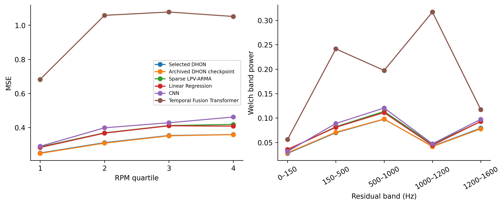
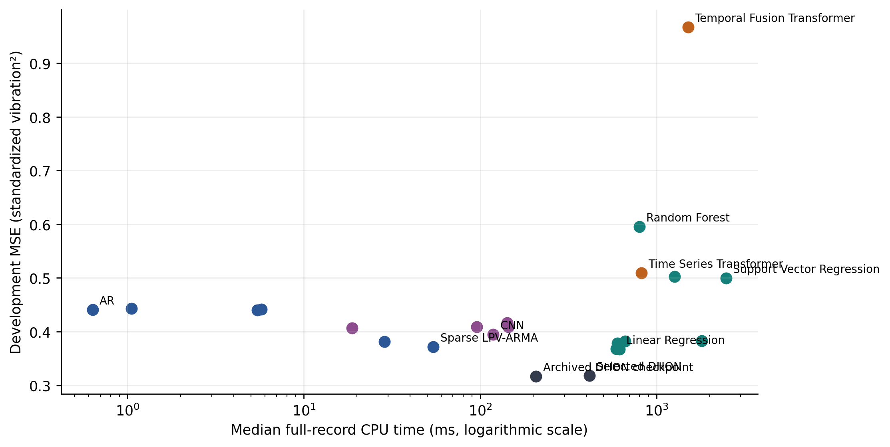
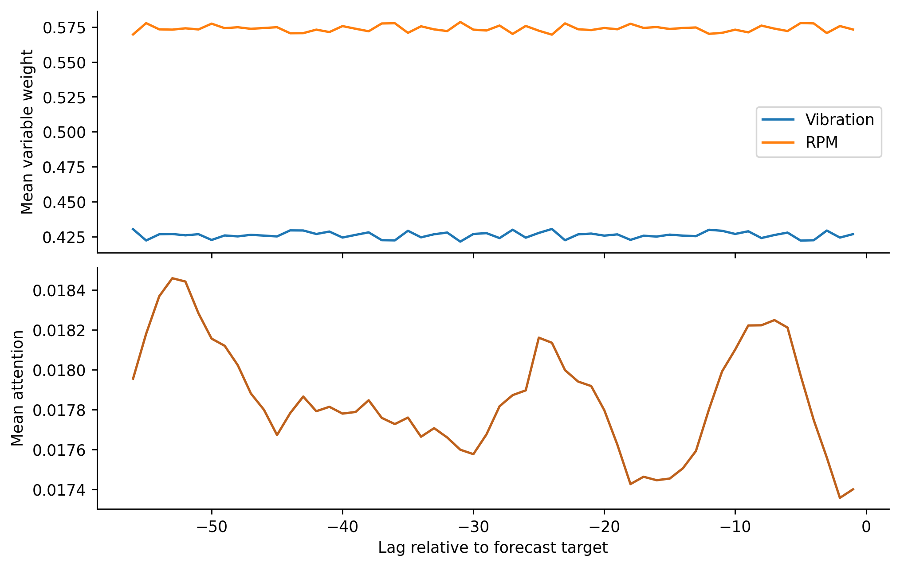

# Results and interpretation

The selected DHON replay scored **0.318626** on 22,208 official development targets. The strongest newly
tuned model on this record was **Linear Regression** (0.367386).
**Lasso Regression** had the lowest comparable guarded-training MSE among newly tuned families
(0.405680), then scored 0.378298 on official development. This difference
between rankings is important because selecting across families with official validation would use the
development acquisition as tuning data. CNN was the best of the matched patched neural group
on this development record (0.394638).

All 21 requested families are in the table. Nineteen had a new guarded search and full-training fit.
The two sparse LPV methods had fresh coefficient refits on prior guarded supports. The three DHON
references are the previous primary checkpoint, the strongest runnable archived checkpoint, and the
strongest saved archived forecasts. The primary scored 14.21% lower MSE
than sparse LPV-ARMA. The replayable archived checkpoint (0.316889) and forecast-only anchor
(0.316445) remain lower than primary DHON. The external published LPV-ARMA value 0.2893
comes from a different segment and is not in this ranking.

| Model | Guarded MSE | Train MSE | Dev MSE | Dev MAE | CPU ms |
| --- | --- | --- | --- | --- | --- |
| Archived DHON forecasts | — | — | 0.31644 | 0.44873 | — |
| Archived DHON checkpoint | — | 0.29733 | 0.31689 | 0.44791 | 207.44179 |
| Selected DHON | — | 0.29554 | 0.31863 | 0.44904 | 416.15648 |
| Linear Regression | 0.43945 | 0.34699 | 0.36739 | 0.48235 | 615.64063 |
| Ridge Regression | 0.41350 | 0.34903 | 0.36806 | 0.48273 | 591.20492 |
| Sparse LPV-ARMA | — | 0.34776 | 0.37141 | 0.48352 | 54.26129 |
| Lasso Regression | 0.40568 | 0.36047 | 0.37830 | 0.48944 | 600.37304 |
| Sparse LPV-AR | — | 0.34899 | 0.38150 | 0.49046 | 28.63666 |
| Elastic Net | 0.40578 | 0.36426 | 0.38220 | 0.49192 | 663.94124 |
| NARX | 0.43092 | 0.32596 | 0.38315 | 0.49199 | 1802.73655 |
| CNN | 0.44371 | 0.35289 | 0.39464 | 0.49736 | 118.68891 |
| MLP | 0.45115 | 0.35506 | 0.40642 | 0.50532 | 18.74918 |
| TCN | 0.44057 | 0.37900 | 0.40858 | 0.50517 | 144.74637 |
| LSTM | 0.43145 | 0.38743 | 0.40881 | 0.50725 | 95.82076 |
| GRU | 0.43708 | 0.39560 | 0.41606 | 0.51069 | 142.08527 |
| ARIMA | 0.46456 | 0.43388 | 0.44007 | 0.52543 | 5.45447 |
| AR | 0.46189 | 0.43255 | 0.44057 | 0.52564 | 0.63391 |
| ARMA | 0.46332 | 0.43323 | 0.44171 | 0.52621 | 5.72670 |
| ARX | 0.46121 | 0.43244 | 0.44320 | 0.52731 | 1.04989 |
| Support Vector Regression | 0.49981 | 0.43139 | 0.49937 | 0.56244 | 2482.01270 |
| Gradient Boosting | 0.48853 | 0.31436 | 0.50251 | 0.56380 | 1263.14689 |
| Time Series Transformer | 0.51531 | 0.47816 | 0.50939 | 0.56518 | 819.28630 |
| Random Forest | 0.57588 | 0.35777 | 0.59516 | 0.61099 | 797.62165 |
| Temporal Fusion Transformer | 0.95592 | 0.92134 | 0.96710 | 0.77723 | 1510.98496 |

Guarded rows are **378** across the new experiments (attention: 12 fold rows; neural: 45 fold rows; statistical: 147 fold rows; tabular: 174 fold rows), including candidates
retained as evidence but excluded by solver or inversion checks. Sparse LPV guarded comparisons refer
to the earlier experiment and are left blank in this column. CPU time is the median of seven calls on
a 7.5-second record from a loaded predictor. Fault diagnostic computation ran separately on the shared host during the benchmark. Train MSE is an in-sample diagnostic and is not a
generalization estimate.

## Paired error and operating conditions

| Comparator | MSE minus DHON | 95% low | 95% high |
| --- | --- | --- | --- |
| Linear Regression | 0.048760 | 0.043159 | 0.054206 |
| Sparse LPV-ARMA | 0.052780 | 0.046986 | 0.059294 |
| CNN | 0.076012 | 0.066889 | 0.087096 |
| Archived DHON forecasts | -0.002181 | -0.004530 | 0.000057 |

Intervals use the predeclared 640-sample moving-block design. The CSV also contains sensitivity to block
lengths of 320 and 1,280 samples. Confidence estimates are for this acquisition and comparisons are
exploratory across multiple families.

## What the model ranking suggests

- The selected physics-aware Linear and Ridge regressions are stronger than classical lag-only AR,
  conditional ARMA or additive ARX on official development. These differences combine representation
  and estimation. A time-only method can be cheaper and useful when RPM is absent.
- The guarded Lasso and Elastic Net performed strongly on the internal folds. The best official
  development score came from a different regularization choice and feature library. Fit on one
  acquisition and evaluate on another before attributing performance to shrinkage alone.
- The selected NARX adds a tanh residual learner to a physics-conditioned ridge predictor.
  Its development score does not establish a gain from nonlinearity over the independently tuned
  linear/ridge models. The exact selection metadata distinguish their input libraries and regularization.
- The matched five-neural-model suite preserves a raw-lag shortcut across heads. Transformer and TFT
  use distinct configurations and training row strides. Their errors show limited performance under these
  specific configurations and resource budgets. TFT performs poorly even in-sample, so the result
  does not establish an architecture-wide generalization penalty or a definitive upper performance limit.
- Prior DHON controlled comparisons isolated an adapter benefit (+0.014029 MSE when removed)
  and a much smaller learned-state benefit (0.000148 over fixed oscillator states). Those controls
  are stronger attribution evidence than rank-based comparisons with unrelated model families.

## Inference trade-offs and operating variation

The table gives the empirical non-dominated rows for clean development error and loaded CPU batch time.
A row is dominated if another runnable model is at least as accurate and fast with a strict advantage
on either metric. Forecast-only archived arrays have no latency and are excluded.

| Model | MSE | Median CPU ms |
| --- | --- | --- |
| AR | 0.44057 | 0.63391 |
| ARIMA | 0.44007 | 5.45447 |
| MLP | 0.40642 | 18.74918 |
| Sparse LPV-AR | 0.38150 | 28.63666 |
| Sparse LPV-ARMA | 0.37141 | 54.26129 |
| Archived DHON checkpoint | 0.31689 | 207.44179 |

The following regional winners are descriptive. It is invalid to pick a different predictor for each
validation stratum and then report the resulting composite as independent performance.

| Operating region | Lowest MSE among new fits | MSE |
| --- | --- | --- |
| chronological_block_1 | Ridge Regression | 0.27837 |
| chronological_block_2 | Linear Regression | 0.33707 |
| chronological_block_3 | Linear Regression | 0.42428 |
| chronological_block_4 | Linear Regression | 0.39904 |
| chronological_block_5 | Linear Regression | 0.39912 |
| chronological_block_6 | Linear Regression | 0.36429 |
| nonrising_rpm | Linear Regression | 0.38305 |
| rising_rpm | Linear Regression | 0.35647 |
| rpm_quartile_1 | Ridge Regression | 0.28254 |
| rpm_quartile_2 | Linear Regression | 0.36738 |
| rpm_quartile_3 | Linear Regression | 0.41032 |
| rpm_quartile_4 | Linear Regression | 0.40839 |

## Fault diagnostics and robustness

The fixed screen used one record every five in MATLAB order, plus the separately documented overlap audit record 63. Raw vibration and all 23 runnable predictors share the subset. A separate scan used all 200 records for the previous DHON, replayable archived DHON, sparse LPV-ARMA and lowest-guarded-MSE new model (Lasso), plus raw. The A/B index grouping is provisional. Acquisitions 61 and 63 are excluded from the summaries.

### Screen diagnostics

| Signal/model | Median A | Median B | B−A | Conditional AUC |
| --- | --- | --- | --- | --- |
| raw | 0.1048 | 0.0849 | -0.0199 | 0.2579 |
| AR | 0.0742 | 0.1104 | 0.0362 | 0.9947 |
| ARMA | 0.0723 | 0.1077 | 0.0354 | 0.9947 |
| ARIMA | 0.0735 | 0.1097 | 0.0362 | 0.9974 |
| ARX | 0.0750 | 0.1099 | 0.0348 | 0.9947 |
| Sparse LPV-AR | 0.0337 | 0.1035 | 0.0698 | 1.0000 |
| Sparse LPV-ARMA | 0.0404 | 0.1050 | 0.0646 | 1.0000 |
| Linear Regression | 0.0343 | 0.1130 | 0.0788 | 1.0000 |
| Ridge Regression | 0.0350 | 0.1114 | 0.0763 | 1.0000 |
| Lasso Regression | 0.0373 | 0.1162 | 0.0789 | 1.0000 |
| Elastic Net | 0.0374 | 0.1158 | 0.0784 | 1.0000 |
| Support Vector Regression | 0.0429 | 0.1032 | 0.0603 | 1.0000 |
| Random Forest | 0.0610 | 0.0917 | 0.0308 | 0.9632 |
| Gradient Boosting | 0.0387 | 0.0941 | 0.0553 | 1.0000 |
| NARX | 0.0345 | 0.1112 | 0.0767 | 1.0000 |
| MLP | 0.0545 | 0.1078 | 0.0533 | 1.0000 |
| LSTM | 0.0579 | 0.1059 | 0.0480 | 1.0000 |
| GRU | 0.0553 | 0.1059 | 0.0506 | 1.0000 |
| CNN | 0.0461 | 0.0968 | 0.0507 | 1.0000 |
| TCN | 0.0548 | 0.1062 | 0.0514 | 1.0000 |
| Time Series Transformer | 0.0831 | 0.1268 | 0.0437 | 0.9921 |
| Temporal Fusion Transformer | 0.0798 | 0.0837 | 0.0039 | 0.5737 |
| Selected DHON | 0.0294 | 0.1356 | 0.1062 | 1.0000 |
| Archived DHON checkpoint | 0.0284 | 0.1307 | 0.1023 | 1.0000 |

### Full diagnostics

| Signal/model | Median A | Median B | B−A | Conditional AUC |
| --- | --- | --- | --- | --- |
| raw | 0.0971 | 0.0885 | -0.0086 | 0.3643 |
| Sparse LPV-ARMA | 0.0401 | 0.1127 | 0.0726 | 1.0000 |
| Lasso Regression | 0.0372 | 0.1192 | 0.0820 | 1.0000 |
| Selected DHON | 0.0289 | 0.1356 | 0.1066 | 1.0000 |
| Archived DHON checkpoint | 0.0281 | 0.1338 | 0.1057 | 1.0000 |

Compute angular position by trapezoidal RPM integration, then interpolate residuals onto a 2,048-point/revolution grid. The Hilbert envelope is centered. For centered envelope $b$, the finite sample ratio is $r(k)=\sum_j b_jb_{j+k}/\sum_j b_j^2$ and PMI is $r/(1-r)$. The primary mode uses the instructor's lag-2,047 indexing and the mathematical correction uses lag 2,048. The unrelated 0.63-turn lag is a specificity check. Scores are threshold-free because no confirmed label or calibration file was available.

The stress comparison applies six fixed RPM perturbations separately to the predictor and the diagnostic angle reconstruction, and jointly to both. Pulse trials compare paired residuals with and without synthetic periodic and aperiodic injections. These controlled inputs probe sensitivity and preservation, with limited evidence about actual crack severity.

| Model | Clean MSE | Mean stress MSE | Worst MSE |
| --- | --- | --- | --- |
| Selected DHON | 0.3186 | 0.3731 | 0.4728 |
| Archived DHON checkpoint | 0.3169 | 0.3642 | 0.4525 |
| Sparse LPV-ARMA | 0.3714 | 1.4351 | 6.5548 |
| Lasso Regression | 0.3783 | 0.3987 | 0.4356 |
| Linear Regression | 0.3674 | 4.2103 | 21.8794 |
| Ridge Regression | 0.3681 | 0.3911 | 0.4333 |
| CNN | 0.3946 | 0.3988 | 0.4120 |
| Temporal Fusion Transformer | 0.9671 | 0.9674 | 0.9710 |

Linear Regression and Ridge selected the same physics library. Their clean errors were 0.367386 and 0.368059, while their worst errors were 21.879433 and 0.433301. The matched library and large divergence under stress support regularization as a practical robustness control on this acquisition. It does not prove either model is robust to all out-of-distribution sensor failures.

| model | kind | cases | positive pmi | median correlation | median pmi delta | median energy retention |
| --- | --- | --- | --- | --- | --- | --- |
| Sparse LPV-ARMA | periodic | 4 | 2 | 0.6801 | 0.0005 | 1.2294 |
| Sparse LPV-ARMA | aperiodic | 2 | 2 | 0.7289 | 0.0007 | 0.9285 |
| Lasso Regression | periodic | 4 | 4 | 0.7206 | 0.0007 | 1.1819 |
| Lasso Regression | aperiodic | 2 | 2 | 0.7712 | 0.0006 | 0.9050 |
| Selected DHON | periodic | 4 | 4 | 0.5722 | 0.0020 | 1.6804 |
| Selected DHON | aperiodic | 2 | 1 | 0.6102 | 0.0002 | 1.2656 |
| Archived DHON checkpoint | periodic | 4 | 3 | 0.5672 | 0.0021 | 1.7413 |
| Archived DHON checkpoint | aperiodic | 2 | 1 | 0.6120 | -0.0000 | 1.2814 |

## Scope of verification

Retain all target predictions for independent numerical rescoring, and all numeric checkpoint arrays
for independent replay. The shared causal perturbation changes RPM and vibration together at scoring
index 12,375. Forecasts through that target must agree with the original record within numerical
tolerance. The frozen run records checkpoint hashes and preserves the target and input ordering.
Blind results are reserved for sigtest and sigfault2. A missing-input preflight records their availability.
No diagnosis threshold or blind score is inferred from the development results.
