# Physics-Informed Structured Reservoir Computing for gearbox vibration

*A study and reproduction guide for MECG 7780 Engineering Data Analytics*

This companion develops a causal predictor of standardized gearbox vibration from measured history. It derives the physical representation, shows how the numerical design follows from the equations, and teaches how to audit the experiment. The prediction and fault-detection questions share a fitted baseline but use different evidence. A useful prediction model reduces healthy-vibration uncertainty. A useful diagnostic also preserves information about a periodic fault in the residual.

## Contents

- [1. Research motivation and the course task](#1-research-motivation-and-the-course-task)
- [2. Gear geometry, loading, and vibration](#2-gear-geometry-loading-and-vibration)
- [3. Measurement, sampling, and units](#3-measurement-sampling-and-units)
- [4. Prediction from dependent observations](#4-prediction-from-dependent-observations)
- [5. Linear algebra, shrinkage, and numerical validation](#5-linear-algebra-shrinkage-and-numerical-validation)
- [6. Experimental design under time dependence](#6-experimental-design-under-time-dependence)
- [7. Structured Reservoir Computing](#7-structured-reservoir-computing)
- [8. Mathematical anatomy of the SRC model](#8-mathematical-anatomy-of-the-src-model)
- [9. RPM conditioning and rotating-machine feature families](#9-rpm-conditioning-and-rotating-machine-feature-families)
- [10. Fourier, order, and envelope analysis](#10-fourier-order-and-envelope-analysis)
- [11. Causal shaft angle and finite oscillator states](#11-causal-shaft-angle-and-finite-oscillator-states)
- [12. Innovations and slow correction](#12-innovations-and-slow-correction)
- [13. Intake and partition checks](#13-intake-and-partition-checks)
- [14. Physics-informed exploratory analysis](#14-physics-informed-exploratory-analysis)
- [15. Configuration, fitting, and checkpoint identity](#15-configuration-fitting-and-checkpoint-identity)
- [16. Joint optimization and evidence interpretation](#16-joint-optimization-and-evidence-interpretation)
- [17. Twenty-one comparator families](#17-twenty-one-comparator-families)
- [18. Evaluation metrics, timed scope, and uncertainty](#18-evaluation-metrics-timed-scope-and-uncertainty)
- [19. Fault detection from causal residuals](#19-fault-detection-from-causal-residuals)
- [20. Robustness and ablation as controlled experiments](#20-robustness-and-ablation-as-controlled-experiments)
- [21. The lecturer’s sparse time-variation reference](#21-the-lecturers-sparse-time-variation-reference)
- [22. Numerical software engineering and reproducibility](#22-numerical-software-engineering-and-reproducibility)
- [23. Interpreting the actual experimental evidence](#23-interpreting-the-actual-experimental-evidence)
- [24. Writing and presenting defensible engineering results](#24-writing-and-presenting-defensible-engineering-results)
- [25. Worked exercises, troubleshooting, and notation](#25-worked-exercises-troubleshooting-and-notation)
- [Appendix A. Worked laboratory sessions](#appendix-a-worked-laboratory-sessions)
- [Generated evidence appendix](#generated-evidence-appendix)
- [Notebook and artifact crosswalk](#notebook-and-artifact-crosswalk)
- [References and reading roadmap](#references-and-reading-roadmap)

## Reading map

- New to the subject? Read Chapters 1–7, then work through the examples in Chapter 25.
- Building or modifying features? Work through Chapters 8–12 and use the causal tests before running a search.
- Reproducing the experiments? Follow Chapters 13–16 and 22 with Notebooks 00–05 first.
- Interpreting the comparison? Read Chapters 17–21 and 23 beside Notebooks 06–10.
- Preparing to explain the work? Use Chapter 24 and the question sets, glossary, and evidence index in Chapter 25.

Notation and values used in examples are identified as analytical, illustrative, or measured. See the [results appendix](#generated-evidence-appendix) for values generated from the completed run.

## 1. Research motivation and the course task

A gearbox transfers rotation and torque between shafts through periodic tooth engagement. In a healthy gearbox, vibration already contains substantial periodic and nonperiodic components. Transmission error, changes in contact stiffness, loading, and structural response can produce vibration that is large compared with a local damage signature. If the machine changes speed, the period of tooth engagement changes in samples. Simple thresholding on raw amplitude may therefore react to operating condition rather than damage.

The project uses a baseline model trained on a designated recording. At time sample $t$ it predicts $x_t$ from past measured vibration, measured operating history, and a bounded state built from those observations. Its error $e_t=x_t-\hat x_t$ is available once sample $t$ is measured. These errors are later analyzed for modulation synchronized with a shaft revolution. No classification label is required for the predictor fit. Diagnostic claims still depend on independently establishing the meaning of the analysis groups.

The course asks whether past vibration predicts the present, encourages using speed as context, and requires MSE, computation time, and fault detection. These are separate objectives. A dense model that minimizes MSE while suppressing a fault signature may be unhelpful for monitoring. A high-quality project reports the joint evidence, including cases where a simpler model wins one criterion. The course weights organization and presentation, clarity, performance, and novelty. For the final component, the corresponding weights are 16%, 16%, 32%, and 16% of the overall project. Progress assessment accounts for the remaining 20%. Evaluation criteria are reasons to communicate evidence clearly. They do not justify optimizing on held-out data or declaring success without a measured comparison.

### 1.1 Testable questions

**Predictive question.** Does the primary PI-SRC pipeline reduce mean squared error compared with a sparse speed-conditioned autoregressive moving-average model on identical measured targets? The committee should be able to reconstruct this difference by opening a saved forecast and subtracting it from the aligned observed signal.

**Representation question.** Do angular delays and structured oscillator interactions improve prediction after controlling for linear readout capacity and causal correction? This needs paired designs with one named feature group changed at a time. If a bundled configuration changes six groups, any advantage belongs to the bundle.

**Attribution question.** How much of the final change is due to a slow average of past error? Applying the same adapter to a physics-free control checks whether that adjustment accounts for the observed improvement. The adapter sees past observations that naturally arrive in a conditional one-step deployment.

**Diagnostic question.** Do the model residuals retain shaft-synchronous modulation under periodic pulse injection and across provisional record groups? Interpreting a visibly separated pair of groups as a laboratory classification result additionally requires acquisition labels and independent grouped testing.

**Efficiency question.** What wall time is required to process a full measured record under a documented hardware and thread protocol? Batch processing and single-sample streaming impose different computational constraints. Timing includes exactly the stages defined by its log.

### 1.2 Project information flow

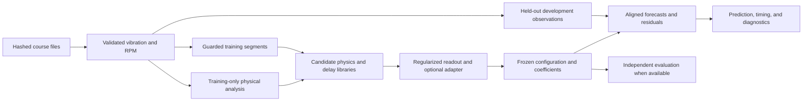

Document conclusions in that order. Physical analyses suggest candidate inputs. Guarded validation ranks admissible configurations. A committed holdout measures the fitted procedure. Diagnostics use residuals and their own inclusion and timing conventions. A result acquired later cannot justify an earlier selection rule.

## 2. Gear geometry, loading, and vibration

### 2.1 Speed ratio and the tooth-passing clock

Suppose the monitored 37-tooth gear rotates at $n(t)$ rpm and drives a 20-tooth pinion. Let $u$ be input shaft revolutions and $\theta=2\pi u$. Tooth contact requires the same number of teeth to pass the mesh from each wheel per unit time, hence

$$
\left|f_{\mathrm{pinion}}(t)\right|=\frac{37}{20}f_{\mathrm{input}}(t),\quad
f_{\mathrm{input}}(t)=\frac{n(t)}{60},\quad
f_{\mathrm{mesh}}(t)=37\frac{n(t)}{60}. \tag{1}
$$

The pinion rotates opposite to the input gear for an external mesh; its signed rotation depends on the chosen axes. Both wheels contribute to one tooth-passing event. Multiplying the pinion frequency by 20 returns the same mesh frequency. Input-shaft orders describe cycles per input revolution. Mesh order is 37 and its second harmonic order is 74. A period tied to one pinion revolution lies at input-shaft order $37/20$. Before interpreting an order, verify which shaft the recorded RPM represents in the measurement documentation.

**Worked example.** At 150 rpm, the input gear turns at 2.50 Hz, the pinion at 4.625 Hz, and the mesh frequency is 92.5 Hz. At 3,200 Hz, there are $3,200/92.5=34.59$ samples per mesh cycle and 1,280 samples per input revolution. A two-mesh-cycle delay is about 69 samples in this example. At 124 rpm it is about 84 samples. A fixed 69-sample lag loses phase alignment when speed falls.

### 2.2 Forces and transfer paths

Teeth deform under contact load and the number of teeth sharing load changes over a meshing cycle. Manufacturing errors and eccentricity can perturb transmission error, the small deviation from ideal gear ratio at each instant. Both processes can excite periodic forces at or around mesh harmonics. The sensor records the resulting movement after transmission through shafts, bearings, and casing, combined with environmental and measurement contributions. Distinct frequencies in the forcing and transfer path can overlap. A narrow peak is evidence of energy concentrated at one frequency in that measurement, and an identification of the underlying structural mode requires a separate excitation or identification experiment.

One useful local physical idealization is a forced linear oscillator,

$$
m\ddot q+c\dot q+kq=F(t),\qquad
\omega_n=\sqrt{k/m},\qquad \zeta=\frac{c}{2\sqrt{km}}. \tag{2}
$$

Here $q$ has displacement units, $m$ is mass, $c$ is viscous damping, and $k$ is stiffness. The underdamped homogeneous envelope decreases as $e^{-\zeta\omega_n t}$. A fitted exponential memory in a predictor has a similar mathematical shape. Its time constant is an effective representation setting that interacts with measured forcing, window support, and regression penalties. Predictive fitting alone cannot identify $m$, $c$, and $k$. The project uses the oscillator state as a causal summary, with information and units described in Chapter 11.

An accelerometer measures acceleration at its mounting point and along a direction. For a sinusoidal displacement $A\cos(2\pi f t)$, acceleration amplitude is $(2\pi f)^2 A$. Consequently a vibration signal can give comparatively large acceleration weight to high-frequency modes. Sensor mounting and anti-alias filtering also alter the observed frequency response. A good time-domain baseline does not recover the gear displacement directly from a normalized acceleration trace.

### 2.3 Local defects, amplitude modulation, and sidebands

If a tooth crack changes stiffness predominantly when the affected tooth is under load, one recurring engagement can disturb each revolution of that gear. The disturbance can be modeled as a periodic sequence in shaft angle carrying a short damped oscillation. Speed variations make this sequence irregular in seconds, while timing in input revolutions can be much more stable when the defect rotates with that gear. Jitter, amplitude variation, multiple defects, dynamic load, and operating transitions can weaken the periodic modulation.

A simple amplitude-modulated component illustrates sidebands. Multiplying $\cos(2\pi f_c t)$ by $1+\eta\cos(2\pi f_m t)$ gives the carrier and two sidebands at $f_c\pm f_m$ with amplitude $\eta/2$ times the carrier, by $\cos a\cos b=(\cos(a+b)+\cos(a-b))/2$. If modulation and carrier are both tied to shaft speed, the corresponding offsets are stable in orders while their Hertz values move over time. Sidebands can also appear in normal operation, for example from eccentricity. Their presence is a hypothesis-generation clue. Comparisons with known condition records, repeated runs, and physical reasoning are needed for diagnostic attribution.

### 2.4 How to read the physics units

Use rev/s for shaft frequency, Hz for physical frequency, cycles/revolution for order, radians for the argument of a trigonometric function, and seconds or samples for decay memory. The same symbol $\omega$ is sometimes used for angular speed in rad/s and for RPM in papers. This guide uses $n$ for RPM and $2\pi n/60$ for angular speed. A factor $2\pi$ error rotates quadratures incorrectly and is easy to miss when a high-capacity readout compensated for the wrong feature on one record. A constant-speed worked example should always precede feature tuning.

## 3. Measurement, sampling, and units

### 3.1 The time grid and aliasing

For sampling rate $f_s$, $\Delta t=1/f_s$. A nominal $f_s=3{,}200$ Hz implies $\Delta t=0.3125$ ms and Nyquist frequency 1,600 Hz. A sampled sine with analogue frequency $f$ and one at $f+kf_s$ produce discrete phase sequences differing by integer multiples of $2\pi$. Once sampled, they cannot be distinguished by inspecting those sequences. Energy folded into the band by insufficient filtering is an acquisition problem. Fitting a model later can describe the observed alias but cannot recover the original underlying frequency uniquely.

The journal describes acquiring at 25.6 kHz and applying low-pass filtering before downsampling to 3.2 kHz. The final project files are already on the 3.2-kHz grid. Reapplying an arbitrary filter would change the target values and benchmark task. The supplied records support grid verification from $t$, frequency checks from the sampled signal, and contextual documentation of source preprocessing. Verification of an exact analogue filter or calibration chain requires source metadata beyond the sampled arrays.

The Nyquist bound on input-shaft order at speed $n$ is

$$
k_{\mathrm{ord,max}}(n)=\frac{f_s/2}{n/60}. \tag{3}
$$

At 167 rpm this is about 575 cycles/rev. A bank of 12 mesh harmonics extends to order 444, or about 1,236 Hz at this speed. Orders near the clearance threshold need extra caution if the evaluated RPM is perturbed, the band is broad, or a requested extrapolation exceeds the observed operating range. Check the maximum RPM of the actual source and the planned perturbations. No argument based on a typical speed guarantees validity over every record.

### 3.2 Observation and transduction errors

An accelerometer signal may include broadband electronic noise, mounting response, drift, quantization and low-frequency motion. A speed channel may be estimated from tach pulses, sample-held, interpolated from lower-rate observations, or delayed by processing. The course files expose RPM values on the vibration grid but do not provide a full encoder synchronization specification. The conservative primary predictor uses RPM through sample $t-1$. Offline analyses may use all samples to map an already measured signal onto angle.

Inspect finite values before fitting. Duplicates in timestamps can invalidate differentiation and interpolation, while dropouts can break monotonic angular integration. Speed units must be explicit. An RPM trace near 150 means roughly 2.5 rev/s, compatible with 25 turns in 10 seconds. Interpreting the same numbers as rev/s would imply around 1,500 turns, moving gear-mesh lines far above the sampled band.

Measurement diagnostics should not overinterpret short segments. Very few exact extrema can rule out obvious repeated saturation plateaus and reveal an absence of one common clipping symptom. They cannot guarantee that clipping never occurred upstream. Narrowly clustered speed values are consistent with tightly controlled operation; they provide little information about high-load or substantially different speed regimes.

### 3.3 Standardized signal scale

If raw acceleration $a_t$ has a verified factor $s$, standardized vibration may be formed by

$$
x_t=\frac{a_t-\mu}{s},\qquad
\mathrm{MSE}_a=s^2\mathrm{MSE}_x. \tag{4}
$$

The second identity holds for the same targets and affine transformation. The mean cancels in errors and the scale is squared. If $a_t$ is in m/s², its MSE is in $(\mathrm{m/s^2})^2$. Metadata and the raw field can establish the affine transformation, while they may leave the absolute sensor calibration units uncertain. Do not normalize each fault recording independently. That would erase amplitude information across acquisitions and could remove diagnostic evidence.

Numerically, use the supplied standardized vibration to preserve score parity. Any extra feature scaling belongs inside each fold. Feature scaling differs from target rescaling: the same model predictions can be returned in the standardized target coordinate while inputs to the least squares are centered and normalized for conditioning. Save the fitted locations and scales beside weights because they are necessary for portable inference.

### 3.4 Acquisition and preprocessing map

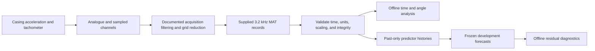

The branch at validation is important. Offline explanatory transforms may see the full record. Rolling prediction features stop immediately before the target. Treating a full-record FFT coefficient, Hilbert envelope, or centered smoothing output at $t$ as a causal covariate can accidentally encode the very signal the model should predict.

## 4. Prediction from dependent observations

### 4.1 Conditional one-step task

For past-information set $\mathcal I_{t-1}$ define

$$
\hat x_t=\mathrm E[x_t\,|\,\mathcal I_{t-1}]\quad\text{as a squared-error target},\qquad
e_t=x_t-\hat x_t. \tag{5}
$$

The actual fitted function approximates the conditional expectation over a finite feature family. At target $t$ the information set includes earlier observed vibration and any earlier measured RPM selected by the method. At target $t+1$, measured $x_t$ belongs to the history. Supplying $\hat x_t$ instead changes the procedure to a free-running forecast with possible error accumulation. Compare such a procedure in a separate study. Compensation from previous observed errors is admissible for Eq. (5) when the physical sensor is continuously available.

A simple baseline is persistence, $\hat x_t=x_{t-1}$. A fast-oscillating waveform can make this baseline particularly poor if adjacent samples often have opposite signs. That result reflects the phase evolution of the measured trace. More context can help interpolate the next phase even if the physical noise realization remains unpredictable.

### 4.2 Stationarity and lag statistics

A weakly stationary process has constant mean and variance and covariance that depends on lag rather than absolute time. Changing speed makes the period in samples time-varying, so a constant-lag covariance estimated from the whole record averages over differing conditions. A lag autocorrelation can therefore be small globally even when a similar waveform repeats under angle alignment. This motivates both speed-conditioned predictions and resampling for descriptive analysis.

The partial autocorrelation at lag $j$ measures linear association between the current and lag-$j$ sample after regressing each on the intervening samples. A finite-order AR model has a theoretical PACF cutoff under assumptions of stationarity and white innovation. In this dataset, an empirical PACF is a memory diagnostic. It does not identify an exact physical memory horizon. Inspect autocorrelation alongside speed-stratified lag behavior and guarded prediction results.

### 4.3 Statistical model hierarchy

For measured vibration lags and innovations, the coefficient convention in this guide is

$$
\hat x_t=b+\sum_{j=1}^p a_j x_{t-j}+\sum_{h=1}^q c_h\epsilon_{t-h}. \tag{6}
$$

AR uses $q=0$. ARMA keeps both lag blocks. Conditional one-step ARMA requires a convention for reconstructing earlier $\epsilon$ values, often a recursion initialized to zero and warmed up. Invertibility relates to how those initial errors decay. Explicit finite replacement must be validated against the full conditional recursion to show acceptable numerical tails. Neither a long warm-up nor numerical closeness justifies including current $\epsilon_t$.

ARIMA models a differenced signal. For $d=1$, $v_t=x_t-x_{t-1}$; predict $v_t$ from its history and return $\hat x_t=x_{t-1}+\hat v_t$. Score on the common standardized level signal. Differencing can stabilize certain slow trends but may unnecessarily amplify high-frequency noise. ARX adds measured exogenous lags such as RPM. LPV scheduling goes further by changing the coefficients multiplying vibration lags with speed. A fixed additive RPM term cannot reproduce an arbitrary RPM-dependent AR coefficient. NARX allows nonlinear feedback and exogenous interactions. A one-step implementation still uses observed previous vibration as feedback.

### 4.4 Causal innovation example

Take $a_1=0.8$, $c_1=0.25$, and previous actual $x_{t-1}=1.4$. Suppose the predictor at $t-1$ returned $1.0$. Then the available innovation is $0.4$, and Eq. (6) gives $1.12+0.10=1.22$. Only after x at $t$ is observed can the next innovation be known. A test that changes $x_t$ and all later values while requiring prediction at $t$ to remain unchanged checks this timing claim directly.

## 5. Linear algebra, shrinkage, and numerical validation

### 5.1 Designing the matrix

A regression row must correspond to one target index. For lags $\{1,3,6\}$, row $t$ contains $[x_{t-1},x_{t-3},x_{t-6}]$. Adjacent rows share much of their underlying information even when individual columns are distinct. Add an intercept to represent the level. A convenient implementation centers each feature using fit rows, centers the target, fits slope coefficients, and restores the target mean when scoring. A column with nearly zero variance is a poorly supported direction and needs a variance floor or removal according to the implementation.

Let $A\in\mathbb R^{N\times P}$ and $y\in\mathbb R^N$. Ordinary least squares minimizes $\|y-Aw\|_2^2$. Under full column rank, the normal equations are $A^TAw=A^Ty$. Computing the inverse of $A^TA$ explicitly is unnecessary. QR solves the triangular system in a numerically stable way; SVD offers a rank and singular-spectrum diagnostic. An unfortunate near-collinearity among delayed vibration, angle histories, and quadratures can make $A^TA$ nearly singular. Its condition number squares the condition number of $A$ in the full-rank case. Use a stable decomposition, carefully controlled regularization, and recorded rank or conditioning evidence.

### 5.2 Ridge, Lasso, and Elastic Net

With centered scale-normalized features and an unpenalized intercept, ridge minimizes

$$
\frac12\|y-Aw\|_2^2+\frac12\lambda\|w\|_2^2,\quad
(A^TA+\lambda I)w=A^Ty. \tag{7}
$$

For positive $\lambda$, the system is positive definite barring numerical or input faults. In the right singular directions, ridge reduces amplification associated with small singular values. A group-ridge variant replaces $\lambda I$ with a positive diagonal assigning different penalties by physics feature group. An interaction coefficient needs more shrinkage when its effective support is scarce or when it encodes a high-capacity library of weakly identified directions. Relative penalties should be stated with their objective scaling and with feature normalization.

Lasso minimizes $\|y-Aw\|_2^2/(2N)+\lambda\|w\|_1$ in one common software convention. Its nonsmooth penalty may produce exact zeros. Elastic Net uses a convex mixture of squared $\ell_2$ and $\ell_1$ penalties, often helpful for correlated groups. A numerical value of $\lambda$ cannot be compared across objectives with different denominators. The same L1 penalty value in unnormalized and $1/N$ loss conventions can differ by orders of magnitude. The solver log should state convergence or the dual gap. A capped, unconverged coefficient vector is evidence of a numerical limitation. It is weaker evidence for claiming a selected sparse support.

For a single orthogonal standardized feature, normalized soft thresholding gives $w=\operatorname{sign}(s)(|s|-\lambda)_+$, where $s=A^Ty/N$. If $s=0.3$ and $\lambda=0.05$, the coefficient is 0.25. On correlated features, coordinates interact. Small changes in penalty may switch between correlated columns while leaving overall predictions similar. This is why individual coefficient magnitudes and selection frequencies deserve cautious interpretation.

### 5.3 Readout capacity and effective complexity

In classical ridge for fixed $A$, the effective degrees of freedom are $\sum_i \sigma_i^2/(\sigma_i^2+\lambda)$. This can be lower than the stored coefficient count, especially when some directions are strongly penalized. Capabilities of a tree ensemble, SVR, and recurrent neural model cannot be equated by one parameter number. Tree node storage has split and routing fields; SVR includes support-vector coordinates and kernel coefficients; a model using proxy innovations needs both stage-one and stage-two parameters. Report each counting convention and compressed checkpoint bytes as complementary measurements.

Akaike’s information criterion for a Gaussian residual approximation compares models using $N\log(\hat\sigma^2)+2k$ up to constants. Bayesian information criterion substitutes $k\log N$ for the penalty term. Keep the response and sample mask the same when comparing orders. Unknown effective complexity and correlated errors limit a literal probabilistic reading. AIC may screen candidate architecture sizes, while the common guarded-fold target error determines the engineering comparison.

## 6. Experimental design under time dependence

### 6.1 What a model hyperparameter is

A parameter is estimated by minimizing the chosen training loss at a fixed configuration, such as a ridge coefficient. A hyperparameter shapes that problem, such as penalty, lag length, oscillator bank, or kernel width. Physics prior choices can be selected by reviewing training-only EDA and a defined search range. The fitted readout and the selected physical feature configuration must both be committed before inspecting a final held-out test outcome.

A common source of confusion is to describe reduced fold loss as better generalization. Guarded folds measure performance within an observed training source under a chosen withholding protocol. When the folds share an acquisition, they share machinery, speed excursion, sensor chain and autocorrelation. The multiple fold scores provide informative sensitivity across segments, with limited evidence for deployment on a new machine.

### 6.2 Time masks and the guard

For fold bounds $[a,b)$, remove the evaluation interval and its guard from model fitting. With guard $G$, admissible training raw segments are $[0,a-G)$ and $[b+G,N)$. Reinitialize state within each segment. Score target $t$ on a measured prefix through the held-out block with the same past-history convention as deployment. The training matrices and scalers access fit segments only. For constant finite support $L$, every target row should satisfy $t-L$ inside its segment. If oscillator, proxy innovation and adapter compose their dependencies, verify the full upstream context rather than only the maximum of their nominal direct lag lengths.

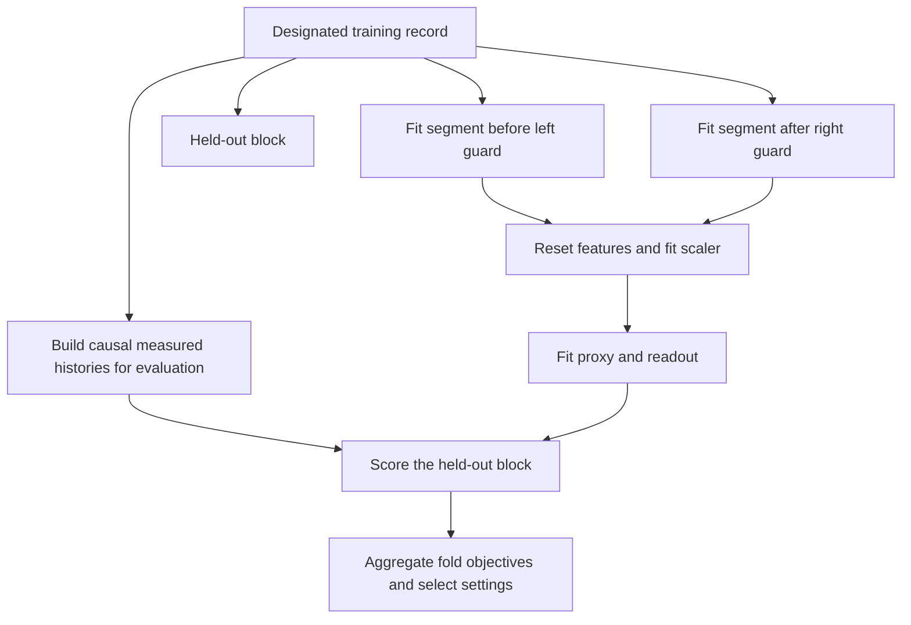

A fit that uses each sample once and then randomly divides overlapping windows can leak strongly correlated neighborhoods. The boundary exclusion should cover the receptive field including interpolation and adaptive terms. An evaluation record may itself provide observed history before a target. That is within the one-step information contract, even when the earlier target belonged to the same held-out block. The model's fitted weights remain frozen.

### 6.3 Bias, variance, and evidence separation

Adding basis functions increases expressive capacity. It may reduce bias, increase variance, or both. Ridge trades these effects by penalizing large coefficients. Deliberate group selection reduces the number of speculative interactions. Deep learners can exploit useful local feature sharing and nonlinear temporal structure, but optimization and calibration on a short acquisition are hard to validate. Make these mechanistic explanations hypotheses. Use training fit, blocked folds and held-out development differences to test them.

Never average away a configuration failure. Record the model, parameters, fold, solver message and elapsed time. Retain the best eligible setting according to the declared objective. State that budgets differ when appropriate. Training support may be smaller for SVR or attention models to fit resource constraints. A narrow family-level search gives a result for a deployed configuration and budget, with uncertainty about what another search might find.

### 6.4 Illustrative fold example

Take $N=24{,}000$, $a=4{,}800$, $b=7{,}200$ and $G=1{,}792$. The left fit segment stops before 3,008 and the right segment starts at 8,992. A fit row at 8,992 has no within-segment past, so a stateful model must warm up or mark it ineligible. A held-out target at 4,800 can use observed $x_{4799}$ for inference but cannot contribute its own target to the parameter fit. Changing $x_{4800}$ should affect later valid use of past history but leave the predicted value for target 4,800 invariant. Recompute that property after adding any nonlinear feature or correction.

## 7. Structured Reservoir Computing

### 7.1 Why a structured reservoir

A reservoir supplies state coordinates in which a simple readout can represent a complex conditional response. A conventional echo-state network updates a recurrent state through a fixed nonlinear map driven by measurements. A structured delay-based reservoir exposes coordinates constructed from available history. PI-SRC combines time delays, speed context, angular delays, oscillator quadratures, proxy innovations and selected nonlinear interactions. Learnable regression weights act on this fixed representation after the configuration is selected.

A state evaluated via recurrence need not have a learned recurrent transition. Fading memory is given concretely by finite delays and damped state responses. RNN and LSTM baselines learn internal transition and readout weights from data. In PI-SRC the damped state has a specified physical phase and its settings are chosen by guarded outer search. Regression does not differentiate through those settings. Its readout can still express a nonlinear relationship to raw signals because the basis is nonlinear.

### 7.2 Why avoid indiscriminate expansion

For $P$ inputs, all second-order monomials including squares number $P(P+1)/2$. The number of third-order monomials is $P(P+1)(P+2)/6$. At $P=200$ this gives 20,100 second-order and 1,353,400 third-order terms, before any coefficients. A compact registry instead names interpretable interaction families such as speed times vibration lag, oscillator quadrature energy, and a short set of lag products. Its dimension grows with selected groups. This is a testable hypothesis about how operational context affects prediction.

A structured library can be too restrictive. A missing harmonic or transient may fall outside the basis. Adding many weak terms makes correlated and accidental associations easier to fit. The correct analysis asks whether clean error, stress error, prediction cost, or fault retention improved under a named pair of configurations.

## 8. Mathematical anatomy of the SRC model

Write temporal delays as $\boldsymbol\ell_t=[x_{t-\ell_1},\ldots,x_{t-\ell_p}]$, with positive integer lags. Let $v_t$ be permitted RPM context, $A_t$ angular history, $H_t$ damped quadratures, $E_t$ past energy, and $I_t$ proxy errors. With library $\Phi$, the base predictor is

$$
\hat x_t^{\mathrm{base}}=b+w^T\Phi(\boldsymbol\ell_t,v_t,A_t,H_t,E_t,I_t). \tag{8}
$$

Each state uses information through $t-1$. The requested observation window, phase and oscillator filter reset on a new record. The features need their source histories even when the target output is masked. Distinguish minimum valid history, common comparative warm-up, and fold guard.

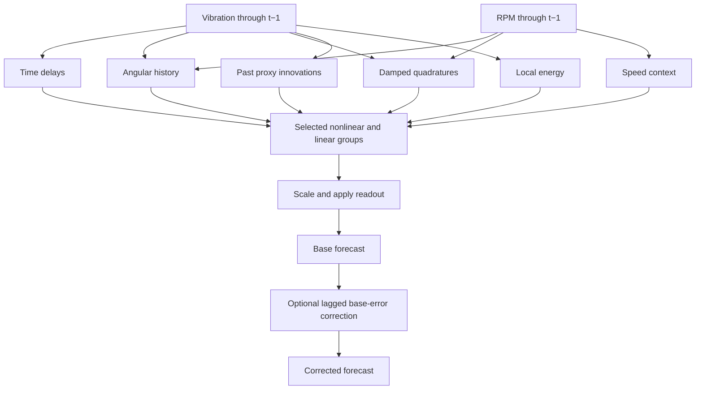

### 8.1 Counting the feature groups

Consecutive lags densely cover a short temporal span. For oscillatory data this helps represent phase but can expose collinearity. Multiresolution lags cover recent samples densely and older intervals sparsely. A mechanically selected fixed lag can track a nominal mesh period, although its true angle varies with RPM. An angle-domain lag targets a prescribed phase change instead. If lag selection uses correlation to the target, compute that ranking only within admissible fit segments.

For $P_\ell$ temporal lags, $P_v$ speed terms, $P_a$ angular lags, $K$ orders, and $F$ fixed frequencies, a bank with one decay per oscillator offers $2(K+F)$ quadratures. With $J$ common decay scales this can become $2J(K+F)$. The innovation group contributes one coordinate per chosen innovation lag and energy contributes one per retained summary. Add selected products by name after these base counts. The exact serialized size depends on the realized configuration and group definitions. Validate it against the saved feature schema.

Fit the location $\mu_j$ and scale $s_j$ of each feature on the permitted rows to build $A_{tj}=(\Phi_{tj}-\mu_j)/s_j$. The transforms are necessary at inference and must be saved. Scaling helps make the penalty numerically comparable across units. It does not remove collinearity among nearby phase and order features. Individual regression weights need careful interpretation.

### 8.2 Group penalties and robustness

A normalized group-ridge objective is

$$
\min_{b,w}\frac{1}{2N}\sum_{t\in\mathcal T_\mathrm{fit}}
(x_t-b-A_tw)^2+\frac12\sum_g\lambda_g\lVert w_g\rVert^2_2. \tag{9}
$$

The $1/N$ factor defines the implemented penalty convention in Eq. (9). A non-normalized convention gives equivalent coefficients if all penalties are multiplied by $N$. A diagonal vector can assign stronger penalties to exploratory interaction groups than to low-order vibration lags. The corresponding ridge system has a positive shift on penalized directions. A Huber objective transitions from quadratic to linear for $|e|$ larger than its threshold. In iteratively reweighted least squares, that is equivalent to weight approximately $\min(1,c/|e|)$ at threshold $c$. Each iteration solves a weighted regularized problem. This suppresses model influence from extreme training points and can increase inference error on other target distributions. Compare the empirical trade-off and count solver caps.

### 8.3 Scaling costs

A dense lag matrix costs $O(NP_\ell)$ operations and storage before evaluating interactions. A direct oscillator sum costs $O(NJM(K+F))$ for finite memory $M$. A recurrence can reduce arithmetic to $O(NJ(K+F))$ with a bounded history buffer. A structured interaction list of length $C$ adds $O(NC)$, while a complete quadratic expansion adds $O(NP^2)$. Forming a dense Gram matrix costs $O(NP^2)$ and its factorization costs up to $O(P^3)$. Applying the fitted readout to already computed features costs $O(NP)$. Full-record timing includes feature construction and memory movement, which can dominate the last step.

## 9. RPM conditioning and rotating-machine feature families

RPM at $t-1$ is observed before the target. Represent it as a fixed engineering coordinate $r_t=(n_{t-1}-n_0)/s$ or a standardized value whose location and scale were fitted within the training fold. A low-order function of $r_t$ can smoothly schedule vibration lag coefficients. A high polynomial degree can extrapolate sharply outside the observed speed range. Legendre functions are orthogonal under their reference continuous density, but observed speeds are distributed unevenly. Inspect the numerical design.

A causal finite difference over $D$ samples estimates speed slope as $[n_{t-1}-n_{t-1-D}]f_s/D$ in rpm/s. Acceleration may correlate with speed and load. A guarded benefit would support including it as a covariate without isolating a physical causal effect. The shortest derivative spans are susceptible to measurement noise or quantization. Define the direction rule, including how ties are grouped.

A lag-by-speed product gives smoothly varying coefficients. A quadrature squared magnitude $|H|^2=(\Re H)^2+(\Im H)^2$, in squared standardized units under a normalized quadrature, summarizes local harmonic strength without choosing an absolute rotation phase. A product between harmonic energy and a lag lets its contribution depend on strength. A fixed-frequency response near a time-spectrum peak encodes a separate hypothesis from phase synchrony. One assumes roughly fixed Hertz through motion, while the other assumes roughly constant cycles/revolution. A mixed bank can encode both. It cannot independently establish a structural natural frequency.

Sidebands at $kZ\pm1$ in the simplest input-shaft modulation model are plausible features. Pinion-synchronous modulation would shift by $37/20$ input-shaft orders. Check peak width before proposing weak neighboring candidates. If short observation windows blur them together, multiple correlated phase rotations can add cost and difficulty without a measurable benefit.

## 10. Fourier, order, and envelope analysis

For a segment of $N$ sampled points,

$$
X[k]=\sum_{n=0}^{N-1}x_n e^{-i2\pi kn/N},\quad f_k=k f_s/N. \tag{10}
$$

A finite sinusoid outside an exact bin excites several bins through window leakage. A rectangular truncation gives a narrow main lobe and broad sidelobes. Hann tapering reduces sidelobes while widening the main lobe. Amplitude estimates require coherent-gain correction, and power estimates require window-energy normalization. Integrating a PSD density over frequency gives mean-square contribution, rather than an amplitude in vibration units.

Welch PSD forms and averages windowed periodograms. A 1,024-point window at 3,200 Hz spans 0.32 s with 3.125 Hz bin spacing. If speed changes substantially within a window, harmonic energy spreads. A short-time Fourier transform localizes time evolution at the cost of frequency resolution. Overlay $kZn(t)/60$ with correct units. Compare measured ridge to predicted order lines at multiple speeds before proposing a fixed-frequency mode.

**Analytical example.** At 125 and 165 rpm, input order 148 corresponds to 308.33 and 407 Hz. A fixed 1,100 Hz mode remains at 1,100 Hz but changes from effective order 528 to 400. Overlay both on simulated chirps to understand their projection. They can cross. A single time slice cannot distinguish them.

Offline order tracking interpolates a completed time-domain record onto a uniform shaft-angle grid. With $S$ points/rev, angle-grid Nyquist is $S/2$ cycles/rev. The original physical time-domain Nyquist at the current speed imposes another limit. Raising $S$ improves resampling resolution within those limits and cannot restore detector or filter bandwidth. Enrollment of a causal angle feature requires both interpolation endpoints before the target. Offline plots can use endpoints anywhere in an already collected record.

For a real trace $z$, the analytic signal is $z+i\mathcal H(z)$, with envelope equal to magnitude. For a narrowband amplitude-modulated carrier, it approximates the modulator. Multiple bands, finite support, or slow baseline can alter interpretation. Whole-record Hilbert features are reserved for explanatory analysis and postrecord detection. They would reveal future vibration if directly inserted into Eq. (8).

## 11. Causal shaft angle and finite oscillator states

### 11.1 Turns at the prediction boundary

The observed position of a past sample and the estimated target position can be computed separately:

$$
u_j=u_{j-1}+\frac{n_{j-1}+n_j}{120f_s},\qquad
\widehat u_t=u_{t-1}+\frac{n_{t-1}}{60f_s}. \tag{11}
$$

Both are in revolutions. The first reconstructs a known path with trapezoids. The second extrapolates using the latest measured speed. A desired delay of $a$ turns defines query $\widehat u_t-a$. Find two bracketing observed phase samples and linearly interpolate measured vibration. The upper bracket must be at most $t-1$. At very low speed or insufficient history the implementation must apply its finite-context handling, with a documented behavior at the boundary.

At 120 rpm and 3,200 Hz, one sample spans $0.000625$ revolutions. A 0.125-revolution lag is 200 samples. A correct phase routine should match that constant-speed fixture and recover the same input order when RPM varies. Mutating speed at and after the target should preserve its predicted phase.

### 11.2 Rotation as demodulation and remodulation

Let $d_j=x_j\exp(-i2\pi ku_j)$ with $k$ cycles/revolution. For exponential decay $r=e^{-1/\tau_s}$ and finite memory $M$,

$$
D_t=\sum_{j=1}^{M} r^{j-1}d_{t-j},\qquad
H_t=c_M e^{i2\pi k\widehat u_t}D_t,\quad
c_M=2\left(\sum_{j=1}^{M}r^{j-1}\right)^{-1}. \tag{12}
$$

Here $\tau_s$ is a scale in samples and its physical time is $\tau_s/f_s$. Moving the exponent to $j$ leaves the normalized state unchanged because all weights gain a common $r$. For fixed Hertz, use $f j/f_s$ as the demodulating phase in turns. Direct recurrence follows by multiplying $D_t$ by $r$:

$$
D_{t+1}=rD_t+d_t-r^M d_{t-M}. \tag{13}
$$

Values outside the record are zero. The oldest subtraction ensures exact finite horizon in arithmetic. Removing it would leave a stable infinite-memory state under $0<r<1$. Such a state can carry information across fold boundaries when reset policy is wrong. Direct sum and fast recurrence can differ near rounding scale, especially under cancellation at long decay. Compare both on chirps, impulses, and zero input. With the implemented factor of two, $|H_t|\leq 2\max_j|x_{t-j}|$ follows from the triangle inequality. A state impulse may first affect $H_{t+1}$ if its sample index is $t$.

A long $\tau_s$ preserves phase-coherent histories and may suppress noncoherent noise. During a fast transient it also includes older operating conditions. $M$ truncates the response even if the chosen decay is large. Learned readout coefficients and externally tuned memory together define effectiveness in this predictor. A predictive time scale remains an effective model setting and does not signify measured material damping.

## 12. Innovations and slow correction

### 12.1 Stage-one proxy

A stage-one predictor estimates $\hat x_j^{(1)}$ from past observations. Its error $\tilde\epsilon_j=x_j-\hat x_j^{(1)}$ is known after $x_j$ arrives. The downstream model may use past $\tilde\epsilon$ samples for $t$. Stage-one raw support $L_1$ and proxy lag cap $Q$ require up to $L_1+Q$ preceding samples. An adapter looking back an additional $M_c$ shifts that entire dependency farther into the past. This motivates tests of the composed model.

Stage one is fit within the appropriate fold. That prevents its weights using that fold's evaluation target rows. Within a training segment, fitting all stage-one weights before deriving its own residual features can still be optimistic. Cross-fitted downstream features would add a separate safeguard. Check the actual implementation and distinguish these two protections. Compare held-out error when proxy features are enabled and removed.

### 12.2 Correction as a separately attributed model component

For $e_t^{\mathrm{base}}=x_t-\hat x_t^{\mathrm{base}}$, the example finite adapter is

$$
\hat x_t^{\mathrm{final}}=\hat x_t^{\mathrm{base}}+
g\,\frac{\sum_{j=1}^{M_c}\rho^{j-1}\operatorname{clip}(e_{t-j}^{\mathrm{base}},-C,C)}{\sum_{j=1}^{M_c}\rho^{j-1}},
\qquad \rho=e^{-1/\tau_c}. \tag{14}
$$

The gain $g$ is dimensionless and $C$ is in standardized units. A fast correction may track fault-related structure as well as drift. An adapter-off forecast with identical weights isolates the runtime effect of Eq. (14). Refitting the readout without correction is a different experiment. Apply an identical adapter to different base learners to test whether the advantage is specific to physical features. The proxy error, uncorrected base error, and final diagnostic residual have separate roles. Recursing on previous corrected errors would change the procedure.

## 13. Intake and partition checks

The course records include designated train and development vibration, RPM and timing. The MAT loader checks fields and numerical validity. Verify any stored raw and standardized fields with a reconstructed affine model, retaining original calibration provenance. The numbered diagnostic parts must preserve MATLAB ordering. Check record IDs, types, shapes and interval structure. The record manifest lists missing blind files and labels separately.

When an excerpt of a diagnostic acquisition matches designated training or validation, exclude the acquisition from independent comparisons. Use raw waveform and speed agreement together, with index offsets and length. Similar speed alone is weak evidence of acquisition identity where a controlled rig follows the same profile. Unknown acquisition labels leave diagnostic group comparisons conditional on a defined index split. If an independent record is absent, keep the frozen manifest and clearly state its status.

```python
from pathlib import Path
import numpy as np
from src_gearbox.data import find_input, load_record

path = find_input(Path("data/raw"), "sigtrain")
if path is not None:
    record = load_record(path)
    np.testing.assert_allclose(np.diff(record.t), 1 / record.fs, atol=2e-12, rtol=0)
    assert len(record.x) == len(record.rpm)
    assert np.isfinite(record.x).all() and (record.rpm > 0).all()
```

## 14. Physics-informed exploratory analysis

Use the training record to formulate candidates before comparing options. Time traces show amplitude, RPM and short-run RMS together. A causal energy feature uses a trailing rather than centered window. Welch and STFT plots document where energy lives and whether the ridge agrees with predicted mesh trajectories. Uniform angle sampling tests whether synchronous structure sharpens. ACF and PACF describe useful lag intervals and clarify why lag count sometimes matters. Speed-binned residuals group heterogeneity without ascribing causality to RPM.

The completed EDA screening compares 148-order, sideband, fixed-frequency, angle-delay and polynomial candidates on guarded training. The independent chirp and constant-speed checks recovered order 148 within 0.024 orders. The extended two-order-plus-shaft/sideband screen obtained guarded MSE approximately 0.42903 against a corresponding 0.46153 control. Oscillator decay of 128 samples scored about 0.44049 versus 0.45228 for 8 samples in that screening design. The tested fixed-Hertz pair scored about 0.46152. Cubic and degree-two variants differed little in their measured guard screen. Those are pre-model controlled EDA screens. They motivate candidate groups and do not estimate the final model’s performance.

For each accepted candidate, connect the physics equation, observed feature, fold evidence and cost. For each rejected candidate, state the setting and the strength of the evidence. In particular, a nominal peak near a fixed frequency can be worth visualizing even if the feature contributes little after other lag terms. Recheck the exact scope and alternatives in `results/eda_feature_hypotheses.csv`. Notebook 01 reads the measured numerical artifacts and figures.

### 14.1 Read the actual frequency and order panels

The STFT figure shows the changing vibration spectrum together with the predicted mesh harmonics from measured speed. On a time-frequency axis the 148-order trajectory moves upward and downward as shaft speed changes. The measured median absolute distance from its training spectral ridge to the phase prediction is about 0.744 Hz. A close match gives a reason to test angle-synchronous states. The estimate depends on window resolution, ridge bounds and the available record; it is not a substitute for a tachometer calibration. The measured training values, including the ridge correlation and available angular turns, are recorded in [the EDA summary](../results/eda/summary.json).

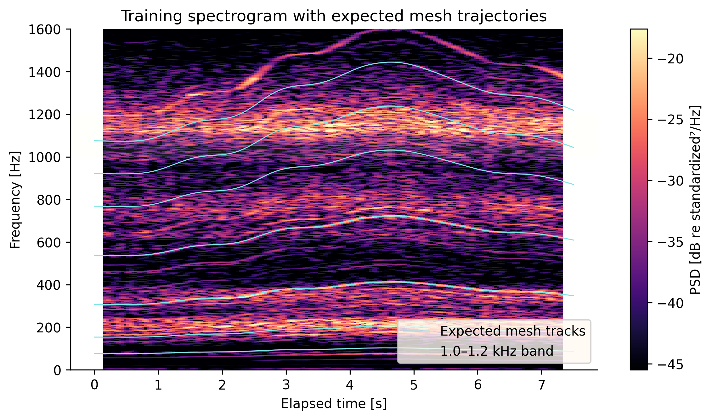

Compare the same operating excursion in the order plot. Input-shaft orders are in cycles per turn. A peak at order 148 is the fourth harmonic of the 37-tooth input gear. This normalized frequency can stay fixed as its Hertz coordinate moves. Fixed-Hz components can appear broadened in order instead. The purpose of viewing both is to see why a predictor might use one or both mechanisms. The training-only feature screen's fixed-Hz pair obtained essentially the same guarded MSE as LPV-AR24, so strong spectral energy near 1.1 kHz did not, by itself, justify retaining a fixed-Hz state. The selected bank omitted fixed-Hz states. Separate sideband and additional-order alternatives remain informative.

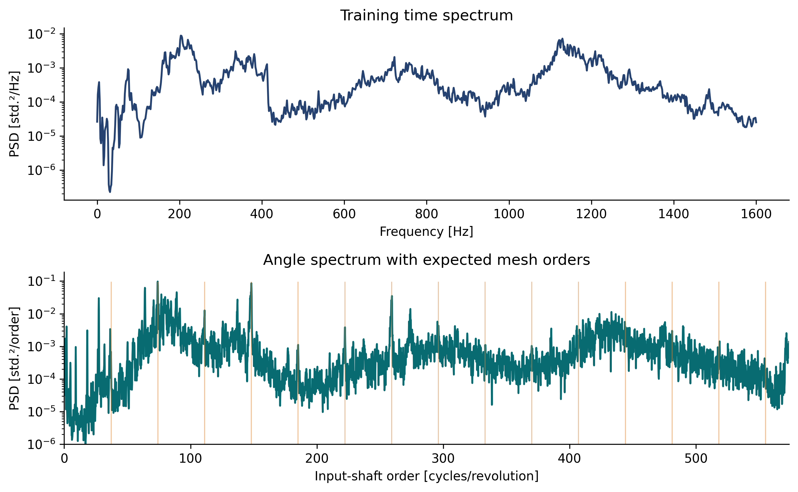

## 15. Configuration, fitting, and checkpoint identity

Start from a saved configuration and allowed raw intervals. Reset angle and state within each fit segment. Fit the proxy model with admissible rows if enabled. Construct strictly past-only features from the relevant history. Fit and save the scaler on those rows. Estimate the group-regularized readout, store all coefficients, and pilot checkpoint reload before reporting metrics. On a new record, restore scales and coefficients and mark the warm-up invalid for comparison. Ensure runtime can regenerate the exact design order; transposed or reordered columns can silently give valid-looking scores.


The selected configuration and fitted weights are both necessary for repeatability. A different numerical library can lead to very small solver differences. Store replay tolerances and observe them on a complete record. Saving train and development forecasts makes it possible to reconcile reported metrics without running training again. Notebook 05 teaches that workflow and includes checkpoint round-trip when the anonymous input path is configured.

## 16. Joint optimization and evidence interpretation

### 16.1 Bounded search

Compare coherent variants before refining the neighborhood of a good design. Candidate dimensions may include temporal/angle span, speed context, order bank, decay, memory, innovation history, interactions, and grouped penalties. Vary related terms conditionally to avoid meaningless settings. For example, changing oscillator decay with the bank disabled has no physical effect. A deterministic finite search can be rigorously reproduced from its trial ledger. It supports conclusions about the declared budget and cannot establish a global optimum.

A trial's composite loss may include clean error, RPM stress and pulse distortion. Declare coefficient weights before development. Form the median or mean of fold terms as prescribed. A Pareto front omits alternatives for which another measured point is at least as good on all criteria and better on at least one. Preferences for interpretability or compactness should be made explicit. Fold rankings can be unstable when a difficult speed segment dominates one validation interval.

The frontier plot summarizes the trade-off between stored coefficient count and held-out training-fold MSE. A point that is strictly worse than another on the plotted criteria cannot be a Pareto choice on those two objectives. The actual utility considers extra terms. A higher-dimensional model can remain justified when its margin on clean, stress, or preservation performance is relevant. Stored parameter count is a complexity proxy, while measured release CPU timing is reported separately after final refit.

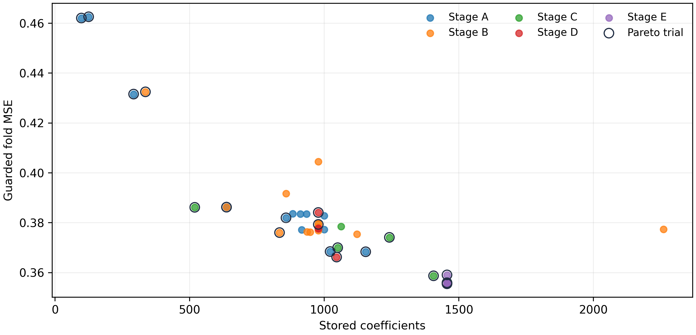

### 16.2 Reading the ledger

An interpretable per-fold ledger identifies the trial configuration, bounds, model dimension, loss summaries, solver state and wall time. Recompute averages before reading the winner. If candidates use different effective target counts, confirm they were scored on identical evaluation masks. The strongest development variant is an observation after selection and may differ from the guarded winner. Report both when needed with correct scope. Evaluating the independent segment only after freeze protects the one-time assessment.

Notebook 04 groups actual fold rows and plots the trade-off between fit, stress and preservation. Notebook 08 links contrasts to settings so a bundled change cannot be mistaken for a one-factor ablation. Confirm that any reported superiority is robust to reasonable configurations and record scope rather than a consequence of seeing the development scores during selection.

## 17. Twenty-one comparator families

The comparator mechanisms below describe models implemented under `src/src_gearbox/models/baselines`. The 21 checkpoint identities are preserved from the earlier course study and replayed with the current target mask. Selected refitted controls remove speed variation. Claims about fitting and selection stay with the actual lineage in `results/metrics/model_coverage.csv`, `baseline_configs.csv`, and `baseline_prior_trials.csv`. New primary-model comparisons use PI-SRC fit in this work. Source policy, masks, target values, and causal verification are independent checks from the original fitting evidence.

### 17.1. AR

A vibration-only autoregression fits a linear map from $p$ observed delays to $x_t$. Its forecast is $b+\sum_{j=1}^p a_j x_{t-j}$. Such a model offers a useful speed and data-volume anchor, especially if coefficients are fitted by least squares or light ridge on an admissible linear design. If a sequence behaves approximately as a stationary damped process within a small operating region, a few AR coefficients can approximate a local linear recurrence. The same coefficients must cover the entire RPM range. Poor moving-harmonic agreement is one reason to consider conditioning. The stored result identifies selection and inference context, rather than assuming that a stationary model reconstructs the physical process.

### 17.2. ARMA

ARMA adds a moving-average term built from previously reconstructed innovations, as in Eq. (6). This lets previous surprising observations inform current error without requiring an arbitrary order increase in measured lags. Conditional fitting yields a computable causal predictor but requires startup and invertibility conventions. The comparator’s finite conditional implementation checks that truncation agrees with the expected recursion and that rejected configurations remain recorded. Excessive recursion memory would invalidate a previously chosen guard. Evaluating its bridge under the common mask checks that the expected warm-up covers the actual model.

### 17.3. ARIMA

ARIMA introduces integration order $d$ by fitting an ARMA model in differences. In this report the task is in vibration levels. In first differences, reconstruction adds predicted difference to $x_{t-1}$, a valid observed feedback. A model need not represent a random walk simply because differencing is available. A trend hypothesis should survive training-only folds, and numerically unstable earlier innovative recursions should be rejected. Its fit can cost more than AR even when it does not improve MSE. The released rows identify status and applied configuration.

### 17.4. ARX

The additive exogenous model augments measured lags by historical RPM lags $n_{t-d_1},\ldots,n_{t-d_k}$. It estimates which part of the target correlates with the exogenous context after accounting for vibrations. It does not automatically change the dynamics of the vibration-lag coefficients with RPM. The speed-withheld control fits an otherwise matched configuration with constant nominal RPM, so it measures the added value of observed variation. It is a stronger comparison than just replacing RPM at inference in a fitted speed-dependent learner, which can create out-of-distribution effects. Interpret the resulting difference alongside the specific design and actual training mask.

### 17.5. NARX

NARX replaces the additive mapping by $g_\theta(x_{t-1:t-p},n_{t-1:t-q})$ with a nonlinear part. In this project a physics-conditioned ridge backbone is supplemented by a tanh hidden block predicting its residual on compact features. The output is one-step and receives measured historical vibration as feedback. The residual head can add effects not expressible by an affine readout of the compact raw features, but it can also fit pattern coincidences in one recording. Compare training and development error. A lower training objective alone leaves the transfer of the extra capacity uncertain. Recursive feed of its own predictions would define a different forecasting experiment.

### 17.6. Sparse LPV-AR

A linear parameter-varying AR model uses coefficients $a_i(s)=\sum_k\gamma_{ik}P_k(s)$, with a previous normalized RPM scheduling coordinate $s$. Each lag-basis product forms one design column. With 240 lags and eight basis values, 1,920 candidate columns are possible. Sparse selection prunes many weak products and refitting supported columns reduces shrinkage bias. The comparator retains the guarded support lineage and masks of the established strict reproduction. Its coefficient counts reflect selected nonzero columns, not a claim that all basis terms represent independently verified physical mechanisms.

### 17.7. Sparse LPV-ARMA

The lecturer reference augments speed-varying AR with speed-varying proxy-innovation terms from a first-stage fit. Both coefficient blocks respond to the measured schedule. The innovation representation makes inference differ from an exact fitted state-space model. Count both stages in the deployed footprint. Verify that the first stage operates on the permitted training subset and that its predicted residuals are only used after the relevant observation. This is the principal strict conventional reference in the prediction comparison. The published original test values, earlier reproduction, and strict refit are traced separately in Chapter 21.

### 17.8. Linear Regression

The affine predictor $b+w^Tz_t$ solves least squares. A design with speed products and oscillator summaries can carry useful physical nonlinearity despite the linear readout. This comparator matters because PI-SRC also uses an affine readout of constructed features. Any advantage could come from how the basis, lag history, penalties or innovations are chosen. A stable solver handles similar columns, but unregularized coefficients can extrapolate sharply beyond observed states. Inspect the chosen design, effective rank and held-out performance.

### 17.9. Ridge Regression

Ridge adds squared coefficient penalties, Eq. (7), to the same score-fitting task. It reduces sensitivity to near-collinear directions. Larger $\lambda$ pulls weights toward zero and can underfit a strong narrow-band regularity. Tune on guarded training only and use a penalty convention consistent across candidates. The retained intercept often uses a separate, unpenalized direction. For a speed-conditioned ridge model, meaningful comparisons require checking whether angular lags and order features enter its library. Its deployment runtime may be dominated by that library.

### 17.10. Lasso Regression

Lasso adds an absolute-value penalty and can return exact zeros. If one important feature is represented by a correlated collection of lags, Lasso may select one representative. Its choice can be unstable across folds. Sparsity can reduce footprint under an inference backend that evaluates only retained coordinates. A checkpoint storing a sparse coefficient vector beside a dense feature constructor may have speed similar to a dense readout. Interpret stored weights, inference work and selected support separately.

### 17.11. Elastic Net

Elastic Net mixes L1 and L2 penalties. It can retain correlated features with distributed weight while removing directions receiving little predictive support. This matters for vibration designs with nearby lags and recurring phase history. Compare both mixing fraction and total penalty at common objective scale. If a solver reaches its stopping cap, look at recorded convergence, not only the apparent MSE. A sparse solution can be easier to inspect but does not automatically yield a better causal model.

### 17.12. Support Vector Regression

Epsilon-insensitive loss penalizes errors outside a tolerance tube. A radial basis kernel $K(z_i,z_t)=\exp(-\gamma\lVert z_i-z_t\rVert^2)$ defines nonlinear responses centered on support vectors. The prediction sums kernel values times signed fitted coefficients and includes an intercept. Large $\gamma$ makes the influence of each fit example local, often problematic when closely sampled windows from different speeds cover the design unevenly. The training support is capped deterministically for cost and the evaluation mask remains full. Report both reduction and runtime. A compact input dimension does not guarantee low inference cost when the support set is large.

### 17.13. Random Forest Regression

A forest averages regression-tree predictions across resampled fit examples and feature choices. Thresholds create local regions of delay/speed feature space. This can capture interactions without a prescribed hand-written polynomial product, at the cost of stepwise response and high sample demand. Nearby state vectors may cross a threshold and give discontinuous predictions. Guarded time splits are applied outside tree fitting, since randomly subsampling already overlapping row histories would underestimate dependence. Deep trees can fit the training record and still generalize poorly. Include tree nodes and serialized bytes so comparisons with weights are intelligible.

### 17.14. Gradient Boosting Regression

Boosting builds an additive sequence of trees to follow remaining loss gradients or residuals. At squared loss a new stage approximates $y-\hat y_m$ subject to its tree capacity. A learning rate scales additions, and the iteration budget determines the total number. Histogram splitting can reduce fit cost. It leaves the same limitation on representing a smoothly varying angular trajectory through many piecewise thresholds. Monitoring a fixed contiguous guarded block supports evaluation. An internal random validation split would not be a physically independent record.

### 17.15. Multilayer Perceptron

The MLP consumes a flattened vector of historical vibration and permitted RPM. Hidden affine maps with activation functions can approximate smooth nonlinear terms. A raw-history shortcut is useful because the strong AR-like relationship is already nearly linear in many coordinates. That shortcut and hidden branch solve a flexible but still fixed-context problem. Every window index identifies a specific raw relative lag. Reordering those features changes the function and must agree with checkpoint serialization. Short-record evidence should be combined with train-only regularization, a finite configuration count, and seed checks where available.

### 17.16. LSTM

An LSTM uses input, forget and output gates to control a memory cell. With past window $z_j$, the remembered state follows a rule like $c_j=f_j\odot c_{j-1}+i_j\odot\tilde c_j$. The bounded historical encoder reads measurements through $t-1$. Sequence resets or fixed-window setup prevent carrying a hidden state across acquisitions. More hidden units add capacity and cost. For one short recording it can be hard to distinguish a learned useful temporal memory from a flexible fit to the observed operating pattern. Its recurrent update also offers less straightforward batch parallelism than temporal convolutions.

### 17.17. GRU

A GRU uses an update and reset gate to combine a proposal and retained state without a separate LSTM cell. It can supply comparable seasonal or transient modeling with different capacity. The same bounded past window and reset policy apply. A comparison with LSTM is meaningful only in the context of chosen widths, sample exposure, optimization and seed variability. Neither architecture is given an advantage by a bidirectional pass through targets. The final scalar predictor is scored on the same measured indices.

### 17.18. CNN

A one-dimensional temporal CNN learns filters applied across historical samples. Locality and shared weights help recognize repeated short patterns and need fewer distinct coefficients than a dense lag map for the same number of positions. Its receptive field is set by kernel width and layer organization. Output positions used in causal inference must access historical samples only. A CNN can learn phase-local features without explicit mechanical frequencies, making it a useful representation comparator. Behavior may deteriorate when the operating speed changes substantially unless speed conditioning and learned filter diversity cover the phase changes.

### 17.19. TCN

A TCN uses finite causal convolutions, often with dilation. For layers with kernel lengths $k_i$ and dilations $d_i$, unit stride gives total support $1+\sum_i(k_i-1)d_i$ for a single convolution per layer. Additional serial stacks add their support. This enlarges context efficiently and can model nonlocal patterns without recurrent state. Verify the implementation's left padding and readout position. A longer context is still a capacity choice and can add cost or exacerbate scarcity of distinct contexts. The common matched evaluation does not infer robustness solely from architecture.

### 17.20. Time Series Transformer

Historical vibration and speed can be grouped into patches with position encoding. Masked self-attention combines token values with weights from scaled query/key similarities, $\mathrm{softmax}(QK^T/\sqrt d)V$. The scalar readout is trained for one-step prediction from past tokens. Patching reduces token count and attention computation, but reduces positional detail. Dense attention cost grows quadratically with token count. Its many expressive relations can be hard to identify from one short acquisition. Benchmark these actual selected settings without treating the result as a judgment about every Transformer.

### 17.21. Temporal Fusion Transformer

The compact TFT adaptation combines historical variable selection, gated residual blocks, a recurrent projection and attention. It is scoped to an available history plus a scalar next observation. Future RPM and future vibration are unavailable. A variable gate can be inspected as activity within this computation graph. Gate weights cannot establish a physical causal effect or assign confidence to a model. Poor performance may reflect data size, selected context, stride, hidden width and optimization together. Preserve the actual configuration and make this scope explicit when discussing the observed comparison.

### 17.22. Interpretation across families

The strict benchmark mask holds target units and positions equal, while architecture, requested covariates, fit subset and computational budget can vary. One matched speed-withheld experiment preserves input tensor shape and changes measured RPM to a constant nominal value during both fit and evaluation. The measured-speed version can benefit by exploiting variable context. It can also overfit a limited speed association. Observed benefits for several families do not imply monotonic benefits across all methods. The numerical appendix gives the measured deltas and exact artifact paths.

## 18. Evaluation metrics, timed scope, and uncertainty

### 18.1 Scales and definitions

For $T$ common target samples define

$$
\mathrm{MSE}=T^{-1}\sum_t e_t^2,\quad
\mathrm{RMSE}=\sqrt{\mathrm{MSE}},\quad
\mathrm{MAE}=T^{-1}\sum_t|e_t|,\quad
\mathrm{bias}=T^{-1}\sum_t e_t. \tag{15}
$$

Residual means depend on whether $e=x-\hat{x}$ or $\hat{x}-x$. State the sign convention. A normalized RMSE needs a stated scale, such as the standard deviation of the aligned observations. $R^2=1-\mathrm{MSE}/\mathrm{Var}(x)$ uses development variance under the matched mask. It may become negative. Both the standardized signal and an unverified physical-unit sensor scale should not be labeled as ordinary acceleration squared. Distinguish square units.

**Worked example.** For errors $[-2,0,1]$ the MSE is $5/3$, RMSE $\sqrt{5/3}\approx1.291$, MAE 1 and bias $-1/3$. If a comparator has MSE 2, relative reduction is $(2-5/3)/2=1/6$. A signed paired difference of $-1/3$ corresponds to model minus comparator. Report both the numerator and denominator interpretation. A small scalar reduction can still hide residual shape changes relevant to diagnosis.

### 18.2 Runs and serial structure

A sign runs test counts changes in sign sequence after a specified zero treatment. A Ljung–Box statistic aggregates autocorrelation over lags. The first reveals unusually clustered signs relative to a simple null, the second tests mean lag structure over a chosen range. Neither guarantees independent white noise in a heterogeneous or nonstationary series. Inspect ACF shape and residual power spectra. The expected useful feature may live in a band rather than a single lag, especially when speed changes.

If the report separates errors by RPM quartile, build bins from observed aligned targets and show counts. A grouping analysis may use measured target-time RPM to describe operating regime, although the model may not use it. Direction grouping should describe the index and slope window used. The full score is target-count-weighted across groups. A cold start or boundary contaminant can disproportionately affect the first chronological block, which motivates a prespecified common warm-up.

### 18.3 Paired block uncertainty

Build paired differences $d_t=e_{A,t}^2-e_{B,t}^2$. Draw moving blocks of that same sequence and compute the sample mean across resampled blocks of full length. A negative difference favors $A$. Multiple block sizes expose sensitivity to dependence and speed-cycle structure. The bootstrap percentile range reflects uncertainty under a resampling model for that recording. It does not simulate new gearboxes, acquisition geometries, speeds or sensor calibrations. A narrow interval on one record and transfer to another recording address different questions.

### 18.4 Compute and practical constraints

Record hardware, device, thread count, timing repeats, data and model sizes, and exact processing scope. Warm inference usually means a loaded model called on in-memory arrays after initialization. Cold/load timings should explain whether import and disk I/O are present. Runtime that includes feature construction is comparable to an end-to-end prediction step at record-level. Timer ratios need equal scope. Divide full-record median by 7.5 seconds for batch real-time factor in this course grid. Divide by the quantity of samples for amortized work, while strict online latency also depends on state updates, deadlines, system scheduling and buffering.

Check which memory quantity was recorded. Model weight file size is independent of process runtime footprint. Full process RSS can include many interpreter libraries and loaded candidate models. A snapshot differs from peak or model-attributable allocation. CPU-only measurements leave comparative GPU throughput unresolved. The completed result declares device evidence in timing metadata and gives practical resource interpretation in Notebook 09.

## 19. Fault detection from causal residuals

### Prediction and detection are different tasks

At sample $t$, a one-step predictor uses observed vibration and available speed through $t-1$ and estimates $\widehat{x}_{t|t-1}$. The residual $e_t=x_t-\widehat{x}_{t|t-1}$ is available after the sample arrives. A gearbox predictor is useful for monitoring if the predictable operating response disappears from its residual and evidence relevant to a fault remains visible. A residual can achieve low mean-square error while losing a physically important impulse. It can also retain high-amplitude artifacts caused by RPM errors or numerical extrapolation. Those two risks motivate evaluating the residual signal and the forecast together.

A defect associated with one tracked shaft turn can give a near-repeating impact angle. RPM is measured in revolutions per minute. At 145 rpm the shaft takes $60/145=0.414$ s per turn, whereas at 167 rpm it takes 0.359 s. A constant lag in seconds therefore loses alignment. Converting the coordinate to the measured shaft’s revolutions makes one target revolution an invariant lag. Which shaft repeats the defect is a physical hypothesis: the supplied instructor script calls the one-order diagnostic, and matching this convention does not identify a defect location.

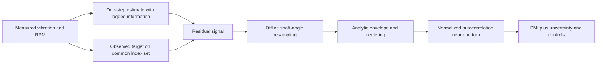

Reset a frozen model per record. Compare the raw vibration and every model residual on zero-based samples `1792:N`. At 3,200 Hz, this starts 0.56 s into the series. A 32,000-point development candidate has 30,208 samples on this mask. A forecasting or diagnostic failure is recorded per method, and only matched finite records enter comparisons at each metric.

### One revolution reconstructed from timestamp and speed

Let $n_i$ denote speed in rpm and $t_i$ the timestamp in seconds. Set $u_0=0$ at the start of the retained window and integrate RPM with a trapezoid:

$$
u_i=u_{i-1}+\frac{n_i+n_{i-1}}{120}(t_i-t_{i-1}). \tag{16}
$$

With positive speed and increasing times this is strictly increasing. Interpolate vibration from irregular $u_i$ onto $j/S$, for $0\le j\le \lfloor S u_{N-1}\rfloor$. The endpoint choice prevents extrapolation. The fixed angular resolution is $S=2,048$ samples per shaft revolution. At an acquisition rate of 3,200 Hz and 150 rpm this is finer than the measured angular density of 1,280 samples per turn. Interpolated density does not extend the measured bandwidth. A coarse angular grid can alias measurable high orders and linear interpolation can attenuate frequencies near the acquisition limit. The diagnostic waveform and its reference residual share the same grid.

The whole-record Hilbert transform and interpolation are **offline**. They do not participate in time-causal SRC features. In particular, the upper interpolation endpoint may be a later sample on the input time axis. The offline method accepts this when producing evidence from an already observed acquisition. The causal prediction method uses its separate angle recurrence and strictly prior endpoints.

The output includes RMS, crest factor, biased Pearson kurtosis, first-shift correlated kurtosis and one-sided Hann-corrected amplitudes near shaft orders 1 and 37. An order of 37 corresponds to the principal gear mesh where shaft speed is the measured primitive. Envelope order 1 tests one cycle of amplitude modulation per turn. In both waveform and envelope spectra, amplitude is in units of the supplied standardized vibration. DFT amplitudes are corrected for the Hann coherent gain and doubled for interior positive-frequency bins. These are descriptive domain features.

### Three PMI interpretations

Let $a_j=|e_\theta(j)+\mathrm{i}\mathcal H(e_\theta)_j|$ be the analytic envelope of the angular residual. The centered envelope is $b_j=a_j-\bar a$. Compute

$$
R_b(k)=\sum_{j=0}^{M-1-k} b_j b_{j+k},\qquad
r(k)=\frac{R_b(k)}{R_b(0)},\qquad
\mathrm{PMI}(k)=\frac{r(k)}{1-r(k)}. \tag{17}
$$

Every lag uses the same zero-lag denominator $R_b(0)$; the numerator has $M-k$ available products. For the envelope $[5,3,5,3]$, centering yields $[1,-1,1,-1]$. At lags 1 and 2, normalized correlations are $-3/4$ and $1/2$ and PMI is $-3/7$ and $1$, respectively. Even the perfectly repeated lag-two pattern uses only two matches. More generally, correlated disturbance, window length and mean removal influence the quantity. A negative score is possible. The diagnostic returns explicit invalid reasons for a missing or nonmonotonic RPM trace, too few angular samples, zero centered variance or a numerically degenerate denominator. No invalid score is silently zeroed.

| Output value | Input to analytic envelope | Lag | Purpose |
|---|---|---:|---|
| `lecturer_compatible` | Mean-centered angular vibration, restore DC to the upper envelope as in MATLAB | 2,047 | Match the supplied PMI code’s coarse-index expression |
| `lag_corrected` | Same MATLAB mean treatment | 2,048 | Isolate the effect of correcting the lag only |
| `mathematically_specified` | Angular vibration directly into Hilbert magnitude | 2,048 | Interpret the centered-envelope mathematical expression over exactly one revolution |
| `pmi_unrelated` | MATLAB mean treatment | Approximately 0.63 revolution | Check whether modulation separation is specific to the target order |

The supplied `fdt_featcal.m` reads `acf(round(fs/f_fault))` in MATLAB when `ran=0`. MATLAB's first array element represents zero lag, so element 2,048 gives lag 2,047. The script calls `envelope(d)`, which uses an analytic envelope of the centered input and restores the input mean to the upper envelope. The next mean subtraction on that upper envelope removes the restored constant. The Python implementation has the same mean convention and zero-lag energy denominator for the instructor-compatible mode. The MATLAB script asks for a 3.1-turn correlation span, so that mode explicitly returns missing when the record cannot support it. The separate mathematical mode uses any valid one-turn lag with nonzero variance. The original `toConstantSamplesPerCycle` helper and gold outputs are absent. Numerical fixtures verify the intended Python arithmetic, while end-to-end MATLAB parity remains unverified.

A sampled signal $x_\theta=[1+0.4\cos(2\pi u)]\cos(2\pi\,37u)$ on an eight-revolution grid has an exactly calculable envelope and exact-lag PMI 7. The measured compatible value at the one-fewer-sample lag is 7.00958 on the test grid of 1,600 angular samples per revolution. Both exact-lag Python modes returned 7 within $2.2\times10^{-13}$. This fixture checks conventions. It is not a source MATLAB experiment.

### Provisional index groups and evidence

Records 61 and 63 exactly overlap the training and development acquisitions in both vibration and speed. These records are retained as outputs and excluded from inference about the remaining candidate corpus. Group A comprises candidate IDs 1–100 and group B 101–200. The exact roles of health condition and acquisition genealogy require authoritative metadata. Describe the measured summaries as provisional index-group distributions. The B-high conditional AUC compares all B-versus-A pairs and gives ties half weight. It can be below one-half if raw vibration has a larger median in A. When several models achieve an AUC of one, distinguish the median gap $\operatorname{median}_B-\operatorname{median}_A$, the extreme separation margin $\min_B-\max_A$, a central-quantile margin, and one-turn specificity. Uncertainty is evaluated by resampling records within groups and keeping the same sampled IDs across methods for paired differences. This resampling cannot resolve unknown common acquisition lineage.

PMI standardization is withheld without independently verified healthy calibration. A threshold selected from the same 198 development candidates would reflect their composition. The conditional results cannot establish a deployment false-alarm rate, verified precision or recall, or a blind crack sensitivity. The complete per-record output is available for future evaluation with the appropriate metadata and a separately determined operating point.

### Stress the prediction channel and the diagnostic grid separately

The validation stress suite uses eight fixed RPM conditions. Two 2% signed biases model a scale error. Correlated noise has 0.6% fractional SD and an autoregressive smoothing parameter 0.962. Independent random jitter has 0.3% fractional SD. Additional conditions are speed measurement rounded to 1 rpm, 40 ms lag, 75 ms hold-last dropouts, and a smooth profile warp with sinusoidal deviations of 0.8% and 0.4%. Random perturbations use fixed seeds. The held-out warp and hold-last windows differ from the optimization’s single 0.45-Hz fold stress. In each intervention the measured vibration target remains fixed. The code labels model-input-only, offline-angle-only and combined interventions separately. Diagnostic-only RPM perturbation changes the inferred shaft angles and may change PMI while leaving prediction MSE fixed by construction. MSE by true-speed quartile and direction of observed speed change localizes stress sensitivity. A separate validation intervention adds seeded vibration-input noise of standardized SD 0.05.

A joint evaluation with clean and pulsed vibration isolates the response to synthetic evidence. Let $p_t$ be a fixed causal damped carrier generated after an angular event. Periodic events use a fixed angle once per turn. Aperiodic controls randomize angle from turn to turn. The five periodic cases span 390–1,260 Hz, amplitude 0.12–0.88 in standardized vibration, decay 1.7–6.1 ms, multiple phases and a mixed RPM-warp case. The two aperiodic controls reuse carriers and amplitudes from matched periodic tests. No pulse amplitude is assigned a physical crack size.

For frozen forecasts with equal speed quality,

$$
\Delta \widehat x_t=\widehat x^{\mathrm{pulse}}_t-\widehat x^{\mathrm{clean}}_t,
\quad
\Delta e_t=p_t-\Delta\widehat x_t. \tag{18}
$$

The distortion score $\sum_t(\Delta\widehat x_t)^2/\sum_t p_t^2$ measures how much the predictor changes when it receives injected vibration. Residual-energy retention compares $\sum_t(\Delta e_t)^2$ with $\sum_t p_t^2$. The energy ratio need not fall between zero and one because a predictor can introduce a long response or alter phase. The signed pulse projection and waveform correlation provide complementary evidence. The aperiodic controls report the number of positive PMI shifts and their magnitude as **label-free response of this synthetic control**, rather than a fault false-alarm probability. A degradation specific to one combination of phase, frequency or RPM informs mechanism without extrapolating to physical crack severity.

### Reproduce the diagnostic stage

Run `python scripts/evaluate_faults.py --data-dir data/raw` from the packaged project after installing dependencies and with the frozen checkpoints present. Additional trained variants can be passed with `--src name=checkpoint`, and saved comparator checkpoints with repeatable `--baseline slug`. The CPU analysis resets models per call. The `--cohort` and `--pulse` switches explicitly control full-corpus and validation-pulse scope. Decode each candidate part in natural MATLAB order and preserve the one-based record identity. Where separate CPU lanes are used, the merger checks raw file SHA-256 values, identical masks, overlap decisions and matching independently computed raw diagnostics before comparing families.

Primary artifacts are `fault_per_record.csv`, `fault_group_summary.csv`, `paired_pmi_bootstrap.csv`, `rpm_stress_summary.csv`, `rpm_stress_regimes.csv` and `pulse_summary.csv` under `results/fault`. Four representative records are retained by ID, including one-based IDs 100 and 101 at the provisional group boundary. `fault_traces.npz` stores their aligned waveforms and spectra. Summary tables and representative figures use the same measured data rather than hand-entered examples.

#### Exercises

1. At 120 rpm, how many measured samples span one shaft turn? At 3,200 Hz, the answer is 1,600. A typical 150-rpm turn contains about 1,280 samples instead. A constant sample lag would misalign these two speeds.
2. Why does perfect rank ordering not determine how far apart two groups are? A single record can almost overlap another group while rank order still yields AUC 1. The extreme and central margins quantify distance, and future observations could cross it.
3. If a speed sensor is 2% high, how many true turns correspond to one measured turn? About $1/1.02=0.9804$. This is enough to offset a narrow periodic peak in the angle domain.
4. If $\Delta\widehat x=0$, what happens to the paired residual? It contains the injected waveform exactly, with distortion zero, retained energy one and correlation one. The PMI response still depends on the background residual.

#### Full diagnostic replay used for release

The complete replay below separates comparator and SRC CPU lanes and rejoins their cohort statistics only after identity checks. Each command is run from the project directory with the declared environment installed. Run one lane at a time if comparing their timing.

```bash
python scripts/evaluate_faults.py --data-dir data/raw --out results/fault/comparator_live --baseline sparse_lpv_arma --baseline archived_src_corrected --baseline cnn --baseline ridge --cohort sparse_lpv_arma archived_src_corrected
python scripts/evaluate_faults.py --data-dir data/raw --out results/fault/src_live --src primary_pi_src=checkpoints/src/primary_pi_src.npz --src pi_src_adapter_off=checkpoints/src/pi_src_adapter_off.npz --src pi_src_optimized=checkpoints/src/pi_src_optimized.npz --src pi_src_fixed=checkpoints/src/pi_src_fixed.npz --src src_generic=checkpoints/src/src_generic.npz --src src_polynomial=checkpoints/src/src_polynomial.npz --cohort primary_pi_src pi_src_adapter_off pi_src_fixed --pulse primary_pi_src pi_src_adapter_off pi_src_fixed src_generic src_polynomial
python scripts/merge_fault_runs.py results/fault/comparator_live results/fault/src_live
```

The supplementary 41-record screen reuses protected predictions only for comparator checkpoints with byte-identical hashes and the same original raw MAT file hashes and scoring mask. The rejoin checks all four raw PMI conventions against live recomputation to numerical tolerance. The full 200-candidate figures use live predictions or raw measurements. Screening results for models whose prior scores were retained are tagged with their provenance. Recreate that supplementary scope with `python scripts/lineage_fault_screen.py <expanded-project-path>` if the protected expanded study directory is available. Development comparisons remain separate from the frozen blind command and its source-data availability checks.

#### Measured intervention results

These results use one held-out development acquisition on the same 22,208 scored targets. The six SRC configuration roles and four reference model roles all completed the eight sensor conditions. The optimized base and the correction-off model give the same recorded forecasts here, so they contribute a single distinct result to the comparison plot.

| Forecast | Clean MSE | Mean eight-case MSE | Worst RPM MSE |
|---|---:|---:|---:|
| Selected PI-SRC, correction enabled | 0.32997 | 0.37031 | 0.45703 |
| Selected PI-SRC, adapter off | 0.34071 | 0.38092 | 0.46823 |
| Fixed-physics PI-SRC | 0.36053 | 0.39931 | 0.49555 |
| Generic SRC | 0.41212 | 0.41675 | 0.42368 |
| Strict sparse LPV–ARMA | 0.37141 | 1.16684 | 6.55481 |
| Archived SRC, correction enabled | 0.31779 | 0.35707 | 0.45406 |
| CNN | 0.39464 | 0.39823 | 0.41202 |
| Ridge | 0.36806 | 0.38656 | 0.43330 |

The correction reduces the selected SRC’s clean and worst-case errors on this acquisition. The archived SRC retains smaller absolute error on both measures. Generic SRC and CNN are less sensitive under these perturbations than PI-SRC, while their clean errors are higher. The very large positive-bias error of sparse LPV–ARMA is an observed extrapolation risk for that fitted speed schedule.

On the original validation signal, selected PI-SRC residual PMI is 0.01804. Raising only the RPM seen by the predictor by 2% increases that value to 0.11624, while applying the same bias only to diagnostic angle reconstruction gives 0.02255 with clean MSE preserved. Changing both paths gives 0.06296. This separates two different mechanisms for sensor-induced changes in the same indicator. The predictor-only nuisance shift of +0.09819 is much larger than the median synthetic periodic uplift described below, despite weak response to the particular aperiodic controls.

Selected PI-SRC increases PMI in all five periodic cases and neither aperiodic control. Its median periodic waveform correlation is 0.690, median distortion 0.946 and median energy ratio 1.794. Its correction-off control also increases PMI in five periodic cases and neither aperiodic one, with median correlation 0.690. Fixed-physics and polynomial SRC give stronger median waveform correlations of 0.756 and 0.792 despite weaker clean prediction. The archived SRC yields the same sign counts, with median waveform correlation 0.616 and distortion 1.331. These measurements expose different trade-offs across the indicators. Real defect sensitivity depends on acquisitions and sensor conditions outside this synthetic battery.

## 20. Robustness and ablation as controlled experiments

Robustness asks how the same fitted procedure responds to a specified change in its measurements or operating context. An ablation asks how the result changes when one part of the procedure is altered. They share a principle. Hold the relevant experimental quantities fixed and identify exactly which intervention occurred. Without a fixed target, mask, and baseline, an apparent gain may reflect a different problem or comparison. Notebook 08 reads the actual intervention ledgers and makes these distinctions executable.

### 20.1 Separate prediction sensitivity from analysis sensitivity

The pipeline has two uses of measured speed. Causal feature generation uses historical RPM to construct phase, select past vibration, and schedule a readout on operating condition. Offline diagnosis uses the measured speed over the record to reconstruct angular coordinates for a residual that already exists. If a speed error enters the forecasting path, it can change the residual even if the angular reconstruction is perfect. If the same error enters only the diagnostic path, the residual in seconds is fixed while its shape and repetition on the angular grid change. Their combined consequence need not be the arithmetic sum of the two independent changes.

Let $x$ be the supplied vibration, $n$ the observed reference RPM, and $g(n)$ a designated sensor error. Write $F(x,n)$ for causal forecast and $P(e,n)$ for the angular PMI of residual $e$. The two error contrasts can be written explicitly as

$$
\begin{aligned}
\Delta_{\mathrm{pred}}&=P\!\left(x-F(x,g(n)),n\right)-P\!\left(x-F(x,n),n\right),\\
\Delta_{\mathrm{grid}}&=P\!\left(x-F(x,n),g(n)\right)-P\!\left(x-F(x,n),n\right).
\end{aligned} \tag{19}
$$

In Eq. (19), forecast vectors and residuals share the 22,208 scored indices. Both terms compare dimensionless PMI under identical timing. The code evaluates the both-path condition separately. These contrasts distinguish mechanisms on the recorded acquisition. They do not establish the accuracy class of a sensor or a population response. The measured values are saved per case and method in the fault ledger. Its scenario named `bias_plus_2pct` scales speed by 1.02. The stress battery also includes holds, delay, smoothing or excursions according to the exact generator, rather than replacing speed with arbitrary noise. See `speed_cases` in [the stress module](../src/src_gearbox/diagnostics/speed_stress.py) before interpreting a case label.

A simple calculation shows why a bias can matter for the 259-order bank. A speed ratio error of $q$ produces a phase offset of about $2\pi kq a$ radians over a history span of $a$ true shaft turns. With $k=259$, $q=0.02$ and $a=0.10$, the magnitude is about 3.25 radians. A predicted state may flip phase over only one tenth of a rotation. Weighting attenuates older samples in an actual oscillator. An angle-domain feature also queries a changed interpolation location. A smooth speed polynomial may extrapolate or saturate for a different reason. These mechanisms motivate separately inspecting the phase, angular, and amplitude branches under speed measurement error.

The selected model's clean development PMI is approximately 0.01804. Feeding a +2% bias into the predictor alone raises PMI to approximately 0.11624, whereas feeding that bias through the offline grid alone raises it to approximately 0.02255. Applying it to both gives approximately 0.06296. Phase distortion and model behavior can partially cancel numerically. Even after demonstrating improved prediction MSE under some stress scenarios, a threshold calibrated from one clean setting could be unreliable under an RPM bias. The [sensor PMI figure](../figures/fault/sensor_pmi.png) is an intervention on one observed speed trajectory. Its vertical or horizontal distances are scenario effects on this fixed record.

### 20.2 Signed waveform retention is more informative than energy alone

For a known synthetic addition $p_t$, define the change in a model's prediction as $d_t=\hat x^{\mathrm{injected}}_t-\hat x^{\mathrm{clean}}_t$. The difference between its injected and clean residuals is $p-d$. In a scored interval the retained waveform energy satisfies

$$
\frac{\lVert p-d\rVert^2}{\lVert p\rVert^2}
=1+\frac{\lVert d\rVert^2}{\lVert p\rVert^2}
-2\frac{p^T d}{\lVert p\rVert^2}. \tag{20}
$$

All three ratios are dimensionless. If the predictor does not react at all to the added pulse, energy ratio equals one and distortion equals zero. An energy ratio greater than one can arise from a counter-phase response or a delayed response that increases energy while blurring shape. If a predictor tracks half a pulse exactly, its residual keeps only half the amplitude and a quarter of the energy, even though the waveform correlation is one. If $d$ is orthogonal to $p$, the original projection is intact while the residual gains unrelated variation. A correlation and a projection alongside the energy ratio clarify each case. This identity can be checked independently in short vectors. For example, $p=(2,0)$ and $d=(1,1)$ give retained energy $1/2$, distortion $1/2$, and $p^Td/\|p\|^2=1/2$.

Periodic injection controls establish sensitivity to chosen, known waveform changes. The archive, SRC, and conventional references can have overlapping MSE ranges but distinctly different pulse response. Normal operating variation and an actual bearing or gear fault do not necessarily produce an additive damped waveform of known order, phase, and amplitude. The observed sign of the PMI shift gives less information than direct labelled detection performance over independent load profiles. The reproducible [pulse ledger](../results/fault/pulse_preservation.csv) records enough structure to change the aggregate diagnostic without retraining. The pulse trade-off display pairs waveform preservation against clean prediction performance. Better orientation on one axis need not improve the other. Primary PI-SRC obtains lower clean error than polynomial SRC on the measured validation record, whereas polynomial SRC's median injected-waveform correlation is greater. That is evidence for a trade-off in this battery.

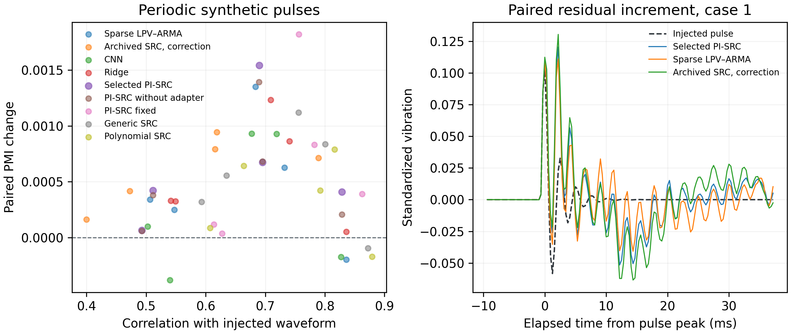

Report measured counts as scenario counts. Five positive cases out of five is a description of a designed battery. Its denominator is five perturbations of one recording, not five independently drawn damaged wheels.

### 20.3 Read the ablation hierarchy

The strongest one-change correction contrast loads one selected model, computes its base forecast once, and compares that base vector with the same causal correction applied. A result of that form isolates the inference mechanism in the frozen implementation. Refitting an uncorrected configuration is a separate experiment and may have its own coefficient values. The [matched adapter ledger](../results/ablations/identical_adapter_controls.csv) keeps these controls in one coordinate system. The identical adapter lowers error for strict sparse LPV–ARMA, the polynomial SRC, and the primary PI-SRC by different amounts. A gain in all three models shows that useful predictability remains in the older base-error history of more than one method.

Removing angular lags, oscillator states, proxy innovations, acceleration, synthetic augmentation, or changing nonlinearity capacity alters the final prediction map. Some such variants regenerate the design and refit coefficients. The observed delta then describes the full changed learner under a stated protocol, including differences in the fitted readout, rather than the contribution of one coefficient set with all else held fixed. A model can use overlapping information from angle and oscillators. The combined no-angle/no-carrier case is therefore valuable in addition to each individual change. Numerical differences can be reconciled in [the ablation table](../results/ablations/src_ablations.csv), with exact configuration JSON for each row. The larger 12-order alternative obtained lower development MSE than the primary. Because model selection had been frozen, this becomes evidence for an independent future check and does not supersede the named primary.

The pure clean-MSE objective provides another informative comparison. Its selected configuration is based only on a different training-only criterion within the same finite trial suite. It can lead to a better error on the single development record while being less attractive on fault or sensor terms. Use the [selected configuration ledger](../results/optimization/selected_configs.json) to confirm that each rule was applied to the planned training summaries. Do not use later development differences to redefine the earlier optimization objective. Interpret a model's fitted condition estimate as a property of its regularized normal system on those rows, including weights and scale. It cannot demonstrate physical interpretability by itself.

### 20.4 Earlier-only sensitivity

A guarded fold excludes the held interval and its neighboring raw history. It may still use distant observations recorded later. A deployment that predicts a future operating state has only earlier measurements for fitting. This is a stricter distributional test. With the same configuration, earlier-only MSEs for the three held intervals were about 1.41380, 1.11093, and 0.35367. Their permitted training stops were 3,008, 9,408, and 16,608 respectively. That strong dependence on record coverage is scientifically important. It shows that within-acquisition interpolation was much easier than forecasting under short or earlier operating coverage. It does not broadly quantify long-term degradation.

Correlated scenario sensitivity also matters for causal verification. Changing the complete input suffix at and after a target should leave the selected model's forecast invariant through that target. Numerical differences of rounding scale are tolerable when controlled. Test three roles separately if expanding the suite. Changing late vibration leaves earlier outputs unchanged, changing late speed leaves earlier phase estimates unchanged, and replaying a prior prefix from a clean reset reproduces its trajectory. These tests fail a specific data-flow implementation that could otherwise yield deceptively low MSE. A passed perturbation probe supplements rather than replaces an explicit support derivation and review of the readout-fit split.

## 21. The lecturer’s sparse time-variation reference

The lecturer's article develops a sparse linear parameter-varying autoregressive moving-average model for nonstationary gearbox vibration. It is a substantive comparison because measured speed may change the coefficients that infer previous vibration and innovations, not only supply an additive offset. It also preserves a relatively clear classical map from historical state to prediction. The reconstruction and protocol examples in Notebook 02 distinguish the article's experimental scores, the supplied legacy checkpoint, the strict matched reference, and diagnostic refits.

### 21.1 Expand scheduled coefficients

Using the sign convention of a positive autoregressive coefficient on the right-hand side, let $s_t$ be a dimensionless rotational schedule, $P_j$ a basis, and $\tilde\epsilon_t$ a proxy innovation. The useful one-step representation is

$$
\widehat y_{t|t-1}
=\sum_{i=1}^{p}\sum_{j=0}^{P_a} a_{ij}P_j(s_t)y_{t-i}
+\sum_{h=1}^{q}\sum_{j=0}^{P_b} b_{hj}P_j(s_t)\tilde\epsilon_{t-h}.
\tag{21}
$$

Each feature is a product of one vibration or innovation lag and one schedule basis value. Implementation details dictate whether a quantity called basis dimension counts the constant term in its stored value. Read the checkpoint dimensions to determine the actual number of product columns. Fit coefficients may also use a sign convention in the polynomial operator different from the expanded predictor written in Eq. (21). Both are translatable by an explicit mapping. Check a small fitted forecast to confirm. In the strict development table $s_t$ uses the latest permissible speed through $t-1$. The preserved archive current-speed row uses the scheduling variable at $t$. Whether contemporaneous RPM can be measured before predicting vibration is then an acquisition-interface question.

The same $s_t$ can be represented in monomials, Legendre polynomials, or another stable basis. For an unpenalized fit on the same full-rank span, an invertible linear basis change may leave fitted predictions unchanged. Lasso penalizes coefficients in the chosen coordinate system. Its support can therefore change when the same polynomial span is represented differently or columns are scaled differently. Projection coefficients fitted in one basis cannot simply be passed into another. The article describes Legendre polynomials in prose while its displayed expression resembles monomials. Reproduction keeps the interpretation explicit and records both. The difference is visible in the current-RPM row-CV evidence rather than settled by guessing which code generated a paper panel.

The first stage fits a sparse speed-scheduled AR model and obtains the innovation proxy from its residual. The second stage uses that history to fit a sparse speed-scheduled ARMA model. An innovation is available after its vibration target arrives. At evaluation time the previous observed vibration lets the algorithm compute the corresponding first-stage residual before predicting the next sample. Replacing $y_{t-i}$ and $\tilde\epsilon_{t-h}$ by recursively forecast values would change the information contract and error accumulation.

### 21.2 AIC, sparsity and refitting

For a family of fixed training residuals and comparable estimated variance, the article uses $\mathrm{AIC}=N\log(\widehat\sigma_e^2)+2d$, with $N$ target count and $d$ parameter count under its convention. AIC penalizes high-dimensional candidates even if their residual variance is lower. For an illustrative comparison with $N=2{,}000$, reducing variance from 0.40 to 0.38 lowers the data term by roughly 102.6. Adding 65 parameters raises the penalty by 130, so the denser candidate loses by about 27.4. That arithmetic assumes comparable evaluated rows and an appropriate objective approximation. AIC does not constitute an independent test, nor should residuals from a shorter, easier segment be compared without caution.

The next step solves an L1-penalized problem. In the article's ADMM setup the sparse coordinate update uses soft-thresholding, which zeros components inside a threshold and subtracts the threshold from the magnitude of the remainder. For $v\in\mathbb R$ and $k\geq0$,

$$
S_k(v)=\operatorname{sign}(v)\max(|v|-k,0). \tag{22}
$$

If the input is 0.6 and threshold is 0.2, its sparse update is 0.4. An input of -0.08 maps to zero at that threshold. This operation handles the cusp in the L1 objective without requiring differentiability at zero. Convergence still depends on scaling, stopping criteria and numerical conditioning. A numerical audit should retain iterations, objective or primal/dual tolerances, input shapes, and the exact support extraction criterion. Refitting the selected nonzeros can reduce shrinkage bias while leaving structural zeros intact. Refitting on the full design would discard the sparse hypothesis.

The nominal paper implementation uses five-fold selection. Its text states that the highest penalty within **one standard deviation** of the MSE of the minimum-MSE penalty is retained, rather than explicitly saying one standard error of the mean. On five observed fold values the latter would usually be smaller by $\sqrt{5}$, under simple independent-fold assumptions. In this setting fold outcomes are dependent. The supplied paper-style to strict-course fit changes more than this one rule: it changes scheduling, support, and how overlapping training histories are guarded. A fair result does not attribute every score difference to one convention.

### 21.3 Three interpretations of a reported number

The publication's laboratory setup used a 20 s raw acquisition to form two 7.5 s baseline segments after preprocessing. The supplied train and development files each span 7.5 s at 3,200 Hz but follow different acquisition and partition evidence, including actual identities of fault-overlapping records. The test segment in the article and its exact chronology were unavailable to verify against the supplied development segment. Table 6's Sparse LPV–ARMA MSE of 0.2893 belongs to the authors' asserted setting. The strict course execution recovers about 0.371406 for the matching baseline on the later matched held-out mask. Both values preserve their own units and information contracts. A same-mask numerical result does not establish absolute superiority to the publication, nor does the numerical discrepancy alone show a failed implementation.

The preserved archive with current RPM and a target start of 316 gives about 0.336901 on its declared earlier development window. Recomputing the score on the stricter [1792,24000) marginally changes its evidence since the earlier 1,476 targets have been removed. Using previous RPM and the common start gives another preserved archive mode entry. Changing training and development settings together makes the strict refit a stronger new procedural benchmark, at the cost of departing from a literal archive replay. The dense strict LPV–ARMA alternative gives about 0.330781 and remains useful supplementary evidence alongside sparsity. It differs from the required sparse family in support and capacity.

An archived retrospective search can rotate or window a record until its MSE approaches a prior published value. If circular wrap splices the end to the beginning, histories straddling the join are not physically continuous. Even within a continuous segment a score-directed search uses outcome information. Its evidence is investigative, and it belongs outside held-out model ranking and selection. A reproducible report stores segment identity and target continuity, making it possible to distinguish the original numerical result from a fitting procedure that happens to return a similar value.

The release includes both the [external table](../results/metrics/published_paper_reference.csv) and the [local reference table](../results/metrics/local_statistical_reference.csv). The measured strict coefficients can be recomputed using [the statistical reference command](../scripts/02_reproduce_lpv_reference.py). Its optional `--fit-paper` flag repeats the current-RPM five-fold coefficient estimation. The result supports comparisons of conventions. It does not make an unavailable original test record appear.

## 22. Numerical software engineering and reproducibility

### 22.1 Separation of inputs, results, and fitted state

A practical scientific tree separates source code from data and derived outputs. Input identities must be visible before a fit. Code, configuration, and fit evidence explain what was done. Most model state is numeric array data. A serialized checkpoint is useful only if a reader can identify the compatible loader, reproduce feature order and scaling, check the training provenance, and distinguish the model's required history from evaluation warm-up. At evaluation time the project reloads frozen weights and recomputes scored vectors under an explicit sample mask.

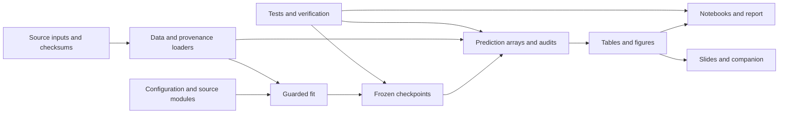

The licensed data are local inputs rather than implicit dependencies hidden in model code. `inputs/input_manifest.csv` records byte identities, roles, and missing files. `data/splits/protocol.json` spells out partitions and target indices. `configs/` stores the selected configuration plus explicit evaluation and optimization settings. `checkpoints/src_registry.json` identifies the source revision, data hash, model parameters and per-checkpoint identities. The fitted artifacts live in `checkpoints/`. Review tables in `results/` keep one row per measured condition or scenario rather than a screenshot of a summary. Sources of figures map back to the tables and vectors. This separation supports both reproducibility and respectful use of external documents and data.

The input manifest fingerprints the bytes with SHA-256. A hash protects identity and helps detect accidental changes. It does not by itself prove a source is licensed or trusted. Compare file path, structure, count, and digest to a known inventory. Archive intake bounds individual and total expanded sizes and rejects unsafe paths. MATLAB loaders treat each struct and subrecord with its declared field types. Skip a missing independent test honestly. Guessing what a malformed or absent source should contain can introduce bias or silent unit errors.

### 22.2 Reference and deployment-style unit tests

A scientific numerical test needs an oracle. An oscillator can be checked with direct finite summation and a faster recurrence. A train-mask test can derive guard intersections from half-open interval arithmetic. A sensor phase fixture at constant speed can give exact rev/s and known lag. A serialization test can round-trip the explicit feature order, fixed normalizers, and numeric weights, then compare resulting predictions. A zero-envelope fixture should report why PMI is invalid instead of inventing a zero score. An expected failure should remain distinguishable from a model that completed normally.

For the direct oscillator reference, separate sign and truncation. Test a constant-speed harmonic at its known order to check remodulation. Test an isolated impulse near a restart and look for the first affected target. Test finite support by comparing output after the oldest allowed raw sample leaves the filter. Test a chirp so a hidden constant-frequency assumption becomes visible. The project includes implementations of these ideas in its test suite and in Notebook 03. The verification report measures equal-input checkpoint replay and perturbation of later samples. A high-level prefix mutation test proves no dynamic influence at the selected tested points. Design review and independent algebra cover gaps between those points.

A data-dependent end-to-end check can reproduce the selected validation vector from the saved checkpoint and the user-supplied `sigvalid.mat` file. A lightweight no-raw-data check can audit the saved arrays against the table. Use either under the stated scope. Numerical errors should be reported to a reasonable tolerance. Relative tolerances can misbehave near zero, and exact identity of floating-point sums across different BLAS builds is unnecessary for scientific reproducibility when the difference remains measured and negligible.

The following check verifies the recorded primary mean squared error and the common index order using only released arrays. Run it from the project root with the packaged Python environment.

```python
from pathlib import Path
import csv
import numpy as np
from src_gearbox.study import scores

with np.load(Path("results/predictions/primary_pi_src/sigvalid.npz"),
             allow_pickle=False) as promoted:
    indices = promoted["target_indices"]
    np.testing.assert_array_equal(indices, np.arange(1792, 24000))
    actual = promoted["target"]
    prediction = promoted["prediction"]
    calculated = scores(actual, prediction)["mse"]
with Path("results/metrics/all_model_comparison.csv").open() as source:
    primary = next(row for row in csv.DictReader(source)
                   if row["model"] == "primary_pi_src")
np.testing.assert_allclose(calculated, float(primary["mse"]), atol=1e-12, rtol=0)
```

The call to `scores` checks finite residuals and computes summary metrics on already aligned inputs. The integer interval test is independent of the floating-point comparator. An error usually means the wrong model path, split, or mask, rather than an optimization result requiring investigation of architectural details.

### 22.3 Timing protocol and scaling

Use the tested Python versions and required native tooling named in the [README](../README.md). Numerical dependencies are pinned by version in the project constraints and compiled backend/CPU details are recorded in the measured timing provenance. Use a fresh environment rather than relying on global packages from unrelated experiments. The common run constrains numerical operation threads to one. Several comparator models use a different code path internally but respect the same reported CPU and thread scope. A cold call may include memory maps, imports, native-library start-up or initialization. Warm calls repeat the loaded predictor on the full record, given the supplied measurement arrays. Compare like stages. The timed project baseline does not include a sensor transport stack, and clock ratios to acquisition duration do not prove real-time deadlines.

Checkpoints can be audited without importing a previous project or opening pickled objects. The prior trained comparator checkpoints are explicitly frozen and replayed. The new 41-trial search fits independent SRC families on guarded training segments and records the completed trial history. Partial outputs use atomic writes and resume identities. A completed trial can be reused only if its source digest, configuration and training data identity agree. Numerical provenance includes actual code hash and fit protocol. The stored results support an audit without silently rerunning expensive stages when opening a notebook.

For Windows PowerShell, set the escape and quoting conventions shown in the README and invoke `python` from the activated virtual environment. On Linux or macOS use the Bash activation path. Force a CPU distribution when comparing the provided CPU benchmark. A GPU is an optional environment with a separate experimental question. Rebuilding reports and decks requires Pandoc and LibreOffice, while reading the packaged PDF and office files only requires compatible viewers. Opening the assembled file cannot verify that a scorer executed, so maintain the artifact verifier and numeric checks separately.

### 22.4 Command sequence and fallback scope

For the numerical evidence alone, use the stage-aware pipeline or execute frozen steps individually. The examples are for a project clone with designated data copied into `data/raw`. None of the commands reads the blind files to tune a model. Frozen blind evaluation runs only when the independent files are available.

```bash
python scripts/run_pipeline.py --mode smoke
python scripts/15_verify_outputs.py --numbers-only
python -m src_gearbox.study score --data-dir data/raw
python scripts/06_train_baselines.py --data-dir data/raw --tier standard
python scripts/07_compare_models.py
python scripts/11_build_figures.py --only-search
```

To independently repeat the SRC search, use `05_optimize_src.py --resume` with the declared data and profile before fitting from its selected configurations. To run new comparator fits rather than only loading and scoring the protected weights, use the isolated all-family fit tier. New fits have a new provenance and can produce a different ranking. Report the difference explicitly. To reproduce the complete diagnostic release use the two lane commands documented in Chapter 19. To rebuild a short example or teaching table with no external reference files present, follow the code-only verification and synthetic exercise commands.

When a relative path fails under notebook launch, start from the repository root or set `SRC_PROJECT_DIR`. The release's executed notebooks use project discovery with a fallback path variable. To rerun a single notebook by name use the indexed helper. For report and presentation regeneration use the workflow in Chapter 24. Keep source figures intact while rerunning any experimental plots twice to avoid comparing a new PDF with stale CSV labels.

## 23. Interpreting the actual experimental evidence

The project answers a controlled question about one available development acquisition. The same 22,208 target values, standardized units, previous-observation protocol, mask and record boundaries apply to the scored required comparators. Different feature assumptions, training budgets and parameter counts are still part of each model definition. A frozen archived SRC had earlier protected exposure and a higher-dimensional representation. Its lower development point estimate is the direct measured historical reference on these targets. The article's original experiment is external evidence. Keeping those scopes visible prevents an improvement claim from moving its comparison target after measurement.

### 23.1 What the project establishes

The selected architecture gives lower same-mask error than the best of the 21 required comparator families. It benefits from a representation anchored to measured timing and speed. On this acquisition the angular-lag ablation has a larger adverse MSE change than the carrier-bank ablation. Disabling the proxy innovations is also harmful. Removing the acceleration term slightly reduces development MSE. The matched conventional, polynomial, and PI-SRC runs with and without the same adapter establish that error-history correction is useful beyond a single physical architecture. Using a full line including the budget, protected final selection, and uncertainty gives a better causal account of the gain than technically correct but incomplete phrases such as “physics wins.”

The 21 comparator families include classical purely temporal models, operating-parameter models, ordinary and regularized regressions, nonlinear kernels, trees, recurrent architectures, convolution, and two distinct transformer models. This breadth probes specific mechanisms. AR controls the contribution of a transparent history-only linear baseline. LPV and ARX probe speed-dependent coefficient scheduling and adding speed lags. Shallow and deep methods serve different combinations of context, nonlinear representational capacity, and regularization. Comparing broadly establishes where the selected representation helped on this record. It does not show that every possible architecture in a named family is inferior.

Within the learning models, the linear model on engineered states is the strongest required baseline, with ridge close by. That is consistent with a favorable physical basis providing meaningful nonlinear information before the readout; an affine readout on nonlinear features can remain an effective overall nonlinear predictor. Sparse LPV is close enough to make timing or deployment cost important. CNN and recurrent models supply data-driven nonlinear responses that improve on some history-only controls. The two Transformer scores in the released ledger reflect their measured compact configurations and tiny number of distinct acquisitions. Their performance cannot be extrapolated to larger labelled datasets or training budgets. Comparators whose architecture names imply future context still use valid past-based inputs in this protocol.

The qualified benchmark speed experiment measures gains in seven of nine matched families when measured RPM is available, with two exceptions. This supports measuring speed and inspecting how it enters a model, rather than assuming every speed channel improves every family. The sign and magnitude of an effect depend on fitting a comparator with both input regimes and keeping the other factors controlled. A frozen version forced to operate on a naive constant speed without refit would probe robustness, not the same feature-value question.

The waveform panel illustrates a specific measured alignment, with predictions above and forecast errors below. Good overlap does not prove residual whiteness. The inset shown here spans only a subset of common targets, while ranking metrics use all of them. Read it beside the residual ACF and PSD plots when evaluating phase lag or periodic structure.

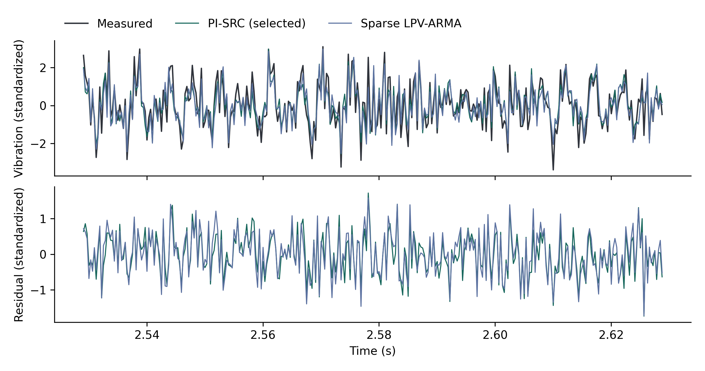

### 23.2 What needs cautious reporting

Timing shows useful differences even among closely ranked models. Seven warmed PI-SRC calls on the measured CPU produce a median approximately 485 ms and an IQR around 32 ms. That is a duration for a loaded 24,000-sample record pipeline and about 6.47% of its 7.5 s duration. The archived method is faster in warm predictions on this platform despite having more deployed parameters. Stored coefficient counts and feature engineering complexity are different dimensions. Fit time includes model training from already loaded data. Other algorithms may allocate differently, have different setup, or expose different compiled kernels. A proposed implementation for live use would need streaming and resource measurements under its actual sensor rate, baseline update policy, and scheduling.

The moving-block comparisons draw contiguous paired error differences, reducing artificial precision from treating every sample as independent. Different block lengths reflect sensitivity to the time dependence being approximated. A noncircular bootstrap includes no artificial wrap between distant ends of the acquisition. It still conditions on a single held-out record. Many bootstrap replications do not multiply the number of independently observed recordings. Do not use the interval as a direct uncertainty statement for a different speed or load distribution. For a contract-sensitive scientific presentation, show the acquisition structure along with the interval and mention that early-only train sensitivity is larger than many within-record differences.

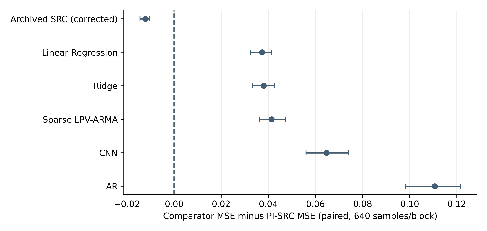

PI-SRC residual PMI distinguishes the supplied provisional record groups under the specified score, with the group margin substantially changed by applying a frozen healthy baseline. The strongest archival SRC also separates the groups. Group separation on provisional IDs does not validate actual healthy/cracked labels. Raw vibration, selected residual, conventional residual, and alternate-lag sensor controls all have specific delivered rows. A reader can reconstruct the actual claim from the cohort counted after overlap removal. The two exactly leaked records were omitted from inferential summaries but retained as audit evidence. Similar-looking speed profiles alone would be insufficient evidence of duplicate acquisitions. Corresponding measured vibration and measured speed provide a much stronger joint signature.

No independent blind prediction or fault label result was available. The frozen command documents availability and expected input contract. Missing independent experiments remain scientifically important. Treat them explicitly even if the final assignment is otherwise substantial. Replacing a test with the development record would both change its scope and obscure the exposure already used in analysis.

### 23.3 Plan an informative independent experiment

A strong extension begins with independently labelled gearbox runs at several speeds and loads, multiple runs per condition, explicit chronological and mechanical device identifiers, calibrated measurement path, and provenance for faults of distinct location or severity. Freeze architecture, features, threshold calibration, and mask prior to opening those runs. Use multiple complete acquisitions as the inferential unit. Hold out one machine, one remount, or one structured group where available. Log speed-sensor conditions so systematic bias and changes in vibration under load can be separated. Track replays of the analysis pipeline without overwriting the preserved evidence.

An expansion can test whether a size-compatible structured library improves transfer over the same nonlinear capacity with basis choices intentionally stripped of shaft and phase information. Conduct a forward-only study as well as a protected within-record study. Compare one-step prediction, autoregressive rollout without future observations, and real fault evidence as separate questions. The methodology developed here already supplies model-reset, mask, fit-statistics, native artifact, and measurement-perturbation tools needed to make such follow-up clear. It also demonstrates that the fastest way to teach reproducibility is to anchor every large performance claim to a short, runnable check and the exact relevant data identity.

## 24. Writing and presenting defensible engineering results

A course report should connect a physical phenomenon to a measurable hypothesis, state the permitted information, show how the algorithm implements the hypothesis, and give both positive and adverse results. The first paragraph of the results can answer three distinct questions in concise order. How accurate is the selected predictor on the held-out scoring problem? Which trained change produced a controlled improvement? What does the diagnostic support under the available labels? Subsequent figures should answer those questions, rather than add decoration or plots with undocumented units.

A figure showing prediction and measured vibration shares time coordinates with the residual. The paired-score interval plot supports uncertainty around development MSE differences, and the speed-quartile plot checks that average improvement does not hide a particularly unfavorable part of the speed trajectory. The [ranking plot](../figures/comparison/mse_ranking.png) should be read with the ranked CSV because archival, provisional, and newly fit evidence have different origins. The [accuracy and cost plot](../figures/comparison/accuracy_cost.png) exposes a trade-off that ranking by MSE alone would miss. Wear monitoring motivates a second family of figures on diagnostic response, sensor sensitivity, and pulse waveform retention.

The eight-minute progress deck can be organized around question, data and acquisition physics, one result that changed the planned features, provisional modelling choices, and credible next measurements. The twelve-minute final deck can add guarded selection, matched benchmark, result attribution, timing, actual diagnosis, adverse results, and limitation of independent claims. Time the succession of explanations, especially where a dense formula competes with a message. Retain speaker notes as self-contained evidence of what each slide communicates. An accessible slide caption gives units and scope for every number it highlights.

Use the [editable project report](../report/SRC_Final_Course_Report.docx), its [PDF review copy](../report/SRC_Final_Course_Report.pdf), and the [eight-minute](../presentations/SRC_Progress_Presentation_8min.pptx) and [twelve-minute](../presentations/SRC_Final_Presentation_12min.pptx) presentations. Generate the office binaries only after the CSVs, JSONs and figures have been frozen. The build script checks native Word equations, figure and table sources, and presentation renderings. The narrative does not assume known defect labels, a verified field diagnostic, or a GPU measurement. The report appendix gives the artifact names and direct timing hardware. The `paper` values and strict matching scores are visually and verbally separated.

For an oral defense, practice questions whose answers depend on the evidence rather than terminology. Which speed samples can enter a prediction at time $t$? What is the largest score-changing correction history? How would an amplitude modulation appear differently on a speed-jittered time grid versus a measured angle grid? Can three guarded folds be treated as three independent runs? Why does a smaller MSE not guarantee that a periodic-impact diagnostic gets better? Under which ablation did each conclusion actually change? A robust response points to a saved record, explains the model scope and unit, and names the next useful experiment.

## 25. Worked exercises, troubleshooting, and notation

### 25.1 Analytical and computational exercises

**1. Phase and sample support.** At 160 RPM and 3,200 samples/s, calculate turns per measured sample, the input mesh frequency, and the largest feasible order by time-domain Nyquist. Predict how an eight-mesh-cycle lag changes between 130 RPM and 160 RPM. For fixed speed, the answers are $160/(60\cdot3200)$, $37\cdot160/60=98.67$ Hz, and 600 cycles/revolution. Eight mesh cycles take about 319 samples at 130 RPM and 259 at 160 RPM. The phase difference across records motivates angular resampling or a physically informed prior. The discrete query still must have both time endpoints preceding the forecast target.

**2. Damped-state test.** Configure one causal estimator with $M=4$ and $\tau=2$ samples. Inject a unit impulse at index 5 and compute which predicted quadrature outputs can change. The allowed influenced targets are 6, 7, 8 and 9. With $r=e^{-1/2}$ their magnitudes before any later linear readout are proportional to $1,r,r^2,r^3$. At target 10 the impulse has left the finite support. Verify the normalized values and observe that complex phase enters multiplicatively without changing their magnitudes. The test intentionally uses fewer samples than the measured record.

**3. Identify a leakage path.** You train a standardized speed-conditioned feature transformer on the complete acquisition, including a future evaluation block, and then fit the readout outside the block. Why is this still a leaky design? A fit to the transform uses data beyond the permitted fit segments and can align the scale to unseen speed or target behavior. Save fit statistics per fold and apply them unchanged to that fold's evaluation. Training on two widely separated records with separate histograms and describing their distributions later is allowed. Reusing the latter distribution as a fit statistic silently changes the information contract.

**4. A threshold reporting example.** Two provisional groups of 98 and 100 records separate with AUC 1 under method A and another method. The observed minimum group-B minus maximum group-A margin is twice as large for A. Can we conclude method A detects cracks twice as well? No. The labels are only indices and an observed margin is a distance on the score scale rather than an estimated detection probability or severity effect. A monotonic nonlinear transformation can alter margins without changing AUC. Identify which quantities remain invariant and which will shift under a change in speed-measurement quality.

**5. Relative score and latency.** Compute the percentage difference between selected PI-SRC MSE and the archived corrected result using the archived number as denominator. Using the measured resolution, $(0.32997332-0.31778771)/0.31778771\approx0.03835$, or 3.83% higher. The same denominator convention with strict Sparse LPV–ARMA in the denominator gives a favorable reduction. Express the median primary cost per record as a fraction of 7.5 s and as throughput on 24,000 samples. Approximately 0.485/7.5 = 0.0647 and 49,500 samples/s. Explain the assumptions behind those numbers and why they do not set a per-sample streaming deadline.

**6. Paired benefit.** A block of observed target and two predictors yields error arrays $a=(2,0,1,-1)$ and $b=(1,1,0,-1)$. The paired MSE difference for $a$ relative to $b$ in model error is computed as the mean difference of squared losses, $\operatorname{mean}(a^2-b^2)=0.75$, rather than the mean squared waveform difference. The latter is useful for sensitivity and disagreement but answers another question. To bootstrap this example, draw integer starting positions for length-two contiguous blocks and collect pair-aligned values. Four observations are too few for a meaningful scientific interval. The exercise tests bookkeeping.

**7. Diagnose a load mismatch.** Suppose a saved MSE and a direct notebook score differ by 0.01. First check the model ID, archived versus newly fitted scope, exact prediction dtype, target axis length, expected mask start, recorded time units, and default reset. Check whether a base or corrected vector was loaded. Then verify checkpoint digest and per-split numerical settings. Refit only when investigating an intentionally different experimental path. This sequence localizes common mistakes before attributing a discrepancy to numerical precision.

### 25.2 Frequent practical faults

| Symptom | Evidence to inspect | First check |
| --- | --- | --- |
| Both archive and split files load | Input manifest and split loader | Supply one complete representation or the set of unique numbered parts |
| RMSE differs from known table | Record and prediction keys in NPZ | Use zero-based target indices and the column's standardized units |
| Oscillator fails at boundary | Measured speed, offset span and minimum RPM | Ensure available support and monotonic accumulated turns |
| Test forecast does not exist | Frozen availability JSON | Identify missing independent file without falling back to development |
| Benchmark much slower on another machine | Timer stage, thread counts and fitted configuration | Repeat loaded batch scope and report platform |
| Office render differs | Fonts, converter versions and document XML audit | Validate native output, line wraps, labels, and figures on the host |
| Diagnostic score is invalid | Status, retained samples and envelope graph | Check length, angular turns, zero variance, and denominator |
| Optimization resumes wrong fit | Trial ledger job hash and configuration tree | Do not edit the source digest while reusing results |
| Comparison changes after opening notebook | Notebook cell mode and frozen prediction path | Use ledger read and package smoke modes before full fitting |
| Truncated plots in handout | Embedded figure size and rendering PDF | Inspect labels at actual viewing width and exported dpi |

### 25.3 Notation and abbreviations

| Symbol or term | Meaning | Scale or role |
| --- | --- | --- |
| $t$, $j$, $h$ | Time index, summation index or historical lag | Samples unless seconds are explicit |
| $x_t$, $a_t$, $e_t$ | Standardized vibration, pre-standardized recorded channel, residual | Supplied standardized scale and the separately verified affine transform |
| $n_t$, $f_s$, $f_{\mathrm{mesh}}$ | Shaft speed, sample rate, mesh frequency | RPM, Hz, Hz respectively |
| $Z$, $k$, $u$, $\theta$ | Gear tooth count, order, turns, angular phase | 37 input teeth, cycles/rev, rev, radians |
| $M$, $\tau_s$, $M_c$ | Finite oscillator length, decay scale, correction length | Samples, with division by $f_s$ to obtain seconds |
| $\Phi_t$, $w$, $b$ | Feature vector, selected readout coefficients, intercept | Frozen learned fit |
| $\lambda$, $c$, $g$, $C$ | Penalty, Huber threshold, adapter gain, adapter clip | Fit trade-off and residual correction settings |
| $\tilde\epsilon_t$ | Stage-one residual proxy | Known after acquisition of observation $t$ |
| $r(k)$, PMI | Normalized angular envelope autocorrelation and periodic modulation index | Dimensionless, selected lag relative to one tracked shaft revolution |
| AR, MA, ARIMA, ARX | Autoregressive, moving average, integrated, or exogenous-input family | Distinct lag assumptions in Chapter 17 |
| SRC, PI-SRC | Structured Reservoir Computing and its physics-informed variant | Model families in Chapters 7–12 |
| LPV | Linear parameter-varying | Speed-scheduled coefficient model |
| MSE, RMSE, MAE | Mean-square, root-mean-square and mean absolute error | Squared or ordinary standardized units |
| CV, AIC, ADMM | Cross-validation, Akaike information criterion, alternating direction method of multipliers | Fit selection and sparse optimization tools |
| PSD, STFT, FFT | Power spectral density, short-time Fourier transform, fast Fourier transform | Engineering spectral tools |
| CNN, TCN, MLP, LSTM, GRU, TFT | Convolutional, temporal convolutional, feed-forward, gated recurrent and fusion-attention model names | Comparator roles in Chapter 17 |
| AUC | Area under ROC curve or oriented pairwise ranking probability | Provisional ranking in this project, contingent on group definition |
| SHA-256 | Cryptographic file fingerprint | Identity and audit, distinct from scientific validity |

## Appendix A. Worked laboratory sessions

The six sessions below connect the mechanics, software and numerical claims. Run the Python cells from the project root with the environment activated. They use the installed package and the saved result files. Each example has an assertion with a clear target. The synthetic checks are small and use deterministic data. No example imports prior research directories, opens blind records, or retrains study checkpoints.

### A.1. Shaft speed, angular phase and the Nyquist margin

Confusing an order with frequency leads to an incorrect feature bank. Consider a speed ramp from 120 to 160 RPM over four seconds. Its angular rate is the ramp divided by 60, in revolutions per second. At the start, the input shaft rotates at 2.0 Hz and mesh frequency is 74 Hz. At the end, the input shaft rotates at 2.667 Hz and mesh frequency is 98.667 Hz. The same nominal gear pair with 20 teeth on the pinion gives a pinion rotation rate of 3.7 Hz initially and approximately 4.933 Hz at the end. Multiplying the pinion rate by 20 recovers the same mesh frequency. Both counts describe the same contacts from different shafts.

The angle reached by a linear RPM ramp has a closed form. Set speed at time $t$ to $n(t)=n_0+at$, with $a$ in RPM per second. Shaft turns are

$$
u(t)=\frac{n_0t}{60}+\frac{at^2}{120}. \tag{A.1}
$$

The whole-record trapezoidal diagnostic phase matches this integral at each available timestamp because the integrand is affine in time. The one-step prediction phase uses a different final increment. At target $j$, it first integrates the measured data through $j-1$, then advances one step using $n_{j-1}$. Its error relative to the full trapezoidal integral is $-a\Delta t^2/120$ turns for this ramp. That discrepancy is small and deterministic. It buys a meaningful availability property. Corrupting $n_j$ must leave the target-$j$ phase intact.

```python
import numpy as np
from src_gearbox.diagnostics.order_tracking import revolutions
from src_gearbox.src_model import phase_turns

fs = 3200
interval = 1 / fs
t = np.arange(fs * 4 + 1) / fs
n0, ramp = 120., 10.
rpm = n0 + ramp * t
exact = (n0 * t + ramp * t**2 / 2) / 60
observed, causal = phase_turns(rpm, fs)
np.testing.assert_allclose(revolutions(rpm, t), exact, atol=5e-13, rtol=0)
np.testing.assert_allclose(observed, exact, atol=5e-13, rtol=0)
np.testing.assert_allclose(causal[1:] - exact[1:], -ramp * interval**2 / 120,
                           atol=5e-13, rtol=0)
print("Final turns:", exact[-1])
print("Mesh range (Hz):", (37 * rpm[[0, -1]] / 60).round(3))
```

The example gives $9\frac{1}{3}$ turns. A 37-tooth input shaft therefore passes around 345.33 tooth spaces. Under an order-synchronous signal $\cos(2\pi\cdot37 u(t))$, the instantaneous frequency uses the mesh range above. If a code cell returns a constant frequency, it has replaced the integrated angle with fixed time spacing. If it returns a ramp scaled by 60, inspect the RPM conversion.

For a strictly sampled signal, order $q$ requires $(q n/60)< f_s/2$. At the highest observed training RPM, the temporal Nyquist order is about 574. A feature library evaluated under synthetic RPM bias needs additional margin since the measured RPM may differ from the nominal trajectory. The selected highest bank order, 259, remains comfortably below this limit. A diagnostic grid of 2,048 samples per revolution has a numerical Nyquist order of 1,024 after interpolation. Interpolation supplies no independent vibration information above the original temporal Nyquist boundary. A denser angular grid improves numerical indexing and representation. It cannot recover analogue content already removed by downsampling or confounded by aliasing.

**Check yourself.** At fixed speed, compare time lag 100 and angular lag $100n/(60f_s)$ revolutions. For a ramp, a 100-sample lag accumulates a changing number of turns. An angular lag keeps turns constant while its support in time changes. This explains why a single fixed delay can represent impacts poorly at one speed and reasonably well at another. It also explains why an angle map can be fragile under RPM sensor bias. Both points can hold in the same experiment.

### A.2. Finite oscillator, scaling and loss of synchronization

Choose one order $q$, memory $M$ samples and decay $\tau$ samples. Write $z_j=x_j e^{-i\phi_j}$ with $\phi_j=2\pi q u_j$. The held state before target $t$ is

$$
s_t=\sum_{m=1}^{M}r^{m-1}z_{t-m},\qquad r=e^{-1/\tau}. \tag{A.2}
$$

Expanding $s_{t+1}$ yields $z_t+r z_{t-1}+\cdots+r^{M-1}z_{t-M+1}$. Subtracting $r^M z_{t-M}$ from $z_t+r s_t$ produces the same finite sequence. The normalization $2(1-r)/(1-r^M)$ follows from the geometric sum. One factor of two compensates for using the coherent positive-frequency part of a real sinusoid. At exact phase lock with many effective samples, the other, oscillating conjugate term largely cancels. Short memory and low carrier rates can leave interference. This is expected behaviour from a finite filter, rather than a calibration error.

```python
import numpy as np
from src_gearbox.src_model import oscillator_states, phase_turns

fs, order = 3200, 148
rpm = np.linspace(124., 167., 2300)
measured_turns, target_turns = phase_turns(rpm, fs)
x = .6 * np.cos(2 * np.pi * order * measured_turns)
memory, tau = 170, 40.
response = oscillator_states(x, fs, rpm, order=order, memory=memory, tau=tau)
target = 1400
lags = np.arange(1, memory + 1)
weights = np.exp(-(lags-1) / tau)
rotation = np.exp(2j * np.pi * order * (target_turns[target] - measured_turns[target-lags]))
reference = 2 * ((weights*x[target-lags]) @ rotation) / weights.sum()
np.testing.assert_allclose(response[target], reference, rtol=0, atol=3e-12)
print("Finite normalized state (real, imaginary):", (response[target].real, response[target].imag))
```

A fixed relative speed error $\eta$ yields a phase error that grows with the elapsed angular separation in a window. At fixed true speed, write the error per sample as $\delta=2\pi q\eta n/(60 f_s)$ radians. The retained coherent amplitude fraction of a complex sinusoid, ignoring its real-valued conjugate term, becomes the magnitude of the weighted geometric sum

$$
\mathcal A(\delta)=
\left|\frac{1-(r e^{i\delta})^M}{1-r e^{i\delta}}\right|
\frac{1-r}{1-r^M}. \tag{A.3}
$$

At $\delta=0$, the fraction is one. The longer the state memory scales, the larger the phase mismatch across the weighted support for a given sensor error. Equation (A.3) describes ideal coherent content. It cannot determine the fitted readout MSE under an actual replay, where angular delays, order mixtures and optional residual correction interact. It nevertheless gives a physical hypothesis for why +2% measured RPM has a large effect on some models. In real data the direction and size of the final performance change can depend on which modes dominate and on covariance during training.

**Check yourself.** Replace \(\tau=40\) by \(\tau=8\) and \(\tau=128\) in the example. Compare the magnitudes of the finite complex response. Test masks at the beginning and end of your simulated record rather than dropping them silently. Use the exact same time span across settings. A larger quadrature magnitude alone does not choose the oscillator for a forecasting task. The held-fold prediction error, state dimension, and robustness evidence answer separate questions.

### A.3. Regularized fit, redundant degrees and the selection ledger

A readout model may contain nearly identical columns. Consider two delays that coincide in a narrow speed interval. In a simplified algebraic example, the two training columns are exactly identical. Holding the combined weight $s=w_1+w_2$ fixed gives identical fitted predictions. If both weights carry the same ridge penalty, the minimum penalty occurs at $w_1=w_2=s/2$. If the penalties differ, let their positive values be $\lambda_1$ and $\lambda_2$. A constrained first derivative gives

$$
w_1=\frac{\lambda_2}{\lambda_1+\lambda_2}s,\qquad
w_2=\frac{\lambda_1}{\lambda_1+\lambda_2}s. \tag{A.4}
$$

The less penalized feature receives more of the allocation. This may reflect a numerical prior rather than independent physical explanatory value. It clarifies why coefficient magnitude is not sufficient for attribution, especially when oscillator, angular and proxy channels overlap. Changing whether a feature is scaled before ridge also changes its effective penalty in physical units. The checkpoints preserve scaling so inference evaluates the same coordinate system.

The next example reconstructs the outer objective. The repetitions within a candidate are held folds from the training recording. Their means enter the saved bounded selection. Omit the development CSV when reconstructing selection. The positive-part stress term does not reward a noise intervention for accidentally improving a fold.

```python
from pathlib import Path
import json
import numpy as np
import pandas as pd

folder = Path("results/optimization")
trials = pd.read_csv(folder / "trials.csv")
trials = trials.loc[trials.status.eq("DONE")].copy()
selection = json.loads((folder / "selected_configs.json").read_text())
cfg = selection["protocol"]
trials["reduced_cost"] = (
    trials.fold_mse
    + cfg["stress_excess_weight"] * (trials.fold_stress_mse - trials.fold_mse).clip(lower=0)
    + cfg["pulse_distortion_weight"] * trials.fold_pulse_distortion
    + cfg["per_coefficient_penalty"] * trials.parameters
)
np.testing.assert_allclose(trials.reduced_cost, trials.utility, atol=1e-12, rtol=0)
for row in selection["selection"]:
    trial = trials.set_index("trial_id").loc[row["trial_id"]]
    print(row["model"], row["trial_id"], round(trial.reduced_cost, 6))
```

The computed objective winner in the designated eligible group, the clean-only challenger, and a compact group are separate choices. Once these are frozen, keeping multiple deliberate outcomes gives a useful comparison of design priorities. One must avoid reading their development MSEs and promoting the nominal winner as if that alternative were prespecified. The measured difference between selected and clean-only outcomes is evidence of the practical trade-off on one record, with no information about another machine's operating distribution.

**Check yourself.** Increase the pulse penalty once after reconstructing the recorded objective. State that you are computing a hypothetical retrospective ranking of saved training guard scores. Keep the official rank and checkpoints unchanged. If this changes the selected trial, explain what it would buy on the scored training folds and at what nominal or computational cost. Do not infer improved real-fault preservation from the objective alone. Synthetic pulse families probe their tested shapes and conditions.

### A.4. Same mask, paired differences and useful precision

Taking a dot product of raw sample differences requires more than equal array lengths. The arrays must describe the same record, normalization, target indices and time stamps. Comparing signal history through one sample using different RPM support also changes the information available to the estimator. The project retains separate provenance for such reproductions and the archive. The calculation below checks the full alignment of the selected checkpoint, the strict baseline bundle, and the archived bundle. It independently identifies the sign of the paired effect on their actual scored targets.

```python
from pathlib import Path
import numpy as np
from src_gearbox.comparison import blocked, verify_axes
from src_gearbox.study_protocol import settings

p = Path("results/predictions")
with (
    np.load(p / "src_sigvalid.npz", allow_pickle=False) as new,
    np.load(p / "baselines_sigvalid.npz", allow_pickle=False) as conventional,
    np.load(p / "archived_src_sigvalid.npz", allow_pickle=False) as old,
):
    verify_axes(new, conventional)
    verify_axes(new, old)
    actual = new["actual"]
    squared = (actual - new["primary_pi_src"])**2
    anchor = (actual - old["archived_src_corrected"])**2
    strict = (actual - conventional["sparse_lpv_arma"])**2
    assert actual.size == 22208
    assert squared.mean() > anchor.mean()
    assert squared.mean() < strict.mean()

e = settings("evaluation")
for name, other in [("archive", anchor), ("strict sparse LPV–ARMA", strict)]:
    difference = other - squared
    intervals = [blocked(difference, size, e["bootstrap_replicates"], e["random_seed"])
                 for size in e["bootstrap_blocks"]]
    print(name, "MSE difference", round(difference.mean(), 6), intervals)
```

Under the shown sign convention a positive mean indicates lower error for the selected PI-SRC. Signs for the archive and strict conventional reference differ. State both. The archive's advantage does not invalidate the strict-reference comparison. The strict-reference comparison does not supersede the matched archival evidence.

The empirical squared-error process is correlated, for example because a burst of underprediction occupies several adjacent samples. If sample indices are resampled independently, a single transient is broken into many apparently unrelated observations. Moving blocks preserve correlated patterns within each drawn piece. The implemented helper samples from all contiguous noncircular pieces of the configured width and handles the remaining length so the bootstrap draw has the original number of target samples. That method neither creates independent records nor solves differences in speed or health conditions absent from the design.

The 640-sample block is 0.2 s at 3,200 Hz. At 150 RPM, one shaft turn lasts 0.4 s, so different block widths capture different degrees of within-revolution dependence. Reporting 320, 640 and 1,280 screens that sensitivity. The same figure should state units and pairing direction. Numerical digits beyond what the interval supports may still serve as file-identity checks. In prose, two or three substantive figures usually communicate error effects better than serialized machine precision.

**Check yourself.** Confirm the blockwise interval does not change if you add a constant $c$ to every difference except by the same $c$. This follows because every bootstrap draw uses the same total sample size. Comparing synthetic constant differences provides a simple unit check before using actual time only.

### A.5. PMI, finite-record bias and a measurement falsifier

Let a periodic positive envelope be observed for exactly $T$ turns on an equally spaced angular grid with $S$ samples per turn. Assume its mean over all samples is exactly $\mu$. At one turn, centered samples match pointwise wherever both are present. A zero-padded, biased circular-free correlation sums only $T-1$ turns at that lag and all $T$ turns at zero lag. Thus $\rho=(T-1)/T$. The selected diagnostic definition is

$$
\mathrm{PMI}=\frac{R(S)}{R(0)-R(S)}
=\frac{\rho}{1-\rho}=T-1. \tag{A.5}
$$

This is a useful check because an unbiased correlation using only the number of overlapping terms in its normalization gives a very different result. It can make a perfectly repeating waveform yield a denominator of zero. Our compatibility and direct diagnostic modes document what each lag and normalization means. Different conditions with equal physical periodicity but different record length need not have identical PMI under this convention.

```python
import numpy as np
from src_gearbox.diagnostics.pmi import pmi_from_envelope

points_per_turn, turns = 2048, 8
angle = np.arange(points_per_turn * turns) / points_per_turn
envelope = 3.0 + np.cos(2*np.pi*angle)
score = pmi_from_envelope(envelope, points_per_turn)
same_physics_half_record = pmi_from_envelope(envelope[:len(envelope)//2], points_per_turn)
np.testing.assert_allclose((score.correlation,score.value), (7/8,7), atol=1e-12)
np.testing.assert_allclose(same_physics_half_record.value, 3, atol=1e-12)
literal_lag = pmi_from_envelope(envelope, points_per_turn-1)
assert literal_lag.status == "ok"
print(score, "literal historical lag:", literal_lag)
```

This exact example starts from an envelope. The real pipeline constructs envelope magnitude from the angle-resampled residual and checks invalid and very short inputs. Do not apply a full-record Hilbert transform before one-step prediction, since samples far to the right influence the analytic representation. It is legitimate when the purpose is an offline postrecord diagnostic. The exercise also does not simulate how a real crack modulates vibration. It isolates an equation and a lag convention using a checkable signal.

Next, use paired sensor interventions to ask whether a diagnostic effect survives a plausible measurement perturbation. If actual vibration is unchanged and only the predictor's RPM is perturbed, a substantial PMI increase is diagnostic nuisance sensitivity in the predicted residual. If only the angle map is perturbed, nominal time-domain prediction MSE should remain unchanged. This stage separation is a method-level falsifier. It demonstrates that an apparent vibration event may follow from altered RPM in either stage.

```python
from pathlib import Path
import numpy as np
import pandas as pd

s = pd.read_csv(Path("results/fault/rpm_stress.csv"))
m = s.loc[s.model.eq("primary_pi_src") & s.condition.eq("bias_plus_2pct")]
assert set(m.scope) == {"predictor", "diagnostics", "both"}
angle_only = m.loc[m.scope.eq("diagnostics")].iloc[0]
np.testing.assert_allclose(angle_only.mse,angle_only.clean_mse)
print(m[["scope","mse","lecturer_compatible","delta_pmi"]].to_string(index=False))
```

For this measurement, +2% RPM only in the predictor increases the selected model's PMI by roughly 0.098. The three scopes share the original vibration record. Their causal attributions pertain to a software intervention on recorded input, not a physical rig intervention. Without approved labels and representative independent conditions, a large group gap or AUC of one for index groups does not imply a deployed threshold with no false alarms.

### A.6. Inspect a fit, check the frozen bytes and evaluate trade-offs

Model identity joins raw data hashes, split definition, search source, selected variant, learned scales and serialized parameters. A convenient paper table shows rounded MSE and label. It cannot show whether the matching executable weights really correspond to those arrays. A small manifest check provides the missing link. Binary weights are read with pickle disabled. Temporary illustrative fits belong outside the frozen release registry.

```python
from pathlib import Path
import hashlib
import json
import numpy as np
from src_gearbox.src_model import load_model

root = Path(".")
manifest = json.loads((root / "checkpoints/src_registry.json").read_text())
entry = next(row for row in manifest["models"] if row["model"] == "primary_pi_src")
state = root / entry["checkpoint"]
assert hashlib.sha256(state.read_bytes()).hexdigest() == entry["sha256"]
assert manifest["target_mask_sha256"] == json.loads(
    (root/"results/metrics/evaluation_mask.json").read_text())["target_indices_sha256"]
model = load_model(state)
weights = model.readout_features
assert len(weights) == entry["feature_columns"] + 1
assert weights[0][:2] == ("intercept", "intercept")
with np.load(state, allow_pickle=False) as parameters:
    print("Stored arrays:", parameters.files)
print("Numeric terms available for grouped inspection:", len(weights))
```

A byte fingerprint depends on more than ideal floating-point results. Compression library, array layout, metadata and filing method can produce different bytes for numerically similar weights. Saved hashes track this exact archive. On a new host, compare masks and forecasts within the documented tolerance, then record a distinct build hash if the bytes differ. A manifest does not replace physical validation. It helps detect when a scientific comparison quietly changed artifacts.

The development table contains CPU batch latency from one machine, fitting time recorded under a specified scope, and coefficient counts with model-specific definitions. These measures describe different axes. For two threshold candidates in a deployment study, require comparable measured batch scopes before speaking of faster inference. The mean elapsed time divided by a nominal sample count gives amortized batch cost. A stream reaches one sample interval about every 312.5 microseconds under this acquisition rate. Whole-record processing at roughly 49,496 samples per second does not establish that each individual stream deadline is met. New streaming tests would need per-sample or bounded chunk measurements, latency percentiles and state warm-up policies.

**Check yourself.** Create a side-by-side table of primary, compact and archive state size, scored MSE and recorded latency. Inspect which columns are measured under matching checkpoints and protocol. If a forecast-only archive lacks replay cost, write “unavailable.” Never fill it with another model's runtime. A rational engineering choice can prefer one model under strict compute constraints and another under nominal MSE, depending on evidence outside the current data. Scientific accuracy comes from retaining the conditional definitions behind both decisions.

## Generated evidence appendix

Tables in this appendix load the release ledgers. Rerun the builder after changing a result scope. A reported MSE is always in the project’s squared standardized vibration units unless an external source uses its own scale. Timing describes the measured CPU stages. A dash means a field lacks a measured value in the source row.

### A.1. Primary measurement and aligned comparison

| Primary record | Measured value |
| --- | --- |
| Training-only selection | selected_correction |
| Guarded mean MSE | 0.355734 |
| Guarded stress MSE | 0.381362 |
| Guarded utility | 0.371689 |
| Training MSE on common mask | 0.308688 |
| Development MSE | 0.329973 |
| Development RMSE | 0.574433 |
| Development MAE | 0.456412 |
| Warm CPU median, milliseconds | 484.89 |
| Selected retained feature columns | 879 |
| Stored coefficients including proxy | 1456 |
| Selected history support, samples | 1280 |
| Target count | 22208 |
| Frozen independent file | NOT AVAILABLE |
| Checkpoint SHA-256 | `488371b5be57102483896c77adc3f4182a98f2d477a9d201036eea93f0875014` |
| Source commit | `802e5b623885129336b0e70e4f94fc45665a4be4` |
| Target index SHA-256 | `1522c0a1b184b971b59763df3d827515370162751cc61209f025765039a89fb1` |

The selected MSE exceeds the archived corrected SRC by 0.012186 (3.83% above that archived value). It is 10.18% below the strongest required comparator. All 21 required families and five archival rows share the exact target mask. The required families use prior tuned frozen fits replayed in the new project. Matched covariate and seed checks were newly fitted where identified.

| Model | Scope | MSE | RMSE | MAE | CPU median, ms | Parameters |
| --- | --- | --- | --- | --- | --- | --- |
| Archived SRC (corrected) | archived checkpoint replay | 0.317788 | 0.563727 | 0.448410 | 188.79 | 2789 |
| Archived earlier SRC (corrected) | archived forecast only | 0.317816 | 0.563752 | 0.449606 | — | — |
| Archived local SRC (corrected) | archived checkpoint replay | 0.318606 | 0.564452 | 0.448904 | 184.81 | 2789 |
| Archived earlier SRC (base) | archived forecast only | 0.325353 | 0.570397 | 0.455213 | — | — |
| Archived SRC (base) | archived checkpoint replay | 0.325630 | 0.570640 | 0.454468 | 185.98 | 2789 |
| PI-SRC (selected) | new PI-SRC | 0.329973 | 0.574433 | 0.456412 | 484.89 | 1456 |
| Linear Regression | replayed comparator | 0.367386 | 0.606123 | 0.482352 | 951.88 | 530 |
| Ridge | replayed comparator | 0.368059 | 0.606678 | 0.482731 | 994.58 | 530 |
| Sparse LPV-ARMA | replayed comparator | 0.371406 | 0.609430 | 0.483517 | 87.96 | 840 |
| Lasso | replayed comparator | 0.378298 | 0.615060 | 0.489438 | 953.80 | 367 |
| Sparse LPV-AR | replayed comparator | 0.381496 | 0.617653 | 0.490459 | 66.09 | 475 |
| Elastic Net | replayed comparator | 0.382196 | 0.618220 | 0.491920 | 1827.37 | 340 |
| NARX | replayed comparator | 0.383150 | 0.618991 | 0.491991 | 2300.15 | 2451 |
| CNN | replayed comparator | 0.394638 | 0.628202 | 0.497356 | 181.20 | 5826 |
| MLP | replayed comparator | 0.406424 | 0.637514 | 0.505325 | 19.86 | 7050 |
| TCN | replayed comparator | 0.408577 | 0.639200 | 0.505173 | 318.67 | 5394 |
| LSTM | replayed comparator | 0.408813 | 0.639385 | 0.507251 | 173.86 | 4314 |
| GRU | replayed comparator | 0.416062 | 0.645028 | 0.510687 | 504.93 | 3306 |
| ARIMA | replayed comparator | 0.440065 | 0.663374 | 0.525433 | 13.58 | 98 |
| AR | replayed comparator | 0.440566 | 0.663752 | 0.525635 | 0.33 | 96 |
| ARMA | replayed comparator | 0.441706 | 0.664610 | 0.526208 | 9.87 | 98 |
| ARX | replayed comparator | 0.443197 | 0.665730 | 0.527307 | 1.14 | 101 |
| SVR | replayed comparator | 0.499373 | 0.706664 | 0.562443 | 3780.92 | 233818 |
| Gradient Boosting | replayed comparator | 0.502513 | 0.708881 | 0.563802 | 2121.70 | 10370 |
| Time Series Transformer | replayed comparator | 0.509394 | 0.713719 | 0.565179 | 1257.82 | 10225 |
| Random Forest | replayed comparator | 0.595164 | 0.771469 | 0.610994 | 1112.38 | 75494 |
| Temporal Fusion Transformer | replayed comparator | 0.967099 | 0.983412 | 0.777230 | 2299.20 | 6411 |

The ranking bars show this table's same-mask errors. Timing and forensic paper rows are interpreted separately.

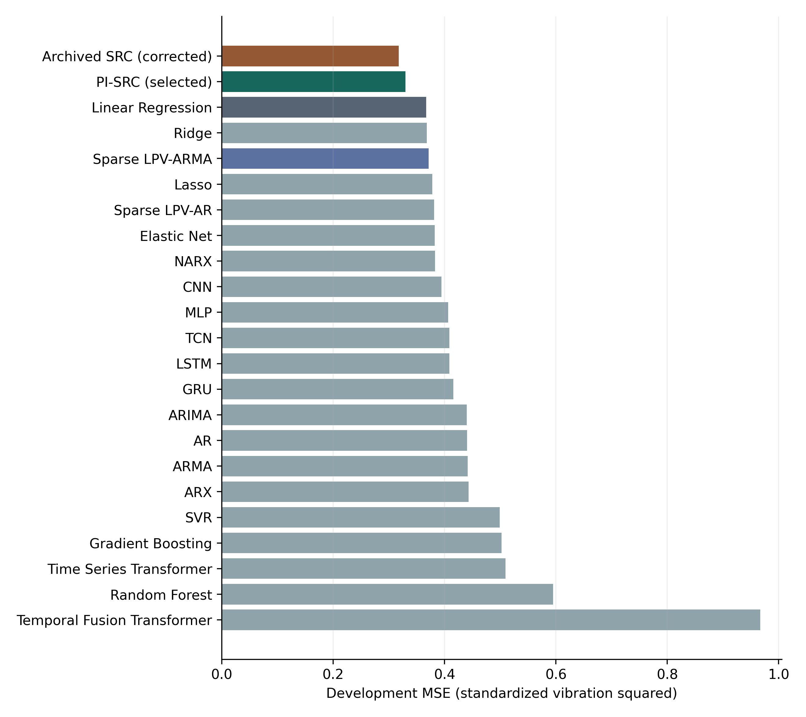

### A.2. Paired uncertainty and capacity controls

The paired error direction below is comparator minus primary PI-SRC. A negative value favors the comparator on this record. Bands are percentile intervals from contiguous within-record blocks. Their interpretation is conditional on this acquisition.

| Comparator | Block length, samples | MSE difference | 2.5th percentile | 97.5th percentile |
| --- | --- | --- | --- | --- |
| sparse_lpv_arma | 320 | 0.041432 | 0.036634 | 0.046438 |
| sparse_lpv_arma | 640 | 0.041432 | 0.036319 | 0.047242 |
| sparse_lpv_arma | 1280 | 0.041432 | 0.035531 | 0.047057 |
| linear | 320 | 0.037412 | 0.032975 | 0.040819 |
| linear | 640 | 0.037412 | 0.032403 | 0.041436 |
| linear | 1280 | 0.037412 | 0.031417 | 0.041230 |
| cnn | 320 | 0.064665 | 0.057568 | 0.071905 |
| cnn | 640 | 0.064665 | 0.056022 | 0.073982 |
| cnn | 1280 | 0.064665 | 0.054325 | 0.076736 |
| archived_src_corrected | 320 | -0.012186 | -0.014160 | -0.010386 |
| archived_src_corrected | 640 | -0.012186 | -0.014521 | -0.010361 |
| archived_src_corrected | 1280 | -0.012186 | -0.014872 | -0.010207 |

Each named ablation uses its own stored configuration and identical score window. These values do not change the selected model.

| Control | Development MSE | Training MSE | Feature columns | Parameters |
| --- | --- | --- | --- | --- |
| PI-SRC (selected) | 0.329973 | 0.308688 | 879 | 1456 |
| PI-SRC (clean-MSE selection) | 0.326401 | 0.304222 | 879 | 1456 |
| PI-SRC-Compact | 0.358022 | 0.339541 | 545 | 834 |
| PI-SRC-Optimized (uncorrected) | 0.340706 | 0.308682 | 879 | 1456 |
| SRC-Linear | 0.447954 | 0.438217 | 97 | 98 |
| SRC-Polynomial | 0.447872 | 0.437514 | 124 | 125 |
| SRC-Speed | 0.411939 | 0.395150 | 291 | 292 |
| SRC-Physics-Linear | 0.351040 | 0.333358 | 627 | 916 |
| PI-SRC-Fixed | 0.360530 | 0.340473 | 636 | 637 |
| src generic | 0.412117 | 0.394208 | 335 | 336 |
| pi src adapter off | 0.340706 | 0.308682 | 879 | 1456 |
| pi src adapter on | 0.329973 | 0.308688 | 879 | 1456 |
| pi src no angle | 0.359049 | 0.346724 | 495 | 1072 |
| pi src no carrier | 0.334961 | 0.313860 | 786 | 1363 |
| pi src no angle no carrier | 0.377201 | 0.364658 | 402 | 979 |
| pi src no innovation | 0.347312 | 0.325897 | 804 | 805 |
| pi src no acceleration | 0.328697 | 0.308792 | 878 | 1455 |
| pi src no augmentation | 0.327177 | 0.304165 | 879 | 1456 |
| pi src low capacity | 0.330144 | 0.309334 | 849 | 1426 |
| pi src high capacity | 0.330022 | 0.308593 | 881 | 1458 |
| pi src degree2 | 0.330390 | 0.309116 | 866 | 1443 |
| pi src order6 | 0.327042 | 0.305601 | 915 | 1492 |
| pi src order12 | 0.324770 | 0.302824 | 1023 | 1600 |
| pi src fixed hz only | 0.334862 | 0.313107 | 837 | 1414 |
| src polynomial matched adapter | 0.444834 | 0.437708 | 124 | 125 |

The same adapter settings also act on matched conventional and polynomial forecasts.

| Controlled base | Uncorrected MSE | Matched correction MSE | Reduction |
| --- | --- | --- | --- |
| strict_sparse_lpv_arma | 0.371406 | 0.367992 | 0.003413 |
| selected_pi_src | 0.340706 | 0.329973 | 0.010733 |
| polynomial_src | 0.447872 | 0.444834 | 0.003038 |

### A.3. Input parity and seed sensitivity

Negative MSE differences indicate an advantage to measured speed compared with the fixed nominal-speed fit.

| Model | Measured speed | Nominal speed | Measured minus nominal |
| --- | --- | --- | --- |
| arx | 0.443197 | 0.440779 | 0.002418 |
| narx | 0.383150 | 0.451529 | -0.068379 |
| mlp | 0.406424 | 0.459911 | -0.053487 |
| lstm | 0.408813 | 0.446419 | -0.037606 |
| gru | 0.416062 | 0.445067 | -0.029005 |
| cnn | 0.394638 | 0.443821 | -0.049183 |
| tcn | 0.408577 | 0.443486 | -0.034909 |
| transformer | 0.509394 | 0.512916 | -0.003522 |
| tft | 0.967099 | 0.953319 | 0.013780 |

Seed dispersion uses three fits of the selected configuration on the same input split. It measures optimization variability under the tested initializations.

| Model | Seeds | Mean MSE | Sample standard deviation |
| --- | --- | --- | --- |
| mlp | 3 | 0.411704 | 0.005796 |
| lstm | 3 | 0.413832 | 0.004362 |
| cnn | 3 | 0.397804 | 0.003005 |
| transformer | 3 | 0.501870 | 0.009914 |

### A.4. External and local reference conventions

Published results below use the authors' reported analysis segment. The development table beneath it shows local coefficients, timing scope and replay conventions. A literature MSE never enters the matched primary ranking.

| Published model | Authors’ training MSE | Authors’ test MSE |
| --- | --- | --- |
| ari | 0.4049 | 0.3658 |
| arima | 0.4034 | 0.3671 |
| spa_lpv_ar | 0.3001 | 0.2911 |
| spa_lpv_arma | 0.3099 | 0.2893 |

| Local model | Convention | Schedule | Start | Reported-window MSE | Common-mask MSE |
| --- | --- | --- | --- | --- | --- |
| ari | strict development | previous | 1792 | 0.425069 | 0.425069 |
| arima | strict development | previous | 1792 | 0.425223 | 0.425223 |
| spa_lpv_ar | strict development | previous | 1792 | 0.381496 | 0.381496 |
| spa_lpv_arma | strict development | previous | 1792 | 0.371406 | 0.371406 |
| lpv_ar_dense | strict development | previous | 1792 | 0.344585 | 0.344585 |
| lpv_arma_dense | strict development | previous | 1792 | 0.330781 | 0.330781 |
| ari | preserved archive current rpm | current | 316 | 0.415816 | 0.425669 |
| arima | preserved archive current rpm | current | 316 | 0.415719 | 0.425436 |
| spa_lpv_ar | preserved archive current rpm | current | 316 | 0.340886 | 0.349844 |
| spa_lpv_arma | preserved archive current rpm | current | 316 | 0.336901 | 0.345151 |
| ari | preserved archive previous rpm | previous | 1792 | 0.425669 | 0.425669 |
| arima | preserved archive previous rpm | previous | 1792 | 0.425436 | 0.425436 |
| spa_lpv_ar | preserved archive previous rpm | previous | 1792 | 0.349826 | 0.349826 |
| spa_lpv_arma | preserved archive previous rpm | previous | 1792 | 0.345133 | 0.345133 |
| spa_lpv_ar | current rpm row cv legendre | current | 316 | 0.341468 | 0.350352 |
| spa_lpv_arma | current rpm row cv legendre | current | 316 | 0.334422 | 0.342278 |
| spa_lpv_ar | current rpm row cv monomial | current | 316 | 0.424537 | 0.433855 |
| spa_lpv_arma | current rpm row cv monomial | current | 316 | 0.439783 | 0.449338 |

### A.5. Measured diagnostic and sensor checks

The full live cohort gives 1200 model-record results and 198 eligible records after removing the two exact overlaps. The table uses the instructor-compatible definition with a one-sample indexing offset relative to exact shaft period. Every group contrast is conditional on the file-index group. No classification threshold was tested.

| Model | n A | n B | Median A | Median B | Median gap | Extreme margin | Conditional AUC |
| --- | --- | --- | --- | --- | --- | --- | --- |
| raw | 98 | 100 | 0.097142 | 0.088550 | -0.008593 | -0.118824 | 0.3643 |
| sparse_lpv_arma | 98 | 100 | 0.040144 | 0.112696 | 0.072552 | 0.019399 | 1.0000 |
| archived_src_corrected | 98 | 100 | 0.028786 | 0.132133 | 0.103347 | 0.055907 | 1.0000 |
| primary_pi_src | 98 | 100 | 0.030189 | 0.114919 | 0.084730 | 0.035803 | 1.0000 |
| pi_src_adapter_off | 98 | 100 | 0.030998 | 0.115030 | 0.084032 | 0.036015 | 1.0000 |
| pi_src_fixed | 98 | 100 | 0.033697 | 0.125202 | 0.091505 | 0.045377 | 1.0000 |

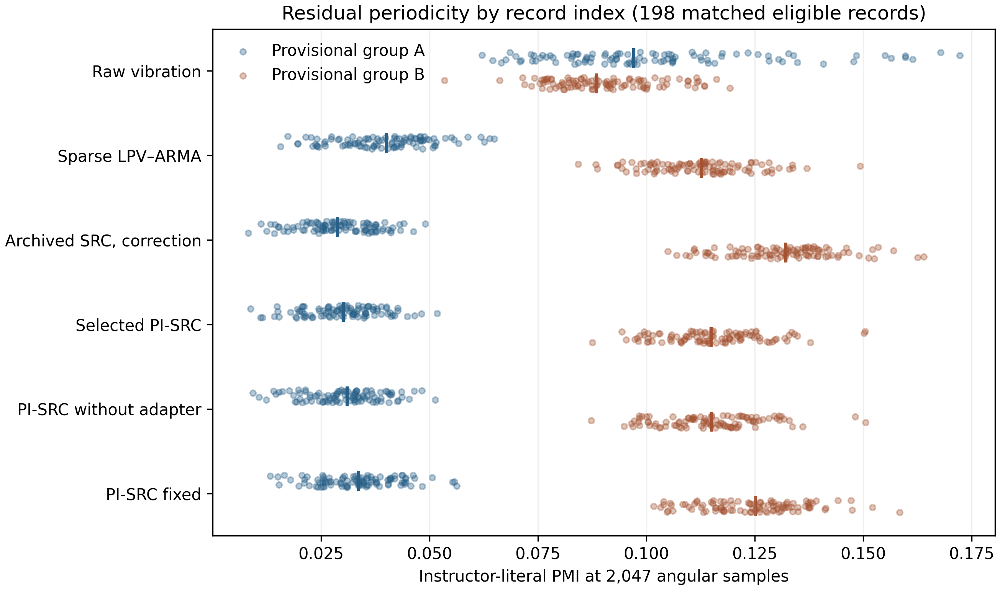

The stress conditions assess known interventions on the available development acquisition.

| Model | Cases | Successful | Clean MSE | Mean stress MSE | Worst stress MSE | Worst condition |
| --- | --- | --- | --- | --- | --- | --- |
| sparse_lpv_arma | 8 | 8 | 0.371406 | 1.166840 | 6.554814 | bias_plus_2pct |
| archived_src_corrected | 8 | 8 | 0.317788 | 0.357068 | 0.454057 | bias_plus_2pct |
| cnn | 8 | 8 | 0.394638 | 0.398226 | 0.412020 | bias_minus_2pct |
| ridge | 8 | 8 | 0.368059 | 0.386563 | 0.433301 | bias_plus_2pct |
| primary_pi_src | 8 | 8 | 0.329973 | 0.370305 | 0.457031 | bias_plus_2pct |
| pi_src_adapter_off | 8 | 8 | 0.340706 | 0.380924 | 0.468232 | bias_plus_2pct |
| pi_src_optimized | 8 | 8 | 0.340706 | 0.380924 | 0.468232 | bias_plus_2pct |
| pi_src_fixed | 8 | 8 | 0.360530 | 0.399313 | 0.495547 | bias_minus_2pct |
| src_generic | 8 | 8 | 0.412117 | 0.416747 | 0.423677 | bias_plus_2pct |
| src_polynomial | 8 | 8 | 0.447872 | 0.447872 | 0.447872 | smooth_profile_warp |

Synthetic pulse outcomes measure an intervention response. Their case counts and positive response counts are descriptive.

| Model | Injection type | Cases | Positive PMI shifts | Median distortion | Median waveform correlation |
| --- | --- | --- | --- | --- | --- |
| sparse_lpv_arma | periodic | 5 | 4 | 0.9245 | 0.6835 |
| sparse_lpv_arma | aperiodic | 2 | 0 | 1.2390 | 0.6962 |
| archived_src_corrected | periodic | 5 | 5 | 1.3308 | 0.6157 |
| archived_src_corrected | aperiodic | 2 | 0 | 2.6411 | 0.5944 |
| cnn | periodic | 5 | 3 | 0.9652 | 0.6771 |
| cnn | aperiodic | 2 | 0 | 1.4432 | 0.6631 |
| ridge | periodic | 5 | 5 | 0.8993 | 0.7091 |
| ridge | aperiodic | 2 | 0 | 1.2927 | 0.6940 |
| primary_pi_src | periodic | 5 | 5 | 0.9456 | 0.6900 |
| primary_pi_src | aperiodic | 2 | 0 | 1.6207 | 0.6596 |
| pi_src_adapter_off | periodic | 5 | 5 | 0.9457 | 0.6896 |
| pi_src_adapter_off | aperiodic | 2 | 0 | 1.6191 | 0.6596 |
| pi_src_fixed | periodic | 5 | 5 | 0.7996 | 0.7562 |
| pi_src_fixed | aperiodic | 2 | 0 | 0.9412 | 0.7386 |
| src_generic | periodic | 5 | 4 | 0.7124 | 0.7560 |
| src_generic | aperiodic | 2 | 1 | 0.9612 | 0.7321 |
| src_polynomial | periodic | 5 | 4 | 0.5995 | 0.7921 |
| src_polynomial | aperiodic | 2 | 0 | 0.8489 | 0.7442 |

## Notebook and artifact crosswalk

Start with the relevant companion chapter, open its executed notebook, and locate the result ledger before running a new fit.

| Executed notebook | Companion chapters |
| --- | --- |
| [00 Project Overview and Data Audit](../notebooks/00_Project_Overview_and_Data_Audit.ipynb) | 1, 6, 13, 22 |
| [01 Physics Informed EDA](../notebooks/01_Physics_Informed_EDA.ipynb) | 2, 3, 9–11, 14 |
| [02 Statistical Reference Reproduction](../notebooks/02_Statistical_Reference_Reproduction.ipynb) | 4, 5, 17, 21 |
| [03 SRC Theory and Feature Architecture](../notebooks/03_SRC_Theory_and_Feature_Architecture.ipynb) | 7–12, 15 |
| [04 SRC Joint Physics and Hyperparameter Optimization](../notebooks/04_SRC_Joint_Physics_and_Hyperparameter_Optimization.ipynb) | 6, 15, 16 |
| [05 SRC Training and Selection](../notebooks/05_SRC_Training_and_Selection.ipynb) | 8, 11, 12, 15, 22 |
| [06 Full Model Comparison](../notebooks/06_Full_Model_Comparison.ipynb) | 17, 18, 21, 23 |
| [07 Fault Detection and PMI](../notebooks/07_Fault_Detection_and_PMI.ipynb) | 10, 13, 19, 20 |
| [08 SRC Ablation and Robustness](../notebooks/08_SRC_Ablation_and_Robustness.ipynb) | 12, 18–20, 23 |
| [09 Computational Efficiency and Uncertainty](../notebooks/09_Computational_Efficiency_and_Uncertainty.ipynb) | 6, 18, 22, 23 |
| [10 Frozen Independent Test and Synthesis](../notebooks/10_Frozen_Independent_Test_and_Synthesis.ipynb) | 6, 13, 20, 22–24 |

| Evidence or deliverable | Companion chapters |
| --- | --- |
| [Input manifest](../inputs/input_manifest.csv) | 2, 3, 13 |
| [Data preparation and EDA](eda_findings.md) | 9–14 |
| [Primary source model](../src/src_gearbox/src_model.py) | 7–12, 15 |
| [Checkpoint registry](../checkpoints/src_registry.json) | 15, 22 |
| [Trial ledger](../results/optimization/trials.csv) | 16, 23 |
| [Matched comparison](../results/metrics/all_model_comparison.csv) | 17, 18, 21, 23 |
| [Fault evidence](../results/fault/fault_group_summary.csv) | 19, 20 |
| [Pipeline](../scripts/run_pipeline.py) | 22 |
| [Office report and figures](../report/SRC_Final_Course_Report.pdf) | 24 |

## References and reading roadmap

Course and source evidence are separated from the new implementation in the [input inventory](../inputs/input_manifest.csv), [data provenance](data_provenance.md), and [baseline lineage](baseline_lineage.md). For physical mechanisms, begin with the two Chen references. For the causal prediction task and selection design, combine the sparse LPV paper with the companion’s training and comparison ledgers. Read Welch with Chapter 10, Künsch with Chapter 18, and the individual comparator references with Chapter 17. Publication results stay on their source segments. Exact paper titles below identify scholarly sources and do not name any new model artifact.

1. MECG 7780 Engineering Data Analytics. *Time serial dependency modeling via advanced machine learning algorithms*. Course project handout and supplied instructor feature script.
2. Y. Chen, Z. Li, Y. Jiang, D. Gong, and K. Zhou. “Sparse LPV-ARMA model for non-stationary vibration representation and its application on gearbox tooth crack detection under variable speed conditions.” *Mechanical Systems and Signal Processing*, 224, article 112161, 2025. [DOI](https://doi.org/10.1016/j.ymssp.2024.112161)
3. Y. Chen. *Vibration-based fault detection and severity assessment for fixed-axis gearboxes*. PhD dissertation, University of Alberta, 2020.
4. D. J. Gauthier, E. Bollt, A. Griffith, and W. A. S. Barbosa. “Next generation reservoir computing.” *Nature Communications*, 12, article 5564, 2021. [DOI](https://doi.org/10.1038/s41467-021-25801-2)
5. P. D. Welch. “The use of fast Fourier transform for the estimation of power spectra.” *IEEE Transactions on Audio and Electroacoustics*, 15, 70–73, 1967. [DOI](https://doi.org/10.1109/TAU.1967.1161901)
6. H. R. Künsch. “The jackknife and the bootstrap for general stationary observations.” *Annals of Statistics*, 17, 1217–1241, 1989. [DOI](https://doi.org/10.1214/aos/1176347265)
7. H. Akaike. “A new look at the statistical model identification.” *IEEE Transactions on Automatic Control*, 19, 716–723, 1974. [DOI](https://doi.org/10.1109/TAC.1974.1100705)
8. R. Tibshirani. “Regression shrinkage and selection via the lasso.” *Journal of the Royal Statistical Society: Series B*, 58, 267–288, 1996. [DOI](https://doi.org/10.1111/j.2517-6161.1996.tb02080.x)
9. H. Zou and T. Hastie. “Regularization and variable selection via the elastic net.” *Journal of the Royal Statistical Society: Series B*, 67, 301–320, 2005. [DOI](https://doi.org/10.1111/j.1467-9868.2005.00503.x)
10. L. Breiman. “Random forests.” *Machine Learning*, 45, 5–32, 2001. [DOI](https://doi.org/10.1023/A:1010933404324)
11. J. H. Friedman. “Greedy function approximation: A gradient boosting machine.” *Annals of Statistics*, 29, 1189–1232, 2001. [DOI](https://doi.org/10.1214/aos/1013203451)
12. S. Hochreiter and J. Schmidhuber. “Long short-term memory.” *Neural Computation*, 9, 1735–1780, 1997. [DOI](https://doi.org/10.1162/neco.1997.9.8.1735)
13. S. Bai, J. Z. Kolter, and V. Koltun. “An empirical evaluation of generic convolutional and recurrent networks for sequence modeling.” 2018. [arXiv](https://arxiv.org/abs/1803.01271)
14. A. Vaswani et al. “Attention is all you need.” *Advances in Neural Information Processing Systems*, 30, 2017. [arXiv](https://arxiv.org/abs/1706.03762)
15. B. Lim, S. Ö. Arık, N. Loeff, and T. Pfister. “Temporal Fusion Transformers for interpretable multi-horizon time series forecasting.” *International Journal of Forecasting*, 37, 1748–1764, 2021. [DOI](https://doi.org/10.1016/j.ijforecast.2021.03.012)
