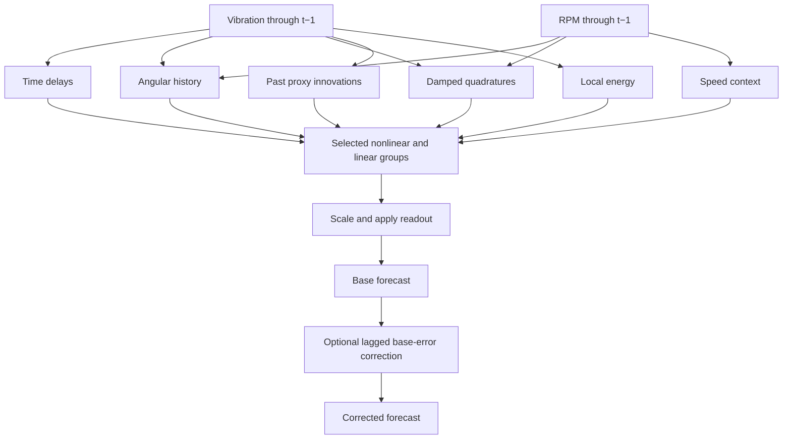
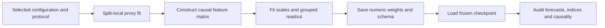

## 7. Structured Reservoir Computing

### 7.1 Why a structured reservoir

A reservoir supplies state coordinates in which a simple readout can represent a complex conditional response. A conventional echo-state network updates a recurrent state through a fixed nonlinear map driven by measurements. A structured delay-based reservoir exposes coordinates constructed from available history. PI-SRC combines time delays, speed context, angular delays, oscillator quadratures, proxy innovations and selected nonlinear interactions. Learnable regression weights act on this fixed representation after the configuration is selected.

A state evaluated via recurrence need not have a learned recurrent transition. Fading memory is given concretely by finite delays and damped state responses. RNN and LSTM baselines learn internal transition and readout weights from data. In PI-SRC the damped state has a specified physical phase and its settings are chosen by guarded outer search. Regression does not differentiate through those settings. Its readout can still express a nonlinear relationship to raw signals because the basis is nonlinear.

### 7.2 Why avoid indiscriminate expansion

For $P$ inputs, all second-order monomials including squares number $P(P+1)/2$. The number of third-order monomials is $P(P+1)(P+2)/6$. At $P=200$ this gives 20,100 second-order and 1,353,400 third-order terms, before any coefficients. A compact registry instead names interpretable interaction families such as speed times vibration lag, oscillator quadrature energy, and a short set of lag products. Its dimension grows with selected groups. This is a testable hypothesis about how operational context affects prediction.

A structured library can be too restrictive. A missing harmonic or transient may fall outside the basis. Adding many weak terms makes correlated and accidental associations easier to fit. The correct analysis asks whether clean error, stress error, prediction cost, or fault retention improved under a named pair of configurations.

## 8. Mathematical anatomy of the SRC model

Write temporal delays as $\boldsymbol\ell_t=[x_{t-\ell_1},\ldots,x_{t-\ell_p}]$, with positive integer lags. Let $v_t$ be permitted RPM context, $A_t$ angular history, $H_t$ damped quadratures, $E_t$ past energy, and $I_t$ proxy errors. With library $\Phi$, the base predictor is

$$
\hat x_t^{\mathrm{base}}=b+w^T\Phi(\boldsymbol\ell_t,v_t,A_t,H_t,E_t,I_t). \tag{8}
$$

Each state uses information through $t-1$. The requested observation window, phase and oscillator filter reset on a new record. The features need their source histories even when the target output is masked. Distinguish minimum valid history, common comparative warm-up, and fold guard.



### 8.1 Counting the feature groups

Consecutive lags densely cover a short temporal span. For oscillatory data this helps represent phase but can expose collinearity. Multiresolution lags cover recent samples densely and older intervals sparsely. A mechanically selected fixed lag can track a nominal mesh period, although its true angle varies with RPM. An angle-domain lag targets a prescribed phase change instead. If lag selection uses correlation to the target, compute that ranking only within admissible fit segments.

For $P_\ell$ temporal lags, $P_v$ speed terms, $P_a$ angular lags, $K$ orders, and $F$ fixed frequencies, a bank with one decay per oscillator offers $2(K+F)$ quadratures. With $J$ common decay scales this can become $2J(K+F)$. The innovation group contributes one coordinate per chosen innovation lag and energy contributes one per retained summary. Add selected products by name after these base counts. The exact serialized size depends on the realized configuration and group definitions. Validate it against the saved feature schema.

Fit the location $\mu_j$ and scale $s_j$ of each feature on the permitted rows to build $A_{tj}=(\Phi_{tj}-\mu_j)/s_j$. The transforms are necessary at inference and must be saved. Scaling helps make the penalty numerically comparable across units. It does not remove collinearity among nearby phase and order features. Individual regression weights need careful interpretation.

### 8.2 Group penalties and robustness

A normalized group-ridge objective is

$$
\min_{b,w}\frac{1}{2N}\sum_{t\in\mathcal T_\mathrm{fit}}
(x_t-b-A_tw)^2+\frac12\sum_g\lambda_g\lVert w_g\rVert^2_2. \tag{9}
$$

The $1/N$ factor defines the implemented penalty convention in Eq. (9). A non-normalized convention gives equivalent coefficients if all penalties are multiplied by $N$. A diagonal vector can assign stronger penalties to exploratory interaction groups than to low-order vibration lags. The corresponding ridge system has a positive shift on penalized directions. A Huber objective transitions from quadratic to linear for $|e|$ larger than its threshold. In iteratively reweighted least squares, that is equivalent to weight approximately $\min(1,c/|e|)$ at threshold $c$. Each iteration solves a weighted regularized problem. This suppresses model influence from extreme training points and can increase inference error on other target distributions. Compare the empirical trade-off and count solver caps.

### 8.3 Scaling costs

A dense lag matrix costs $O(NP_\ell)$ operations and storage before evaluating interactions. A direct oscillator sum costs $O(NJM(K+F))$ for finite memory $M$. A recurrence can reduce arithmetic to $O(NJ(K+F))$ with a bounded history buffer. A structured interaction list of length $C$ adds $O(NC)$, while a complete quadratic expansion adds $O(NP^2)$. Forming a dense Gram matrix costs $O(NP^2)$ and its factorization costs up to $O(P^3)$. Applying the fitted readout to already computed features costs $O(NP)$. Full-record timing includes feature construction and memory movement, which can dominate the last step.

## 9. RPM conditioning and rotating-machine feature families

RPM at $t-1$ is observed before the target. Represent it as a fixed engineering coordinate $r_t=(n_{t-1}-n_0)/s$ or a standardized value whose location and scale were fitted within the training fold. A low-order function of $r_t$ can smoothly schedule vibration lag coefficients. A high polynomial degree can extrapolate sharply outside the observed speed range. Legendre functions are orthogonal under their reference continuous density, but observed speeds are distributed unevenly. Inspect the numerical design.

A causal finite difference over $D$ samples estimates speed slope as $[n_{t-1}-n_{t-1-D}]f_s/D$ in rpm/s. Acceleration may correlate with speed and load. A guarded benefit would support including it as a covariate without isolating a physical causal effect. The shortest derivative spans are susceptible to measurement noise or quantization. Define the direction rule, including how ties are grouped.

A lag-by-speed product gives smoothly varying coefficients. A quadrature squared magnitude $|H|^2=(\Re H)^2+(\Im H)^2$, in squared standardized units under a normalized quadrature, summarizes local harmonic strength without choosing an absolute rotation phase. A product between harmonic energy and a lag lets its contribution depend on strength. A fixed-frequency response near a time-spectrum peak encodes a separate hypothesis from phase synchrony. One assumes roughly fixed Hertz through motion, while the other assumes roughly constant cycles/revolution. A mixed bank can encode both. It cannot independently establish a structural natural frequency.

Sidebands at $kZ\pm1$ in the simplest input-shaft modulation model are plausible features. Pinion-synchronous modulation would shift by $37/20$ input-shaft orders. Check peak width before proposing weak neighboring candidates. If short observation windows blur them together, multiple correlated phase rotations can add cost and difficulty without a measurable benefit.

## 10. Fourier, order, and envelope analysis

For a segment of $N$ sampled points,

$$
X[k]=\sum_{n=0}^{N-1}x_n e^{-i2\pi kn/N},\quad f_k=k f_s/N. \tag{10}
$$

A finite sinusoid outside an exact bin excites several bins through window leakage. A rectangular truncation gives a narrow main lobe and broad sidelobes. Hann tapering reduces sidelobes while widening the main lobe. Amplitude estimates require coherent-gain correction, and power estimates require window-energy normalization. Integrating a PSD density over frequency gives mean-square contribution, rather than an amplitude in vibration units.

Welch PSD forms and averages windowed periodograms. A 1,024-point window at 3,200 Hz spans 0.32 s with 3.125 Hz bin spacing. If speed changes substantially within a window, harmonic energy spreads. A short-time Fourier transform localizes time evolution at the cost of frequency resolution. Overlay $kZn(t)/60$ with correct units. Compare measured ridge to predicted order lines at multiple speeds before proposing a fixed-frequency mode.

**Analytical example.** At 125 and 165 rpm, input order 148 corresponds to 308.33 and 407 Hz. A fixed 1,100 Hz mode remains at 1,100 Hz but changes from effective order 528 to 400. Overlay both on simulated chirps to understand their projection. They can cross. A single time slice cannot distinguish them.

Offline order tracking interpolates a completed time-domain record onto a uniform shaft-angle grid. With $S$ points/rev, angle-grid Nyquist is $S/2$ cycles/rev. The original physical time-domain Nyquist at the current speed imposes another limit. Raising $S$ improves resampling resolution within those limits and cannot restore detector or filter bandwidth. Enrollment of a causal angle feature requires both interpolation endpoints before the target. Offline plots can use endpoints anywhere in an already collected record.

For a real trace $z$, the analytic signal is $z+i\mathcal H(z)$, with envelope equal to magnitude. For a narrowband amplitude-modulated carrier, it approximates the modulator. Multiple bands, finite support, or slow baseline can alter interpretation. Whole-record Hilbert features are reserved for explanatory analysis and postrecord detection. They would reveal future vibration if directly inserted into Eq. (8).

## 11. Causal shaft angle and finite oscillator states

### 11.1 Turns at the prediction boundary

The observed position of a past sample and the estimated target position can be computed separately:

$$
u_j=u_{j-1}+\frac{n_{j-1}+n_j}{120f_s},\qquad
\widehat u_t=u_{t-1}+\frac{n_{t-1}}{60f_s}. \tag{11}
$$

Both are in revolutions. The first reconstructs a known path with trapezoids. The second extrapolates using the latest measured speed. A desired delay of $a$ turns defines query $\widehat u_t-a$. Find two bracketing observed phase samples and linearly interpolate measured vibration. The upper bracket must be at most $t-1$. At very low speed or insufficient history the implementation must apply its finite-context handling, with a documented behavior at the boundary.

At 120 rpm and 3,200 Hz, one sample spans $0.000625$ revolutions. A 0.125-revolution lag is 200 samples. A correct phase routine should match that constant-speed fixture and recover the same input order when RPM varies. Mutating speed at and after the target should preserve its predicted phase.

### 11.2 Rotation as demodulation and remodulation

Let $d_j=x_j\exp(-i2\pi ku_j)$ with $k$ cycles/revolution. For exponential decay $r=e^{-1/\tau_s}$ and finite memory $M$,

$$
D_t=\sum_{j=1}^{M} r^{j-1}d_{t-j},\qquad
H_t=c_M e^{i2\pi k\widehat u_t}D_t,\quad
c_M=2\left(\sum_{j=1}^{M}r^{j-1}\right)^{-1}. \tag{12}
$$

Here $\tau_s$ is a scale in samples and its physical time is $\tau_s/f_s$. Moving the exponent to $j$ leaves the normalized state unchanged because all weights gain a common $r$. For fixed Hertz, use $f j/f_s$ as the demodulating phase in turns. Direct recurrence follows by multiplying $D_t$ by $r$:

$$
D_{t+1}=rD_t+d_t-r^M d_{t-M}. \tag{13}
$$

Values outside the record are zero. The oldest subtraction ensures exact finite horizon in arithmetic. Removing it would leave a stable infinite-memory state under $0<r<1$. Such a state can carry information across fold boundaries when reset policy is wrong. Direct sum and fast recurrence can differ near rounding scale, especially under cancellation at long decay. Compare both on chirps, impulses, and zero input. With the implemented factor of two, $|H_t|\leq 2\max_j|x_{t-j}|$ follows from the triangle inequality. A state impulse may first affect $H_{t+1}$ if its sample index is $t$.

A long $\tau_s$ preserves phase-coherent histories and may suppress noncoherent noise. During a fast transient it also includes older operating conditions. $M$ truncates the response even if the chosen decay is large. Learned readout coefficients and externally tuned memory together define effectiveness in this predictor. A predictive time scale remains an effective model setting and does not signify measured material damping.

## 12. Innovations and slow correction

### 12.1 Stage-one proxy

A stage-one predictor estimates $\hat x_j^{(1)}$ from past observations. Its error $\tilde\epsilon_j=x_j-\hat x_j^{(1)}$ is known after $x_j$ arrives. The downstream model may use past $\tilde\epsilon$ samples for $t$. Stage-one raw support $L_1$ and proxy lag cap $Q$ require up to $L_1+Q$ preceding samples. An adapter looking back an additional $M_c$ shifts that entire dependency farther into the past. This motivates tests of the composed model.

Stage one is fit within the appropriate fold. That prevents its weights using that fold's evaluation target rows. Within a training segment, fitting all stage-one weights before deriving its own residual features can still be optimistic. Cross-fitted downstream features would add a separate safeguard. Check the actual implementation and distinguish these two protections. Compare held-out error when proxy features are enabled and removed.

### 12.2 Correction as a separately attributed model component

For $e_t^{\mathrm{base}}=x_t-\hat x_t^{\mathrm{base}}$, the example finite adapter is

$$
\hat x_t^{\mathrm{final}}=\hat x_t^{\mathrm{base}}+
g\,\frac{\sum_{j=1}^{M_c}\rho^{j-1}\operatorname{clip}(e_{t-j}^{\mathrm{base}},-C,C)}{\sum_{j=1}^{M_c}\rho^{j-1}},
\qquad \rho=e^{-1/\tau_c}. \tag{14}
$$

The gain $g$ is dimensionless and $C$ is in standardized units. A fast correction may track fault-related structure as well as drift. An adapter-off forecast with identical weights isolates the runtime effect of Eq. (14). Refitting the readout without correction is a different experiment. Apply an identical adapter to different base learners to test whether the advantage is specific to physical features. The proxy error, uncorrected base error, and final diagnostic residual have separate roles. Recursing on previous corrected errors would change the procedure.

## 13. Intake and partition checks

The course records include designated train and development vibration, RPM and timing. The MAT loader checks fields and numerical validity. Verify any stored raw and standardized fields with a reconstructed affine model, retaining original calibration provenance. The numbered diagnostic parts must preserve MATLAB ordering. Check record IDs, types, shapes and interval structure. The record manifest lists missing blind files and labels separately.

When an excerpt of a diagnostic acquisition matches designated training or validation, exclude the acquisition from independent comparisons. Use raw waveform and speed agreement together, with index offsets and length. Similar speed alone is weak evidence of acquisition identity where a controlled rig follows the same profile. Unknown acquisition labels leave diagnostic group comparisons conditional on a defined index split. If an independent record is absent, keep the frozen manifest and clearly state its status.

```python
from pathlib import Path
import numpy as np
from src_gearbox.data import find_input, load_record

path = find_input(Path("data/raw"), "sigtrain")
if path is not None:
    record = load_record(path)
    np.testing.assert_allclose(np.diff(record.t), 1 / record.fs, atol=2e-12, rtol=0)
    assert len(record.x) == len(record.rpm)
    assert np.isfinite(record.x).all() and (record.rpm > 0).all()
```

## 14. Physics-informed exploratory analysis

Use the training record to formulate candidates before comparing options. Time traces show amplitude, RPM and short-run RMS together. A causal energy feature uses a trailing rather than centered window. Welch and STFT plots document where energy lives and whether the ridge agrees with predicted mesh trajectories. Uniform angle sampling tests whether synchronous structure sharpens. ACF and PACF describe useful lag intervals and clarify why lag count sometimes matters. Speed-binned residuals group heterogeneity without ascribing causality to RPM.

The completed EDA screening compares 148-order, sideband, fixed-frequency, angle-delay and polynomial candidates on guarded training. The independent chirp and constant-speed checks recovered order 148 within 0.024 orders. The extended two-order-plus-shaft/sideband screen obtained guarded MSE approximately 0.42903 against a corresponding 0.46153 control. Oscillator decay of 128 samples scored about 0.44049 versus 0.45228 for 8 samples in that screening design. The tested fixed-Hertz pair scored about 0.46152. Cubic and degree-two variants differed little in their measured guard screen. Those are pre-model controlled EDA screens. They motivate candidate groups and do not estimate the final model’s performance.

For each accepted candidate, connect the physics equation, observed feature, fold evidence and cost. For each rejected candidate, state the setting and the strength of the evidence. In particular, a nominal peak near a fixed frequency can be worth visualizing even if the feature contributes little after other lag terms. Recheck the exact scope and alternatives in `results/eda_feature_hypotheses.csv`. Notebook 01 reads the measured numerical artifacts and figures.

### 14.1 Read the actual frequency and order panels

The STFT figure shows the changing vibration spectrum together with the predicted mesh harmonics from measured speed. On a time-frequency axis the 148-order trajectory moves upward and downward as shaft speed changes. The measured median absolute distance from its training spectral ridge to the phase prediction is about 0.744 Hz. A close match gives a reason to test angle-synchronous states. The estimate depends on window resolution, ridge bounds and the available record; it is not a substitute for a tachometer calibration. The measured training values, including the ridge correlation and available angular turns, are recorded in [the EDA summary](../results/eda/summary.json).


Compare the same operating excursion in the order plot. Input-shaft orders are in cycles per turn. A peak at order 148 is the fourth harmonic of the 37-tooth input gear. This normalized frequency can stay fixed as its Hertz coordinate moves. Fixed-Hz components can appear broadened in order instead. The purpose of viewing both is to see why a predictor might use one or both mechanisms. The training-only feature screen's fixed-Hz pair obtained essentially the same guarded MSE as LPV-AR24, so strong spectral energy near 1.1 kHz did not, by itself, justify retaining a fixed-Hz state. The selected bank omitted fixed-Hz states. Separate sideband and additional-order alternatives remain informative.


## 15. Configuration, fitting, and checkpoint identity

Start from a saved configuration and allowed raw intervals. Reset angle and state within each fit segment. Fit the proxy model with admissible rows if enabled. Construct strictly past-only features from the relevant history. Fit and save the scaler on those rows. Estimate the group-regularized readout, store all coefficients, and pilot checkpoint reload before reporting metrics. On a new record, restore scales and coefficients and mark the warm-up invalid for comparison. Ensure runtime can regenerate the exact design order; transposed or reordered columns can silently give valid-looking scores.



The selected configuration and fitted weights are both necessary for repeatability. A different numerical library can lead to very small solver differences. Store replay tolerances and observe them on a complete record. Saving train and development forecasts makes it possible to reconcile reported metrics without running training again. Notebook 05 teaches that workflow and includes checkpoint round-trip when the anonymous input path is configured.

## 16. Joint optimization and evidence interpretation

### 16.1 Bounded search

Compare coherent variants before refining the neighborhood of a good design. Candidate dimensions may include temporal/angle span, speed context, order bank, decay, memory, innovation history, interactions, and grouped penalties. Vary related terms conditionally to avoid meaningless settings. For example, changing oscillator decay with the bank disabled has no physical effect. A deterministic finite search can be rigorously reproduced from its trial ledger. It supports conclusions about the declared budget and cannot establish a global optimum.

A trial's composite loss may include clean error, RPM stress and pulse distortion. Declare coefficient weights before development. Form the median or mean of fold terms as prescribed. A Pareto front omits alternatives for which another measured point is at least as good on all criteria and better on at least one. Preferences for interpretability or compactness should be made explicit. Fold rankings can be unstable when a difficult speed segment dominates one validation interval.

The frontier plot summarizes the trade-off between stored coefficient count and held-out training-fold MSE. A point that is strictly worse than another on the plotted criteria cannot be a Pareto choice on those two objectives. The actual utility considers extra terms. A higher-dimensional model can remain justified when its margin on clean, stress, or preservation performance is relevant. Stored parameter count is a complexity proxy, while measured release CPU timing is reported separately after final refit.


### 16.2 Reading the ledger

An interpretable per-fold ledger identifies the trial configuration, bounds, model dimension, loss summaries, solver state and wall time. Recompute averages before reading the winner. If candidates use different effective target counts, confirm they were scored on identical evaluation masks. The strongest development variant is an observation after selection and may differ from the guarded winner. Report both when needed with correct scope. Evaluating the independent segment only after freeze protects the one-time assessment.

Notebook 04 groups actual fold rows and plots the trade-off between fit, stress and preservation. Notebook 08 links contrasts to settings so a bundled change cannot be mistaken for a one-factor ablation. Confirm that any reported superiority is robust to reasonable configurations and record scope rather than a consequence of seeing the development scores during selection.
