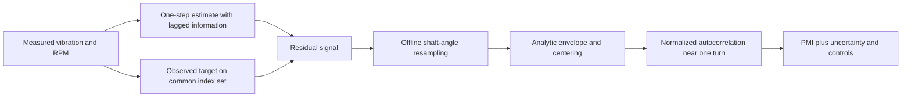

# From causal prediction to a shaft-angle diagnostic

## Prediction and detection are different tasks

At sample $t$, a one-step predictor uses observed vibration and available speed through $t-1$ and estimates $\widehat{x}_{t|t-1}$. The residual $e_t=x_t-\widehat{x}_{t|t-1}$ is available after the sample arrives. A gearbox predictor is useful for monitoring if the predictable operating response disappears from its residual and evidence relevant to a fault remains visible. A residual can achieve low mean-square error while losing a physically important impulse. It can also retain high-amplitude artifacts caused by RPM errors or numerical extrapolation. Those two risks motivate evaluating the residual signal and the forecast together.

A defect associated with one tracked shaft turn can give a near-repeating impact angle. RPM is measured in revolutions per minute. At 145 rpm the shaft takes $60/145=0.414$ s per turn, whereas at 167 rpm it takes 0.359 s. A constant lag in seconds therefore loses alignment. Converting the coordinate to the measured shaft’s revolutions makes one target revolution an invariant lag. Which shaft repeats the defect is a physical hypothesis: the supplied instructor script calls the one-order diagnostic, and matching this convention does not identify a defect location.



Reset a frozen model per record. Compare the raw vibration and every model residual on zero-based samples `1792:N`. At 3,200 Hz, this starts 0.56 s into the series. A 32,000-point development candidate has 30,208 samples on this mask. A forecasting or diagnostic failure is recorded per method, and only matched finite records enter comparisons at each metric.

## One revolution reconstructed from timestamp and speed

Let $n_i$ denote speed in rpm and $t_i$ the timestamp in seconds. Set $u_0=0$ at the start of the retained window and integrate RPM with a trapezoid:

$$
u_i=u_{i-1}+\frac{n_i+n_{i-1}}{120}(t_i-t_{i-1}).
$$

With positive speed and increasing times this is strictly increasing. Interpolate vibration from irregular $u_i$ onto $j/S$, for $0\le j\le \lfloor S u_{N-1}\rfloor$. The endpoint choice prevents extrapolation. The fixed angular resolution is $S=2,048$ samples per shaft revolution. At an acquisition rate of 3,200 Hz and 150 rpm this is finer than the measured angular density of 1,280 samples per turn. Interpolated density does not extend the measured bandwidth. A coarse angular grid can alias measurable high orders and linear interpolation can attenuate frequencies near the acquisition limit. The diagnostic waveform and its reference residual share the same grid.

The whole-record Hilbert transform and interpolation are **offline**. They do not participate in time-causal SRC features. In particular, the upper interpolation endpoint may be a later sample on the input time axis. The offline method accepts this when producing evidence from an already observed acquisition. The causal prediction method uses its separate angle recurrence and strictly prior endpoints.

The output includes RMS, crest factor, biased Pearson kurtosis, first-shift correlated kurtosis and one-sided Hann-corrected amplitudes near shaft orders 1 and 37. An order of 37 corresponds to the principal gear mesh where shaft speed is the measured primitive. Envelope order 1 tests one cycle of amplitude modulation per turn. In both waveform and envelope spectra, amplitude is in units of the supplied standardized vibration. DFT amplitudes are corrected for the Hann coherent gain and doubled for interior positive-frequency bins. These are descriptive domain features.

## Three PMI interpretations

Let $a_j=|e_\theta(j)+\mathrm{i}\mathcal H(e_\theta)_j|$ be the analytic envelope of the angular residual. The centered envelope is $b_j=a_j-\bar a$. Compute

$$
R_b(k)=\sum_{j=0}^{M-1-k} b_j b_{j+k},\qquad
r(k)=\frac{R_b(k)}{R_b(0)},\qquad
\mathrm{PMI}(k)=\frac{r(k)}{1-r(k)}.
$$

Every lag uses the same zero-lag denominator $R_b(0)$; the numerator has $M-k$ available products. For the envelope $[5,3,5,3]$, centering yields $[1,-1,1,-1]$. At lags 1 and 2, normalized correlations are $-3/4$ and $1/2$ and PMI is $-3/7$ and $1$, respectively. Even the perfectly repeated lag-two pattern uses only two matches. More generally, correlated disturbance, window length and mean removal influence the quantity. A negative score is possible. The diagnostic returns explicit invalid reasons for a missing or nonmonotonic RPM trace, too few angular samples, zero centered variance or a numerically degenerate denominator. No invalid score is silently zeroed.

| Output value | Input to analytic envelope | Lag | Purpose |
|---|---|---:|---|
| `lecturer_compatible` | Mean-centered angular vibration, restore DC to the upper envelope as in MATLAB | 2,047 | Match the supplied PMI code’s coarse-index expression |
| `lag_corrected` | Same MATLAB mean treatment | 2,048 | Isolate the effect of correcting the lag only |
| `mathematically_specified` | Angular vibration directly into Hilbert magnitude | 2,048 | Interpret the centered-envelope mathematical expression over exactly one revolution |
| `pmi_unrelated` | MATLAB mean treatment | Approximately 0.63 revolution | Check whether modulation separation is specific to the target order |

The supplied `fdt_featcal.m` reads `acf(round(fs/f_fault))` in MATLAB when `ran=0`. MATLAB's first array element represents zero lag, so element 2,048 gives lag 2,047. The script calls `envelope(d)`, which uses an analytic envelope of the centered input and restores the input mean to the upper envelope. The next mean subtraction on that upper envelope removes the restored constant. The Python implementation has the same mean convention and zero-lag energy denominator for the instructor-compatible mode. The MATLAB script asks for a 3.1-turn correlation span, so that mode explicitly returns missing when the record cannot support it. The separate mathematical mode uses any valid one-turn lag with nonzero variance. The original `toConstantSamplesPerCycle` helper and gold outputs are absent. Numerical fixtures verify the intended Python arithmetic, while end-to-end MATLAB parity remains unverified.

A sampled signal $x_\theta=[1+0.4\cos(2\pi u)]\cos(2\pi\,37u)$ on an eight-revolution grid has an exactly calculable envelope and exact-lag PMI 7. The measured compatible value at the one-fewer-sample lag is 7.00958 on the test grid of 1,600 angular samples per revolution. Both exact-lag Python modes returned 7 within $2.2\times10^{-13}$. This fixture checks conventions. It is not a source MATLAB experiment.

## Provisional index groups and evidence

Records 61 and 63 exactly overlap the training and development acquisitions in both vibration and speed. These records are retained as outputs and excluded from inference about the remaining candidate corpus. Group A comprises candidate IDs 1–100 and group B 101–200. The exact roles of health condition and acquisition genealogy require authoritative metadata. Describe the measured summaries as provisional index-group distributions. The B-high conditional AUC compares all B-versus-A pairs and gives ties half weight. It can be below one-half if raw vibration has a larger median in A. When several models achieve an AUC of one, distinguish the median gap $\operatorname{median}_B-\operatorname{median}_A$, the extreme separation margin $\min_B-\max_A$, a central-quantile margin, and one-turn specificity. Uncertainty is evaluated by resampling records within groups and keeping the same sampled IDs across methods for paired differences. This resampling cannot resolve unknown common acquisition lineage.

PMI standardization is withheld without independently verified healthy calibration. A threshold selected from the same 198 development candidates would reflect their composition. The conditional results cannot establish a deployment false-alarm rate, verified precision or recall, or a blind crack sensitivity. The complete per-record output is available for future evaluation with the appropriate metadata and a separately determined operating point.

## Stress the prediction channel and the diagnostic grid separately

The validation stress suite uses eight fixed RPM conditions. Two 2% signed biases model a scale error. Correlated noise has 0.6% fractional SD and an autoregressive smoothing parameter 0.962. Independent random jitter has 0.3% fractional SD. Additional conditions are speed measurement rounded to 1 rpm, 40 ms lag, 75 ms hold-last dropouts, and a smooth profile warp with sinusoidal deviations of 0.8% and 0.4%. Random perturbations use fixed seeds. The held-out warp and hold-last windows differ from the optimization’s single 0.45-Hz fold stress. In each intervention the measured vibration target remains fixed. The code labels model-input-only, offline-angle-only and combined interventions separately. Diagnostic-only RPM perturbation changes the inferred shaft angles and may change PMI while leaving prediction MSE fixed by construction. MSE by true-speed quartile and direction of observed speed change localizes stress sensitivity. A separate validation intervention adds seeded vibration-input noise of standardized SD 0.05.

A joint evaluation with clean and pulsed vibration isolates the response to synthetic evidence. Let $p_t$ be a fixed causal damped carrier generated after an angular event. Periodic events use a fixed angle once per turn. Aperiodic controls randomize angle from turn to turn. The five periodic cases span 390–1,260 Hz, amplitude 0.12–0.88 in standardized vibration, decay 1.7–6.1 ms, multiple phases and a mixed RPM-warp case. The two aperiodic controls reuse carriers and amplitudes from matched periodic tests. No pulse amplitude is assigned a physical crack size.

For frozen forecasts with equal speed quality,

$$
\Delta \widehat x_t=\widehat x^{\mathrm{pulse}}_t-\widehat x^{\mathrm{clean}}_t,
\quad
\Delta e_t=p_t-\Delta\widehat x_t.
$$

The distortion score $\sum_t(\Delta\widehat x_t)^2/\sum_t p_t^2$ measures how much the predictor changes when it receives injected vibration. Residual-energy retention compares $\sum_t(\Delta e_t)^2$ with $\sum_t p_t^2$. The energy ratio need not fall between zero and one because a predictor can introduce a long response or alter phase. The signed pulse projection and waveform correlation provide complementary evidence. The aperiodic controls report the number of positive PMI shifts and their magnitude as **label-free response of this synthetic control**, rather than a fault false-alarm probability. A degradation specific to one combination of phase, frequency or RPM informs mechanism without extrapolating to physical crack severity.

## Reproduce the diagnostic stage

Run `python scripts/evaluate_faults.py --data-dir data/raw` from the packaged project after installing dependencies and with the frozen checkpoints present. Additional trained variants can be passed with `--src name=checkpoint`, and saved comparator checkpoints with repeatable `--baseline slug`. The CPU analysis resets models per call. The `--cohort` and `--pulse` switches explicitly control full-corpus and validation-pulse scope. Decode each candidate part in natural MATLAB order and preserve the one-based record identity. Where separate CPU lanes are used, the merger checks raw file SHA-256 values, identical masks, overlap decisions and matching independently computed raw diagnostics before comparing families.

Primary artifacts are `fault_per_record.csv`, `fault_group_summary.csv`, `paired_pmi_bootstrap.csv`, `rpm_stress_summary.csv`, `rpm_stress_regimes.csv` and `pulse_summary.csv` under `results/fault`. Four representative records are retained by ID, including one-based IDs 100 and 101 at the provisional group boundary. `fault_traces.npz` stores their aligned waveforms and spectra. Summary tables and representative figures use the same measured data rather than hand-entered examples.

### Exercises

1. At 120 rpm, how many measured samples span one shaft turn? At 3,200 Hz, the answer is 1,600. A typical 150-rpm turn contains about 1,280 samples instead. A constant sample lag would misalign these two speeds.
2. Why does perfect rank ordering not determine how far apart two groups are? A single record can almost overlap another group while rank order still yields AUC 1. The extreme and central margins quantify distance, and future observations could cross it.
3. If a speed sensor is 2% high, how many true turns correspond to one measured turn? About $1/1.02=0.9804$. This is enough to offset a narrow periodic peak in the angle domain.
4. If $\Delta\widehat x=0$, what happens to the paired residual? It contains the injected waveform exactly, with distortion zero, retained energy one and correlation one. The PMI response still depends on the background residual.

### Full diagnostic replay used for release

The complete replay below separates comparator and SRC CPU lanes and rejoins their cohort statistics only after identity checks. Each command is run from the project directory with the declared environment installed. Run one lane at a time if comparing their timing.

```bash
python scripts/evaluate_faults.py --data-dir data/raw --out results/fault/comparator_live --baseline sparse_lpv_arma --baseline archived_src_corrected --baseline cnn --baseline ridge --cohort sparse_lpv_arma archived_src_corrected
python scripts/evaluate_faults.py --data-dir data/raw --out results/fault/src_live --src primary_pi_src=checkpoints/src/primary_pi_src.npz --src pi_src_adapter_off=checkpoints/src/pi_src_adapter_off.npz --src pi_src_optimized=checkpoints/src/pi_src_optimized.npz --src pi_src_fixed=checkpoints/src/pi_src_fixed.npz --src src_generic=checkpoints/src/src_generic.npz --src src_polynomial=checkpoints/src/src_polynomial.npz --cohort primary_pi_src pi_src_adapter_off pi_src_fixed --pulse primary_pi_src pi_src_adapter_off pi_src_fixed src_generic src_polynomial
python scripts/merge_fault_runs.py results/fault/comparator_live results/fault/src_live
```

The supplementary 41-record screen reuses protected predictions only for comparator checkpoints with byte-identical hashes and the same original raw MAT file hashes and scoring mask. The rejoin checks all four raw PMI conventions against live recomputation to numerical tolerance. The full 200-candidate figures use live predictions or raw measurements. Screening results for models whose prior scores were retained are tagged with their provenance. Recreate that supplementary scope with `python scripts/lineage_fault_screen.py <expanded-project-path>` if the protected expanded study directory is available. Development comparisons remain separate from the frozen blind command and its source-data availability checks.

### Measured intervention results

These results use one held-out development acquisition on the same 22,208 scored targets. The six SRC configuration roles and four reference model roles all completed the eight sensor conditions. The optimized base and the correction-off model give the same recorded forecasts here, so they contribute a single distinct result to the comparison plot.

| Forecast | Clean MSE | Mean eight-case MSE | Worst RPM MSE |
|---|---:|---:|---:|
| Selected PI-SRC, correction enabled | 0.32997 | 0.37031 | 0.45703 |
| Selected PI-SRC, adapter off | 0.34071 | 0.38092 | 0.46823 |
| Fixed-physics PI-SRC | 0.36053 | 0.39931 | 0.49555 |
| Generic SRC | 0.41212 | 0.41675 | 0.42368 |
| Strict sparse LPV–ARMA | 0.37141 | 1.16684 | 6.55481 |
| Archived SRC, correction enabled | 0.31779 | 0.35707 | 0.45406 |
| CNN | 0.39464 | 0.39823 | 0.41202 |
| Ridge | 0.36806 | 0.38656 | 0.43330 |

The correction reduces the selected SRC’s clean and worst-case errors on this acquisition. The archived SRC retains smaller absolute error on both measures. Generic SRC and CNN are less sensitive under these perturbations than PI-SRC, while their clean errors are higher. The very large positive-bias error of sparse LPV–ARMA is an observed extrapolation risk for that fitted speed schedule.

On the original validation signal, selected PI-SRC residual PMI is 0.01804. Raising only the RPM seen by the predictor by 2% increases that value to 0.11624, while applying the same bias only to diagnostic angle reconstruction gives 0.02255 with clean MSE preserved. Changing both paths gives 0.06296. This separates two different mechanisms for sensor-induced changes in the same indicator. The predictor-only nuisance shift of +0.09819 is much larger than the median synthetic periodic uplift described below, despite weak response to the particular aperiodic controls.

Selected PI-SRC increases PMI in all five periodic cases and neither aperiodic control. Its median periodic waveform correlation is 0.690, median distortion 0.946 and median energy ratio 1.794. Its correction-off control also increases PMI in five periodic cases and neither aperiodic one, with median correlation 0.690. Fixed-physics and polynomial SRC give stronger median waveform correlations of 0.756 and 0.792 despite weaker clean prediction. The archived SRC yields the same sign counts, with median waveform correlation 0.616 and distortion 1.331. These measurements expose different trade-offs across the indicators. Real defect sensitivity depends on acquisitions and sensor conditions outside this synthetic battery.
