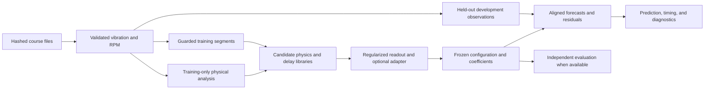
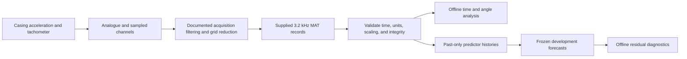
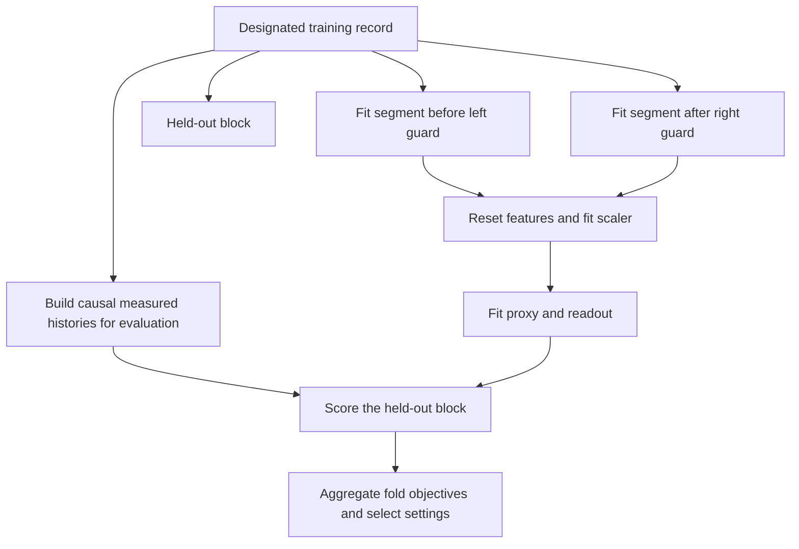

# Physics-Informed Structured Reservoir Computing for gearbox vibration

*A study and reproduction guide for MECG 7780 Engineering Data Analytics*

This companion develops a causal predictor of standardized gearbox vibration from measured history. It derives the physical representation, shows how the numerical design follows from the equations, and teaches how to audit the experiment. The prediction and fault-detection questions share a fitted baseline but use different evidence. A useful prediction model reduces healthy-vibration uncertainty. A useful diagnostic also preserves information about a periodic fault in the residual.

## Reading map

- New to the subject? Read Chapters 1–7, then work through the examples in Chapter 25.
- Building or modifying features? Work through Chapters 8–12 and use the causal tests before running a search.
- Reproducing the experiments? Follow Chapters 13–16 and 22 with Notebooks 00–05 first.
- Interpreting the comparison? Read Chapters 17–21 and 23 beside Notebooks 06–10.
- Preparing to explain the work? Use Chapter 24 and the question sets, glossary, and evidence index in Chapter 25.

Notation and values used in examples are identified as analytical, illustrative, or measured. See the [results appendix](#generated-evidence-appendix) for values generated from the completed run.

## 1. Research motivation and the course task

A gearbox transfers rotation and torque between shafts through periodic tooth engagement. In a healthy gearbox, vibration already contains substantial periodic and nonperiodic components. Transmission error, changes in contact stiffness, loading, and structural response can produce vibration that is large compared with a local damage signature. If the machine changes speed, the period of tooth engagement changes in samples. Simple thresholding on raw amplitude may therefore react to operating condition rather than damage.

The project uses a baseline model trained on a designated recording. At time sample $t$ it predicts $x_t$ from past measured vibration, measured operating history, and a bounded state built from those observations. Its error $e_t=x_t-\hat x_t$ is available once sample $t$ is measured. These errors are later analyzed for modulation synchronized with a shaft revolution. No classification label is required for the predictor fit. Diagnostic claims still depend on independently establishing the meaning of the analysis groups.

The course asks whether past vibration predicts the present, encourages using speed as context, and requires MSE, computation time, and fault detection. These are separate objectives. A dense model that minimizes MSE while suppressing a fault signature may be unhelpful for monitoring. A high-quality project reports the joint evidence, including cases where a simpler model wins one criterion. The course weights organization and presentation, clarity, performance, and novelty. For the final component, the corresponding weights are 16%, 16%, 32%, and 16% of the overall project. Progress assessment accounts for the remaining 20%. Evaluation criteria are reasons to communicate evidence clearly. They do not justify optimizing on held-out data or declaring success without a measured comparison.

### 1.1 Testable questions

**Predictive question.** Does the primary PI-SRC pipeline reduce mean squared error compared with a sparse speed-conditioned autoregressive moving-average model on identical measured targets? The committee should be able to reconstruct this difference by opening a saved forecast and subtracting it from the aligned observed signal.

**Representation question.** Do angular delays and structured oscillator interactions improve prediction after controlling for linear readout capacity and causal correction? This needs paired designs with one named feature group changed at a time. If a bundled configuration changes six groups, any advantage belongs to the bundle.

**Attribution question.** How much of the final change is due to a slow average of past error? Applying the same adapter to a physics-free control checks whether that adjustment accounts for the observed improvement. The adapter sees past observations that naturally arrive in a conditional one-step deployment.

**Diagnostic question.** Do the model residuals retain shaft-synchronous modulation under periodic pulse injection and across provisional record groups? Interpreting a visibly separated pair of groups as a laboratory classification result additionally requires acquisition labels and independent grouped testing.

**Efficiency question.** What wall time is required to process a full measured record under a documented hardware and thread protocol? Batch processing and single-sample streaming impose different computational constraints. Timing includes exactly the stages defined by its log.

### 1.2 Project information flow

Document conclusions in that order. Physical analyses suggest candidate inputs. Guarded validation ranks admissible configurations. A committed holdout measures the fitted procedure. Diagnostics use residuals and their own inclusion and timing conventions. A result acquired later cannot justify an earlier selection rule.

## 2. Gear geometry, loading, and vibration

### 2.1 Speed ratio and the tooth-passing clock

Suppose the monitored 37-tooth gear rotates at $n(t)$ rpm and drives a 20-tooth pinion. Let $u$ be input shaft revolutions and $\theta=2\pi u$. Tooth contact requires the same number of teeth to pass the mesh from each wheel per unit time, hence

$$
\left|f_{\mathrm{pinion}}(t)\right|=\frac{37}{20}f_{\mathrm{input}}(t),\quad
f_{\mathrm{input}}(t)=\frac{n(t)}{60},\quad
f_{\mathrm{mesh}}(t)=37\frac{n(t)}{60}. \tag{1}
$$

The pinion rotates opposite to the input gear for an external mesh; its signed rotation depends on the chosen axes. Both wheels contribute to one tooth-passing event. Multiplying the pinion frequency by 20 returns the same mesh frequency. Input-shaft orders describe cycles per input revolution. Mesh order is 37 and its second harmonic order is 74. A period tied to one pinion revolution lies at input-shaft order $37/20$. Before interpreting an order, verify which shaft the recorded RPM represents in the measurement documentation.

**Worked example.** At 150 rpm, the input gear turns at 2.50 Hz, the pinion at 4.625 Hz, and the mesh frequency is 92.5 Hz. At 3,200 Hz, there are $3,200/92.5=34.59$ samples per mesh cycle and 1,280 samples per input revolution. A two-mesh-cycle delay is about 69 samples in this example. At 124 rpm it is about 84 samples. A fixed 69-sample lag loses phase alignment when speed falls.

### 2.2 Forces and transfer paths

Teeth deform under contact load and the number of teeth sharing load changes over a meshing cycle. Manufacturing errors and eccentricity can perturb transmission error, the small deviation from ideal gear ratio at each instant. Both processes can excite periodic forces at or around mesh harmonics. The sensor records the resulting movement after transmission through shafts, bearings, and casing, combined with environmental and measurement contributions. Distinct frequencies in the forcing and transfer path can overlap. A narrow peak is evidence of energy concentrated at one frequency in that measurement, and an identification of the underlying structural mode requires a separate excitation or identification experiment.

One useful local physical idealization is a forced linear oscillator,

$$
m\ddot q+c\dot q+kq=F(t),\qquad
\omega_n=\sqrt{k/m},\qquad \zeta=\frac{c}{2\sqrt{km}}. \tag{2}
$$

Here $q$ has displacement units, $m$ is mass, $c$ is viscous damping, and $k$ is stiffness. The underdamped homogeneous envelope decreases as $e^{-\zeta\omega_n t}$. A fitted exponential memory in a predictor has a similar mathematical shape. Its time constant is an effective representation setting that interacts with measured forcing, window support, and regression penalties. Predictive fitting alone cannot identify $m$, $c$, and $k$. The project uses the oscillator state as a causal summary, with information and units described in Chapter 11.

An accelerometer measures acceleration at its mounting point and along a direction. For a sinusoidal displacement $A\cos(2\pi f t)$, acceleration amplitude is $(2\pi f)^2 A$. Consequently a vibration signal can give comparatively large acceleration weight to high-frequency modes. Sensor mounting and anti-alias filtering also alter the observed frequency response. A good time-domain baseline does not recover the gear displacement directly from a normalized acceleration trace.

### 2.3 Local defects, amplitude modulation, and sidebands

If a tooth crack changes stiffness predominantly when the affected tooth is under load, one recurring engagement can disturb each revolution of that gear. The disturbance can be modeled as a periodic sequence in shaft angle carrying a short damped oscillation. Speed variations make this sequence irregular in seconds, while timing in input revolutions can be much more stable when the defect rotates with that gear. Jitter, amplitude variation, multiple defects, dynamic load, and operating transitions can weaken the periodic modulation.

A simple amplitude-modulated component illustrates sidebands. Multiplying $\cos(2\pi f_c t)$ by $1+\eta\cos(2\pi f_m t)$ gives the carrier and two sidebands at $f_c\pm f_m$ with amplitude $\eta/2$ times the carrier, by $\cos a\cos b=(\cos(a+b)+\cos(a-b))/2$. If modulation and carrier are both tied to shaft speed, the corresponding offsets are stable in orders while their Hertz values move over time. Sidebands can also appear in normal operation, for example from eccentricity. Their presence is a hypothesis-generation clue. Comparisons with known condition records, repeated runs, and physical reasoning are needed for diagnostic attribution.

### 2.4 How to read the physics units

Use rev/s for shaft frequency, Hz for physical frequency, cycles/revolution for order, radians for the argument of a trigonometric function, and seconds or samples for decay memory. The same symbol $\omega$ is sometimes used for angular speed in rad/s and for RPM in papers. This guide uses $n$ for RPM and $2\pi n/60$ for angular speed. A factor $2\pi$ error rotates quadratures incorrectly and is easy to miss when a high-capacity readout compensated for the wrong feature on one record. A constant-speed worked example should always precede feature tuning.

## 3. Measurement, sampling, and units

### 3.1 The time grid and aliasing

For sampling rate $f_s$, $\Delta t=1/f_s$. A nominal $f_s=3{,}200$ Hz implies $\Delta t=0.3125$ ms and Nyquist frequency 1,600 Hz. A sampled sine with analogue frequency $f$ and one at $f+kf_s$ produce discrete phase sequences differing by integer multiples of $2\pi$. Once sampled, they cannot be distinguished by inspecting those sequences. Energy folded into the band by insufficient filtering is an acquisition problem. Fitting a model later can describe the observed alias but cannot recover the original underlying frequency uniquely.

The journal describes acquiring at 25.6 kHz and applying low-pass filtering before downsampling to 3.2 kHz. The final project files are already on the 3.2-kHz grid. Reapplying an arbitrary filter would change the target values and benchmark task. The supplied records support grid verification from $t$, frequency checks from the sampled signal, and contextual documentation of source preprocessing. Verification of an exact analogue filter or calibration chain requires source metadata beyond the sampled arrays.

The Nyquist bound on input-shaft order at speed $n$ is

$$
k_{\mathrm{ord,max}}(n)=\frac{f_s/2}{n/60}. \tag{3}
$$

At 167 rpm this is about 575 cycles/rev. A bank of 12 mesh harmonics extends to order 444, or about 1,236 Hz at this speed. Orders near the clearance threshold need extra caution if the evaluated RPM is perturbed, the band is broad, or a requested extrapolation exceeds the observed operating range. Check the maximum RPM of the actual source and the planned perturbations. No argument based on a typical speed guarantees validity over every record.

### 3.2 Observation and transduction errors

An accelerometer signal may include broadband electronic noise, mounting response, drift, quantization and low-frequency motion. A speed channel may be estimated from tach pulses, sample-held, interpolated from lower-rate observations, or delayed by processing. The course files expose RPM values on the vibration grid but do not provide a full encoder synchronization specification. The conservative primary predictor uses RPM through sample $t-1$. Offline analyses may use all samples to map an already measured signal onto angle.

Inspect finite values before fitting. Duplicates in timestamps can invalidate differentiation and interpolation, while dropouts can break monotonic angular integration. Speed units must be explicit. An RPM trace near 150 means roughly 2.5 rev/s, compatible with 25 turns in 10 seconds. Interpreting the same numbers as rev/s would imply around 1,500 turns, moving gear-mesh lines far above the sampled band.

Measurement diagnostics should not overinterpret short segments. Very few exact extrema can rule out obvious repeated saturation plateaus and reveal an absence of one common clipping symptom. They cannot guarantee that clipping never occurred upstream. Narrowly clustered speed values are consistent with tightly controlled operation; they provide little information about high-load or substantially different speed regimes.

### 3.3 Standardized signal scale

If raw acceleration $a_t$ has a verified factor $s$, standardized vibration may be formed by

$$
x_t=\frac{a_t-\mu}{s},\qquad
\mathrm{MSE}_a=s^2\mathrm{MSE}_x. \tag{4}
$$

The second identity holds for the same targets and affine transformation. The mean cancels in errors and the scale is squared. If $a_t$ is in m/s², its MSE is in $(\mathrm{m/s^2})^2$. Metadata and the raw field can establish the affine transformation, while they may leave the absolute sensor calibration units uncertain. Do not normalize each fault recording independently. That would erase amplitude information across acquisitions and could remove diagnostic evidence.

Numerically, use the supplied standardized vibration to preserve score parity. Any extra feature scaling belongs inside each fold. Feature scaling differs from target rescaling: the same model predictions can be returned in the standardized target coordinate while inputs to the least squares are centered and normalized for conditioning. Save the fitted locations and scales beside weights because they are necessary for portable inference.

### 3.4 Acquisition and preprocessing map

The branch at validation is important. Offline explanatory transforms may see the full record. Rolling prediction features stop immediately before the target. Treating a full-record FFT coefficient, Hilbert envelope, or centered smoothing output at $t$ as a causal covariate can accidentally encode the very signal the model should predict.

## 4. Prediction from dependent observations

### 4.1 Conditional one-step task

For past-information set $\mathcal I_{t-1}$ define

$$
\hat x_t=\mathrm E[x_t\,|\,\mathcal I_{t-1}]\quad\text{as a squared-error target},\qquad
e_t=x_t-\hat x_t. \tag{5}
$$

The actual fitted function approximates the conditional expectation over a finite feature family. At target $t$ the information set includes earlier observed vibration and any earlier measured RPM selected by the method. At target $t+1$, measured $x_t$ belongs to the history. Supplying $\hat x_t$ instead changes the procedure to a free-running forecast with possible error accumulation. Compare such a procedure in a separate study. Compensation from previous observed errors is admissible for Eq. (5) when the physical sensor is continuously available.

A simple baseline is persistence, $\hat x_t=x_{t-1}$. A fast-oscillating waveform can make this baseline particularly poor if adjacent samples often have opposite signs. That result reflects the phase evolution of the measured trace. More context can help interpolate the next phase even if the physical noise realization remains unpredictable.

### 4.2 Stationarity and lag statistics

A weakly stationary process has constant mean and variance and covariance that depends on lag rather than absolute time. Changing speed makes the period in samples time-varying, so a constant-lag covariance estimated from the whole record averages over differing conditions. A lag autocorrelation can therefore be small globally even when a similar waveform repeats under angle alignment. This motivates both speed-conditioned predictions and resampling for descriptive analysis.

The partial autocorrelation at lag $j$ measures linear association between the current and lag-$j$ sample after regressing each on the intervening samples. A finite-order AR model has a theoretical PACF cutoff under assumptions of stationarity and white innovation. In this dataset, an empirical PACF is a memory diagnostic. It does not identify an exact physical memory horizon. Inspect autocorrelation alongside speed-stratified lag behavior and guarded prediction results.

### 4.3 Statistical model hierarchy

For measured vibration lags and innovations, the coefficient convention in this guide is

$$
\hat x_t=b+\sum_{j=1}^p a_j x_{t-j}+\sum_{h=1}^q c_h\epsilon_{t-h}. \tag{6}
$$

AR uses $q=0$. ARMA keeps both lag blocks. Conditional one-step ARMA requires a convention for reconstructing earlier $\epsilon$ values, often a recursion initialized to zero and warmed up. Invertibility relates to how those initial errors decay. Explicit finite replacement must be validated against the full conditional recursion to show acceptable numerical tails. Neither a long warm-up nor numerical closeness justifies including current $\epsilon_t$.

ARIMA models a differenced signal. For $d=1$, $v_t=x_t-x_{t-1}$; predict $v_t$ from its history and return $\hat x_t=x_{t-1}+\hat v_t$. Score on the common standardized level signal. Differencing can stabilize certain slow trends but may unnecessarily amplify high-frequency noise. ARX adds measured exogenous lags such as RPM. LPV scheduling goes further by changing the coefficients multiplying vibration lags with speed. A fixed additive RPM term cannot reproduce an arbitrary RPM-dependent AR coefficient. NARX allows nonlinear feedback and exogenous interactions. A one-step implementation still uses observed previous vibration as feedback.

### 4.4 Causal innovation example

Take $a_1=0.8$, $c_1=0.25$, and previous actual $x_{t-1}=1.4$. Suppose the predictor at $t-1$ returned $1.0$. Then the available innovation is $0.4$, and Eq. (6) gives $1.12+0.10=1.22$. Only after x at $t$ is observed can the next innovation be known. A test that changes $x_t$ and all later values while requiring prediction at $t$ to remain unchanged checks this timing claim directly.

## 5. Linear algebra, shrinkage, and numerical validation

### 5.1 Designing the matrix

A regression row must correspond to one target index. For lags $\{1,3,6\}$, row $t$ contains $[x_{t-1},x_{t-3},x_{t-6}]$. Adjacent rows share much of their underlying information even when individual columns are distinct. Add an intercept to represent the level. A convenient implementation centers each feature using fit rows, centers the target, fits slope coefficients, and restores the target mean when scoring. A column with nearly zero variance is a poorly supported direction and needs a variance floor or removal according to the implementation.

Let $A\in\mathbb R^{N\times P}$ and $y\in\mathbb R^N$. Ordinary least squares minimizes $\|y-Aw\|_2^2$. Under full column rank, the normal equations are $A^TAw=A^Ty$. Computing the inverse of $A^TA$ explicitly is unnecessary. QR solves the triangular system in a numerically stable way; SVD offers a rank and singular-spectrum diagnostic. An unfortunate near-collinearity among delayed vibration, angle histories, and quadratures can make $A^TA$ nearly singular. Its condition number squares the condition number of $A$ in the full-rank case. Use a stable decomposition, carefully controlled regularization, and recorded rank or conditioning evidence.

### 5.2 Ridge, Lasso, and Elastic Net

With centered scale-normalized features and an unpenalized intercept, ridge minimizes

$$
\frac12\|y-Aw\|_2^2+\frac12\lambda\|w\|_2^2,\quad
(A^TA+\lambda I)w=A^Ty. \tag{7}
$$

For positive $\lambda$, the system is positive definite barring numerical or input faults. In the right singular directions, ridge reduces amplification associated with small singular values. A group-ridge variant replaces $\lambda I$ with a positive diagonal assigning different penalties by physics feature group. An interaction coefficient needs more shrinkage when its effective support is scarce or when it encodes a high-capacity library of weakly identified directions. Relative penalties should be stated with their objective scaling and with feature normalization.

Lasso minimizes $\|y-Aw\|_2^2/(2N)+\lambda\|w\|_1$ in one common software convention. Its nonsmooth penalty may produce exact zeros. Elastic Net uses a convex mixture of squared $\ell_2$ and $\ell_1$ penalties, often helpful for correlated groups. A numerical value of $\lambda$ cannot be compared across objectives with different denominators. The same L1 penalty value in unnormalized and $1/N$ loss conventions can differ by orders of magnitude. The solver log should state convergence or the dual gap. A capped, unconverged coefficient vector is evidence of a numerical limitation. It is weaker evidence for claiming a selected sparse support.

For a single orthogonal standardized feature, normalized soft thresholding gives $w=\operatorname{sign}(s)(|s|-\lambda)_+$, where $s=A^Ty/N$. If $s=0.3$ and $\lambda=0.05$, the coefficient is 0.25. On correlated features, coordinates interact. Small changes in penalty may switch between correlated columns while leaving overall predictions similar. This is why individual coefficient magnitudes and selection frequencies deserve cautious interpretation.

### 5.3 Readout capacity and effective complexity

In classical ridge for fixed $A$, the effective degrees of freedom are $\sum_i \sigma_i^2/(\sigma_i^2+\lambda)$. This can be lower than the stored coefficient count, especially when some directions are strongly penalized. Capabilities of a tree ensemble, SVR, and recurrent neural model cannot be equated by one parameter number. Tree node storage has split and routing fields; SVR includes support-vector coordinates and kernel coefficients; a model using proxy innovations needs both stage-one and stage-two parameters. Report each counting convention and compressed checkpoint bytes as complementary measurements.

Akaike’s information criterion for a Gaussian residual approximation compares models using $N\log(\hat\sigma^2)+2k$ up to constants. Bayesian information criterion substitutes $k\log N$ for the penalty term. Keep the response and sample mask the same when comparing orders. Unknown effective complexity and correlated errors limit a literal probabilistic reading. AIC may screen candidate architecture sizes, while the common guarded-fold target error determines the engineering comparison.

## 6. Experimental design under time dependence

### 6.1 What a model hyperparameter is

A parameter is estimated by minimizing the chosen training loss at a fixed configuration, such as a ridge coefficient. A hyperparameter shapes that problem, such as penalty, lag length, oscillator bank, or kernel width. Physics prior choices can be selected by reviewing training-only EDA and a defined search range. The fitted readout and the selected physical feature configuration must both be committed before inspecting a final held-out test outcome.

A common source of confusion is to describe reduced fold loss as better generalization. Guarded folds measure performance within an observed training source under a chosen withholding protocol. When the folds share an acquisition, they share machinery, speed excursion, sensor chain and autocorrelation. The multiple fold scores provide informative sensitivity across segments, with limited evidence for deployment on a new machine.

### 6.2 Time masks and the guard

For fold bounds $[a,b)$, remove the evaluation interval and its guard from model fitting. With guard $G$, admissible training raw segments are $[0,a-G)$ and $[b+G,N)$. Reinitialize state within each segment. Score target $t$ on a measured prefix through the held-out block with the same past-history convention as deployment. The training matrices and scalers access fit segments only. For constant finite support $L$, every target row should satisfy $t-L$ inside its segment. If oscillator, proxy innovation and adapter compose their dependencies, verify the full upstream context rather than only the maximum of their nominal direct lag lengths.

A fit that uses each sample once and then randomly divides overlapping windows can leak strongly correlated neighborhoods. The boundary exclusion should cover the receptive field including interpolation and adaptive terms. An evaluation record may itself provide observed history before a target. That is within the one-step information contract, even when the earlier target belonged to the same held-out block. The model's fitted weights remain frozen.

### 6.3 Bias, variance, and evidence separation

Adding basis functions increases expressive capacity. It may reduce bias, increase variance, or both. Ridge trades these effects by penalizing large coefficients. Deliberate group selection reduces the number of speculative interactions. Deep learners can exploit useful local feature sharing and nonlinear temporal structure, but optimization and calibration on a short acquisition are hard to validate. Make these mechanistic explanations hypotheses. Use training fit, blocked folds and held-out development differences to test them.

Never average away a configuration failure. Record the model, parameters, fold, solver message and elapsed time. Retain the best eligible setting according to the declared objective. State that budgets differ when appropriate. Training support may be smaller for SVR or attention models to fit resource constraints. A narrow family-level search gives a result for a deployed configuration and budget, with uncertainty about what another search might find.

### 6.4 Illustrative fold example

Take $N=24{,}000$, $a=4{,}800$, $b=7{,}200$ and $G=1{,}792$. The left fit segment stops before 3,008 and the right segment starts at 8,992. A fit row at 8,992 has no within-segment past, so a stateful model must warm up or mark it ineligible. A held-out target at 4,800 can use observed $x_{4799}$ for inference but cannot contribute its own target to the parameter fit. Changing $x_{4800}$ should affect later valid use of past history but leave the predicted value for target 4,800 invariant. Recompute that property after adding any nonlinear feature or correction.
