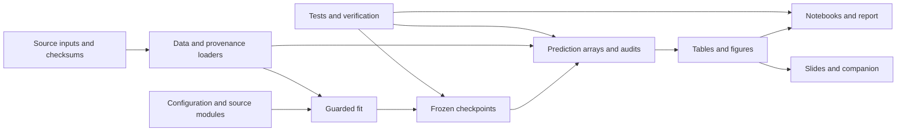

## 20. Robustness and ablation as controlled experiments

Robustness asks how the same fitted procedure responds to a specified change in its measurements or operating context. An ablation asks how the result changes when one part of the procedure is altered. They share a principle. Hold the relevant experimental quantities fixed and identify exactly which intervention occurred. Without a fixed target, mask, and baseline, an apparent gain may reflect a different problem or comparison. Notebook 08 reads the actual intervention ledgers and makes these distinctions executable.

### 20.1 Separate prediction sensitivity from analysis sensitivity

The pipeline has two uses of measured speed. Causal feature generation uses historical RPM to construct phase, select past vibration, and schedule a readout on operating condition. Offline diagnosis uses the measured speed over the record to reconstruct angular coordinates for a residual that already exists. If a speed error enters the forecasting path, it can change the residual even if the angular reconstruction is perfect. If the same error enters only the diagnostic path, the residual in seconds is fixed while its shape and repetition on the angular grid change. Their combined consequence need not be the arithmetic sum of the two independent changes.

Let $x$ be the supplied vibration, $n$ the observed reference RPM, and $g(n)$ a designated sensor error. Write $F(x,n)$ for causal forecast and $P(e,n)$ for the angular PMI of residual $e$. The two error contrasts can be written explicitly as

$$
\begin{aligned}
\Delta_{\mathrm{pred}}&=P\!\left(x-F(x,g(n)),n\right)-P\!\left(x-F(x,n),n\right),\\
\Delta_{\mathrm{grid}}&=P\!\left(x-F(x,n),g(n)\right)-P\!\left(x-F(x,n),n\right).
\end{aligned} \tag{19}
$$

In Eq. (19), forecast vectors and residuals share the 22,208 scored indices. Both terms compare dimensionless PMI under identical timing. The code evaluates the both-path condition separately. These contrasts distinguish mechanisms on the recorded acquisition. They do not establish the accuracy class of a sensor or a population response. The measured values are saved per case and method in the fault ledger. Its scenario named `bias_plus_2pct` scales speed by 1.02. The stress battery also includes holds, delay, smoothing or excursions according to the exact generator, rather than replacing speed with arbitrary noise. See `speed_cases` in [the stress module](../src/src_gearbox/diagnostics/speed_stress.py) before interpreting a case label.

A simple calculation shows why a bias can matter for the 259-order bank. A speed ratio error of $q$ produces a phase offset of about $2\pi kq a$ radians over a history span of $a$ true shaft turns. With $k=259$, $q=0.02$ and $a=0.10$, the magnitude is about 3.25 radians. A predicted state may flip phase over only one tenth of a rotation. Weighting attenuates older samples in an actual oscillator. An angle-domain feature also queries a changed interpolation location. A smooth speed polynomial may extrapolate or saturate for a different reason. These mechanisms motivate separately inspecting the phase, angular, and amplitude branches under speed measurement error.

The selected model's clean development PMI is approximately 0.01804. Feeding a +2% bias into the predictor alone raises PMI to approximately 0.11624, whereas feeding that bias through the offline grid alone raises it to approximately 0.02255. Applying it to both gives approximately 0.06296. Phase distortion and model behavior can partially cancel numerically. Even after demonstrating improved prediction MSE under some stress scenarios, a threshold calibrated from one clean setting could be unreliable under an RPM bias. The [sensor PMI figure](../figures/fault/sensor_pmi.png) is an intervention on one observed speed trajectory. Its vertical or horizontal distances are scenario effects on this fixed record.

### 20.2 Signed waveform retention is more informative than energy alone

For a known synthetic addition $p_t$, define the change in a model's prediction as $d_t=\hat x^{\mathrm{injected}}_t-\hat x^{\mathrm{clean}}_t$. The difference between its injected and clean residuals is $p-d$. In a scored interval the retained waveform energy satisfies

$$
\frac{\lVert p-d\rVert^2}{\lVert p\rVert^2}
=1+\frac{\lVert d\rVert^2}{\lVert p\rVert^2}
-2\frac{p^T d}{\lVert p\rVert^2}. \tag{20}
$$

All three ratios are dimensionless. If the predictor does not react at all to the added pulse, energy ratio equals one and distortion equals zero. An energy ratio greater than one can arise from a counter-phase response or a delayed response that increases energy while blurring shape. If a predictor tracks half a pulse exactly, its residual keeps only half the amplitude and a quarter of the energy, even though the waveform correlation is one. If $d$ is orthogonal to $p$, the original projection is intact while the residual gains unrelated variation. A correlation and a projection alongside the energy ratio clarify each case. This identity can be checked independently in short vectors. For example, $p=(2,0)$ and $d=(1,1)$ give retained energy $1/2$, distortion $1/2$, and $p^Td/\|p\|^2=1/2$.

Periodic injection controls establish sensitivity to chosen, known waveform changes. The archive, SRC, and conventional references can have overlapping MSE ranges but distinctly different pulse response. Normal operating variation and an actual bearing or gear fault do not necessarily produce an additive damped waveform of known order, phase, and amplitude. The observed sign of the PMI shift gives less information than direct labelled detection performance over independent load profiles. The reproducible [pulse ledger](../results/fault/pulse_preservation.csv) records enough structure to change the aggregate diagnostic without retraining. The pulse trade-off display pairs waveform preservation against clean prediction performance. Better orientation on one axis need not improve the other. Primary PI-SRC obtains lower clean error than polynomial SRC on the measured validation record, whereas polynomial SRC's median injected-waveform correlation is greater. That is evidence for a trade-off in this battery.


Report measured counts as scenario counts. Five positive cases out of five is a description of a designed battery. Its denominator is five perturbations of one recording, not five independently drawn damaged wheels.

### 20.3 Read the ablation hierarchy

The strongest one-change correction contrast loads one selected model, computes its base forecast once, and compares that base vector with the same causal correction applied. A result of that form isolates the inference mechanism in the frozen implementation. Refitting an uncorrected configuration is a separate experiment and may have its own coefficient values. The [matched adapter ledger](../results/ablations/identical_adapter_controls.csv) keeps these controls in one coordinate system. The identical adapter lowers error for strict sparse LPV–ARMA, the polynomial SRC, and the primary PI-SRC by different amounts. A gain in all three models shows that useful predictability remains in the older base-error history of more than one method.

Removing angular lags, oscillator states, proxy innovations, acceleration, synthetic augmentation, or changing nonlinearity capacity alters the final prediction map. Some such variants regenerate the design and refit coefficients. The observed delta then describes the full changed learner under a stated protocol, including differences in the fitted readout, rather than the contribution of one coefficient set with all else held fixed. A model can use overlapping information from angle and oscillators. The combined no-angle/no-carrier case is therefore valuable in addition to each individual change. Numerical differences can be reconciled in [the ablation table](../results/ablations/src_ablations.csv), with exact configuration JSON for each row. The larger 12-order alternative obtained lower development MSE than the primary. Because model selection had been frozen, this becomes evidence for an independent future check and does not supersede the named primary.

The pure clean-MSE objective provides another informative comparison. Its selected configuration is based only on a different training-only criterion within the same finite trial suite. It can lead to a better error on the single development record while being less attractive on fault or sensor terms. Use the [selected configuration ledger](../results/optimization/selected_configs.json) to confirm that each rule was applied to the planned training summaries. Do not use later development differences to redefine the earlier optimization objective. Interpret a model's fitted condition estimate as a property of its regularized normal system on those rows, including weights and scale. It cannot demonstrate physical interpretability by itself.

### 20.4 Earlier-only sensitivity

A guarded fold excludes the held interval and its neighboring raw history. It may still use distant observations recorded later. A deployment that predicts a future operating state has only earlier measurements for fitting. This is a stricter distributional test. With the same configuration, earlier-only MSEs for the three held intervals were about 1.41380, 1.11093, and 0.35367. Their permitted training stops were 3,008, 9,408, and 16,608 respectively. That strong dependence on record coverage is scientifically important. It shows that within-acquisition interpolation was much easier than forecasting under short or earlier operating coverage. It does not broadly quantify long-term degradation.

Correlated scenario sensitivity also matters for causal verification. Changing the complete input suffix at and after a target should leave the selected model's forecast invariant through that target. Numerical differences of rounding scale are tolerable when controlled. Test three roles separately if expanding the suite. Changing late vibration leaves earlier outputs unchanged, changing late speed leaves earlier phase estimates unchanged, and replaying a prior prefix from a clean reset reproduces its trajectory. These tests fail a specific data-flow implementation that could otherwise yield deceptively low MSE. A passed perturbation probe supplements rather than replaces an explicit support derivation and review of the readout-fit split.

## 21. The lecturer’s sparse time-variation reference

The lecturer's article develops a sparse linear parameter-varying autoregressive moving-average model for nonstationary gearbox vibration. It is a substantive comparison because measured speed may change the coefficients that infer previous vibration and innovations, not only supply an additive offset. It also preserves a relatively clear classical map from historical state to prediction. The reconstruction and protocol examples in Notebook 02 distinguish the article's experimental scores, the supplied legacy checkpoint, the strict matched reference, and diagnostic refits.

### 21.1 Expand scheduled coefficients

Using the sign convention of a positive autoregressive coefficient on the right-hand side, let $s_t$ be a dimensionless rotational schedule, $P_j$ a basis, and $\tilde\epsilon_t$ a proxy innovation. The useful one-step representation is

$$
\widehat y_{t|t-1}
=\sum_{i=1}^{p}\sum_{j=0}^{P_a} a_{ij}P_j(s_t)y_{t-i}
+\sum_{h=1}^{q}\sum_{j=0}^{P_b} b_{hj}P_j(s_t)\tilde\epsilon_{t-h}.
\tag{21}
$$

Each feature is a product of one vibration or innovation lag and one schedule basis value. Implementation details dictate whether a quantity called basis dimension counts the constant term in its stored value. Read the checkpoint dimensions to determine the actual number of product columns. Fit coefficients may also use a sign convention in the polynomial operator different from the expanded predictor written in Eq. (21). Both are translatable by an explicit mapping. Check a small fitted forecast to confirm. In the strict development table $s_t$ uses the latest permissible speed through $t-1$. The preserved archive current-speed row uses the scheduling variable at $t$. Whether contemporaneous RPM can be measured before predicting vibration is then an acquisition-interface question.

The same $s_t$ can be represented in monomials, Legendre polynomials, or another stable basis. For an unpenalized fit on the same full-rank span, an invertible linear basis change may leave fitted predictions unchanged. Lasso penalizes coefficients in the chosen coordinate system. Its support can therefore change when the same polynomial span is represented differently or columns are scaled differently. Projection coefficients fitted in one basis cannot simply be passed into another. The article describes Legendre polynomials in prose while its displayed expression resembles monomials. Reproduction keeps the interpretation explicit and records both. The difference is visible in the current-RPM row-CV evidence rather than settled by guessing which code generated a paper panel.

The first stage fits a sparse speed-scheduled AR model and obtains the innovation proxy from its residual. The second stage uses that history to fit a sparse speed-scheduled ARMA model. An innovation is available after its vibration target arrives. At evaluation time the previous observed vibration lets the algorithm compute the corresponding first-stage residual before predicting the next sample. Replacing $y_{t-i}$ and $\tilde\epsilon_{t-h}$ by recursively forecast values would change the information contract and error accumulation.

### 21.2 AIC, sparsity and refitting

For a family of fixed training residuals and comparable estimated variance, the article uses $\mathrm{AIC}=N\log(\widehat\sigma_e^2)+2d$, with $N$ target count and $d$ parameter count under its convention. AIC penalizes high-dimensional candidates even if their residual variance is lower. For an illustrative comparison with $N=2{,}000$, reducing variance from 0.40 to 0.38 lowers the data term by roughly 102.6. Adding 65 parameters raises the penalty by 130, so the denser candidate loses by about 27.4. That arithmetic assumes comparable evaluated rows and an appropriate objective approximation. AIC does not constitute an independent test, nor should residuals from a shorter, easier segment be compared without caution.

The next step solves an L1-penalized problem. In the article's ADMM setup the sparse coordinate update uses soft-thresholding, which zeros components inside a threshold and subtracts the threshold from the magnitude of the remainder. For $v\in\mathbb R$ and $k\geq0$,

$$
S_k(v)=\operatorname{sign}(v)\max(|v|-k,0). \tag{22}
$$

If the input is 0.6 and threshold is 0.2, its sparse update is 0.4. An input of -0.08 maps to zero at that threshold. This operation handles the cusp in the L1 objective without requiring differentiability at zero. Convergence still depends on scaling, stopping criteria and numerical conditioning. A numerical audit should retain iterations, objective or primal/dual tolerances, input shapes, and the exact support extraction criterion. Refitting the selected nonzeros can reduce shrinkage bias while leaving structural zeros intact. Refitting on the full design would discard the sparse hypothesis.

The nominal paper implementation uses five-fold selection. Its text states that the highest penalty within **one standard deviation** of the MSE of the minimum-MSE penalty is retained, rather than explicitly saying one standard error of the mean. On five observed fold values the latter would usually be smaller by $\sqrt{5}$, under simple independent-fold assumptions. In this setting fold outcomes are dependent. The supplied paper-style to strict-course fit changes more than this one rule: it changes scheduling, support, and how overlapping training histories are guarded. A fair result does not attribute every score difference to one convention.

### 21.3 Three interpretations of a reported number

The publication's laboratory setup used a 20 s raw acquisition to form two 7.5 s baseline segments after preprocessing. The supplied train and development files each span 7.5 s at 3,200 Hz but follow different acquisition and partition evidence, including actual identities of fault-overlapping records. The test segment in the article and its exact chronology were unavailable to verify against the supplied development segment. Table 6's Sparse LPV–ARMA MSE of 0.2893 belongs to the authors' asserted setting. The strict course execution recovers about 0.371406 for the matching baseline on the later matched held-out mask. Both values preserve their own units and information contracts. A same-mask numerical result does not establish absolute superiority to the publication, nor does the numerical discrepancy alone show a failed implementation.

The preserved archive with current RPM and a target start of 316 gives about 0.336901 on its declared earlier development window. Recomputing the score on the stricter [1792,24000) marginally changes its evidence since the earlier 1,476 targets have been removed. Using previous RPM and the common start gives another preserved archive mode entry. Changing training and development settings together makes the strict refit a stronger new procedural benchmark, at the cost of departing from a literal archive replay. The dense strict LPV–ARMA alternative gives about 0.330781 and remains useful supplementary evidence alongside sparsity. It differs from the required sparse family in support and capacity.

An archived retrospective search can rotate or window a record until its MSE approaches a prior published value. If circular wrap splices the end to the beginning, histories straddling the join are not physically continuous. Even within a continuous segment a score-directed search uses outcome information. Its evidence is investigative, and it belongs outside held-out model ranking and selection. A reproducible report stores segment identity and target continuity, making it possible to distinguish the original numerical result from a fitting procedure that happens to return a similar value.

The release includes both the [external table](../results/metrics/published_paper_reference.csv) and the [local reference table](../results/metrics/local_statistical_reference.csv). The measured strict coefficients can be recomputed using [the statistical reference command](../scripts/02_reproduce_lpv_reference.py). Its optional `--fit-paper` flag repeats the current-RPM five-fold coefficient estimation. The result supports comparisons of conventions. It does not make an unavailable original test record appear.

## 22. Numerical software engineering and reproducibility

### 22.1 Separation of inputs, results, and fitted state

A practical scientific tree separates source code from data and derived outputs. Input identities must be visible before a fit. Code, configuration, and fit evidence explain what was done. Most model state is numeric array data. A serialized checkpoint is useful only if a reader can identify the compatible loader, reproduce feature order and scaling, check the training provenance, and distinguish the model's required history from evaluation warm-up. At evaluation time the project reloads frozen weights and recomputes scored vectors under an explicit sample mask.



The licensed data are local inputs rather than implicit dependencies hidden in model code. `inputs/input_manifest.csv` records byte identities, roles, and missing files. `data/splits/protocol.json` spells out partitions and target indices. `configs/` stores the selected configuration plus explicit evaluation and optimization settings. `checkpoints/src_registry.json` identifies the source revision, data hash, model parameters and per-checkpoint identities. The fitted artifacts live in `checkpoints/`. Review tables in `results/` keep one row per measured condition or scenario rather than a screenshot of a summary. Sources of figures map back to the tables and vectors. This separation supports both reproducibility and respectful use of external documents and data.

The input manifest fingerprints the bytes with SHA-256. A hash protects identity and helps detect accidental changes. It does not by itself prove a source is licensed or trusted. Compare file path, structure, count, and digest to a known inventory. Archive intake bounds individual and total expanded sizes and rejects unsafe paths. MATLAB loaders treat each struct and subrecord with its declared field types. Skip a missing independent test honestly. Guessing what a malformed or absent source should contain can introduce bias or silent unit errors.

### 22.2 Reference and deployment-style unit tests

A scientific numerical test needs an oracle. An oscillator can be checked with direct finite summation and a faster recurrence. A train-mask test can derive guard intersections from half-open interval arithmetic. A sensor phase fixture at constant speed can give exact rev/s and known lag. A serialization test can round-trip the explicit feature order, fixed normalizers, and numeric weights, then compare resulting predictions. A zero-envelope fixture should report why PMI is invalid instead of inventing a zero score. An expected failure should remain distinguishable from a model that completed normally.

For the direct oscillator reference, separate sign and truncation. Test a constant-speed harmonic at its known order to check remodulation. Test an isolated impulse near a restart and look for the first affected target. Test finite support by comparing output after the oldest allowed raw sample leaves the filter. Test a chirp so a hidden constant-frequency assumption becomes visible. The project includes implementations of these ideas in its test suite and in Notebook 03. The verification report measures equal-input checkpoint replay and perturbation of later samples. A high-level prefix mutation test proves no dynamic influence at the selected tested points. Design review and independent algebra cover gaps between those points.

A data-dependent end-to-end check can reproduce the selected validation vector from the saved checkpoint and the user-supplied `sigvalid.mat` file. A lightweight no-raw-data check can audit the saved arrays against the table. Use either under the stated scope. Numerical errors should be reported to a reasonable tolerance. Relative tolerances can misbehave near zero, and exact identity of floating-point sums across different BLAS builds is unnecessary for scientific reproducibility when the difference remains measured and negligible.

The following check verifies the recorded primary mean squared error and the common index order using only released arrays. Run it from the project root with the packaged Python environment.

```python
from pathlib import Path
import csv
import numpy as np
from src_gearbox.study import scores

with np.load(Path("results/predictions/primary_pi_src/sigvalid.npz"),
             allow_pickle=False) as promoted:
    indices = promoted["target_indices"]
    np.testing.assert_array_equal(indices, np.arange(1792, 24000))
    actual = promoted["target"]
    prediction = promoted["prediction"]
    calculated = scores(actual, prediction)["mse"]
with Path("results/metrics/all_model_comparison.csv").open() as source:
    primary = next(row for row in csv.DictReader(source)
                   if row["model"] == "primary_pi_src")
np.testing.assert_allclose(calculated, float(primary["mse"]), atol=1e-12, rtol=0)
```

The call to `scores` checks finite residuals and computes summary metrics on already aligned inputs. The integer interval test is independent of the floating-point comparator. An error usually means the wrong model path, split, or mask, rather than an optimization result requiring investigation of architectural details.

### 22.3 Timing protocol and scaling

Use the tested Python versions and required native tooling named in the [README](../README.md). Numerical dependencies are pinned by version in the project constraints and compiled backend/CPU details are recorded in the measured timing provenance. Use a fresh environment rather than relying on global packages from unrelated experiments. The common run constrains numerical operation threads to one. Several comparator models use a different code path internally but respect the same reported CPU and thread scope. A cold call may include memory maps, imports, native-library start-up or initialization. Warm calls repeat the loaded predictor on the full record, given the supplied measurement arrays. Compare like stages. The timed project baseline does not include a sensor transport stack, and clock ratios to acquisition duration do not prove real-time deadlines.

Checkpoints can be audited without importing a previous project or opening pickled objects. The prior trained comparator checkpoints are explicitly frozen and replayed. The new 41-trial search fits independent SRC families on guarded training segments and records the completed trial history. Partial outputs use atomic writes and resume identities. A completed trial can be reused only if its source digest, configuration and training data identity agree. Numerical provenance includes actual code hash and fit protocol. The stored results support an audit without silently rerunning expensive stages when opening a notebook.

For Windows PowerShell, set the escape and quoting conventions shown in the README and invoke `python` from the activated virtual environment. On Linux or macOS use the Bash activation path. Force a CPU distribution when comparing the provided CPU benchmark. A GPU is an optional environment with a separate experimental question. Rebuilding reports and decks requires Pandoc and LibreOffice, while reading the packaged PDF and office files only requires compatible viewers. Opening the assembled file cannot verify that a scorer executed, so maintain the artifact verifier and numeric checks separately.

### 22.4 Command sequence and fallback scope

For the numerical evidence alone, use the stage-aware pipeline or execute frozen steps individually. The examples are for a project clone with designated data copied into `data/raw`. None of the commands reads the blind files to tune a model. Frozen blind evaluation runs only when the independent files are available.

```bash
python scripts/run_pipeline.py --mode smoke
python scripts/15_verify_outputs.py --numbers-only
python -m src_gearbox.study score --data-dir data/raw
python scripts/06_train_baselines.py --data-dir data/raw --tier standard
python scripts/07_compare_models.py
python scripts/11_build_figures.py --only-search
```

To independently repeat the SRC search, use `05_optimize_src.py --resume` with the declared data and profile before fitting from its selected configurations. To run new comparator fits rather than only loading and scoring the protected weights, use the isolated all-family fit tier. New fits have a new provenance and can produce a different ranking. Report the difference explicitly. To reproduce the complete diagnostic release use the two lane commands documented in Chapter 19. To rebuild a short example or teaching table with no external reference files present, follow the code-only verification and synthetic exercise commands.

When a relative path fails under notebook launch, start from the repository root or set `SRC_PROJECT_DIR`. The release's executed notebooks use project discovery with a fallback path variable. To rerun a single notebook by name use the indexed helper. For report and presentation regeneration use the workflow in Chapter 24. Keep source figures intact while rerunning any experimental plots twice to avoid comparing a new PDF with stale CSV labels.

## 23. Interpreting the actual experimental evidence

The project answers a controlled question about one available development acquisition. The same 22,208 target values, standardized units, previous-observation protocol, mask and record boundaries apply to the scored required comparators. Different feature assumptions, training budgets and parameter counts are still part of each model definition. A frozen archived SRC had earlier protected exposure and a higher-dimensional representation. Its lower development point estimate is the direct measured historical reference on these targets. The article's original experiment is external evidence. Keeping those scopes visible prevents an improvement claim from moving its comparison target after measurement.

### 23.1 What the project establishes

The selected architecture gives lower same-mask error than the best of the 21 required comparator families. It benefits from a representation anchored to measured timing and speed. On this acquisition the angular-lag ablation has a larger adverse MSE change than the carrier-bank ablation. Disabling the proxy innovations is also harmful. Removing the acceleration term slightly reduces development MSE. The matched conventional, polynomial, and PI-SRC runs with and without the same adapter establish that error-history correction is useful beyond a single physical architecture. Using a full line including the budget, protected final selection, and uncertainty gives a better causal account of the gain than technically correct but incomplete phrases such as “physics wins.”

The 21 comparator families include classical purely temporal models, operating-parameter models, ordinary and regularized regressions, nonlinear kernels, trees, recurrent architectures, convolution, and two distinct transformer models. This breadth probes specific mechanisms. AR controls the contribution of a transparent history-only linear baseline. LPV and ARX probe speed-dependent coefficient scheduling and adding speed lags. Shallow and deep methods serve different combinations of context, nonlinear representational capacity, and regularization. Comparing broadly establishes where the selected representation helped on this record. It does not show that every possible architecture in a named family is inferior.

Within the learning models, the linear model on engineered states is the strongest required baseline, with ridge close by. That is consistent with a favorable physical basis providing meaningful nonlinear information before the readout; an affine readout on nonlinear features can remain an effective overall nonlinear predictor. Sparse LPV is close enough to make timing or deployment cost important. CNN and recurrent models supply data-driven nonlinear responses that improve on some history-only controls. The two Transformer scores in the released ledger reflect their measured compact configurations and tiny number of distinct acquisitions. Their performance cannot be extrapolated to larger labelled datasets or training budgets. Comparators whose architecture names imply future context still use valid past-based inputs in this protocol.

The qualified benchmark speed experiment measures gains in seven of nine matched families when measured RPM is available, with two exceptions. This supports measuring speed and inspecting how it enters a model, rather than assuming every speed channel improves every family. The sign and magnitude of an effect depend on fitting a comparator with both input regimes and keeping the other factors controlled. A frozen version forced to operate on a naive constant speed without refit would probe robustness, not the same feature-value question.

The waveform panel illustrates a specific measured alignment, with predictions above and forecast errors below. Good overlap does not prove residual whiteness. The inset shown here spans only a subset of common targets, while ranking metrics use all of them. Read it beside the residual ACF and PSD plots when evaluating phase lag or periodic structure.


### 23.2 What needs cautious reporting

Timing shows useful differences even among closely ranked models. Seven warmed PI-SRC calls on the measured CPU produce a median approximately 485 ms and an IQR around 32 ms. That is a duration for a loaded 24,000-sample record pipeline and about 6.47% of its 7.5 s duration. The archived method is faster in warm predictions on this platform despite having more deployed parameters. Stored coefficient counts and feature engineering complexity are different dimensions. Fit time includes model training from already loaded data. Other algorithms may allocate differently, have different setup, or expose different compiled kernels. A proposed implementation for live use would need streaming and resource measurements under its actual sensor rate, baseline update policy, and scheduling.

The moving-block comparisons draw contiguous paired error differences, reducing artificial precision from treating every sample as independent. Different block lengths reflect sensitivity to the time dependence being approximated. A noncircular bootstrap includes no artificial wrap between distant ends of the acquisition. It still conditions on a single held-out record. Many bootstrap replications do not multiply the number of independently observed recordings. Do not use the interval as a direct uncertainty statement for a different speed or load distribution. For a contract-sensitive scientific presentation, show the acquisition structure along with the interval and mention that early-only train sensitivity is larger than many within-record differences.


PI-SRC residual PMI distinguishes the supplied provisional record groups under the specified score, with the group margin substantially changed by applying a frozen healthy baseline. The strongest archival SRC also separates the groups. Group separation on provisional IDs does not validate actual healthy/cracked labels. Raw vibration, selected residual, conventional residual, and alternate-lag sensor controls all have specific delivered rows. A reader can reconstruct the actual claim from the cohort counted after overlap removal. The two exactly leaked records were omitted from inferential summaries but retained as audit evidence. Similar-looking speed profiles alone would be insufficient evidence of duplicate acquisitions. Corresponding measured vibration and measured speed provide a much stronger joint signature.

No independent blind prediction or fault label result was available. The frozen command documents availability and expected input contract. Missing independent experiments remain scientifically important. Treat them explicitly even if the final assignment is otherwise substantial. Replacing a test with the development record would both change its scope and obscure the exposure already used in analysis.

### 23.3 Plan an informative independent experiment

A strong extension begins with independently labelled gearbox runs at several speeds and loads, multiple runs per condition, explicit chronological and mechanical device identifiers, calibrated measurement path, and provenance for faults of distinct location or severity. Freeze architecture, features, threshold calibration, and mask prior to opening those runs. Use multiple complete acquisitions as the inferential unit. Hold out one machine, one remount, or one structured group where available. Log speed-sensor conditions so systematic bias and changes in vibration under load can be separated. Track replays of the analysis pipeline without overwriting the preserved evidence.

An expansion can test whether a size-compatible structured library improves transfer over the same nonlinear capacity with basis choices intentionally stripped of shaft and phase information. Conduct a forward-only study as well as a protected within-record study. Compare one-step prediction, autoregressive rollout without future observations, and real fault evidence as separate questions. The methodology developed here already supplies model-reset, mask, fit-statistics, native artifact, and measurement-perturbation tools needed to make such follow-up clear. It also demonstrates that the fastest way to teach reproducibility is to anchor every large performance claim to a short, runnable check and the exact relevant data identity.

## 24. Writing and presenting defensible engineering results

A course report should connect a physical phenomenon to a measurable hypothesis, state the permitted information, show how the algorithm implements the hypothesis, and give both positive and adverse results. The first paragraph of the results can answer three distinct questions in concise order. How accurate is the selected predictor on the held-out scoring problem? Which trained change produced a controlled improvement? What does the diagnostic support under the available labels? Subsequent figures should answer those questions, rather than add decoration or plots with undocumented units.

A figure showing prediction and measured vibration shares time coordinates with the residual. The paired-score interval plot supports uncertainty around development MSE differences, and the speed-quartile plot checks that average improvement does not hide a particularly unfavorable part of the speed trajectory. The [ranking plot](../figures/comparison/mse_ranking.png) should be read with the ranked CSV because archival, provisional, and newly fit evidence have different origins. The [accuracy and cost plot](../figures/comparison/accuracy_cost.png) exposes a trade-off that ranking by MSE alone would miss. Wear monitoring motivates a second family of figures on diagnostic response, sensor sensitivity, and pulse waveform retention.

The eight-minute progress deck can be organized around question, data and acquisition physics, one result that changed the planned features, provisional modelling choices, and credible next measurements. The twelve-minute final deck can add guarded selection, matched benchmark, result attribution, timing, actual diagnosis, adverse results, and limitation of independent claims. Time the succession of explanations, especially where a dense formula competes with a message. Retain speaker notes as self-contained evidence of what each slide communicates. An accessible slide caption gives units and scope for every number it highlights.

Use the [editable project report](../report/SRC_Final_Course_Report.docx), its [PDF review copy](../report/SRC_Final_Course_Report.pdf), and the [eight-minute](../presentations/SRC_Progress_Presentation_8min.pptx) and [twelve-minute](../presentations/SRC_Final_Presentation_12min.pptx) presentations. Generate the office binaries only after the CSVs, JSONs and figures have been frozen. The build script checks native Word equations, figure and table sources, and presentation renderings. The narrative does not assume known defect labels, a verified field diagnostic, or a GPU measurement. The report appendix gives the artifact names and direct timing hardware. The `paper` values and strict matching scores are visually and verbally separated.

For an oral defense, practice questions whose answers depend on the evidence rather than terminology. Which speed samples can enter a prediction at time $t$? What is the largest score-changing correction history? How would an amplitude modulation appear differently on a speed-jittered time grid versus a measured angle grid? Can three guarded folds be treated as three independent runs? Why does a smaller MSE not guarantee that a periodic-impact diagnostic gets better? Under which ablation did each conclusion actually change? A robust response points to a saved record, explains the model scope and unit, and names the next useful experiment.

## 25. Worked exercises, troubleshooting, and notation

### 25.1 Analytical and computational exercises

**1. Phase and sample support.** At 160 RPM and 3,200 samples/s, calculate turns per measured sample, the input mesh frequency, and the largest feasible order by time-domain Nyquist. Predict how an eight-mesh-cycle lag changes between 130 RPM and 160 RPM. For fixed speed, the answers are $160/(60\cdot3200)$, $37\cdot160/60=98.67$ Hz, and 600 cycles/revolution. Eight mesh cycles take about 319 samples at 130 RPM and 259 at 160 RPM. The phase difference across records motivates angular resampling or a physically informed prior. The discrete query still must have both time endpoints preceding the forecast target.

**2. Damped-state test.** Configure one causal estimator with $M=4$ and $\tau=2$ samples. Inject a unit impulse at index 5 and compute which predicted quadrature outputs can change. The allowed influenced targets are 6, 7, 8 and 9. With $r=e^{-1/2}$ their magnitudes before any later linear readout are proportional to $1,r,r^2,r^3$. At target 10 the impulse has left the finite support. Verify the normalized values and observe that complex phase enters multiplicatively without changing their magnitudes. The test intentionally uses fewer samples than the measured record.

**3. Identify a leakage path.** You train a standardized speed-conditioned feature transformer on the complete acquisition, including a future evaluation block, and then fit the readout outside the block. Why is this still a leaky design? A fit to the transform uses data beyond the permitted fit segments and can align the scale to unseen speed or target behavior. Save fit statistics per fold and apply them unchanged to that fold's evaluation. Training on two widely separated records with separate histograms and describing their distributions later is allowed. Reusing the latter distribution as a fit statistic silently changes the information contract.

**4. A threshold reporting example.** Two provisional groups of 98 and 100 records separate with AUC 1 under method A and another method. The observed minimum group-B minus maximum group-A margin is twice as large for A. Can we conclude method A detects cracks twice as well? No. The labels are only indices and an observed margin is a distance on the score scale rather than an estimated detection probability or severity effect. A monotonic nonlinear transformation can alter margins without changing AUC. Identify which quantities remain invariant and which will shift under a change in speed-measurement quality.

**5. Relative score and latency.** Compute the percentage difference between selected PI-SRC MSE and the archived corrected result using the archived number as denominator. Using the measured resolution, $(0.32997332-0.31778771)/0.31778771\approx0.03835$, or 3.83% higher. The same denominator convention with strict Sparse LPV–ARMA in the denominator gives a favorable reduction. Express the median primary cost per record as a fraction of 7.5 s and as throughput on 24,000 samples. Approximately 0.485/7.5 = 0.0647 and 49,500 samples/s. Explain the assumptions behind those numbers and why they do not set a per-sample streaming deadline.

**6. Paired benefit.** A block of observed target and two predictors yields error arrays $a=(2,0,1,-1)$ and $b=(1,1,0,-1)$. The paired MSE difference for $a$ relative to $b$ in model error is computed as the mean difference of squared losses, $\operatorname{mean}(a^2-b^2)=0.75$, rather than the mean squared waveform difference. The latter is useful for sensitivity and disagreement but answers another question. To bootstrap this example, draw integer starting positions for length-two contiguous blocks and collect pair-aligned values. Four observations are too few for a meaningful scientific interval. The exercise tests bookkeeping.

**7. Diagnose a load mismatch.** Suppose a saved MSE and a direct notebook score differ by 0.01. First check the model ID, archived versus newly fitted scope, exact prediction dtype, target axis length, expected mask start, recorded time units, and default reset. Check whether a base or corrected vector was loaded. Then verify checkpoint digest and per-split numerical settings. Refit only when investigating an intentionally different experimental path. This sequence localizes common mistakes before attributing a discrepancy to numerical precision.

### 25.2 Frequent practical faults

| Symptom | Evidence to inspect | First check |
| --- | --- | --- |
| Both archive and split files load | Input manifest and split loader | Supply one complete representation or the set of unique numbered parts |
| RMSE differs from known table | Record and prediction keys in NPZ | Use zero-based target indices and the column's standardized units |
| Oscillator fails at boundary | Measured speed, offset span and minimum RPM | Ensure available support and monotonic accumulated turns |
| Test forecast does not exist | Frozen availability JSON | Identify missing independent file without falling back to development |
| Benchmark much slower on another machine | Timer stage, thread counts and fitted configuration | Repeat loaded batch scope and report platform |
| Office render differs | Fonts, converter versions and document XML audit | Validate native output, line wraps, labels, and figures on the host |
| Diagnostic score is invalid | Status, retained samples and envelope graph | Check length, angular turns, zero variance, and denominator |
| Optimization resumes wrong fit | Trial ledger job hash and configuration tree | Do not edit the source digest while reusing results |
| Comparison changes after opening notebook | Notebook cell mode and frozen prediction path | Use ledger read and package smoke modes before full fitting |
| Truncated plots in handout | Embedded figure size and rendering PDF | Inspect labels at actual viewing width and exported dpi |

### 25.3 Notation and abbreviations

| Symbol or term | Meaning | Scale or role |
| --- | --- | --- |
| $t$, $j$, $h$ | Time index, summation index or historical lag | Samples unless seconds are explicit |
| $x_t$, $a_t$, $e_t$ | Standardized vibration, pre-standardized recorded channel, residual | Supplied standardized scale and the separately verified affine transform |
| $n_t$, $f_s$, $f_{\mathrm{mesh}}$ | Shaft speed, sample rate, mesh frequency | RPM, Hz, Hz respectively |
| $Z$, $k$, $u$, $\theta$ | Gear tooth count, order, turns, angular phase | 37 input teeth, cycles/rev, rev, radians |
| $M$, $\tau_s$, $M_c$ | Finite oscillator length, decay scale, correction length | Samples, with division by $f_s$ to obtain seconds |
| $\Phi_t$, $w$, $b$ | Feature vector, selected readout coefficients, intercept | Frozen learned fit |
| $\lambda$, $c$, $g$, $C$ | Penalty, Huber threshold, adapter gain, adapter clip | Fit trade-off and residual correction settings |
| $\tilde\epsilon_t$ | Stage-one residual proxy | Known after acquisition of observation $t$ |
| $r(k)$, PMI | Normalized angular envelope autocorrelation and periodic modulation index | Dimensionless, selected lag relative to one tracked shaft revolution |
| AR, MA, ARIMA, ARX | Autoregressive, moving average, integrated, or exogenous-input family | Distinct lag assumptions in Chapter 17 |
| SRC, PI-SRC | Structured Reservoir Computing and its physics-informed variant | Model families in Chapters 7–12 |
| LPV | Linear parameter-varying | Speed-scheduled coefficient model |
| MSE, RMSE, MAE | Mean-square, root-mean-square and mean absolute error | Squared or ordinary standardized units |
| CV, AIC, ADMM | Cross-validation, Akaike information criterion, alternating direction method of multipliers | Fit selection and sparse optimization tools |
| PSD, STFT, FFT | Power spectral density, short-time Fourier transform, fast Fourier transform | Engineering spectral tools |
| CNN, TCN, MLP, LSTM, GRU, TFT | Convolutional, temporal convolutional, feed-forward, gated recurrent and fusion-attention model names | Comparator roles in Chapter 17 |
| AUC | Area under ROC curve or oriented pairwise ranking probability | Provisional ranking in this project, contingent on group definition |
| SHA-256 | Cryptographic file fingerprint | Identity and audit, distinct from scientific validity |
