# COURSE-TITLE-MARKER

MECG 7780 / ENGINEERING DATA ANALYTICS

Physics-Informed Structured Reservoir Computing for Nonstationary Gearbox Vibration Modelling and Tooth Crack Detection

Causal one-step prediction, matched benchmarks and residual diagnostics

Final course project report

Submission package includes the editable report, the validated implementation and the corresponding numerical evidence.

Project release / November 2026

WORD_PAGE_BREAK

# Abstract

Variable shaft speed transports mesh-related vibration across frequencies and changes the observed waveform. This study designed physics-informed structured reservoir computing (PI-SRC) to predict the next standardized vibration sample from measurements through the preceding time step. The reservoir combines causal delay coordinates, phase-transported harmonic quadratures, speed context and past innovations. Its regularized readout is fitted after each candidate representation is constructed. Physical settings and the optional residual adapter are chosen under a guarded training-only protocol. The 24,000-sample official development record supplies 22,208 common targets for the reported comparisons.

PI-SRC MSE 0.329973 is 11.16% lower than the strict sparse LPV–ARMA result. The selected model scored 3.83% higher than the strongest replayed SRC anchor (0.317788). The lowest requested comparator scored 0.367386 (Linear Regression). The selected PI-SRC required 484.89 ms median for one 24,000-sample CPU batch (49,496 samples/s or 0.065 times the record duration). The local sparse LPV–ARMA median was 87.96 ms under its recorded benchmark. The study compares conditional residual periodicity across 198 provisionally grouped candidate acquisitions and tests RPM interventions and injected-pulse preservation. The absence of verified condition labels and independent test files limits diagnostic and generalization claims. The release preserves fitted configurations, aligned results and a frozen test interface.

**Keywords**  structured reservoir computing, nonstationary vibration, shaft order, causal prediction, sparse LPV–ARMA, periodic modulation intensity

WORD_PAGE_BREAK

# Contents

WORD_TOC_MARKER

# 1. Introduction

Under a variable speed trajectory, an otherwise stable gear mesh event moves through the frequency axis. A forecasting rule can follow this effect by modelling operating conditions more directly than a stationary filter. The practical task is to improve short-horizon prediction of the supplied gearbox vibration and retain residual structure that may support tooth-crack investigation. The course evaluates accuracy by mean squared error (MSE), computational cost by CPU/GPU time, and diagnostic performance with angular periodicity evidence [1].

The first hypothesis is that order-aware history improves the prediction problem in which the next sample is estimated from measured history. The second is that structured interactions and training-only selection reduce error under a fair mask. The third is that residual correction and modelling error reduction may have distinct magnitudes and diagnostic consequences. Each hypothesis is checked with a measured comparison or a bounded ablation. Results from a published segment and previously fitted archive models are attributed to their own evidence scopes.

The study contributes a finite sensor-driven reservoir, a joint feature and regularization search, a matched comparison across statistical and machine learning families, and a diagnostic investigation that preserves acquisition identity. Figure 1.1 summarizes the separation among fitting, scored forecasting and diagnosis.


# 2. Physical and methodological background

Gear teeth come into contact every fraction of a shaft revolution. For a monitored $z=37$ tooth gear and shaft speed $n_t$ in revolutions per minute, the nominal mesh frequency is $f_m(t)=z n_t/60$ Hz. Mesh harmonics shift with speed in frequency units and remain fixed multiples of the reference shaft order. Amplitude modulation, transmission through the housing, changes in load, and superposed resonance or noise can change observed power without changing the gear ratio. Such mechanisms motivate a feature library with separately testable speed-locked and fixed-Hz groups.

A sparse linear parameter-varying autoregression lets coefficients change with the measured scheduling signal. A sparse LPV–ARMA additionally describes past error contributions through moving-average terms. Chen et al. use a two-stage identification procedure and evaluate fault indicators on vibration residuals [2]. The first-stage autoregressive residual provides a proxy for unresolved dynamic effects and enters the forecast only at positive lag. The present experiments preserve the distinction among a fresh fit on supplied data, an archive checkpoint replay and the publication’s Table 6.

Reservoir computing separates the map of observed history from the fitted readout [3]. The present model uses an engineered, finite state driven by observed signals and a constrained feature library. Polynomial interactions and linear readout can exploit nonlinear observables. The finite oscillator states implement a physical representation whose candidate frequency and memory settings are tuned in the training folds and frozen at inference. This estimator has no recurrent learned hidden-state update. Related order-tracking and envelope diagnostics provide a way to compare residual periodicity when speed changes [4].

# 3. Experimental data and integrity

The official training and development traces contain 24,000 samples each at 3,200 Hz. The predictor uses supplied standardized vibration and shaft speed. Feature scaling is fitted on permitted training data without per-record re-standardization. The 200 candidate acquisitions were checked for exact matches across vibration and speed. Records 61 and 63 matched the official records and were excluded from A/B summaries. This leaves 198 eligible candidates with provisional index labels. Clip origins and authoritative condition labels remain unavailable.

Table 3.1. Data roles and evaluation status.

| Input | Role | Status |
| --- | --- | --- |
| sigtrain | Fit, training-only exploration and guarded selection | 24,000 samples at 3,200 Hz |
| sigvalid | Matched development scoring after selection | 22,208 scored targets |
| sigfault1 | Candidate diagnostics and integrity audit | The supplied source inventory and overlap audit retain both complete and excluded record identities. |
| sigtest, sigfault2 | Blind study following freeze | Unavailable in the supplied release |

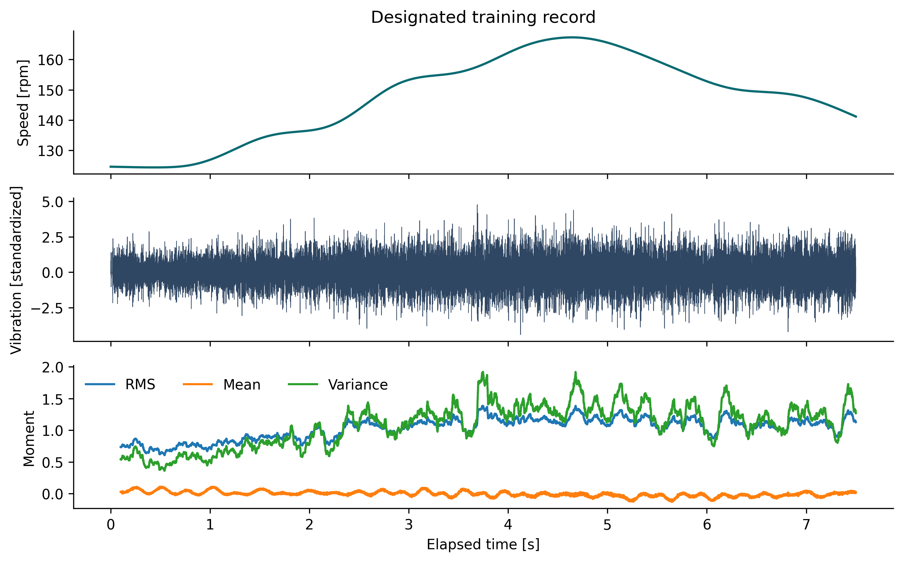

# 4. Physics-informed exploratory evidence

Training spectrograms show how speed-locked candidates trace stationary orders while frequency varies. The local ridge near order 148 is close to the fourth mesh harmonic over changing RPM. The independently regenerated EDA measures median absolute ridge discrepancy 0.744 Hz. Its angle-domain peak is about 160 times the local median. Orders 148 and 259 therefore provide directly testable carrier candidates. Among the training diagnostics, the 1.0–1.2 kHz band contains 31.3% of Welch power. A broad concentration in hertz can include crossing harmonics and distributed excitation. It does not establish that a single feature at the center is mechanically resonant.

Figure 4.1 shows the frequency-domain ridge evidence. Figure 4.2 checks whether rotation-consistent components align more clearly in the angle representation. Both figures are calculated from the actual training record [5]. Their preprocessing is diagnostic. It does not introduce complete-record transforms as predictor features.

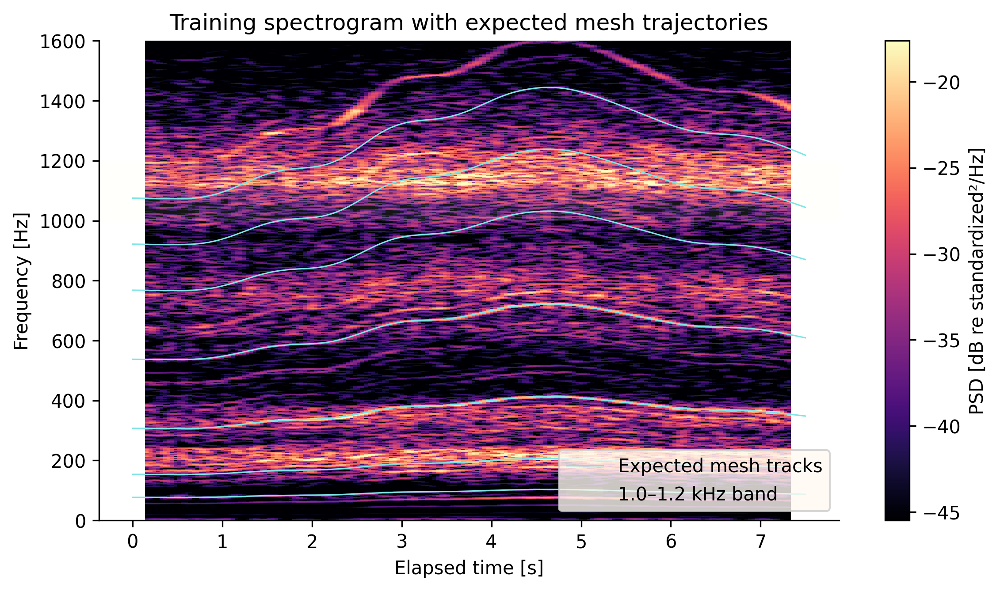

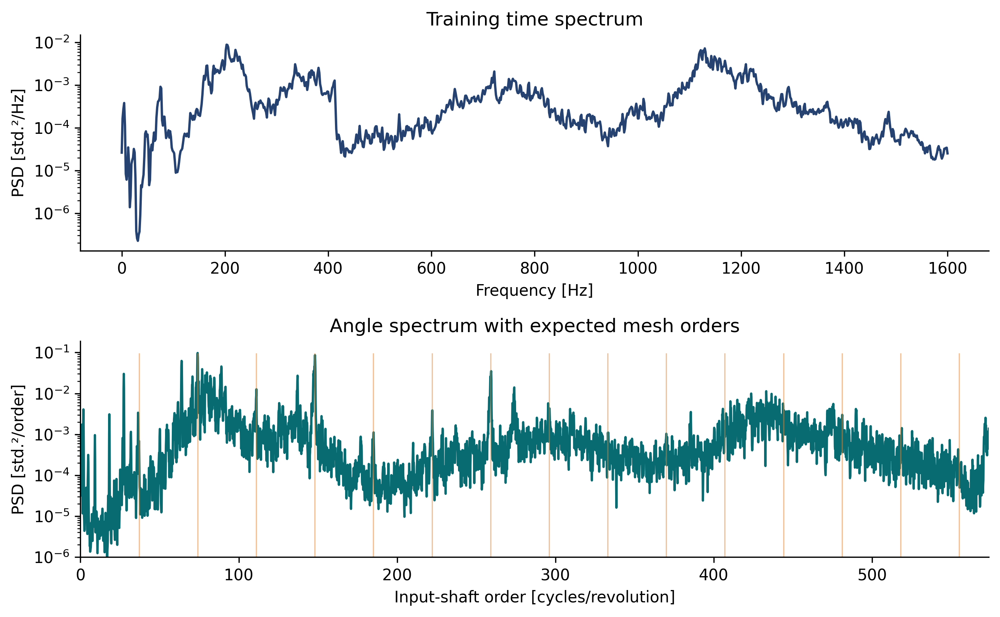

The independently calculated guarded screen quantified the marginal contribution of state choices before the full model fit. LPV–AR24 averaged 0.46153 in that screen. Two order states at 148 and 259 with 128 samples of decay averaged 0.44049. A six-order bank with 32-sample decay averaged 0.43537. A sideband and shaft-aware candidate with orders 148 and 259 averaged 0.42903 in its own feature screen. Two fixed-Hz states at 1080 and 1125 Hz produced mean MSE 0.46152. Selective quadratic and cubic designs gave 0.43819 and 0.43803 under the separate nonlinear screen. Together these results motivate order-conscious states and explicit checks of sideband and nonlinear value under matched pulse and validation protocols. Screening scores on training folds are distinct from the full search and from official development scores.

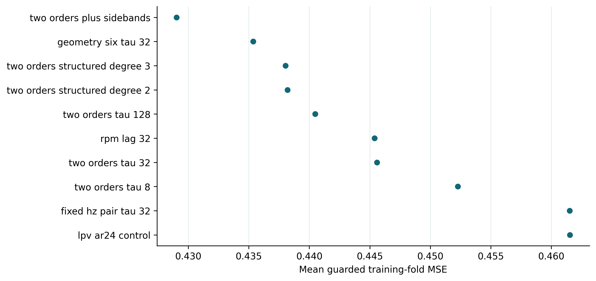

# 5. Physics-Informed Structured Reservoir Computing

## 5.1. Information set and physical state

Let $x_t$ denote standardized vibration, $n_t$ shaft speed in RPM and $f_s$ the sample frequency. The forecast information set is $\mathcal{F}_{t-1}=\sigma(x_s,n_s:s\leq t-1)$. Any finite time-delay bank stores selected $x_{t-j}$ with $j\geq1$. Causal state transformations depend on this information set. For observations, trapezoidal integration updates revolutions using the current and previous available RPM. The target phase advances using the preceding RPM:

$$
u_k=u_{k-1}+\frac{n_k+n_{k-1}}{120f_s},
\qquad
\widehat{u}_t=u_{t-1}+\frac{n_{t-1}}{60f_s}.
$$

An equal-angle feature locates a previous angular offset within known history and interpolates between the available surrounding samples. A delay without valid causal bracketing is caught by the support and evaluation policy. Backward acceleration and causal RMS estimate local speed and vibration context. These channels use measured past inputs and training-only scaling.

## 5.2. Damped harmonic quadratures

On a speed-locked carrier $q$ in cycles per input revolution, use $\phi_{q,k}=2\pi q u_k$. For a fixed-Hz carrier $f$, use $\phi_{f,k}=2\pi f k/f_s$. The implementation represents a finite weighted complex quadrature using real coordinates. Decay $\tau>0$ determines the weight $\rho=\exp(-1/\tau)$ for memory $M$. The state is

$$
h_{q,t}=\frac{2}{Z}\sum_{j=1}^{M}\rho^{j-1}x_{t-j}
\exp\!\left(\mathrm{i}[\widehat{\phi}_{q,t}-\phi_{q,t-j}]\right),
\qquad
Z=\sum_{j=1}^{M}\rho^{j-1}.
$$

The efficient implementation demodulates the input $a_k=x_k\exp(-\mathrm{i}\phi_{q,k})$. Its recurrence is $A_k=a_k-\rho^M a_{k-M}+\rho A_{k-1}$. The outgoing term removes contributions older than $M$ samples. The predicted state remodulates $A_{t-1}$ at the extrapolated phase and normalizes as in Equation (5.2). Separate real and imaginary components preserve phase information in a finite state. Multiple memories encode different persistence. The nonnegative normalized weights imply $|h_{q,t}|\leq 2\max_{1\leq j\leq M}|x_{t-j}|$. This bound describes the feature under measured historical input. Open-loop rollout would require a separate stability analysis. The phases depend on relative measured rotation and are reset for every acquisition. A speed perturbation changes the transported phase and weighted mixture, so the model is tested under RPM bias, delay and other recorded sensor interventions.

## 5.3. Innovation and structured readout

A fitted stage-one LPV–AR produces a causal proxy error. The error becomes available after the observation arrives and can enter a later reservoir state through lagged values. This creates a broader response family than vibration samples alone. It also requires a common guard that covers both stage-one and stage-two history.

The feature vector $z_t$ concatenates the enabled time, angle, speed, harmonic and innovation groups. The nonlinear library $\Phi(z_t)$ may include a restricted set of selected interactions. Group-scaled regularization accounts for differences in feature scaling or dimensionality. Feature means, scales and coefficients are fitted on the allowed blocks. A regularized objective has the form

$$
\min_{\beta,b}\frac{1}{N_{\mathrm{fit}}}\sum_{t\in\mathcal{I}_{\mathrm{fit}}}
L\!\left(x_t-b-\beta^\mathsf{T}\Phi(z_t)\right)
+\lambda\sum_g w_g\left\|\beta_g\right\|_2^2 ,
$$

where $L$ denotes squared or robust loss for the chosen candidate and $w_g$ is the group weight. Changing an allowed physics group changes the feature matrix and therefore requires a fit. Zeroing coefficients after the fit defines a different perturbation. Figure 5.1 shows the separation between state computation, readout fitting and the optional correction.

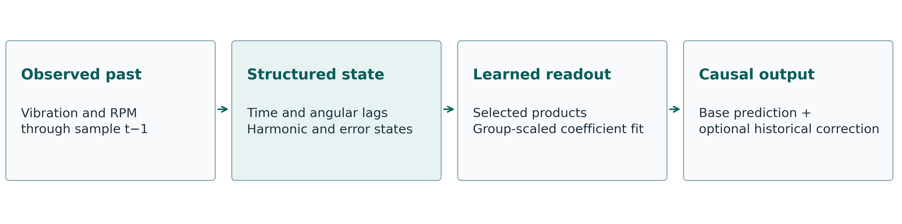

## 5.4. Historical residual correction

The base estimate is $b+\beta^\mathsf{T}\Phi(z_t)$. A clipped, exponentially weighted mean of earlier base errors can correct slowly varying signed bias. Let the past base residual be $r_{t-j}=x_{t-j}-\widehat{x}^{\,0}_{t-j}$. With clipping limit $c$, memory $M_c$, decay $\rho_c$ and gain $g_c$,

$$
\widehat{x}_t=\widehat{x}^{\,0}_t+
g_c\frac{\sum_{j=1}^{M_c}\rho_c^{j-1}\operatorname{clip}(r_{t-j},-c,c)}
{\sum_{j=1}^{M_c}\rho_c^{j-1}}.
$$

This expression makes the causal update explicit. Subtracting the model can remove predictive energy and can also change diagnostically relevant rotational modulation. Matching the correction across eligible alternatives and comparing an adapter-off build separates effects of past-error dynamics from representation and readout effects. A correction is judged jointly on prediction, stress and pulse behaviour.

# 6. Optimization and validation methodology

Three guarded contiguous blocks of the designated training trace provide the selection evidence. Held-out intervals begin at 4,800, 11,200 and 18,400 with 2,400 targets each. The recipe uses 1,792-sample raw-history guards, fits only permitted slices and preserves reset boundaries in the fitted features. If an innovation looks back $L$ samples and the readout uses it a further lag $j$ back, their combined maximum delay is $L+j$. The guard covers this composition and any additional adapter history. Every fold refits transformations and readouts from eligible samples.

Training selection uses clean error $E_{\mathrm{clean}}$, the excess sensor-stress error relative to clean, paired synthetic pulse distortion $D$, and a penalty for the coefficient count $P$:

$$
J=E_{\mathrm{clean}}
+0.14\max(0,E_{\mathrm{stress}}-E_{\mathrm{clean}})
+0.009D+0.000002P.
$$

The finite search compares candidate feature groups, carrier and delay settings, penalty strengths, and adapter parameters. The selected configuration depends on these bounds and the diagnostic proxy. Published MSEs and the provisional candidate labels do not enter selection. The best clean, compact and no-adapter variants use the distinct criteria documented in the registry. Each selected configuration is refit on official training and scored on development.

Table 6.1. Selected configuration and training-fold objective. Values are read from the saved selection record.

| Selected component | Recorded value |
| --- | --- |
| Training trial | selected_correction |
| Mean guarded MSE: clean, stressed | 0.355734 / 0.381362 |
| Guarded pulse distortion | 1.050501 |
| Selection objective | 0.371689 |
| Effective raw support (samples) | 1,280 |
| Fitted model coefficients / readout features | 1,456 / 879 |
| Training MSE on common mask | 0.308688 |
| Time lags / angular steps / mesh cycles | 96 / 16 / 8 |
| Shaft orders / oscillator decay (samples) | [37, 74, 148, 259] / [8, 32, 128] |
| Oscillator memory / speed polynomial degree | 512 / 2 |
| Innovation order / lag count / clip | 192 / 24 / 3.0 |
| RMS and acceleration windows (samples) | 64 / 32 |
| Polynomial degree / nonlinear feature cap | 3 / 60 |
| Solver / ridge weight | ridge / 0.022 |
| Adapter gain / decay / memory / clip | 0.5 / 512.0 / 768 / 1.75 |
| Pulse preservation / augmentation weights | 0.2 / 0.35 |

The released ledger records 41 completed candidates of 41 attempted and 123 fold rows.

Across 25 frozen SRC checkpoint tests, perturbing vibration and RPM at and after a target changed the forecasts through that target by at most 4.44e-16 standardized units. The test evaluates realized numerical causality in addition to the finite-support construction.

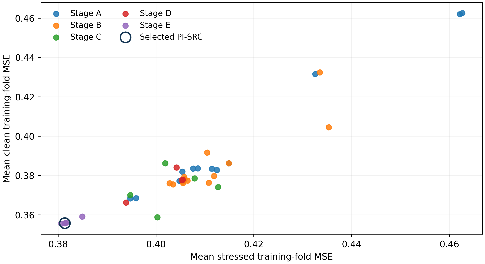

Predictive errors are paired by actual target index. Paired moving-block estimates are appropriate because adjacent errors are temporally dependent [6]. A block interval on one acquisition quantifies within-segment differences under the chosen resampling rule. It does not measure the distribution across separately acquired machines or experiments. A complete study of cross-machine uncertainty would sample acquisition units at that level.

# 7. Comparator methodology

Classical comparators isolate autoregressive dependence in different ways. AR uses past vibration. ARX adds causal exogenous speed terms. ARMA models serial innovations, and ARIMA uses a differencing transform appropriate to its candidate definition. Sparse LPV–AR and sparse LPV–ARMA extend these models with speed scheduling and sparse support [2]. Fit scope and proxy-innovation implementation affect reproduction. A lower published value on the original paper’s evaluation window cannot resolve the difference in the supplied segment.

Linear Regression, Ridge, Lasso and Elastic Net fit lagged or physics-feature spaces with different shrinkage assumptions [7], [8]. SVR replaces a fixed linear predictor with selected kernel similarities. Random Forest and Gradient Boosting use ensembles of partitions and can express interactions carried by the feature map [9], [10]. NARX uses an exogenous nonlinear lag representation. Training controls include bounded fit and search costs and require a saved configuration and the matched evaluation mask.

MLP, LSTM, GRU, CNN and TCN represent the same finite measured inputs with different nonlinear operations. LSTM and GRU update recurrent hidden summaries on a causal sequence. CNN and TCN use local shared filters, with the TCN using dilated causal operators. The Transformer and Temporal Fusion Transformer introduce attention or variable-selection and gating under their implemented data and compute limits [11]–[14]. Chapter 8 reports all eligible rows. The comparison uses verified checkpoints from the earlier expanded study, applied to the newly audited course inputs and scored again on the same target array. The supervised models were originally fitted using protected training evidence. This run performs the new PI-SRC fit and comparator replay rather than fresh fold searches for all 21 families. Conventional support refits and external paper results are documented separately by their scheduling convention.

A fixed-architecture refit with speed held at 145 RPM was compared across 9 comparator families. Measured RPM improved development MSE in 7 instances. The strongest improvement was for NARX (-0.06838 MSE). Across the three-fit seed sensitivity checks, CNN had the lowest mean MSE (0.39780, sample SD 0.00300). These limited controls describe specific replayed architectures and one development acquisition.

# 8. Matched results and critical discussion

## 8.1. Prediction performance

On the supplied official development record use targets with indices from 1,792 inclusive to 24,000 exclusive. Samples in the prefix serve initialization and history. MSE is $N^{-1}\sum_{t}(x_t-\widehat{x}_t)^2$ in standardized vibration squared. RMSE, MAE and signed residual bias describe scale and direction. The baseline and candidate MSE column is calculated on one identical target array.

PI-SRC MSE 0.329973 is 11.16% lower than the strict sparse LPV–ARMA result. The selected model scored 3.83% higher than the strongest replayed SRC anchor (0.317788). The lowest requested comparator scored 0.367386 (Linear Regression).

Table 8.1. Common development prediction metrics. The archived publication’s test result is external to this table.

| Predictor | MSE | RMSE | MAE | Bias | Targets |
| --- | --- | --- | --- | --- | --- |
| Archived corrected SRC | 0.317788 | 0.563727 | 0.448410 | -0.003392 | 22,208 |
| Archived earlier SRC (corrected) | 0.317816 | 0.563752 | 0.449606 | -0.004541 | 22,208 |
| Archived local SRC (corrected) | 0.318606 | 0.564452 | 0.448904 | -0.003572 | 22,208 |
| Archived earlier SRC (base) | 0.325353 | 0.570397 | 0.455213 | -0.014631 | 22,208 |
| Archived SRC (base) | 0.325630 | 0.570640 | 0.454468 | -0.012469 | 22,208 |
| Selected PI-SRC | 0.329973 | 0.574433 | 0.456412 | 0.007643 | 22,208 |
| Linear Regression | 0.367386 | 0.606123 | 0.482352 | 0.008699 | 22,208 |
| Ridge | 0.368059 | 0.606678 | 0.482731 | 0.003971 | 22,208 |
| Sparse LPV–ARMA | 0.371406 | 0.609430 | 0.483517 | -0.008890 | 22,208 |
| Lasso | 0.378298 | 0.615060 | 0.489438 | -0.003721 | 22,208 |
| Sparse LPV–AR | 0.381496 | 0.617653 | 0.490459 | 0.009693 | 22,208 |
| Elastic Net | 0.382196 | 0.618220 | 0.491920 | -0.004282 | 22,208 |
| NARX | 0.383150 | 0.618991 | 0.491991 | 0.009114 | 22,208 |
| CNN | 0.394638 | 0.628202 | 0.497356 | 0.001516 | 22,208 |
| MLP | 0.406424 | 0.637514 | 0.505325 | -0.006386 | 22,208 |
| TCN | 0.408577 | 0.639200 | 0.505173 | 0.004680 | 22,208 |
| LSTM | 0.408813 | 0.639385 | 0.507251 | -0.029884 | 22,208 |
| GRU | 0.416062 | 0.645028 | 0.510687 | -0.025676 | 22,208 |
| ARIMA | 0.440065 | 0.663374 | 0.525433 | 0.002009 | 22,208 |
| AR | 0.440566 | 0.663752 | 0.525635 | -0.001300 | 22,208 |
| ARMA | 0.441706 | 0.664610 | 0.526208 | -0.001383 | 22,208 |
| ARX | 0.443197 | 0.665730 | 0.527307 | 0.001907 | 22,208 |
| SVR | 0.499373 | 0.706664 | 0.562443 | 0.033583 | 22,208 |
| Gradient Boosting | 0.502513 | 0.708881 | 0.563802 | 0.006799 | 22,208 |
| Time Series Transformer | 0.509394 | 0.713719 | 0.565179 | 0.001143 | 22,208 |
| Random Forest | 0.595164 | 0.771469 | 0.610994 | 0.001903 | 22,208 |
| Temporal Fusion Transformer | 0.967099 | 0.983412 | 0.777230 | -0.003079 | 22,208 |

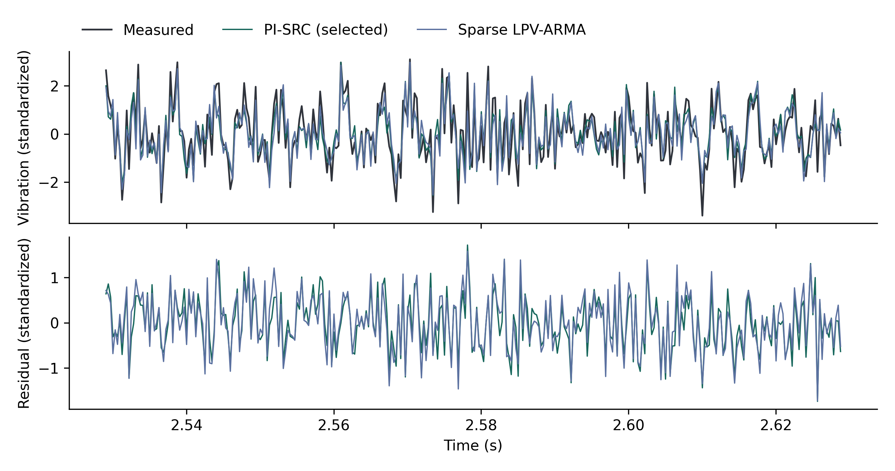

The PI-SRC estimate should be interpreted with the paired intervals and with the stronger archived checkpoint, which has a different stored implementation and fit provenance. A global estimate may average different operating regimes. Error summaries by speed or time block indicate whether a point improvement is concentrated near part of the speed profile. Residual structure indicates remaining systematic effects, even where pointwise error is lower. The waveform and diagnostic figures use the same aligned target indices. The recorded comparison also retains checkpoints and inference runs, so numerical recomputation is distinct from the interpretation of curves.

The publication reports 0.2893 in Table 6 on its own segment [2]. The official record provided for the course has a different speed phase and a distinct target mask. Table 8.2 distinguishes that external benchmark from reproductions with previous-RPM scheduling and with archive current-RPM scheduling. The previous-RPM filter follows the information limit used in the PI-SRC comparison. Archive reproduction also uses its original scoring start at sample 316.

Table 8.2. External paper and local statistical reference MSE under three distinct scopes.

| Model | Paper test segment | Strict development | Archive reproduction |
| --- | --- | --- | --- |
| ARI | 0.3658 | 0.425069 | 0.415816 |
| ARIMA | 0.3671 | 0.425223 | 0.415719 |
| Sparse LPV–AR | 0.2911 | 0.381496 | 0.340886 |
| Sparse LPV–ARMA | 0.2893 | 0.371406 | 0.336901 |

Table 8.3. Selected 95% paired moving-block intervals. Differences are comparator minus PI-SRC MSE using 640-sample blocks.

| Model | MSE minus PI-SRC | Lower 95% | Upper 95% |
| --- | --- | --- | --- |
| Sparse LPV–ARMA | 0.041432 | 0.036319 | 0.047242 |
| Linear Regression | 0.037412 | 0.032403 | 0.041436 |
| Ridge | 0.038085 | 0.033149 | 0.042579 |
| CNN | 0.064665 | 0.056022 | 0.073982 |
| Archived corrected SRC | -0.012186 | -0.014521 | -0.010361 |

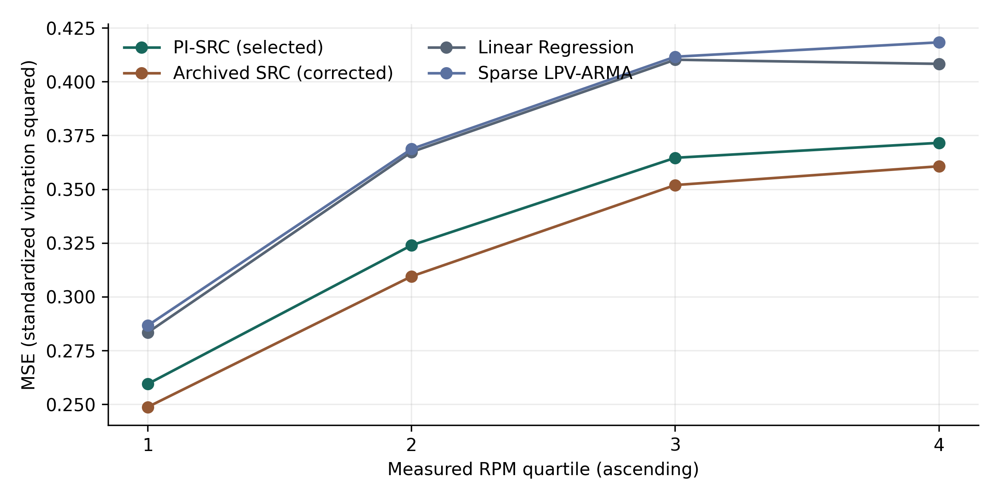

Across ascending measured-RPM quartiles, PI-SRC MSE was 0.2595, 0.3240, 0.3647, 0.3717. On the three guarded training holdouts, earlier-only refits produced MSE 1.4138, 1.1109, 0.3537. Those scores show sensitivity to fitting record length and operating-regime coverage.

## 8.2. Computational efficiency

The selected PI-SRC required 484.89 ms median for one 24,000-sample CPU batch (49,496 samples/s or 0.065 times the record duration). The local sparse LPV–ARMA median was 87.96 ms under its recorded benchmark. Benchmarks report measured CPU batch inference on the full scored record under the recorded thread conditions. Fit cost, checkpoint bytes and fitted parameter count measure different quantities. Warm CPU medians and interquartile ranges characterize repeated in-memory calls and include feature production where the benchmark defines this scope. GPU and streaming measurements require observed hardware and deployment workloads.

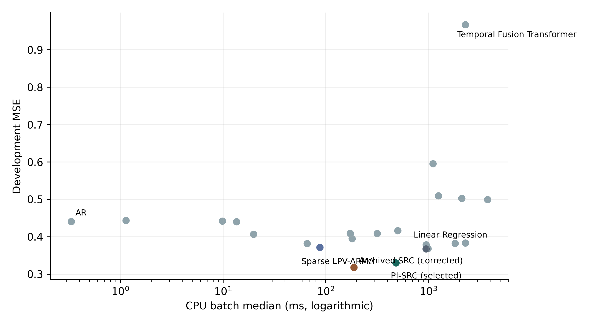

Table 8.4. Representative fit, batch inference and model size. The complete ledger is in results/timings/benchmark_table.csv. An em dash marks an unavailable measurement.

| Model | Fit (s) | CPU median (ms) | IQR (ms) | Parameters | Bytes |
| --- | --- | --- | --- | --- | --- |
| Archived corrected SRC | — | 188.793 | 8.279 | 2,789 | — |
| Selected PI-SRC | 4.27 | 484.887 | 31.806 | 1,456 | 32,494 |
| Linear Regression | 3.14 | 951.884 | 58.010 | 530 | 12,738 |
| Ridge | 1.18 | 994.577 | 23.701 | 530 | 12,735 |
| Sparse LPV–ARMA | 5.19 | 87.960 | 20.369 | 840 | 8,908 |
| CNN | 5.81 | 181.201 | 32.238 | 5,826 | 24,566 |
| AR | 0.25 | 0.333 | 0.018 | 96 | 2,855 |
| SVR | 2.59 | 3,780.916 | 1,170.293 | 233,818 | 1,767,851 |
| Time Series Transformer | 32.69 | 1,257.816 | 87.022 | 10,225 | 47,085 |
| Temporal Fusion Transformer | 17.08 | 2,299.202 | 287.512 | 6,411 | 43,682 |

# 9. Fault diagnosis, robustness and ablation

## 9.1. Candidate-record periodic modulation

Subtract the prediction from the observation using the same warm-up for each matched method. Resample the eligible vibration or residual onto a uniform revolution grid inferred from measured speed. Use the centered analytic envelope $b_i$ to calculate correlation and PMI at rotation lag $T$.

$$
r(T)=\frac{\sum_{i=1}^{N-T}b_i b_{i+T}}{\sum_{i=1}^{N}b_i^2},
\qquad
\mathrm{PMI}=\frac{r(T)}{1-r(T)}.
$$

The instructor MATLAB reference uses first-position zero lag when indexing its autocorrelation sequence. The literal convention is one sample below the exact one-turn lag, and an alternate mathematical comparison preserves this distinction. Exact end-to-end MATLAB parity requires the missing order-tracking helper and gold outputs. Degenerate envelopes and insufficient rotations must be exposed by the audit. Groups A and B are provisional index groups; an AUC calculated by ranking B above A estimates index-group separation rather than verified crack classification [1], [4].

Table 9.1. Candidate-record PMI for provisional A/B index groups.

| Signal | Median A | Median B | Gap B−A | 95% gap interval | Conditional AUC |
| --- | --- | --- | --- | --- | --- |
| Raw vibration | 0.09714 | 0.08855 | -0.00859 | -0.0154 to -0.0023 | 0.364 |
| Sparse LPV–ARMA | 0.04014 | 0.11270 | 0.07255 | 0.0684 to 0.0766 | 1.000 |
| Archived corrected SRC | 0.02879 | 0.13213 | 0.10335 | 0.0995 to 0.1068 | 1.000 |
| Selected PI-SRC | 0.03019 | 0.11492 | 0.08473 | 0.0815 to 0.0887 | 1.000 |
| PI-SRC, same weights without adapter | 0.03100 | 0.11503 | 0.08403 | 0.0806 to 0.0878 | 1.000 |
| PI-SRC-Fixed | 0.03370 | 0.12520 | 0.09151 | 0.0879 to 0.0950 | 1.000 |

The primary PI-SRC median PMI gap B−A was 0.08473, with a bootstrap interval from 0.08146 to 0.08869. Pairwise B-high ordering was 1.000 within the audited index groups. The minimum-B minus maximum-A margin was 0.03580. Several methods tied on conditional AUC, and gaps and margins reveal differences concealed by that statistic.

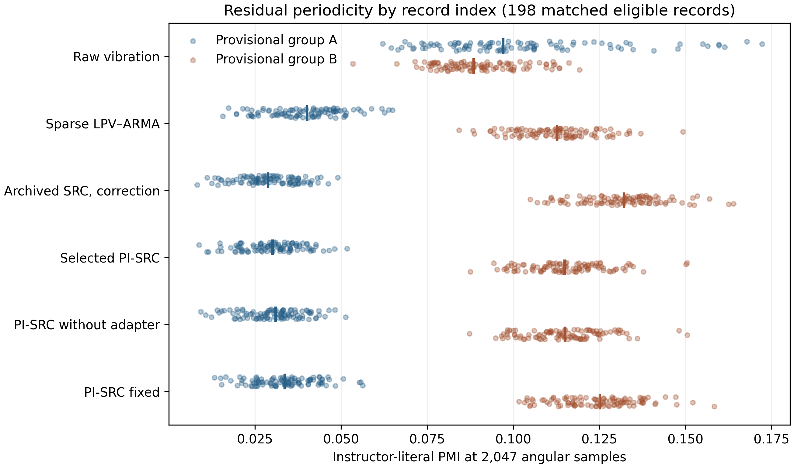

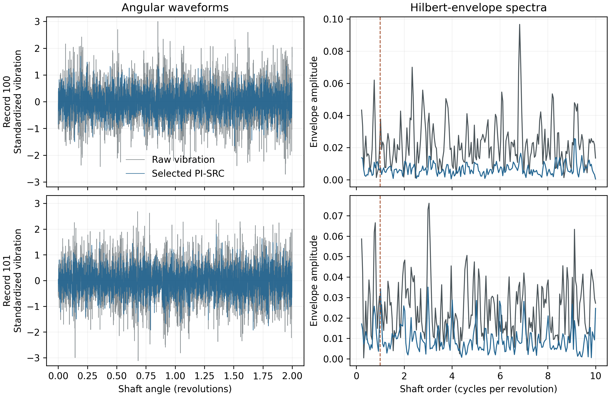

## 9.2. Speed interventions and pulse retention

The stress study treats predictor RPM and angular diagnostic speed as separate interventions. A distorted predictor RPM shifts its constructed phase and may affect MSE. A distorted diagnostic RPM changes the angular resampling even for the same residual. Worse diagnostic stress can arise without a change in the prediction. Both perturbations are evaluated against their own clean reference. Near realistic operating bounds, an angular feature must retain causal support and stable units.

The pulse experiment injects a known disturbance into an otherwise unchanged record and compares the two residuals. The relevant questions are how much pulse energy remains, whether the recovered waveform correlates with the injected pulse, and whether its periodic envelope score changes. Retention and clean MSE can move in different directions. Synthetic results assess the specified waveform and injection model. A real tooth-damage claim requires physical condition metadata and independent records.

Table 9.2. Saved speed-stress measurements by method and scope.

| Model | Clean MSE | Worst tested MSE | Worst tested RPM condition |
| --- | --- | --- | --- |
| Sparse LPV–ARMA | 0.371406 | 6.554814 | +2% bias |
| Archived corrected SRC | 0.317788 | 0.454057 | +2% bias |
| CNN | 0.394638 | 0.412020 | −2% bias |
| Ridge | 0.368059 | 0.433301 | +2% bias |
| Selected PI-SRC | 0.329973 | 0.457031 | +2% bias |
| PI-SRC, same weights without adapter | 0.340706 | 0.468232 | +2% bias |
| PI-SRC-Optimized (uncorrected) | 0.340706 | 0.468232 | +2% bias |
| PI-SRC-Fixed | 0.360530 | 0.495547 | −2% bias |
| SRC-Generic | 0.412117 | 0.423677 | +2% bias |
| SRC-Polynomial | 0.447872 | 0.447872 | smooth profile warp |

Selected PI-SRC clean MSE 0.329973 increased to 0.457031 at the worst tested predictor-RPM condition. Residual PMI rose in 5 of 5 periodic injections. Median paired residual–pulse correlation was 0.690. Median residual change energy was 1.79 times injected energy, consistent with waveform distortion as well as retained pulse energy. The same +2% predictor-only RPM interference changed validation PMI by +0.09819. The controlled sensor effect should be considered before assigning this score a condition threshold.

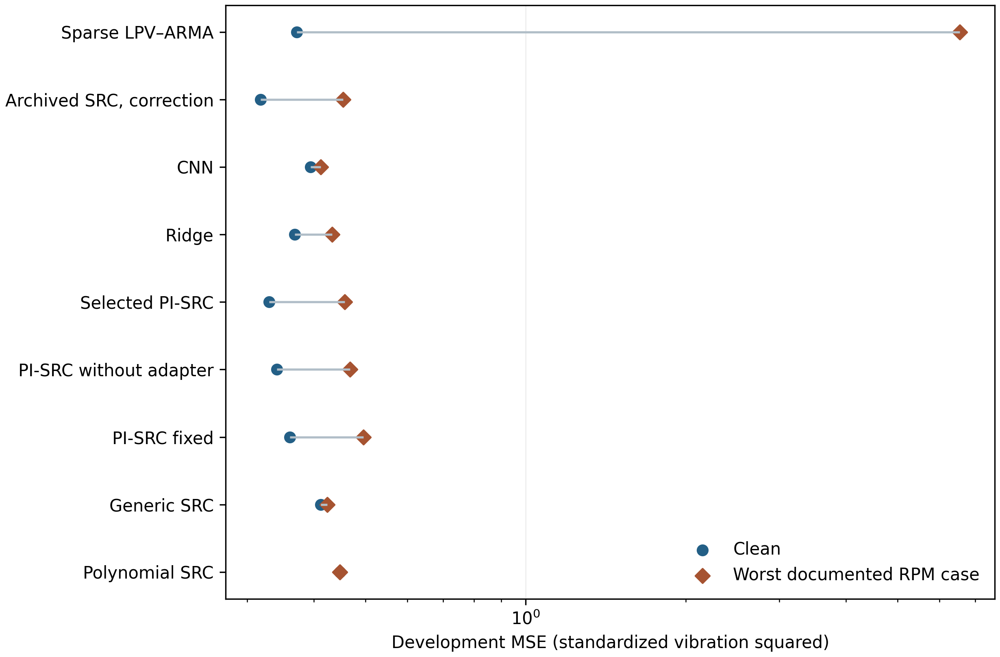

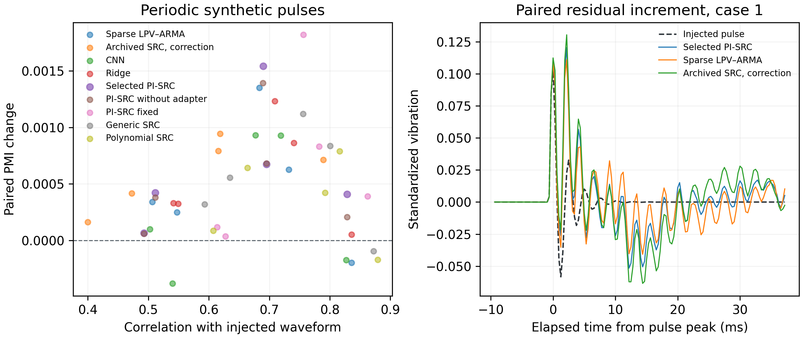

## 9.3. Matched model ablations

Reselect or refit an ablation within its declared scope. Angular lags, speed context, carrier groups, nonlinear interactions, innovation history and adapter effects have different mechanisms. Compare matched subsets and retain fit and correction policies so an observed change has a testable interpretation. Higher accuracy alone does not determine whether marginal data support the extra cost of the added state.

Table 9.3. Representative SRC controls and development sensitivities. The full matrix is in results/ablations/src_ablations.csv.

| Control | Development MSE | Training MSE | Coefficients |
| --- | --- | --- | --- |
| Selected PI-SRC | 0.329973 | 0.308688 | 1,456 |
| PI-SRC (clean-MSE selection) | 0.326401 | 0.304222 | 1,456 |
| PI-SRC-Compact | 0.358022 | 0.339541 | 834 |
| SRC-Linear | 0.447954 | 0.438217 | 98 |
| SRC-Polynomial | 0.447872 | 0.437514 | 125 |
| SRC-Speed | 0.411939 | 0.395150 | 292 |
| SRC-Physics-Linear | 0.351040 | 0.333358 | 916 |
| PI-SRC-Fixed | 0.360530 | 0.340473 | 637 |
| SRC-Generic | 0.412117 | 0.394208 | 336 |
| PI-SRC, same weights without adapter | 0.340706 | 0.308682 | 1,456 |
| PI-SRC without angle lags | 0.359049 | 0.346724 | 1,072 |
| PI-SRC without oscillator bank | 0.334961 | 0.313860 | 1,363 |
| PI-SRC without innovations | 0.347312 | 0.325897 | 805 |
| PI-SRC without augmentation | 0.327177 | 0.304165 | 1,456 |
| PI-SRC with degree two | 0.330390 | 0.309116 | 1,443 |
| PI-SRC with 12 orders | 0.324770 | 0.302824 | 1,600 |
| PI-SRC with fixed-Hz states only | 0.334862 | 0.313107 | 1,414 |

Using the same fitted weights, the no-adapter MSE was 0.340706. Applying the selected correction changed MSE by -0.010733.

The configuration chosen by clean guarded MSE scored 0.326401 on development. The compact fit scored 0.358022 with 834 coefficients. Disabling angular history scored 0.359049 on development. Disabling proxy innovations scored 0.347312 on development. The larger order-bank sensitivity scored 0.324770 on development. The reported feature sensitivities retain their original analysis scope. A favorable development ablation provides a hypothesis for confirmation and leaves the frozen training-only primary choice intact.

Table 9.4. Same-weight comparisons with the selected correction applied identically within each row.

| Predictor | Base MSE | Corrected MSE | MSE decrease |
| --- | --- | --- | --- |
| Strict sparse LPV–ARMA | 0.371406 | 0.367992 | 0.003413 |
| Selected PI-SRC | 0.340706 | 0.329973 | 0.010733 |
| Polynomial SRC | 0.447872 | 0.444834 | 0.003038 |

# 10. Conclusions

PI-SRC MSE 0.329973 is 11.16% lower than the strict sparse LPV–ARMA result. The selected model scored 3.83% higher than the strongest replayed SRC anchor (0.317788). The lowest requested comparator scored 0.367386 (Linear Regression). The project establishes an auditable finite reservoir that uses measured history and tests interpretable feature groups in guarded folds. Viable engineering use depends on the measured balance among error, inference cost and fault-sensitive residual information.

Table 10.1. Research hypothesis and qualified outcome.

| Research hypothesis | Evidence | Supported conclusion |
| --- | --- | --- |
| A shaft-angle representation stabilizes some variable-speed spectral components | Training spectrogram, angle spectrum and guarded feature screen | Order-locked peaks and selected guarded gains support order-aware testing. |
| A structured reservoir can compete with matched sparse and learned predictors | Common-target errors, guarded search and the model registry | PI-SRC MSE 0.329973 is 11.16% lower than the strict sparse LPV–ARMA result. |
| A lower forecast error is sufficient for diagnosis | Candidate PMI, perturbations and paired pulse preservation | Predictive and residual diagnostic outcomes need separate evidence. |
| The release establishes independent condition classification | Data availability and exact overlap audit | Blind records, verified labels and acquisition metadata remain unavailable. |

Independent evaluation uses a frozen manifest after eligible records are supplied. Batch timing is reproducible only relative to the recorded runtime and hardware. The results guide additional experimental design, including condition-confirmed recordings across speed and load regimes.

# References

[1] MECG 7780 Engineering Data Analytic, “Course project: Time serial dependency modeling via advanced machine learning algorithms,” course handout and MATLAB reference script.

[2] Y. Chen, Z. Li, Y. Jiang, D. Gong, and K. Zhou, “Sparse LPV-ARMA model for non-stationary vibration representation and its application on gearbox tooth crack detection under variable speed conditions,” *Mechanical Systems and Signal Processing*, vol. 224, art. 112161, 2025. <https://doi.org/10.1016/j.ymssp.2024.112161>

[3] D. J. Gauthier, E. Bollt, A. Griffith, and W. A. S. Barbosa, “Next generation reservoir computing,” *Nature Communications*, vol. 12, art. 5564, 2021. <https://doi.org/10.1038/s41467-021-25801-2>

[4] Y. Chen, *Vibration-based fault detection and severity assessment for fixed-axis gearboxes*, Ph.D. dissertation, Department of Mechanical Engineering, University of Alberta, 2020.

[5] P. D. Welch, “The use of fast Fourier transform for the estimation of power spectra,” *IEEE Transactions on Audio and Electroacoustics*, vol. 15, pp. 70–73, 1967. <https://doi.org/10.1109/TAU.1967.1161901>

[6] H. R. Künsch, “The jackknife and the bootstrap for general stationary observations,” *Annals of Statistics*, vol. 17, pp. 1217–1241, 1989. <https://doi.org/10.1214/aos/1176347265>

[7] R. Tibshirani, “Regression shrinkage and selection via the lasso,” *Journal of the Royal Statistical Society: Series B*, vol. 58, pp. 267–288, 1996. <https://doi.org/10.1111/j.2517-6161.1996.tb02080.x>

[8] H. Zou and T. Hastie, “Regularization and variable selection via the elastic net,” *Journal of the Royal Statistical Society: Series B*, vol. 67, pp. 301–320, 2005. <https://doi.org/10.1111/j.1467-9868.2005.00503.x>

[9] L. Breiman, “Random forests,” *Machine Learning*, vol. 45, pp. 5–32, 2001. <https://doi.org/10.1023/A:1010933404324>

[10] J. H. Friedman, “Greedy function approximation: A gradient boosting machine,” *Annals of Statistics*, vol. 29, pp. 1189–1232, 2001. <https://doi.org/10.1214/aos/1013203451>

[11] S. Hochreiter and J. Schmidhuber, “Long short-term memory,” *Neural Computation*, vol. 9, pp. 1735–1780, 1997. <https://doi.org/10.1162/neco.1997.9.8.1735>

[12] S. Bai, J. Z. Kolter, and V. Koltun, “An empirical evaluation of generic convolutional and recurrent networks for sequence modeling,” 2018. <https://arxiv.org/abs/1803.01271>

[13] A. Vaswani et al., “Attention is all you need,” *Advances in Neural Information Processing Systems*, vol. 30, 2017. <https://arxiv.org/abs/1706.03762>

[14] B. Lim, S. Ö. Arık, N. Loeff, and T. Pfister, “Temporal Fusion Transformers for interpretable multi-horizon time series forecasting,” *International Journal of Forecasting*, vol. 37, pp. 1748–1764, 2021. <https://doi.org/10.1016/j.ijforecast.2021.03.012>

# Appendix A. Reproducibility and source evidence

The project README and environment constraints identify the tested platform and dependency versions. The data manifest identifies uploaded files and their hashes. Run all commands from the isolated project root. Preserve the released result tables and checkpoints when running new builds. No source attachment or credential is needed to regenerate only the report from its existing project evidence.

```bash
python scripts/build_report.py --pages
python scripts/build_presentations.py --render
```

Table A.1. Scientific evidence map.

| Evidence | Location |
| --- | --- |
| Input and dependency evidence | inputs/input_manifest.csv, README.md and requirements files |
| Training and selected configurations | results/optimization, results/metrics/src_summary.json |
| Prediction and cost | results/metrics/all_model_comparison.csv and tracked prediction arrays |
| Candidate and synthetic diagnostics | results/fault and figures/fault |
| Report validity | report/validation_report.md and report/qa |
