# COURSE-TITLE-MARKER

MECG 7780 / ENGINEERING DATA ANALYTICS

Physics-Informed Structured Reservoir Computing for Variable-Speed Gearbox Vibration

Causal one-step prediction, matched benchmarks and residual diagnostics

Final course project research report

WORD_PAGE_BREAK

# Abstract

A change in shaft speed moves gear-mesh energy across frequency and alters the vibration history that is informative for prediction. This study evaluated Physics-Informed Structured Reservoir Computing (PI-SRC), a finite representation of earlier vibration and rotational speed with a regularized readout. The feature map combines time and angular delays, damped shaft-order quadratures, speed interactions and lagged proxy innovations. A bounded correction uses previous base residuals. Forty-one configurations were compared in three guarded blocks of the designated training recording. The chosen configuration was frozen before development scoring.

The selected PI-SRC obtained training and development mean squared errors of **0.308688** and **0.329973**, in squared standardized vibration units. On the 22,208 matched development targets, error was 11.16% below the strict local sparse linear parameter-varying autoregressive moving-average benchmark and 10.18% below Linear Regression, the strongest of 21 requested comparators. The replayable corrected SRC archive remained ahead at 0.317788. Median one-thread CPU time for PI-SRC was 484.89 ms per 7.5 s record. Matched ablations associated the largest tested structural loss with removing angular delays and showed a 0.010733 MSE reduction from the correction with weights fixed.

After excluding two overlapping records, residual periodic modulation intensity separated provisional groups across 198 candidates. PI-SRC’s median group gap was 0.08473. A controlled +2% speed bias in prediction alone increased the indicator by 0.09819, exceeding the median increment from the five periodic synthetic injections. These results support the physical feature design for causal prediction and constrain the diagnostic interpretation. Independent test inputs and verified condition labels were unavailable.

**Keywords** Structured reservoir computing, gear-mesh order, one-step prediction, sparse LPV–ARMA, periodic modulation intensity

WORD_PAGE_BREAK

# Contents

WORD_TOC_MARKER

## Abbreviations and notation

Table P.1. Terms and symbols used in the report.

| Abbreviation | Meaning |
| --- | --- |
| SRC, PI-SRC | Structured Reservoir Computing and its physics-informed variant |
| AR, MA, ARX | Autoregression, moving average and autoregression with exogenous input |
| LPV | Linear parameter-varying |
| ACF, PSD, STFT | Autocorrelation function, power spectral density and short-time Fourier transform |
| MSE, RMSE, MAE | Mean squared, root mean squared and mean absolute error |
| PMI | Periodic modulation intensity |
| RPM, $f_s$ | Revolutions per minute and sample rate in hertz |
| $x_t$, $n_t$ | Standardized vibration and measured input-shaft RPM at sample $t$ |
| $u_t$, $Z$ | Cumulative shaft revolutions and the number of teeth on the monitored gear |
| $q$ | A harmonic order expressed in cycles per input-shaft revolution |

# 1. Introduction and research objectives

Gear-mesh contacts excite a train of forces whose spacing in time changes with shaft speed. The same tooth mesh can therefore produce a moving frequency ridge even when its order relative to the input shaft stays fixed. The vibration measured at a bearing housing also reflects the transmission path, loading, shafts and noise. A tooth crack can change mesh stiffness periodically and alter the vibration envelope around a characteristic shaft angle. A prediction model that explains the regular component can make such modulation more visible in its residual, while any estimator that anticipates part of a periodic disturbance can also suppress the same structure. These mechanisms motivate evaluating short-horizon prediction and residual diagnostics as separate outcomes. [@mcfadden1986gears; @chen2021crack; @chen2025sparse]

The course asks for estimation of the next vibration sample from measured history, with rotational speed available as an additional channel. It evaluates mean squared error, computational efficiency and fault-detection performance. It also identifies a sparse linear parameter-varying autoregressive moving-average model, angular resampling and periodic modulation intensity as reference methods. [@mecgbrief] These objectives are addressed here as an engineering question about how to represent prior observations under a varying speed profile. The score uses the next sample of the supplied processed stream, and the deployment interface receives past measurements through the preceding sample. Multi-step free-running behaviour requires an independent experiment.

The candidate architecture places a physical transformation before a fitted statistical readout. Time delays preserve broadband short-memory dependence. Physical angle aligns events over distinct shaft speeds. Finite damped quadratures represent coherent orders, and a scheduled feature map can vary their utility with operating regime. The combination is investigated with both simple controls and a broad measured comparison. The novelty claim concerns the engineering design and its controlled measurement on the course data. Foundational nonlinear vector autoregression, speed-scheduled linear models, angular diagnostics and general physics-informed reservoir methods supply its intellectual antecedents. [@gauthier2021; @adler2026; @chen2025sparse]

Table 1.1. Testable questions and decision evidence.

| Question | Measured comparison | Scope of interpretation |
| --- | --- | --- |
| H1. Does the selected representation reduce causal prediction error? | Matched MSE against strict sparse LPV–ARMA, conventional and neural models, and an executable SRC archive | One official development record and identical processed target samples |
| H2. Which physical mechanisms contribute after fitting and correction are controlled? | Remove angular, oscillator or innovation features, compare generic and fixed controls, toggle the same correction with weights fixed | Single and bundled interventions have different causal interpretations |
| H3. Does residual prediction preserve periodic disturbance evidence? | Provisional PMI group separation, paired injected-pulse experiments, and isolated RPM measurement stress | Index groups are provisional. Synthetic injections assess defined waveform recovery |
| H4. What computational and robustness costs accompany the gain? | One-thread CPU repeats, coefficient and memory measures, lag support and measured RPM perturbations | Batch hardware results and stress scenarios on the same development record |

The practical contribution is a reproducible comparison with explicit failure modes. The analysis retains the corrected archive, the clean-error finalist and favourable post-selection ablations as distinct cases. It includes the complete comparator registry, validated input availability and a report-level evidence ledger. These records allow the reader to distinguish a design or modelling hypothesis from the observational evidence available to evaluate it.

# 2. Scientific background and related literature

## 2.1 From rotational kinematics to a predictive feature map

A gear pair generates a periodic excitation through changes in contact stiffness and transmission error as successive teeth enter and leave engagement. In a controlled laboratory setting, an isolated tooth crack can reduce the local stiffness and change both amplitude and phase of the meshing response when the damaged tooth re-enters contact. Analytical cracked-tooth stiffness models give a mechanical basis for this mechanism, and McFadden's measurements demonstrated the diagnostic relevance of demodulating the mesh response. The casing accelerometer nevertheless measures a response after transmission through shafts, bearing supports and the structure. Both loading and measurement position can affect the observed pulse shape. The mechanism motivates a fault-order hypothesis without fixing the response amplitude, phase or shape for an individual record. [@chaari2009stiffness; @mcfadden1986gears; @chen2025sparse]

Shaft speed determines the physical frequency through cumulative revolutions. For measured input speed $n(t)$ in $\mathrm{rev\,min^{-1}}$, define $u(t)=\int_{0}^{t}n(v)/60\,dv$. A component tied to $m$ events per input-shaft revolution has phase $2\pi m u(t)$ and instantaneous frequency $m n(t)/60$ Hz. In the cited Pretoria rig the test stage is a single-pair step-up helical gearbox with a 37-tooth input gear and a 20-tooth output pinion. Enforcing equal tooth passage rates gives a mesh order of 37 relative to the input and a mean output-to-input rotational frequency ratio of $37/20$. A defective tooth on the input gear can recur at input-shaft order one while perturbing the mesh carrier. Amplitude modulation by order $p$ produces sidebands at $m-p$ and $m+p$ in the simplest sinusoidal model. Assembly and load modulation can also produce sidebands, so their presence supplies a mechanism to investigate and has limited specificity for tooth damage. [@chen2025sparse; @mcfadden1986gears; @capdessus2000cyclo]

Constant-rate time samples see the carrier sweep through a range of frequencies as speed varies. Computed order tracking estimates a monotonically increasing angular trajectory and interpolates the measured vibration onto equally spaced angular samples. Shaft-synchronous content then maintains a fixed order, while a component with approximately fixed frequency $f_0$ appears at varying instantaneous order $f_0/(n/60)$. These are different physical hypotheses. A gearbox acceleration signal can sometimes support angular resampling in the absence of a tachometer under limited fluctuations, but the local study has a measured speed channel and uses that channel explicitly. A fixed-frequency resonance can overlap a moving order over part of a sweep. Assignment of a single time-averaged peak to a mode without checking speed dependence would therefore be ambiguous. Welch estimates provide interval-averaged power and a useful overview of broad energetic bands. A time-frequency ridge and an order-domain comparison supply the phase-locking evidence that a time-averaged spectrum alone leaves unresolved. [@fyfe1997order; @bonnardot2005resample; @abboud2017envelope; @welch1967fft]

Order tracking also imposes a metrological requirement. Errors in the speed channel accumulate into angular error, and the phase displacement of order $m$ is $2\pi m\,\Delta u$. Higher orders are consequently more sensitive to the same angular error. Interpolation can distort an envelope during speed variation, and the chosen angular grid sets the numerical representation, subject to the bandwidth already available from time sampling. At 3.2 kHz, the highest observed training speed limits the time-domain Nyquist bound to approximately order 574 even when interpolation produces 2,048 samples per revolution. [@fyfe1997order; @cheng2014deformation; @abboud2017envelope]

## 2.2 Operating-condition-dependent prediction and adjacent methods

A linear parameter-varying autoregression is linear in past samples for a fixed schedule and allows that coefficient vector to change with measured speed. Chen, Liang and Zuo used sparse functional pooled autoregression to represent healthy gearbox vibration with a speed-indexed basis. Earlier and later related work demonstrate that the operating trajectory and phase matter in diagnostic models. Chen et al. used speed and phase information to model impulse-rich vibration under random speed variation. Chen and Zuo extended sparse LPV autoregression to multichannel vibration, while Schmidt et al. proposed a probabilistic novelty method for gearboxes under fluctuating conditions. These methods establish precedent for conditioning on operating variables and for judging departures from baseline after accounting for operational variation. The local contribution is the controlled evaluation of a different feature map and its fault-sensitive selection, within a single-channel, strictly observed-history protocol. [@chen2019baseline; @chen2021crack; @chen2022multiv; @schmidt2018novelty]

The course's sparse LPV-ARMA comparator extends the schedule-dependent AR component by including delayed innovation proxies. The paper forms a product expansion of the lagged signal and innovation vectors with basis functions of the speed schedule. A sparse LPV-AR fit first yields residual proxies. A second stage combines those proxies with vibration lags, uses the LASSO and five-fold tuning to select support, and refits retained terms by least squares. The paper's penalty rule uses the largest penalty within one standard deviation of the minimum mean validation error. The generic rationale is support control in an expanded regression whose columns can be correlated. The local strict comparator restores the original protected sparse supports with a fresh refit and uses speed no later than $t-1$. PI-SRC instead uses a structured library containing explicit time and angle lags, finite quadrature memories, speed and energy interactions and separately controlled innovation and correction components. This distinction concerns the model construction and information set, even though both readouts regress on engineered histories. [@chen2025sparse]

## 2.3 Reservoir computing and engineering memory

The central problem is to compress recent measured vibration and shaft speed into states suited to prediction. In an echo state network, an input drives a recurrent state and a usually linear readout maps that state to the response. Training the readout avoids adjusting every recurrent weight. Liquid state machines embody the related idea that a driven dynamical substrate supplies time-dependent features for a trained readout. Both strands show why representation and estimation can be treated separately. They use different internal dynamics and establish different notions of computational capability. [@jaeger2004; @maass2002]

Structured Reservoir Computing (SRC) uses that separation with a deterministic map of past observations. Its state consists of declared taps and filters with identifiable support. The selected physics-informed version (PI-SRC) includes damped order quadratures that can be implemented by recurrence. This is a computational realization of a finite filter with an explicit delayed subtraction. Each resulting state remains a fixed function of measured history at deployment. The construction has a direct methodological precedent in nonlinear vector autoregression (NVAR). Gauthier and co-authors formed a finite vector of delayed observations, added polynomial features and estimated a regularized readout. This puts feature geometry and regularization at the centre of the model design. Their work supplies the closest conventional delay-feature template for the present encoder. [@gauthier2021]

Fading memory provides another justification for using such regressors. Boyd and Chua developed approximation results for causal fading-memory nonlinear operators using Volterra series and finite-memory constructions. Echo-state approximation results establish universality for suitable fading-memory input–output systems under specified analytical conditions. These are representation results for model classes. The performance of a particular set of lags, a finite training record and a fitted readout remains an empirical question. A useful physical consequence of choosing finite support is more immediate. For the local one-step implementation, support determines how much history the algorithm must buffer, how far back a perturbation can affect a target, and how much of a record is removed at a reset. [@boyd1985; @grigoryeva2018]

## 2.4 Delay coordinates, exogenous forcing and nonlinear libraries

A delay vector is a way to make a measured time series carry information about unobserved dynamical state. Takens provided the classical generic embedding argument, while Sauer, Yorke and Casdagli extended the geometric analysis to settings with an attractor described by its box-counting dimension. Stark showed that forced systems require separate assumptions and embedding formulations. Measured gearbox vibration is noisy, externally driven and speed dependent. Here the embedding literature motivates the use of recent history and the inclusion of measured operating input. The experiment evaluates those coordinates for one-step prediction. A state-reconstruction claim would require independent evidence for determinism, generic observation conditions and attractor coverage. [@takens1981; @sauer1991; @stark1999]

The engineering alternative to an unrestricted polynomial embedding is to select terms that represent plausibly useful interactions. For $p$ state coordinates, the number of distinct homogeneous quadratic and cubic monomials grows as $p(p+1)/2$ and $p(p+1)(p+2)/6$, respectively. In the gearbox study, nearby taps share information and the same latent component can enter the design through different orders, decay times and speed products. A large feature count can therefore coexist with severe collinearity. Dambre and co-authors formalized computation as the ability to recover classes of functions of past input from a dynamical state. Their capacity analysis, under specified input and orthogonality conditions, helps distinguish the number of coordinates from the useful diversity of information they supply. In PI-SRC, screening and shrinkage address the observed design problem, and capacity has no direct identification with the number of fitted columns. [@dambre2012; @gauthier2021]

The historical innovation channel also has a discrete-time identification precedent. NARMAX organizes nonlinear prediction in terms of observed outputs, exogenous inputs and disturbances. In a practical fit, true disturbances are latent. PI-SRC builds a finite proxy from errors of a preliminary speed-conditioned predictor, then uses older proxy values as features. That design imports the useful principle of exploiting predictable residual structure. Treating the proxy as a white innovation or an identified physical disturbance would require additional screening and identification evidence. This distinction matters for diagnostics because structured energy left by the preliminary predictor may reflect wear, operating variation or ordinary model mismatch. [@chenbillings1989]

## 2.5 Where the physical information enters

A shaft-synchronous component is approximately periodic in accumulated turns. Its phase advances by $2\pi q$ per revolution for order $q$, so its frequency in hertz moves with speed. A fixed delay in seconds then represents a speed-dependent mechanical phase offset. Computed order tracking addresses this by resampling acquired signals at fixed angle increments. Related Vold–Kalman order tracking estimates order components subject to a smooth-amplitude assumption while using shaft-speed information to specify their carriers. In this report those approaches motivate the use of angular lags and complex synchronous demodulation inside a causal predictor. PI-SRC implements direct past-only interpolation and a finite weighted order filter. Its output serves as a forecast feature. The literature's joint order-separation objective serves a different estimation task. [@fyfe1997order; @pan2006]

Speed enters at three different interfaces. First, angular queries aim to place past vibration at repeatable tooth-pass offsets. Second, order oscillators translate a candidate rotating component toward baseband for weighted accumulation. Third, speed and its interactions allow the conditional readout to depend on operating point. Those roles remain distinct under measurement error. A perturbed RPM history can alter past-sample interpolation and the carrier phase, even when its normalized value changes little as a regression covariate. An independent diagnostic resampling error can also change estimated order-domain periodicity without changing the predicted waveform. This structure makes the separate speed-channel perturbations important to interpretation. Their outcomes come from this investigation's controlled inputs. [@fyfe1997order; @pan2006]

Kinematic alignment is related to the broader use of prior structure in reservoir computing. Barbosa and co-authors used known task symmetries to choose suitable readout or reservoir structure in parity and dynamical benchmarks. Zhang and Cornelius showed in multistable dynamical examples that matching specific physical nonlinearities can matter to autonomous basin predictions, with marked sensitivity to mismatch. For PI-SRC, shaft phase provides a physically meaningful basis and selected interactions couple recognizable quantities such as recent energy and quadrature. Equivariance of the full predictor and gearbox fault sensitivity would each require separate verification. They motivate testing whether a proposed coordinate improves prediction and preserves a diagnostic quantity when the physical input is measured imperfectly. [@barbosa2021; @zhang2023]

## 2.6 Relation to physics-informed and hybrid forecasts

Physics-informed machine learning can introduce scientific knowledge through the input representation, model structure or training objective. Which mechanism is used determines the strength of the physical interpretation. Doan, Polifke and Magri added a governing-equation loss to recurrent echo state learning. Pathak and co-authors coupled a machine-learning forecaster to a separate knowledge-based dynamical model. Adler and co-authors give a particularly close recent precedent by incorporating differential-equation information into the objective of a nonlinear vector autoregression and examining prediction on several specified ODE systems. Their approach and PI-SRC share a fixed-form nonlinear autoregressive representation. The physical information enters at different points of the modeling pipeline. The gearbox estimator uses measured shaft geometry and phase to construct predictors and tests how they react to training perturbations. Its selected order numbers and decay times describe the fitted representation. Identification of actual modal parameters or a conservation law would require a different measurement and estimation design. [@karniadakis2021; @doan2020; @pathak2018; @adler2026]

The same distinction narrows the contribution relative to the sparse LPV-ARMA gearbox baseline. A speed-scheduled linear dynamic model can represent different lag relationships at different rotary speeds. With supplied speed, it remains linear in the lagged vibration and innovation histories. The sparse formulation emphasizes a tractable subset of scheduling and lag coefficients and uses residuals for tooth-crack analysis. PI-SRC shares the task and the rationale for lagged residual information. It adds angle-referenced observations, rotating quadrature summaries and selected nonlinear products before a grouped readout. These are two empirical ways to model recurring vibration under varying speed. Numerical outcomes from Chen and co-authors' paper describe their experiment and must be kept apart from the matched local ranking. [@chen2025sparse; @chenbillings1989]

## 2.7 Regularization, selection and the scope of the contribution

Regularization is a fitting decision once the feature set is declared. Hoerl and Kennard demonstrated the relevance of ridge shrinkage with nonorthogonal predictors. The selected PI-SRC applies a common ridge parameter and group-dependent quadratic multipliers. Their practical role is to control the relative shrinkage of, for example, oscillator-related and nonlinear terms in a correlated design. Group lasso provides a separate model-selection mechanism through a sum of group norms and can set groups exactly to zero. Here the fitted state uses feature screening and group-weighted ridge, and the degree of shrinkage is jointly tuned with the feature design. A small coefficient among correlated features is weak evidence about the physical absence of its underlying mechanism. Retrained feature-removal controls and known-input perturbations provide more direct tests of attribution. [@hoerl1970; @yuan2006]

The empirical question is whether the physical bias pays for its added states at the target and horizon of interest. Robust validation work on echo state networks has shown that hyperparameter selection can depend strongly on how validation performance is measured, particularly in short temporal segments and chaotic forecasting examples. That evidence supports treating the local selection protocol as part of the contribution. The gearbox study uses guarded training folds, and its outer comparison uses the supplied development segment with measured histories. The development MSE therefore evaluates a conditional predictor. An autonomous rollout that feeds its own outputs back as inputs, or a new acquisition at unfamiliar speed and load, requires a distinct validation campaign. [@racca2021; @zhang2023]

The novelty claimed here is the tested combination of causal order-aware feature construction, selective nonlinear readout inputs and joint guarded tuning for a measured gearbox, with matched controls for historical error correction. The individual ingredients have clear precedents. The appropriate evidence is comparison on a common target mask, feature ablation and residual checks, accompanied by negative and neutral results. Claims of architectural novelty and validated crack diagnosis would demand separate evidence beyond the forecast ranking. [@gauthier2021; @adler2026; @chen2025sparse]

# 3. Experimental system and data integrity

## 3.1 Measurement chain and source roles

The published experiment uses an electric drive motor and an alternator that applies a load correlated with rotational speed. Its test gearbox is a single-mesh helical stage. The input shaft is attached to a 37-tooth gear and the output shaft to a 20-tooth pinion. The authors report the $x$-direction vibration from the accelerometer on the input-shaft bearing housing and rotational information from an optical 88-pulse-per-revolution encoder. Figure 3.1 depicts the major equipment and measurements. Under this kinematic arrangement an input-shaft order of 37 and a pinion order of 20 describe the same mesh-event frequency on their respective references. The reported original vibration sampling rate was 25.6 kHz. The authors low-pass filtered at 1.6 kHz and downsampled to 3.2 kHz for their experiments. The supplied project files begin at 3.2 kHz. Their preprocessing metadata support use of the processed stream. Original filter taps and delay are unavailable, so raw-sensor latency remains unresolved. [@chen2025sparse; @chen2020vibration]

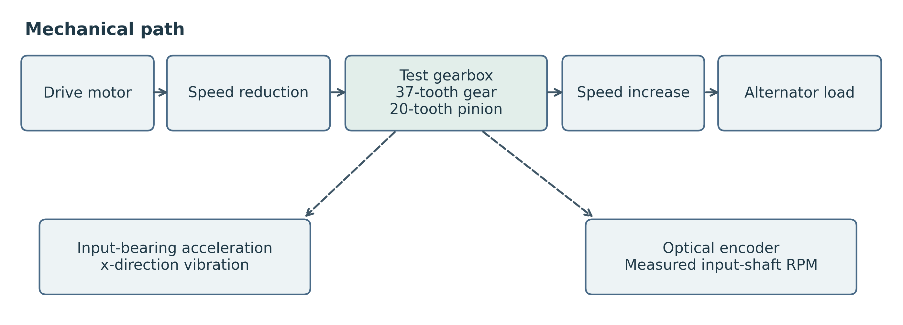{width=6.35in}

The paper describes a 20 s healthy acquisition selected for modelling. Two 7.5 s segments were extracted and assigned to training and testing. The corresponding paper test speed trajectory starts in a different part of the cycle from the supplied development sequence. The original 20 s sample origins and exact mapping to the supplied file are unavailable. The reported paper score is therefore a contextual research benchmark on the authors’ segment. Section 7 gives values and distinguishes local historical reproductions, published performance and the strict lag-1 comparison. The published healthy/damaged acquisition counts motivate investigation of the supplied diagnostic corpus. The release lacks the mapping needed to assert the health labels of those files. [@chen2025sparse]

Table 3.1. Supplied signals, scores and permitted uses.

| File or corpus | Verified size at 3,200 Hz | Role and equality controls |
| --- | --- | --- |
| sigtrain.mat | 24,000 samples, 7.5 s | EDA, guarded fit and selection, final refit, in-sample benchmark |
| sigvalid.mat | 24,000 samples, 7.5 s | Development replay only, 22,208 targets after the common guard |
| sigfault1 parts 001–020 | 200 matched vibration/RPM records, 32,000 samples or 10 s each | One-based indices. Exclude 61 and 63. Conditional groups A/B with 98 and 100 eligible records |
| sigtest.mat and sigfault2.mat | Unavailable at report generation | Frozen interfaces exist for separate evaluation when supplied |
| Acquisition condition and absolute tooth keyphase | Unavailable | Diagnostic labels and absolute damaged-tooth identity require additional independent records |

The intake loaded all 202 supplied arrays and verified finite vibration, positive rotational speed, lengths and the regular timestamp grid starting at one sample interval. It treated the supplied vibration field as dimensionless standardized vibration. In the short files, reconstructing the pre-standardization channel from the stored offset 0.00262219 and scale 0.425173 agrees with the supplied array within $2.22\times10^{-16}$. That agreement verifies an affine relationship. Traceable physical calibration of the supplied acceleration channel is unavailable. MSE throughout this study is therefore in squared standardized vibration units. The stored speed extrema reconstruct the supplied normalized channel, but the selected pipeline reads RPM and fits its own feature transforms on the authorized fit rows. No held-out record supplies new vibration standardization or scaling of the fitted feature library.

## 3.2 Overlap, fit boundaries and frequency coverage

All 8,001 possible contiguous positions of each 24,000-sample short record within each 32,000-sample diagnostic candidate were assessed for an exact joint vibration and speed match. Two pairs matched exactly from offset zero. One-based record 61 contains the designated training file and record 63 contains the designated development file. A second exact-marker scan using 64-point identities on a 512-point anchor grid confirmed the same pairings. The finite scan and tolerance checks address the audited overlap patterns, while original acquisition relationships and all possible approximate partial overlap remain unresolved. The two entire candidate records are excluded from group statistics. The experiment resets its predictors for each other candidate. Figure 3.2 specifies the role and direction of each split.

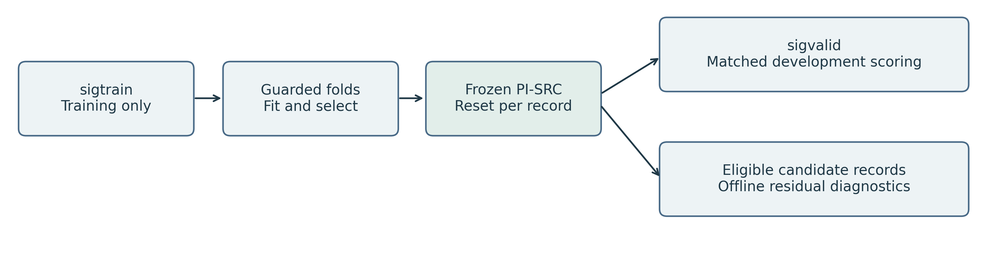{width=6.35in}

The primary measured prediction mask is the zero-based interval $[1792,24000)$, with 22,208 one-step targets. A reset and common warm-up give all approaches the declared comparison interval. The selected base representation has finite support of 512 samples. Its adapter increases the full support to 1,280, below the common 1,792-sample guard. The three held training blocks and their disjoint fit regions are specified in Section 6. Observed history in a scoring block is available at inference after the relevant sample has arrived. Its target values never update the fitted coefficients. This distinction is important for innovation histories and the optional adapter.

Figure 3.3 compares the two designated speed profiles and vibration channels under identical plotting scales. The observed speed intervals are 124.323–167.334 RPM in training and 124.335–167.323 RPM in development. Across the fault-candidate corpus the extrema are 123.655–167.416 RPM. These ranges are narrow and overlapping. An estimator can be valid at the target information horizon and still extrapolate poorly to a different operating regime. The late-to-early gaps in the chronological sensitivity control show why coverage and timed causal validity are distinct.

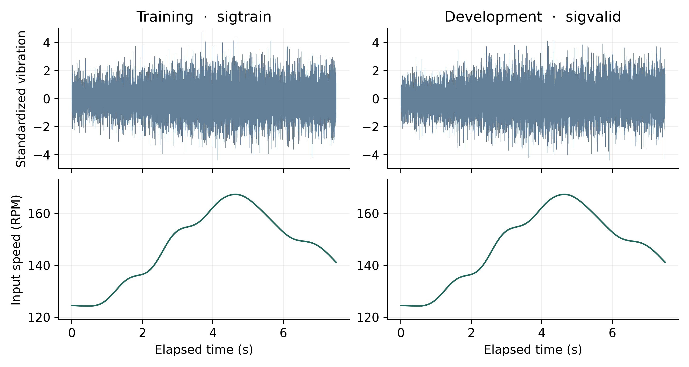{width=6.35in}

# 4. Physics-informed exploratory analysis

## 4.1 From rotational speed to features

Rotational speed determines the observable locations of several candidate components. With $n_t$ in RPM and $Z=37$, the shaft and gear-mesh frequencies in hertz satisfy

$$
f_{\mathrm{shaft}}(t)=\frac{n_t}{60},
\qquad f_{\mathrm{mesh}}(t)=Zf_{\mathrm{shaft}}(t),
\qquad f_q(t)=q f_{\mathrm{shaft}}(t).
$$

Here $q$ is order, measured in cycles per input revolution. The order of mesh harmonic number $k$ is $kZ$ cycles per input revolution. On the training profile the fundamental mesh frequency spans 76.666–103.189 Hz. The period in the original sampled stream spans about 31.0–41.7 samples. A single discrete-time delay therefore aligns to different fractions of a mesh period across the record. At 3.2 kHz the frequency Nyquist limit is 1.6 kHz, equivalent to about shaft order 573.7 at the highest training speed. This permits the first 15 mesh harmonics at that speed on the ideal grid. The study keeps a finite frequency margin under speed perturbation during candidate checking. Angular interpolation aligns speed-synchronous energy, and it cannot recover frequencies already removed by the original acquisition or preprocessing. [@fyfe1997order; @chen2025sparse]

A training-only STFT with a 1,024-sample Hann window, 896-sample overlap and 4,096-point Fourier grid tested the model’s physical premise. The measured local ridge near the fourth mesh harmonic tracked the speed-derived trajectory with correlation 0.987 and median absolute frequency discrepancy 0.744 Hz. The search was restricted to a neighbourhood of that predicted ridge, so these numbers characterize local agreement, rather than proof that the source is a single physical mode. Figure 4.1 shows the moving trajectories and frequency band. Welch estimates with 1,024-sample segments and angle-domain interpolation contrast frequency and shaft-order evidence in Figure 4.2. The order-148 peak was approximately 160 times its local order-spectrum median. The 1.0–1.2 kHz band contained 31.3% of the training Welch power. A broad band shared by moving mesh lines and potential structural effects cannot identify a fixed resonance. A dedicated fixed-frequency test is required to assess predictive benefit. [@welch1967fft; @fyfe1997order]

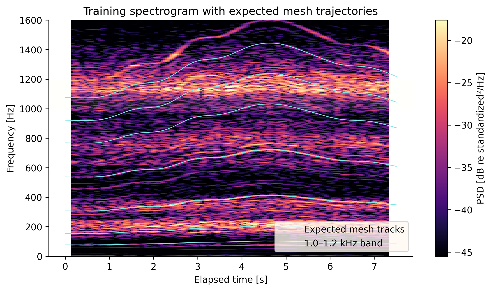{width=6.35in}

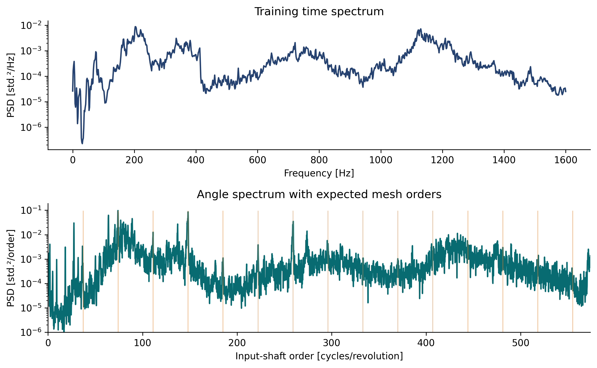{width=6.35in}

## 4.2 Time memory, operating regime and targeted screens

Short-time RMS and measured RPM correlated 0.927 across the descriptive training blocks. Load was correlated with speed in the rig, so this statistic associates the operating variables with vibration amplitude. It does not isolate a causal speed-to-amplitude mechanism. The lag-one time correlation was 0.0759, while a one-mesh-period angular correlation was 0.1278. A separate one-shaft-turn angular correlation was 0.0745. These are quantities on different coordinates and supports and direct comparisons are limited. They motivate keeping local time history as well as angular delays. The fourth time lag had the largest absolute partial autocorrelation among lags 2–96 in the stored screen. That observation supports modelling short histories and does not identify a unique order or justify setting memory to a fixed shaft period.

An LPV–AR24 screen within the designated training data separated these hypotheses before the joint PI-SRC sweep. Its mean guarded MSE was 0.46153. Adding order-148 and order-259 quadratures yielded 0.43803 in the initial feature screen. In the extension, the same two orders with decay constants 8, 32 and 128 samples yielded means 0.45228, 0.44560 and 0.44049. A six-order candidate at 32 samples yielded 0.43537. Adding selected shaft/sideband orders to the two-order bank gave 0.42903 in the corresponding highly constrained comparison. These values justify examining carrier family, damping and sideband combinations in the full search. Selection of the final four-order bank remains determined by the declared joint objective and fold scoring.

Two fixed-Hz states near 1.08 and 1.125 kHz produced 0.46152, effectively the initial linear control’s score, despite their plausible frequencies. The single 1.1 kHz feature scored 0.46230. Selective degree-two and degree-three extensions gave 0.43819 and 0.43803 in a narrower nonlinear comparison. This weak marginal difference did not justify a full cubic expansion. It instead supports testing a constrained, reproducible selection and reporting capacity as a separate factor. The screen’s artificial RPM lead is a descriptive timing check only. Forecasting requires previously arrived measurements. The synthetic constant-speed and chirp fixtures recovered order 148 to within 0.024 order, and their suffix perturbations changed the guarded quadrature outputs by zero in those fixtures.

Table 4.1. From exploratory physical evidence to a measured model decision. Reported screening values use training folds only.

| Physical observation | Controlled candidate implication | Verification in the final study |
| --- | --- | --- |
| Ridge near moving order 148 and a strong angular peak | Synchronous carriers at physically plausible orders and multiple decay scales | Joint bank and support search, finite-sum check, carrier and order-count ablations |
| Wide training power band near 1.1 kHz | Try a small fixed-Hz bank alongside angular states | Fixed-Hz screening matched the control, selected model has no fixed-Hz state |
| Mesh period changes by roughly 10.7 time samples over training speed | Mix time delays and angle-aligned history | Remove angle history while keeping model family and score mask |
| Local RMS follows the operating cycle | Include energy and measured speed context with bounded interactions | Screened energy/scheduling groups and model-record stratification |
| Constrained cubic increment is small in the preliminary screen | Restrict and regularize nonlinear interactions | Compare capacity and degree variants, and retain group-level evidence |
| Sensor reliability is distinct from the utility of a speed channel | Preserve bounded history and separate sensor perturbation pathways | Prediction-only, angle-only and combined stress tests |

The measurements distinguish a physical hypothesis from a fitting choice. Knowledge of the gear geometry supplies candidate orders and defines the interpretation of a quadrature. The guarded search resolves whether a combination is useful on this record. Later ablations provide additional attribution under a common target mask.

# 5. Physics-informed structured reservoir computing

## 5.1 Target, information set and forecasting scope

Let $x_t$ denote the supplied standardized vibration at time index $t$, $n_t$ the measured input-shaft speed in revolutions per minute, and $f_s=3200$ Hz the shared sampling rate. One tick lasts $312.5\,\mu\mathrm{s}$. The fitted readout uses a vector of deterministic, finite-history quantities constructed from $(x_j,n_j)$ through $j=t-1$. Write $\mathcal F_{t-1}=\sigma\{x_j,n_j:0\le j\le t-1\}$ for that measured history, and let $\widehat\Theta$ contain the configuration and fixed training estimates. The forecast and its scoring residual are

$$
\widehat x_t=F_{\widehat\Theta}(\mathcal F_{t-1}),\qquad e_t=x_t-\widehat x_t .
$$

The predictor has a strict lag-one cutoff for both channels. The instantaneous sample $n_t$ is reserved for later predictions, as is $x_t$. Once the vibration is observed, older errors may become inputs to subsequent predictions. This is teacher-forced, one-step forecasting on measured histories. Deployment as a free-running simulator would instead replace unavailable future measured histories with model outputs. The latter would require separate stability and accuracy evidence.

PI-SRC is a fixed map of causal histories after configuration selection. A regularized linear readout acts on its mixed linear and nonlinear features. Finite causal filters can update internal states recursively. The proxy and readout are trained by regularized least squares, while phase, decay, history length, candidate transformations and correction parameters are externally specified and selected over the guarded grid. This construction fits within fixed-feature reservoir and nonlinear autoregression practice [@gauthier2021; @chenbillings1989]. The physical constraint enters the representation and parameter search [@karniadakis2021]. Figure 5.1 links the measured history, finite phase-aligned feature groups and optional residual correction.

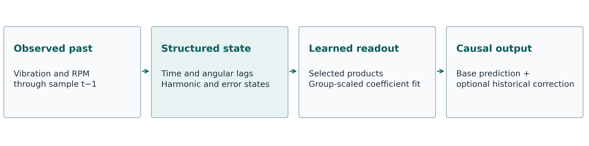{width=6.35in}

## 5.2 Sample delays and speed conditioning

The time-domain backbone records a prescribed set of delays $\mathcal L$:

$$
\mathbf{d}_t=\bigl[x_{t-\ell_1},\ldots,x_{t-\ell_L}\bigr]^{\mathsf T},
\qquad 1\le\ell_1<\cdots<\ell_L .
$$

The selected design keeps consecutive lags 1 through 96, equivalent to 30 ms of maximum time-domain displacement. The multiresolution candidate holds the first 16 lags consecutive and then fills longer spacings using a reproducible logarithmic grid. The candidate's maximum chosen lag governs its support. The time and angle embeddings can represent complementary structure. A fixed-time tap follows absolute time, while an angular tap follows the fraction of a mechanical period. Delay-coordinate ideas motivate the representation [@takens1981; @gauthier2021]. The study treats these finite vectors as predictive features in measured vibration with varying operating conditions.

Let $n_{\mathrm{mid}}$ and $n_{\mathrm{half}}$ be the midpoint and half-range of RPM in the admitted training fragments, with the half-range floored at 1 RPM. The operating variables include

$$
z_t=\operatorname{clip}\!\left(\frac{n_{t-1}-n_{\mathrm{mid}}}{n_{\mathrm{half}}},-1.2,1.2\right),
\qquad
a_t=\frac{n_{t-1}-n_{t-33}}{n_{\mathrm{half}}},\qquad
E_t=\frac{1}{64}\sum_{j=1}^{64}x_{t-j}^2.
$$

The acceleration proxy $a_t$ is the scaled 32-sample RPM difference. Division by the corresponding elapsed time would convert an unscaled RPM difference into RPM per second. The fitted features use $a_t$ as defined above, $z_t$, and $\sqrt{E_t}$. The fit recalculates the calibration for each admitted fold and stores the resulting full-training midpoint and half-range, 145.828179 and 21.505339 RPM, in the checkpoint. The deployed model applies that fixed calibration within each subsequent record.

Four linear feature blocks receive the Legendre factors $P_0(z)=1$, $P_1(z)=z$ and $P_2(z)=(3z^2-1)/2$. If $h$ is one of the delay, angle, innovation or quadrature quantities, its scheduled block is $\{h,P_1(z_t)h,P_2(z_t)h\}$. The architecture thereby gives the affine readout smoothly speed-varying weights over each original state, a design link to LPV coefficient scheduling [@chen2025sparse]. Separate use of $z_t$, $a_t$ and RMS preserves operating and amplitude information without multiplying every context variable into every group. Calibration, signal feature scaling and ridge grouping each serve different purposes.

## 5.3 Historical shaft phase and angular interpolation

The 37-tooth input gear defines mesh frequency $37n/60$ in hertz. For the 20-tooth mating pinion, the same mesh frequency corresponds to a pinion rotational rate $37/20$ times input-shaft rate. The feature orders in this study are referenced to the measured input shaft. Order tracking is appropriate when a component repeats at a given angular offset as speed varies [@fyfe1997order]. For each acquired record the code uses an arbitrary zero phase and trapezoidal integration of the observed speed. It then extrapolates the target phase one sample ahead with lag-one speed:

$$
u_0=0,\qquad
u_j=u_{j-1}+\frac{n_{j-1}+n_j}{120f_s},\qquad
\widehat u_t=u_{t-1}+\frac{n_{t-1}}{60f_s}.
$$

Here $u$ is measured in shaft turns. Multiplication by $2\pi$ gives radians. Trapezoidal integration can use $n_j$ for a historical location because $j\le t-1$ at the prediction boundary. The prospective phase $\widehat u_t$ uses approximated next-sample progression. Its forecast error can grow with RPM-change rate, sensor bias or speed dropout. The diagnostic resampling described later uses a completed trace available offline.

The selected angular grid has $Q=16$ points per mesh and eight mesh cycles, so it provides 128 features. For slot $i$ the requested angle is

$$
v_{i,t}=\min\!\left(\widehat u_t-\frac{i}{37Q},\ u_{t-1}\right),
\qquad i=1,\ldots,128.
$$

Find observed turns $u_j\le v_{i,t}\le u_{j+1}$ with $j+1<t$ and form $x_j+(x_{j+1}-x_j)(v_{i,t}-u_j)/(u_{j+1}-u_j)$. Positive RPM makes the observed turn sequence strictly increasing. The implementation checks allowed interpolation endpoints and uses 100 RPM as a resource bound for finite angular history. At 100 RPM the eight-cycle geometry plus two safety samples requires $\lceil 8f_s60/(37\times100)\rceil+2=418$ prior samples. This bound is shorter than the 512-sample oscillator memory. In the supplied training range there are about 31–42 samples per mesh, so the first one-sixteenth-mesh offset is larger than one sample advance. The cap at $u_{t-1}$ gives explicit protection for finer grids. Interpolation can alter spectral amplitudes and is sensitive to the speed channel. Maintaining the ordinary delay block allows evidence from the original time grid to contribute alongside the geometry-aligned representation [@fyfe1997order; @abboud2017envelope].

## 5.4 Finite speed-synchronous oscillator states

The complex oscillator coordinates act as damped synchronous filters with a target-frame phase. For shaft order $o$, define $\phi_j=2\pi o u_j$ and $\widehat\phi_t=2\pi o\widehat u_t$. With time constant $\tau$ in samples, take $\rho=\exp(-1/\tau)$. The code implements the normalized weighted finite history

$$
G_{\rho,M}=\sum_{j=0}^{M-1}\rho^j,\qquad
H_{o,\tau,t}=\frac{2}{G_{\rho,M}}
\sum_{j=1}^{M}\rho^{j-1}x_{t-j}
\exp\!\left\{i(\widehat\phi_t-\phi_{t-j})\right\}.
$$

The oldest allowed vibration sample is $x_{t-M}$. The lag weights start at exponent zero for $x_{t-1}$. The constant $G_{\rho,M}$ normalizes the finite geometric weight array. For a real oscillation with stationary amplitude in the carrier frame, multiplication by the negative carrier phase moves its positive-frequency component to near zero. The reverse component oscillates at twice the carrier phase. Finite smoothing attenuates that reverse image to a degree set by decay and phase progression. The factor of two compensates the positive-frequency half-amplitude in the ideal image-rejection limit. Real and imaginary parts then supply quadratures referenced to the candidate phase at $t$. The effective feature memory depends on $\rho$ and the cut-off $M$. It characterizes a predictive fading-memory kernel [@boyd1985; @abboud2017envelope].

If $c_j=x_j\exp(-i\phi_j)$ and $s_t=\sum_{j=1}^{M}\rho^{j-1}c_{t-j}$, reindexing yields

$$
s_{t+1}=\rho s_t+c_t-\rho^M c_{t-M},\qquad
H_{o,\tau,t}=\frac{2}{G_{\rho,M}}\exp(i\widehat\phi_t)s_t.
$$

Subtraction of the departing sample gives exact finite memory in arithmetic. The implementation applies a first-order filter to the difference signal $c_t-\rho^M c_{t-M}$, delays by one observation and remodulates. Evaluation of the normalization with cancellation-safe exponential expressions retains precision for $\rho$ close to one. For any bounded history, the triangle inequality gives $|H_{o,\tau,t}|\le 2\max_j|x_{t-j}|$. A report-side check directly evaluated 24 of these sums at several positions and order/decay pairs, including the boundary of the 512-sample memory. The largest absolute complex discrepancy with the implemented filter was $6.03\times10^{-13}$. The source also contains independent tests on synthetic signals. This finite-memory bound concerns the feature operator on measured histories. The closed-loop map associated with hypothetical free-running forecasts is a separate dynamical system.

The selected bank uses orders 37, 74, 148 and 259, equivalent to mesh harmonics 1, 2, 4 and 7. Each uses 8-, 32- and 128-sample decay constants (2.5, 10 and 40 ms), with 512-sample maximum history (160 ms). Different decays trade between temporal responsiveness and frequency selectivity. The four carriers and three decays provide 12 complex states and 24 real quadratures. The selected bank uses only shaft-dependent carriers. In fixed-Hz candidates the historical and target phases instead follow $2\pi f j/f_s$ and $2\pi f t/f_s$ for a specified frequency $f$. Candidate fixed-Hz states test for temporal-frequency structure that need not follow the gear order. Interpreting such structure as a specific structural resonance requires independent physical evidence [@abboud2017envelope]. At fit, the largest order frequency evaluated at 103% of the maximum allowed training-fragment RPM and any fixed-Hz frequency must remain below $0.49f_s=1568$ Hz. A new operating range would require its own frequency-validity check.

## 5.5 First-stage innovation proxy

The first stage computes a short-horizon prediction from a speed-scheduled finite AR model. Let $p=192$. For each acquired sample $j$ following adequate history, its proxy forecast and clipped error are

$$
\widetilde x_j=\sum_{d=0}^{2}z_j^d\sum_{\ell=1}^{p}b_{d\ell}x_{j-\ell},
\qquad
\widetilde e_j=\operatorname{clip}(x_j-\widetilde x_j,-3,3).
$$

The fit uses ridge 0.0003, no intercept, and the same outer-fragment RPM calibration as the main library. The scheduled first-stage coefficients multiply monomial powers of $z$, while the main library uses Legendre factors. The implementation filters each AR coefficient row then shifts it by one sample and combines the rows with their target-specific speed powers. The proxy residual uses the newly observed $x_j$, so the downstream readout at $t$ receives only the strictly historical vector $\bigl(\widetilde e_{t-1},\dots,\widetilde e_{t-24}\bigr)$ and scheduled or nonlinear versions of these values. The proxy uses $p+24=216$ raw past samples at maximum. Records reset without transients carried from preceding acquisitions. Within a record the code initializes proxy errors before their required lag order to zero, and scores only after complete context. A fitted AR proxy plus older estimated errors is related to staged innovation methods [@chenbillings1989; @chen2025sparse]. Proxy-error whiteness and exact recovery of physical innovations remain separate questions.

The primary fits the proxy and clean downstream readout on the same admitted outer fragments. A three-block inner cross-fit was tried in a different compound configuration. The upper-layer folds always exclude the held targets and prescribed guards from both fits. The cross-fit trial changes proxy and augmentation choices together, so its utility estimates a bundle.

## 5.6 Structured feature groups and final dimensions

The time, angular and proxy-lag states, oscillator quadratures, and the speed/RMS context form the design backbone. For a causal tap vector $q_{t,i}=x_{t-i}$ with $i\in\{1,2,4,8,16,32,64\}$, the structured group adds squares, consecutive products in that tap list and selected cubes. Energy interactions are $q_{t,i}E_t$ and $q_{t,i} E_t z_t$. There are four lag–innovation products plus a candidate averaged squared proxy-error term. With $h_{o,t}=H_{o,32,t}$, the central decay carrier state, the bounded energy is

$$
B_{o,t}=\frac{|h_{o,t}|^2}{1+|h_{o,t}|^2}.
$$

Candidates include $B_{o,t}$, $z_tB_{o,t}$, $B_{o,t}\operatorname{Re}h_{o,t}$, and $B_{o,t}\operatorname{Im}h_{o,t}$ for each order, along with seven products between the time taps and the mean bounded energy across the four carriers. The code can construct neighboring complex carrier cross-products under its coherent policy. The selected structured policy uses the listed within-carrier interactions. The generic polynomial comparison forms restricted all-pairs products and cubes from historical taps and scaled speed. Such polynomial and rational interactions increase representational capacity beyond an affine raw-delay predictor. The group structure provides a controlled choice of interactions grounded in lag, operating and oscillator quantities [@gauthier2021; @boyd1985].

**Table 5.1. Feature columns in the selected frozen PI-SRC checkpoint.**

| Design block | Unscheduled columns | Scheduled columns | Nonlinear columns |
|:---|---:|---:|---:|
| Vibration sample delays | 96 | 192 | 19 |
| Angular interpolation | 128 | 256 | 0 |
| Clipped proxy history | 24 | 48 | 4 |
| Complex oscillator quadratures | 24 | 48 | 23 |
| Operating context and amplitude | 3 | 0 | 14 |
| Total | 275 | 544 | 60 |

The combined library has 819 non-interaction features and 62 nonlinear candidates before selection. A column is eligible if its training standard deviation exceeds $10^{-7}$. All 881 candidates passed this threshold in the selected full fit. A nonlinear-only feature cap then ranks $\bigl|\sum_t(x_t-\overline x)v_{t,j}\bigr|/s_j$ on clean fitting rows, with $s_j$ the candidate standard deviation. The common target variance and row count are irrelevant to the ranking. Stable sorting resolves ties before original column order is restored within the selected nonlinear group. The two dropped candidates are $x_{t-32}^2$ and mean proxy-error energy. Exactly 879 feature columns remain. The code scales a retained quantity $v_{t,j}$ to $(v_{t,j}-\mu_j)/\max(s_j,0.005)$ using clean admitted rows only. The selected rank setting retains the actual columns. The reduced-rank alternative applies a fitted principal-direction projection to the screened nonlinear features. Column identities, group membership, moments, coefficients and any projection are serialized explicitly.

## 5.7 Group ridge and protection rows

Write $\boldsymbol\psi_t$ for the normalized retained vector, $b$ for an unpenalized intercept and $\boldsymbol w$ for readout weights. With $A$ denoting the actual design of clean and weighted auxiliary rows, $\boldsymbol y$ their targets and $N_A$ their total number, the optimized numerical objective is

$$
\min_{b,\boldsymbol w}\frac{1}{N_A}
\left\|A\begin{bmatrix}b\\\boldsymbol w\end{bmatrix}-\boldsymbol y\right\|_2^2
+\lambda\sum_g a_g\|\boldsymbol w_g\|_2^2.
$$

Diagonal group weighting retains the ridge objective [@hoerl1970]. Group-specific penalties are $a_g=6$ for nonlinear columns, $a_g=0.9$ for other oscillator columns (including their Legendre schedules), and $a_g=1$ elsewhere. The selected $\lambda$ is $0.022$, with squared feature coefficients penalized in the standardized basis. The group weights preserve all retained columns and adjust the degree of shrinkage. Group-sparse estimation with a different penalty can set an entire group to zero [@yuan2006].

Two auxiliary designs were activated in the selected fit. On every fifth clean design row, the RPM channel is multiplied by $1-0.0075$ or $1+0.0075$ and the feature vector is reconstructed with its original clean target. Both copies have loss weight $0.35$. For synthetic pulse preservation, two once-per-turn vibration bursts use 520/700 Hz and shaft phase offsets of 0.23/0.71 turns. The generator gives the bursts amplitude 0.9 in standardized vibration and an exponentially decaying envelope with a 3.5 ms time constant, truncated at 18 ms. The input row is the difference between the perturbed and pristine standardized feature vectors. Its intercept column and target are zero, so the penalized quantity is the change in the base forecast due to the pulse. Each of the two difference rows carries weight $0.2/2=0.1$. These weights are applied by scaling a row and its target by the square root of the relevant weight. The resulting extra 18,792 rows augment 23,488 clean full-training rows. These rows alter the objective while preserving the same acquisition count. The folded intervention vector in Section 6 is a separate stimulus from both fitting bursts.

The code forms the Gram matrix and right-hand side in blocks of 4,096 rows and accumulates both in float64. The primary normal-equation solver is Cholesky with a reciprocal condition estimate. When a factorization or reciprocal-condition check fails, the implementation solves an augmented weighted least-squares system by pivoted QR. The selected run completed one Cholesky solve with estimated Gram condition $2.34\times10^4$. The Huber option performs five reweighted solves, changing the robustness weights on clean rows. OLS is also exercised in the search. Runtime and near-collinearity are practical considerations because the angular, time and scheduled groups overlap. The reported total of 1,456 parameters consists of 880 readout scalars (879 plus intercept) and a $3\times192$ first-stage coefficient array. Moments and feature indices are stored separately from fit coefficients. The compactness definition counts projection weights in addition when a projection is present.

## 5.8 Historical correction and end-to-end support

Let $\widehat x^0_t=b+\boldsymbol\psi_t^{\mathsf T}\boldsymbol w$ and $e^0_t=x_t-\widehat x^0_t$. The selected adapter uses older, clipped base-model errors:

$$
\widehat x_t=\widehat x^0_t+
g_c\frac{\sum_{j=1}^{M_c}\exp[-(j-1)/\tau_c]\operatorname{clip}(e^0_{t-j},-C,C)}
{\sum_{j=1}^{M_c}\exp[-(j-1)/\tau_c]}.
$$

The selected gain is 0.5, decay is 512 samples, memory is 768 samples and clip is 1.75 standardized units. The clipped quantity is the base error, which becomes available after each earlier measurement. The finite filter uses overlap-add convolution and an explicit one-sample delay. Under valid recorded histories, changing vibration and RPM at and after the current target can affect later predictions. Four perturbation positions in the development record left the entire scored forecast prefix through each current target equal within $4.44\times10^{-16}$. An independently expanded correction sum agreed with the implementation to $1.11\times10^{-16}$. These discrepancies are on the scale of float64 arithmetic, including small convolution roundoff. The record-level software validates shape, finite inputs, sampling rate and minimum speed before applying the predictor, so numerical causality was checked on admissible histories.

The maximum base support is 512 samples. The oldest used base residual requires up to a further 768 samples, making the selected full support 1,280 samples (0.400 s). The 1,792-sample scoring mask is a comparison warm-up. It covers the primary and all included model variants. Each admitted fragment resets the feature construction. At inference no phase crosses acquisition boundaries, and the model builds features in 4,096-target batches with their required preceding context. Common-mask comparison with correction disabled on identical coefficients directly attributes the adapter effect. The development MSE decreased from 0.340706 to 0.329973 with the adapter. Applying the identical filter to strict Sparse LPV-ARMA and polynomial SRC lowered MSE by 0.003413 and 0.003038. This establishes an observed benefit of correction in multiple pipelines and motivates separate evaluation of PI-SRC's state design.

## 5.9 Complexity, interpretability and contribution

For a record of length $N$, $K$ order/frequency carriers and $D_\tau$ decay constants, finite oscillator state construction takes $O(NKD_\tau)$ operations with first-order filtering. Building the scheduled proxy takes finite-filter work associated with $p$ lags and its three degree rows. Angular interpolation locates two observed samples by binary search for each target and angular offset. The affine readout requires work proportional to the scored number of targets and $d$ retained feature columns. Dense Gram accumulation and factorization costs scale as $O(N_A d^2)$ and $O(d^3)$ respectively, conditional on materialized feature vectors. The delivered code performs blockwise accumulation and bounded-batch inference. The dedicated allocation measurement compares roughly 248 MB for full-matrix feature materialization with 43.2 MB for the two principal arrays in 4,096-target batches. The largest prediction difference between these implementations was $8.79\times10^{-9}$ on that benchmark. These figures quantify allocated bytes for two design buffers. Computational results later quantify batch timing of the full delivered pipeline.

Physical interpretability resides chiefly in input synchronization, finite memory, measured speed scheduling and group definitions. Coefficients of correlated groups can compensate one another and depend on feature scaling and the augmentation objective. Learned weights describe an empirical predictor, and orders/decays encode hypothesized structure. Claims about resonance or identified damping would require a mechanical experiment designed for that purpose.

The main contribution is a specified integration of measured-history order alignment, finite damped quadratures, lagged innovations and selected low-degree nonlinear interactions in a group-regularized predictor. Relative to the generic polynomial and Sparse LPV-ARMA comparators, it brings explicit shaft-phase states and interaction groups into the represented history, and tests a guarded joint selection criterion with RPM and pulse perturbations. Prior fixed-feature, physics-informed and regularized approaches establish distinct precedents for these ingredients [@gauthier2021; @karniadakis2021; @chen2025sparse]. This investigation establishes how their exact combination performed against aligned, executed comparators and control variants in the supplied experiment.

# 6. Guarded optimization and reproducibility

## 6.1 Folds, guard and candidate chronology

The optimization driver uses the supplied training file alone. Its three half-open target intervals are listed in Table 6.1. Given held targets $[l,h)$ and guard $g=1792$, admissible raw fit fragments are $[0,l-g)$ and $[h+g,24000)$. Each fold has 2,400 held targets and 18,016 raw training samples spread across the two fragments. The primary loses its 512-sample base context at each fragment origin, leaving 16,992 clean readout rows per fold. The largest full support among the 41 completed configurations was 1,536, so the guard covers all their dependency depths. Calibration, proxy weights, feature means, scaling, screens and readout are reconstructed inside each fold.

**Table 6.1. Zero-based training-series intervals for guarded model selection.**

| Fold | Held targets | First fitting fragment | Second fitting fragment |
|:---|:---|:---|:---|
| 1 | [4800, 7200) | [0, 3008) | [8992, 24000) |
| 2 | [11200, 13600) | [0, 9408) | [15392, 24000) |
| 3 | [18400, 20800) | [0, 16608) | [22592, 24000) |

The fold predictions use the original series with observed histories. The guard removes held targets and neighboring samples from coefficient estimation, while operational inference conditions on earlier measured samples. Fitting can use disjoint later sections of the training series. The reported fold score estimates guarded within-record comparison in a setting with speed and time dependence. A separate earlier-only refit evaluated the principal configuration using only the first admissible fragment of each fold and produced held-block MSEs of 1.413805, 1.110925 and 0.353668. Fragility in the early folds indicates limited coverage of subsequent conditions using those shorter fragments. The earlier-only figures were kept outside the selection objective. Both procedures sample blocks from the same machine and recording.

There were five stages, with 13, 13, 5, 6 and 4 configurations in stages A through E, respectively. The 41 successful configurations produced 123 guarded fits. Stage A evaluated controls and physical carrier alternatives, covering delay-only and speed-scheduled baselines, a linear physics readout, angular depth alternatives, no-carrier and fixed-Hz ablations, and banks of two, four, six and twelve mesh orders. It also tested selected shaft and near-mesh sideband orders. Stage B changed feature capacities, innovation history, time and angle geometry, acceleration, the polynomial family, the coefficient norm penalty, a reduced-rank alternative, a multiresolution/coherent configuration, Huber estimation and OLS. Stage C explored compound configurations with memory 256–720, decays from 6 to 190 samples across tested settings, angular grids from 8 to 16 points per mesh, and a mixed sideband/fixed-frequency bank. Stage D evaluated multiple adapter settings and targeted protection bundles including optional inner cross-fitting. Stage E refined ridge strength and correction around the best admissible physical configuration from stages A–D. This finite staged search evaluates trial bundles, so coupled changes in configurations limit attribution to any single varied variable.

The standard sweep used a fixed configuration sequence, deterministic operations for the SRC primary and a recorded protocol seed of 19. The trial log gives about 231 s in total recorded per-configuration runtime in that run. This sum includes fitting and per-fold clean, RPM-stress and pulse predictions. The development file entered only after the named choices were frozen.

## 6.2 What the scalar utility measured

Each fold drew clean and modified predictions for exactly the held indices. An RPM-stress intervention multiplies the RPM trace by $1+0.012\cos(2\pi(0.45)t/f_s)$, retaining the original vibration as the target. The folded pulse vector comprises eight 20-sample damped cosine bursts placed inside the scored interval, all with amplitude 0.6 and decay constant six samples. Their carrier has 0.19 cycles per sample (608 Hz). Define $D$ as the squared change in the model output, summed over the held interval and divided by the squared injected pulse norm. Both forecasts in the numerator use the same frozen fit. A small $D$ means comparatively little of this prescribed pulse was followed by the predictor. This surrogate concerns waveform retention under a defined intervention. Evaluation of PMI on real record groups addresses a separate question. The scalar objective averages fold quantities equally:

$$
J=\overline{\mathrm{MSE}}_{\mathrm{clean}}
+0.14\max\!\left[0,\overline{\mathrm{MSE}}_{\mathrm{stress}}
                    -\overline{\mathrm{MSE}}_{\mathrm{clean}}\right]
+0.009\overline D+0.000002p_{\max}.
$$

The final complexity term uses the maximum stored coefficient count across the three fitted folds. The first two terms use squared standardized vibration units. The $D$ term is dimensionless before weighting, and the coefficient-count term prices stored coefficients. The weights establish a specific trade-off on the utility scale. Timing is recorded separately. The code also writes a nondominated four-axis frontier using clean MSE, RPM-stress MSE, pulse distortion and coefficient count. Figure 6.1 shows the guarded selection trade-offs.

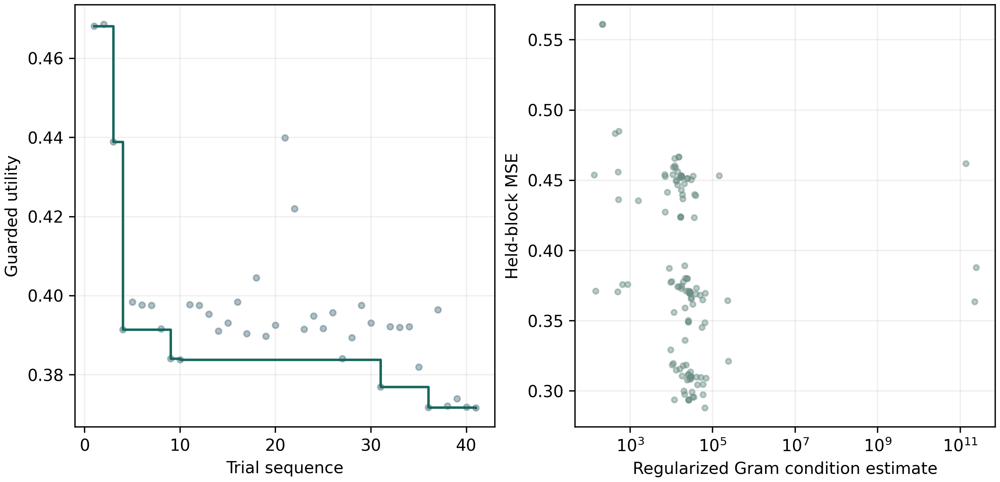{width=6.35in}

At the primary choice the mean clean fold MSE was 0.355734, the stress MSE 0.381362 and the mean pulse ratio 1.050501. The corresponding contributions to $J$ were about 0.355734, 0.003588, 0.009455 and 0.002912. These sum to 0.371689. A bounded report-side recomputation from saved targets and forecast vectors reproduced all 123 clean and stress fold MSEs to within $5.55\times10^{-17}$ of the archived tables, and all pulse ratios to within $2.22\times10^{-16}$. The archived scalar utilities reconciled within $5.55\times10^{-17}$. The primary's individual clean fold MSEs were 0.293951, 0.423995 and 0.349257. Variation across three dependent blocks informs sensitivity to the held interval. Acquisition-level uncertainty would require multiple independent recordings.

## 6.3 Selection, alternatives and artifact lineage

The driver restricts the primary selection to completed eligible physical PI-SRC variants, sorting by utility and a deterministic trial-ID tie rule. From the same admissible set it saves the minimum-clean-MSE fit, the best utility within the compactness constraint and the best utility with the adapter off. The compactness threshold is the larger of the minimum admissible coefficient count and 65% of the primary count. These rules produced the rows in Table 6.2. The trial named selected_correction, stage E, retains stage D's protected four-order design, lowers the memory from 1,024 to 768 correction samples and changes its decay from 640 to 512 samples. The 192-order proxy, 24 innovation lags, four order choices, eight angular cycles and group-weighted ridge are fixed in that final configuration. The minimum-clean-MSE row local_ridge_down uses ridge 0.0099 with the stage D correction geometry.

**Table 6.2. Training-selected PI-SRC choices and subsequent common-mask development results.**

| Locked choice | Trial identifier | Clean MSE | Stress MSE | Pulse ratio | Utility | Coef. | Dev. MSE |
|:---|:---|---:|---:|---:|---:|---:|---:|
| Utility | selected_correction | 0.355734 | 0.381362 | 1.050501 | 0.371689 | 1456 | 0.329973 |
| Clean MSE | local_ridge_down | 0.355511 | 0.380581 | 1.132523 | 0.372125 | 1456 | 0.326401 |
| Compact | lag_degree1 | 0.376050 | 0.402773 | 0.930360 | 0.389832 | 834 | 0.358022 |
| Adapter off | selected_uncorrected | 0.355942 | 0.381616 | 1.050319 | 0.371901 | 1456 | 0.340706 |

The utility winner improves $J$ by 0.000437 versus the pure-MSE choice despite a small clean-MSE disadvantage across its training folds. Its lower synthetic response drives that trade. The pure-MSE choice subsequently scores lower on development, and the primary retains the originally declared utility target. The compact design has less than 60% of the primary stored coefficient count and higher development MSE, a different accuracy and resource profile. Extending to a fixed 1,100 Hz carrier without order-state features took the stage-A clean fold MSE from 0.383623 (no carrier) to 0.383525. The improvement of about 0.00010 for this pairing gives limited evidence that a fixed frequency helped under those settings. Other changes to the angle grid, operator bandwidth or datasets could yield different outcomes. In the delivered experiment, the utility selected four explicitly specified shaft-synchronous orders.

The final configuration and forecast vectors are versioned with the experiment. Configuration files, the trial table, fold scores and saved fold forecast vectors record the evidence for the selected numerical checkpoint. The trial log records the model-source and optimization-config fingerprint and the training file hash. The recorded model-source commit prefix is 802e5b6. The tested environment used Python 3.12.14, NumPy 2.5.5 and SciPy 1.17.0 on Linux x86-64. The model constructs features in mixed float32/float64 arithmetic, with phase and oscillator calculations in double precision and Gram accumulation in float64. Measurements use one BLAS thread on an AMD EPYC 9V74. A previous deterministic refit produced the same checkpoint SHA-256 and exact development forecast vector. Loading the frozen selected checkpoint at report preparation reproduced all 22,208 development predictions exactly. These checks tie the reported values to the numerical pipeline under the supplied operating conditions.

# 7. Conventional and machine-learning comparator methods

## 7.1 Experimental equivalence and model coverage

The 21 required benchmark families test distinct ways of constructing a one-step predictor. A common target set, causal information cutoff and measurement protocol constrain the comparison. They leave variation in the inductive bias, training budgets and feature maps. For each target $t$, the available measured vibration is $x_{t-1},x_{t-2},\ldots$. When a model uses speed, its latest input is $\omega_{t-1}$. The 1,792-sample common warm-up covers the widest allowed causal history. Every comparator scores all 22,208 targets on the same supplied development recording, with zero-based indices $[1792,24000)$. MSE is in squared supplied standardized vibration units. The main evaluation contains 21 trained and development-validated comparator rows, one newly selected PI-SRC row and five separately identified archival SRC rows. Three archival rows replay checkpoints, and two use preserved forecasts.

Selection for the ordinary comparator families used mean MSE across three training-only held-out blocks, $[4800,7200)$, $[11200,13600)$ and $[18400,20800)$ of the separate designated training recording. Each fit excludes a 1,792-sample guard immediately before and after its held-out block, and lagged features are constructed within each permitted raw fit segment. When the model standardizes inputs, centres and scales are fitted from the allowed training data. These precautions address direct history overlap. Remaining serial dependence, the use of one training acquisition and the ability to train on later portions of that acquisition limit the interpretation of blocked validation. The fold procedure resembles gap-based validation for dependent observations. Theoretical results permitting particular forms of cross-validation in autoregressive settings require assumptions about the residual dependence, so they provide context rather than assurance of exchangeability in this speed-varying experiment. [@compRacine2000; @compBergmeir2018]

The protected comparator study recorded 126 candidate configurations and 378 fold rows for 19 families. The two sparse LPV supports originated from a separate guarded ADMM search with 36 fold results and were sealed before the current support-only refits. Candidate counts varied by family. ARMA and ARIMA candidates had to satisfy a moving-average inverse-filter margin in every fold. Lasso and Elastic Net rankings preferred candidates that converged in all folds before comparing mean MSE. ARX has 54 fold rows, Random Forest and Gradient Boosting each have 12, and the two attention models each have six. A fresh rerun of the complete guarded workflow and sealed-support refits reproduced the selected configurations, checkpoint bytes, reloaded predictions and development MSE of all 21 required models. The audit reconciled 57 selected guarded-fold rows for the 19 directly selected families. Fresh sparse coefficients matched the original stored supports and RPM calibration, with a maximum coefficient difference of $2.22\times10^{-16}$ against the earlier source. This establishes deterministic reproduction at the tested settings and hardware. Generalization to a fresh acquisition remains constrained by the available data. Final-fit target counts differed before the shared development evaluation. The fixed-order statistical training pass uses 23,664 target rows after its internal initialization, and the sealed sparse support fits use 22,208. The affine and tree designs use the 22,208 eligible training rows, whereas the selected SVR uses a 4,500-row deterministic subset. The selected MLP, LSTM, GRU and TCN use 23,872 history windows and the CNN uses 23,808. Training strides reduce attention fit targets to 11,928 for Transformer and 7,982 for compact TFT. Feature support and fit subsampling therefore affect comparison even where the score is exactly paired.

## 7.2 Autoregression, innovations and speed-scheduled dynamics

AR, ARMA and ARIMA use vibration only. AR fits coefficients on fixed lags. The local ARMA fit uses residuals from a preliminary order-320 AR model as innovation proxies in a second least-squares stage, following the logic of Hannan and Rissanen's recursive estimation strategy. At inference, the model's own causal innovation filter is used to convert observed past samples to a one-step prediction. For an invertible ARMA representation $A(L)x_t=M(L)e_t$, where $L$ is the unit lag operator and the constant terms are one, the transfer from vibration to prediction is
$$
\widehat x_t=\left[1-\frac{A(L)}{M(L)}\right]x_t.
$$
The operator has zero current-sample coefficient. The implementation bounds its support at 1,792 lags and screens moving-average roots during estimation. ARIMA fits the corresponding ARMA structure on first differences and recovers the original target scale by adding $x_{t-1}$. The chosen configurations were AR(96), ARMA(96,2) and ARIMA(96,1,2). Agreement among these three development scores, from 0.440065 to 0.441706, suggests that differencing or adding two constant innovation coefficients brought only small point changes for this record and grid. [@compBox2015; @compHannan1982]

ARX augments fixed vibration lags with an additive measured-speed regression. It uses 96 vibration lags, RPM lags 1, 17, 65 and 257, and scaled ridge with penalty 0.002 in its own normalized convention. Additive exogenous terms permit a speed-dependent level contribution. A scheduling law allows RPM to alter the coefficients multiplying vibration history. NARX extends the conditional map with nonlinear input interactions. In this study, its interpretation is a ridge physics-conditioned base plus a width-32 tanh residual correction on a compact lag and physics library, fitted for up to 36 epochs. The base and correction use true historical observations. The NARX papers motivate nonlinear dependency modelling, while the local implementation and experiment define the specific finite-memory architecture and training budget. The development MSEs were 0.443197 for ARX and 0.383150 for the NARX residual model. [@compLjung1999; @compBillings2013; @compLin1996]

Sparse LPV-AR and sparse LPV-ARMA use eight shifted Legendre features $P_k(z_{t-1})$, where $z_{t-1}=2\widetilde\omega_{t-1}-1$ and $\widetilde\omega$ is speed scaled using the sealed calibration. Their coefficients depend on operating condition. A generic shorthand for the two stages is
$$
\widehat x_t=\sum_{i=1}^{p}\sum_{k=0}^{7}\alpha_{ik}P_k(z_{t-1})x_{t-i}
 +\sum_{j=1}^{q}\sum_{k=0}^{7}\beta_{jk}P_k(z_{t-1})e^{(1)}_{t-j}.
$$
Here $e^{(1)}$ is the residual from the already fitted first-stage predictor. The sparse AR model uses 240 candidate vibration lags and retains 475 nonzero basis coefficients. The second stage uses 135 vibration and 75 innovation lags, with 365 nonzeros in addition to the 475 stage-one coefficients. These 840 stored coefficients include both stages. QR-refitting on the existing supports produced local MSEs of 0.381496 and 0.371406 respectively. Chen et al. jointly motivate speed scheduling, a residual-based second stage and sparse model fitting. Their published Table 6 gives 0.2893 for sparse LPV-ARMA on the authors' reported segment. The current-RPM and early-window local reproductions are separate experiments, and the published value cannot enter the matched ranking. A strict dense LPV-ARMA sensitivity run reached 0.330781 on the common mask and sat outside the predefined 21-model set. Its proximity to PI-SRC underscores the importance of comparing support selection and feature design separately. [@chen2025sparse]

## 7.3 Affine, kernel and ensemble regression

Linear Regression, Ridge, Lasso and Elastic Net fit affine readouts of training-scaled causal feature vectors. The selected physics feature library contains time lags, RPM and speed differences, speed–lag interactions, angular delays, order-aware quadratures and lag energy. Consequently the unpenalized Linear Regression result is a strong physics-feature comparator. A purely lagged linear predictor is already represented by AR. For design matrix $Z$, the method family can be expressed as minimizing
$$
\frac{1}{2n}\lVert y-b\mathbf 1-Z\beta\rVert_2^2
+\lambda_1\lVert\beta\rVert_1+\frac{\lambda_2}{2}\lVert\beta\rVert_2^2.
$$
Ridge shrinks coefficients continuously, Lasso can set coefficients exactly to zero, and Elastic Net combines these penalties. The selected ridge parameter was 80 in the implementation's unnormalized squared-error convention. Lasso selected 0.0015, and Elastic Net selected 0.0025 with an L1 mixing fraction of 0.75 in the scikit-learn convention. These settings are reported in their native conventions. Linear Regression gave the lowest required comparator MSE, 0.367386, followed by Ridge at 0.368059. The modest difference is specific to the selected feature set and this acquisition. [@hoerl1970; @compTibshirani1996; @compZou2005]

Support Vector Regression uses an $\epsilon$-insensitive loss and a radial kernel $K(z,z')=\exp(-\gamma\lVert z-z'\rVert_2^2)$. The stored implementation uses $C=10$, $\epsilon=0.1$ and $\gamma=0.14/d$ for feature dimension $d$. It fits 4,500 deterministic time-stratified training rows for computational tractability and scores every development target. Random Forest averages 48 randomized trees, each with maximum depth 12 under the selected settings. Gradient Boosting combines 170 histogram-based tree additions with learning rate 0.075 and up to 31 leaves per tree. These three fits select the compact physics bank. They probe nonlinear response surfaces under different fit costs and data access, with MSE 0.499373 for SVR, 0.595164 for Random Forest and 0.502513 for Gradient Boosting. The timing and size columns describe the actual estimator. Tree parameter entries count stored nodes, and the kernel storage includes support vectors and their weights. [@compSmola2004; @compBreiman2001; @compFriedman2001]

## 7.4 Neural and attention baselines

The MLP, LSTM, GRU, one-dimensional CNN and temporal convolutional network (TCN) share a trainable affine shortcut on their normalized vibration and RPM window and differ in the additional nonlinear branch. The MLP uses a flattened history and GELU layers. The LSTM uses a gated memory cell, while the GRU uses update and reset gates. Both recurrent branches start afresh in each historical window. Their windows are split into contiguous eight-sample patches while retaining the individual time samples. The CNN applies ordinary finite-support convolution across prior patches, using symmetric zero padding on the completed window. Its measured support ends at the most recent prior sample. The TCN uses explicitly left-padded dilated residual convolutions and reads out the latest encoded patch. The tested CNN, with 192 past samples, width 32 and a 16-epoch budget, was the leading generic neural comparator at 0.394638. The other four selected 128 samples, width 24 and a 12-epoch budget. Their point scores characterize data and resource constraints; they do not rank the model classes in general. [@compCybenko1989; @compHochreiter1997; @compCho2014; @compLeCun1998; @compBai2018]

The Time Series Transformer uses learned embeddings of eight-sample input patches, sinusoidal positions, two masked self-attention layers with four heads, and a final-token point readout. Its selected history is 144 samples. Compact TFT accepts 56 historical samples and combines variable selection, gated residual blocks, one recurrent layer and three heads with shared-value attention over the history. The original TFT supports multi-horizon prediction with static and known-future covariates and quantile outputs. This study uses a history-only, one-step adaptation with a scalar output and without these covariates. It uses only the observed channels available to all historical speed-aware models. The Transformer and compact TFT reached 0.509394 and 0.967099. Each had two tested configurations and three folds, with selected training target strides of two and three respectively. These are finite-resource, task-specific evaluations of causal encoders and a compact adaptation, rather than tests of the complete set of contexts for which the literature introduced those architectures. [@compVaswani2017; @compLim2021]

## 7.5 Input parity and dependence-aware evaluation

Nine architectures were refitted at fixed selected configurations and seed with measured RPM replaced by a constant 145 RPM in both fitting and inference. This preserves architecture dimensions and removes measured speed variation. The NARX control also holds nominal angle conversion and harmonic frequencies fixed. Measured speed lowered observed MSE for seven of these nine fits, including NARX by 0.068379, CNN by 0.049183 and the Transformer by 0.003522. Measured RPM raised MSE in the tested ARX and compact TFT variants by 0.002418 and 0.013780. The design isolates speed variation within each evaluated configuration. It leaves open how architecture selection would change under separately optimized speed-withheld runs. Three-seed sensitivity at fixed settings was available for MLP, LSTM, CNN and Transformer, with MSE standard deviations of 0.005796, 0.004362, 0.003005 and 0.009914 respectively. Variation across initializations on fixed data is separate from variation across acquisitions.

Comparisons use per-target paired loss differences $d_t=e^2_{t,\mathrm{comp}}-e^2_{t,\mathrm{PI\text{-}SRC}}$. Each recorded case resamples contiguous noncircular blocks of identical paired positions, recreates the original target count and forms empirical 2.5% and 97.5% quantiles over 2,000 draws. Block lengths of 320, 640 and 1,280 samples correspond to 0.10, 0.20 and 0.40 s. The 640-sample interval is [0.032403, 0.041436] for Linear Regression minus PI-SRC and [0.036319, 0.047242] for strict Sparse LPV-ARMA minus PI-SRC. The archived corrected SRC minus PI-SRC interval is [−0.014521, −0.010361], documenting the adverse archive comparison. The paired approach addresses dependence missed by independent sample resampling. The observed trajectory still contains potentially nonstationary speed regimes and is only one record. Interval coverage for new machines, runs or load profiles remains unverified. Full-record CPU timing and development residual diagnostics likewise characterize this protocol. In particular, a Ljung‑Box statistic probes remaining autocorrelation under its modelling assumptions and supplies no independent evidence of crack detection. [@compDiebold1995; @compKunsch1989; @compLjung1978]

# 8. Matched prediction results and computational efficiency

## 8.1 Primary score and valid comparisons

The score covers the 22,208 targets with zero-based indices 1,792 to 23,999 of the official development recording. All 27 ranked rows use the same vibration values, RPM and time arrays and target order. The excluded prefix supplies model history. It contributes no squared errors to the score. PI-SRC forecasts one sample ahead from measured history through $t-1$. That task tests prediction under continued access to measurements and differs from free-running trajectory simulation.

For residual $e_t=x_t-\widehat{x}_t$ and retained indices $\mathcal{I}$, the evaluation uses

$$
\operatorname{MSE}=\frac{1}{|\mathcal{I}|}\sum_{t\in\mathcal{I}}e_t^2,\qquad
\operatorname{RMSE}=\sqrt{\operatorname{MSE}},\qquad
\operatorname{MAE}=\frac{1}{|\mathcal{I}|}\sum_{t\in\mathcal{I}}|e_t|.
$$

MSE is in squared standardized vibration units. RMSE, MAE and residual bias are in standardized vibration units. The selected PI-SRC achieved MSE 0.329973, RMSE 0.574433, MAE 0.456412 and mean residual +0.007643. Its resubstitution MSE on training was 0.308688. The difference of 0.021286 describes these two supplied segments and their evaluation scopes. The clean mean over the three guarded training folds was 0.355734. Guarded fold fits use less training data than the production fit and have distinct speed distributions, so the lower development value does not establish superior performance beyond the tested operating region.

Define the signed contrast and relative improvement against comparator $c$ by

$$
\Delta_c=\operatorname{MSE}_c-\operatorname{MSE}_{\mathrm{PI\text{-}SRC}},\qquad
I_c=100\,\frac{\Delta_c}{\operatorname{MSE}_c}.
$$

Under this sign convention, positive values favour PI-SRC. Table 8.1 gives primary contrasts and retains the historical anchor because it changes the scientific conclusion. Linear Regression was the strongest of the 21 required baselines on this segment. The strict sparse LPV–ARMA fit was the prescribed speed-varying statistical comparator and CNN was the strongest completed neural comparator. PI-SRC improved on these three comparators by 10.18%, 11.16% and 16.39%, respectively. The archived corrected SRC had lower MSE, RMSE and MAE than PI-SRC. Its MSE advantage of 0.012186 means that the primary score was 3.83% higher relative to the archived denominator.

Table 8.1. Representative registered results on the common development mask. The signed difference is comparator minus selected PI-SRC.

| Predictor | MSE | RMSE | MAE | Difference | Gain (%) |
| --- | --- | --- | --- | --- | --- |
| Archived corrected SRC | 0.317788 | 0.563727 | 0.448410 | −0.012186 | −3.83 |
| Selected PI-SRC | 0.329973 | 0.574433 | 0.456412 | Reference | Reference |
| Linear Regression | 0.367386 | 0.606123 | 0.482352 | 0.037412 | 10.18 |
| Ridge | 0.368059 | 0.606678 | 0.482731 | 0.038085 | 10.35 |
| Strict sparse LPV–ARMA | 0.371406 | 0.609430 | 0.483517 | 0.041432 | 11.16 |
| CNN | 0.394638 | 0.628202 | 0.497356 | 0.064665 | 16.39 |

Figure 8.1 puts the matched required-family scores and the archival anchor in the same numerical frame.

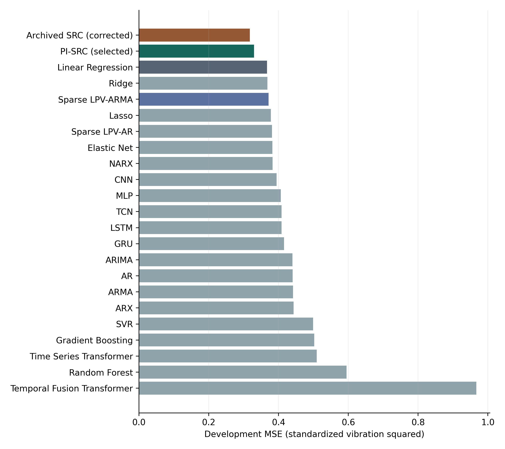{width=6.35in}

The complete appendix ranking accounts for every required comparator and distinguishes forecast-only historical rows from executable checkpoint replays. The separate fresh rerun reproduced the 21 protected comparator forecasts and saved checkpoints exactly in the recorded environment. For the two sparse families that rerun refitted the previously selected support, so it verifies the numerical procedure with that support held fixed. The archived SRC has a different selection history and serves as a performance anchor on the shared targets. Its replay supports the narrower finding that it scored better here.

The published sparse LPV–ARMA test MSE of 0.2893 belongs to the authors' test segment [@chen2025sparse]. The local archived implementation using current RPM and an earlier scoring start gave 0.336901 on 23,684 points. Rescoring that row on the common mask gave 0.345151. The strict previous-RPM sparse result of 0.371406 also uses a different fitted reference configuration. These three values cannot isolate the effect of a one-sample scheduling shift. A separate dense local LPV–ARMA diagnostic fit using previous RPM scored 0.330781 on the common mask. Its difference from selected PI-SRC is only 0.000808. This supplementary comparison puts the much larger sparse-reference improvement in context.

## 8.2 Paired uncertainty and residual structure

Let $d_t=e_{c,t}^{2}-e_{\mathrm{PI\text{-}SRC},t}^{2}$. The reported uncertainty preserves the pairing in $d_t$ so both candidates retain each target's operating conditions. A non-circular moving-block bootstrap samples valid starting locations for contiguous blocks of $d_t$, with a shorter terminal block to reproduce the original count. Each setting uses 2,000 draws, and the displayed interval takes the 2.5th and 97.5th percentiles [@compKunsch1989]. Block lengths 320, 640 and 1,280 samples span 0.10, 0.20 and 0.40 s. The directions in Table 8.2 were unchanged across all three block lengths. The intervals reflect within-record loss variation under these resampling conventions. The intervals are pointwise. Changing block length addresses some short-range dependence. Generalization across rigs, speed profiles or records requires repeated physical acquisitions.

Table 8.2. Paired moving-block intervals at 640 samples per block. All entries are in squared standardized vibration units.

| Comparator | Mean paired difference | Lower 95% | Upper 95% |
| --- | --- | --- | --- |
| Linear Regression | 0.037412 | 0.032403 | 0.041436 |
| Ridge | 0.038085 | 0.033149 | 0.042579 |
| Strict sparse LPV–ARMA | 0.041432 | 0.036319 | 0.047242 |
| CNN | 0.064665 | 0.056022 | 0.073982 |
| Archived corrected SRC | −0.012186 | −0.014521 | −0.010361 |

Figure 8.2 illustrates local amplitude tracking using one fixed interval.

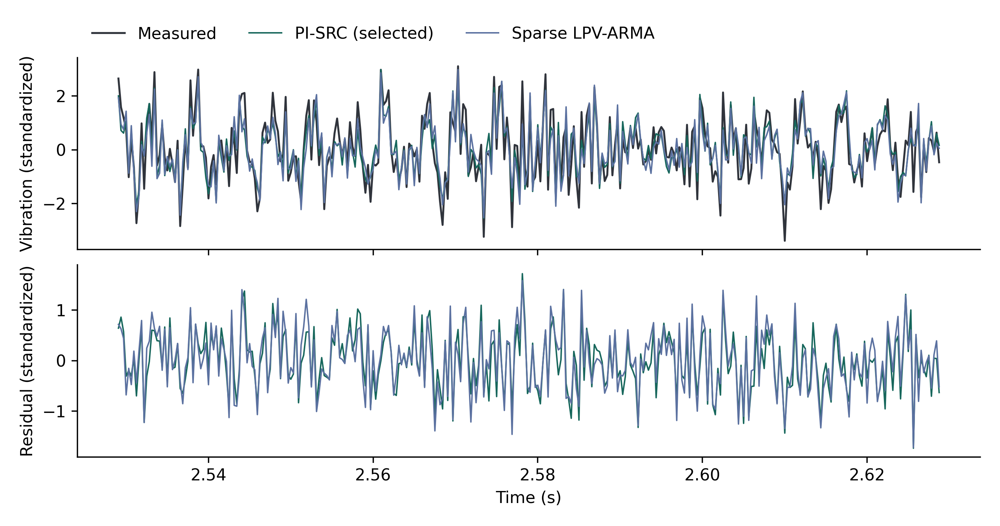{width=6.35in}

The waveform display uses the same 320 consecutive targets for each model, array positions 6,300 through 6,619 of the cropped development bundle. These are native indices 8,092 through 8,411, approximately 2.529–2.629 s on the saved time axis. This fixed display rule makes it a local illustration of amplitude tracking and residual structure. Evidence for recovery of an impulse requires the paired injection in Chapter 9, where its location and waveform are known. The diagnosis of individual transient events in this measured trace would require ground-truth condition or event labels.

Figure 8.3 shows the residual dependence left in both the time and frequency domains.

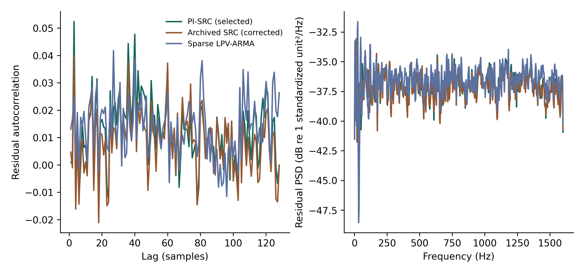{width=6.35in}

The primary residual autocorrelation is 0.000945 at lag one, yet its largest magnitude from lags 2 to 128 is 0.0524 at lag three. The Ljung–Box portmanteau diagnostic at 64 lags yields $p=3.39\times10^{-92}$ using its nominal chi-square reference [@compLjung1978]. Its signal here is that residual dependence extends beyond the first lag. The result is descriptive for this single changing-speed segment. The two-sided runs diagnostic, which counts transitions in the nonzero residual signs, gave $p=0.2358$. This is compatible with small sign imbalance or serial dependence at particular lags because the two diagnostics address different properties. The Welch estimate uses 1,024-sample segments at 3,200 Hz, a 3.125 Hz Fourier grid [@welch1967fft]. The surviving structure motivates inspecting the order-related envelope, rather than treating forecast loss or near-zero lag-one correlation as evidence of diagnostic sufficiency.

## 8.3 Operating-regime error

Measured RPM quartiles contain 5,552 retained targets each. The boundaries span approximately 124.36–167.32 RPM. Table 8.3 shows a rise from 0.259514 in the first quartile to 0.371653 in the fourth for selected PI-SRC. Its error is below strict sparse LPV–ARMA and above the archive in every quartile. Thus the two main contrasts do not rely on one RPM quartile. The full strata table also divides the retained record into six consecutive time blocks. Primary MSE ranges from 0.254959 in the first block to 0.378389 in the third. The primary and both reference methods consistently retain their ordering in those blocks.

Table 8.3. Development MSE by measured RPM quartile.

| RPM quartile | Targets | PI-SRC | Sparse LPV–ARMA | Archived SRC |
| --- | --- | --- | --- | --- |
| 1 | 5,552 | 0.259514 | 0.286705 | 0.248805 |
| 2 | 5,552 | 0.324015 | 0.368801 | 0.309555 |
| 3 | 5,552 | 0.364711 | 0.411718 | 0.352031 |
| 4 | 5,552 | 0.371653 | 0.418398 | 0.360760 |

Figure 8.4 shows how the common-mask comparison changes with speed.

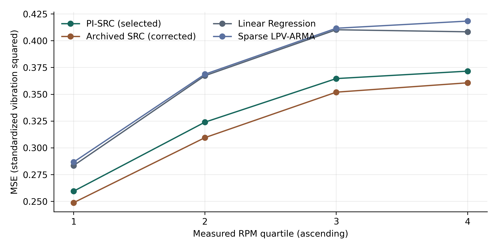{width=6.35in}

The retrospective 128-sample vibration-energy strata show primary MSE from 0.276564 to 0.369472 between the lowest and highest quartiles. Rising RPM is defined by a positive difference across 64 samples. PI-SRC MSE was 0.322608 on 13,022 rising targets and 0.340879 on 9,122 nonrising targets. The first 64 cropped targets are omitted from this difference-based comparison. Speed, speed gradient, vibration energy and time are associated along the measured sweep. Estimating an independent effect of one operating variable would require replication across controlled conditions. Earlier-only training refits scored 1.413805, 1.110925 and 0.353668 on the three held regions, showing sensitivity to the length and operating coverage of the available past. Those refits had no role in model selection.

## 8.4 Runtime and efficiency

The timing host was an AMD EPYC 9V74 under Linux with one numerical thread and CPU-only Torch. The runtime manifest records Python 3.12.14, NumPy 2.5.5, SciPy 1.17.0 and Torch 2.10.0+cpu. The warm measurement times one prediction call on the whole 24,000-sample record, using arrays and a checkpoint already in memory. Feature production is part of the call. Checkpoint deserialization, acquisition and the separate angular diagnostic stage are outside it. Primary warm timing uses seven calls, with median 484.887 ms, IQR 31.806 ms and estimated 95th percentile 524.715 ms. The separate checkpoint load and first prediction took 2.302 and 523.467 ms, respectively. A cold-start distribution would require repeated loading and first-call measurements. The comparator and executable archive warm timings use seven saved repetitions per row. Primary fitting time covers its single final fit, while comparator fit times are the available recorded fit times for their respective training pipelines. Neither represents the full exploration cost.

Table 8.4. Measured CPU costs and stored model sizes. Missing historical values were not imputed.

| Predictor | Fit (s) | Batch (ms) | IQR (ms) | Coeffs. | Bytes |
| --- | --- | --- | --- | --- | --- |
| AR | 0.247 | 0.333 | 0.018 | 96 | 2,855 |
| MLP | 0.849 | 19.862 | 17.283 | 7,050 | 29,004 |
| Strict sparse LPV–ARMA | 5.188 | 87.960 | 20.369 | 840 | 8,908 |
| Archived corrected SRC | — | 188.793 | 8.279 | 2,789 | — |
| Selected PI-SRC | 4.265 | 484.887 | 31.806 | 1,456 | 32,494 |
| Linear Regression | 3.142 | 951.884 | 58.010 | 530 | 12,738 |

Figure 8.5 compares measured batch cost with development error.

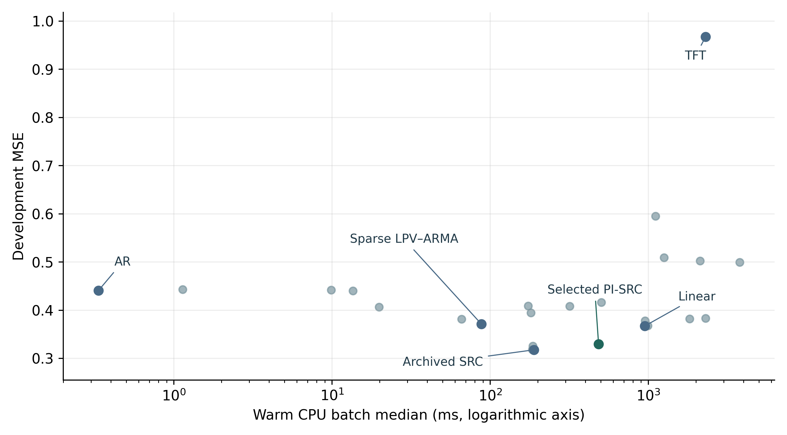{width=6.35in}

The primary has 879 retained readout feature columns and 1,456 fitted coefficients, including the readout intercept and first-stage coefficients. The latter count differs in meaning from, for example, an attention network's trainable tensor count. Its compressed checkpoint is 32,494 bytes. A separate five-repeat timing probe measured the principal feature arrays at 247,939,328 bytes for explicit construction and 43,237,376 bytes for bounded batches of 4,096 rows. Median times were 350.768 and 359.231 ms. The maximum prediction difference was $8.79\times10^{-9}$. These values describe array storage and a bounded feature-evaluation probe. Full-runtime peak memory and warm inference are distinct quantities. The selected prediction verification recorded approximately 120.43 MiB of process RSS after the timed work, which is a different quantity again.

The primary processed a 7.5 s record at an amortized 49,496 input samples/s or a real-time factor of 0.0647. Worst-case 312.5 µs per-sample deadlines, buffering latency and device-side cost require streaming measurements. GPU and independent embedded timings were unavailable. The accuracy–time frontier illustrates different choices. Among the primary and 21 comparator fits, the primary gives the lowest MSE at the highest frontier latency. Strict sparse LPV–ARMA runs at approximately 18.1% of the primary's median latency with 0.041432 greater MSE. Including the executable archive yields a different frontier because archived corrected SRC has both lower MSE and lower warm median latency. The frontier uses executable replays with measured latency. Forecast-only archives lack such a measurement.

# 9. Residual periodicity and tooth-crack evidence

## 9.1 Why the residual and its envelope are distinct

A tooth that engages once per input-shaft revolution can excite a damped response whose waveform varies with transmission path, torque and speed. When pulse timing remains coherent in angle, energy can be dispersed in time frequency while envelope modulation remains concentrated near shaft order one. Residual prediction changes this mixture. Regular mesh content may be suppressed, a repeated fault-related component may be removed in part, and a phase error in the predictor may generate its own periodic residual. McFadden’s gear work on mesh demodulation and later variable-speed LPV studies motivate inspecting the residual envelope at a physically specified order. Cyclostationary analysis provides a wider explanation for why repeated carrier effects become apparent in the envelope. In the present experiment order-one periodicity is a feature of the signal, and attribution to a particular defect requires labelled measurements. [@mcfadden1986gears; @antoni2009cyclo; @abboud2017envelope; @chen2021crack; @chen2025sparse]

For each record, the frozen predictor is initialized independently. Retained outputs start at zero-based sample 1,792. The residual is measured vibration minus the causal one-step estimate. The diagnostic then integrates measured speed over the retained time grid and linearly interpolates onto $S=2048$ uniform samples per input-shaft revolution. This diagnostic calculation is offline. It is distinct from the forecasting-phase extrapolation in Equation (5.4) and it does not enter the fitted predictors. On the resulting angular trace $r_j$, the lecturer-compatible analytic magnitude and its centred version are

$$
A_j=\left|(r_j-\overline r)+\mathrm{i}\mathcal H[r-\overline r]_j\right|+\overline r,
\qquad a_j=A_j-\overline A.
$$

The centred envelope $a_j$ is used with finite-record correlations. If its length is $L_\theta$, then the lag product and indicator are

$$
C_\ell=\sum_{j=0}^{L_\theta-1-\ell} a_j a_{j+\ell}, \qquad
\rho_\ell=\frac{C_\ell}{C_0}, \qquad
\mathrm{PMI}_\ell=\frac{C_\ell}{C_0-C_\ell}
=\frac{\rho_\ell}{1-\rho_\ell}.
$$

The finite sum uses fewer pairs at nonzero lags than at zero. PMI is dimensionless, can be negative and grows rapidly as the normalized correlation approaches one. A zero-energy envelope or degenerate denominator is flagged. The direct physical one-turn setting is $\ell=S$. The supplied MATLAB main branch takes element $S$ of a one-based autocorrelation array whose first entry is lag zero. The lecturer-compatible result therefore uses $\ell=S-1=2047$. The project separately computes the exact-lag variant and the direct Hilbert-envelope variant. In a reference fixture with eight rotations, the exact one-turn score was 7 and the literal row gave 7.00958. The fixture verifies the arithmetic and sensitivity to the lag convention. Exact numerical parity with the original MATLAB angular-resampling helper remains unverified because the helper and numerical reference outputs were not supplied. No healthy-reference rescaling, polynomial detrending, bandpass, padding or extra end trimming is applied in the local primary branch. [@zhao2017pmi; @chen2020vibration; @chen2025sparse]

The source paper interprets PMI in terms of repeated pulse energy under assumptions about pulse shape, periodicity and disturbance correlation. In local finite records a number can reflect periodicity arising from either defect dynamics or known operating variations. An envelope spectrum locates that structure and a companion waveform shows its magnitude. Figure 9.1 illustrates the physical coordinate and visible model dependence of the residual under the published display rule. These display records are case illustrations with provisional file grouping and no asserted defect identities.

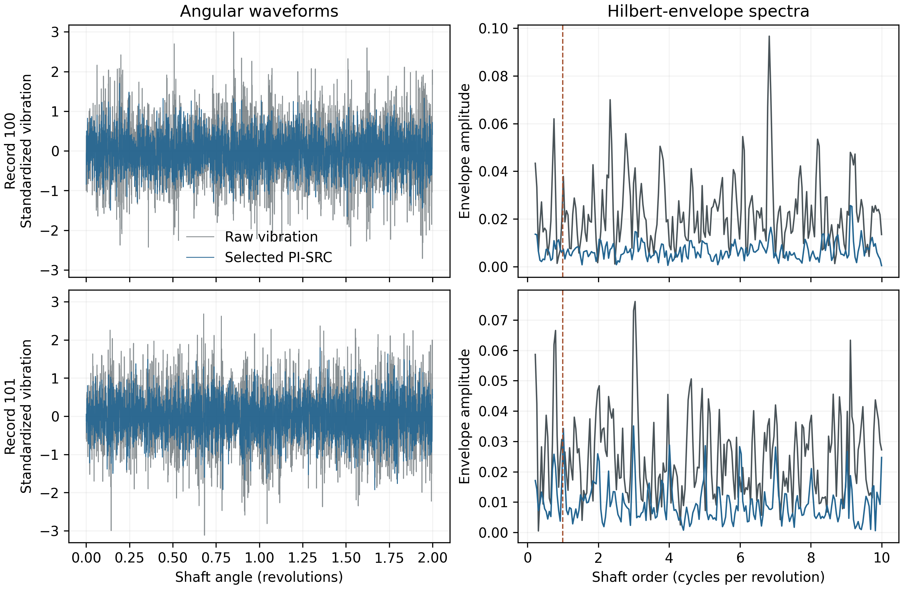{width=6.35in}

## 9.2 Real candidate acquisitions and conditional separation

The full diagnostic matrix evaluated six raw or residual series across all 200 supplied candidates. Each was passed through the same angular analysis and exclusion protocol. Only one-based records 61 and 63 were dropped for exact overlap with the two official modelling records, leaving 98 eligible members of A and 100 of B. The distinction between the groups is their original index range. None of the supplied acquisition metadata establishes a health-state mapping. The gap reported here is median PMI of B minus median PMI of A. The extremal margin is the smallest score in B minus the largest score in A. Both increase when the provisional groups separate more strongly in the hypothesized direction.

Table 9.1. Lecturer-compatible PMI on 198 eligible candidates. AUC and group statistics are conditional on the provisional file index.

| Model or signal | Median A | Median B | Gap | Margin | AUC |
| --- | --- | --- | --- | --- | --- |
| Raw vibration | 0.09714 | 0.08855 | −0.00859 | −0.11882 | 0.364 |
| Strict sparse LPV–ARMA | 0.04014 | 0.11270 | 0.07255 | 0.01940 | 1.000 |
| Archived corrected SRC | 0.02879 | 0.13213 | 0.10335 | 0.05591 | 1.000 |
| Selected PI-SRC | 0.03019 | 0.11492 | 0.08473 | 0.03580 | 1.000 |
| Same weights, adapter off | 0.03100 | 0.11503 | 0.08403 | 0.03601 | 1.000 |
| Fixed-physics SRC | 0.03370 | 0.12520 | 0.09151 | 0.04538 | 1.000 |

The selected residual increased median PMI from 0.03019 in provisional A to 0.11492 in B. Its gap of 0.08473 exceeds the raw signal’s negative gap and the strict sparse LPV–ARMA gap of 0.07255, while the corrected archived SRC gap is larger at 0.10335. Figure 9.2 plots the observed distributions. For the lecturer-compatible score, the selected-minus-sparse increase in median gap was 0.01218. The paired within-group bootstrap interval was [0.00853, 0.01595] using matched candidate IDs. Relative to the archive, the corresponding contrast was −0.01862, with interval [−0.02123, −0.01606]. The same-weight adapter-off contrast was 0.00070 with an interval crossing zero. These intervals quantify resampling sensitivity over the supplied index cohorts. They cannot verify that each file represents an independent original acquisition.

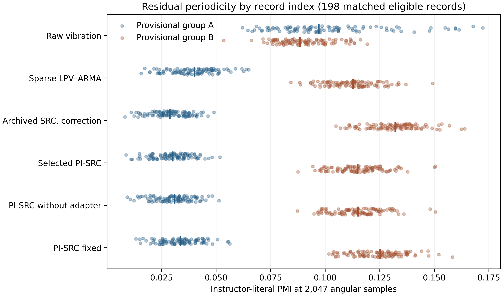{width=6.35in}

All five residual models attained conditional AUC 1.000 on this partition, so AUC cannot rank these residual models there. The larger archive and fixed-physics gaps, and positive margins for the residual models, provide more discriminating descriptions of the supplied scores. On a different instrument channel, fault severity or operating cycle, both group central tendencies and thresholds may shift. Fitting a decision threshold on those provisional labels would conflate score separation with true-positive and false-positive rates on independent machines. The diagnostic package retains a supplemental 41-record comparative screen across the full family roster. Table 9.1 uses the live 198-record common cohort to avoid mixing counts or claiming all 21 baselines were run on every candidate acquisition.

## 9.3 Paired pulse response and calibrated stress

The pulse study perturbs a single measured development signal with known damped sine events. For a periodic scenario, event times satisfy a fixed phase in successive input-shaft revolutions, derived from measured speed. Aperiodic controls use seeded random phase within turns. The five periodic cases vary carrier frequency (390 through 1,260 Hz), amplitude (0.12 through 0.88 standardized units), decay (1.7 through 6.1 ms), phase and modulation. One periodic case applies a warped RPM profile to both its clean and injected predictions. Two aperiodic cases are waveform-matched controls. Separate, differently specified disturbance fixtures were used in guarded training and selection. The development injection patterns here probe a frozen model’s response on the measured development trace.

Let $d_t$ be the injected waveform, let $\Delta\widehat x_t=\widehat x_t(x+d)-\widehat x_t(x)$ be the difference in the forecast under the same speed path, and let $z_t$ be the change in residual. Then

$$
z_t=d_t-\Delta\widehat x_t,\qquad
D_{\mathrm{pulse}}=\frac{\lVert z-d\rVert_2^2}{\lVert d\rVert_2^2},
\qquad Q_{\mathrm{pulse}}=\frac{\lVert z\rVert_2^2}{\lVert d\rVert_2^2}.
$$

$D_{\mathrm{pulse}}$ measures relative distortion in the recovered residual waveform. $Q_{\mathrm{pulse}}$ measures its relative energy. For an unchanged recovered pulse, distortion is zero and energy ratio is one. The waveform can change even when its recovered energy appears close to one. The saved results also report correlation, signed projection and paired change in PMI. These complementary quantities avoid interpreting one component as a complete measure of preservation.

Table 9.2. Paired pulse outcomes on five periodic development interventions. Entries other than counts are medians.

| Model or signal | Positive | PMI increase | Distortion | Energy ratio | Correlation |
| --- | --- | --- | --- | --- | --- |
| Selected PI-SRC | 5/5 | 0.000422 | 0.946 | 1.794 | 0.690 |
| Same weights, adapter off | 5/5 | 0.000380 | 0.946 | 1.792 | 0.690 |
| Fixed-physics SRC | 5/5 | 0.000390 | 0.800 | 1.795 | 0.756 |
| Archived corrected SRC | 5/5 | 0.000713 | 1.331 | 1.970 | 0.616 |
| Strict sparse LPV–ARMA | 4/5 | 0.000341 | 0.924 | 1.714 | 0.683 |
| Ridge | 5/5 | 0.000331 | 0.899 | 1.804 | 0.709 |
| CNN | 3/5 | 0.000098 | 0.965 | 1.764 | 0.677 |

PI-SRC yielded positive PMI changes in five of five periodic and zero of two aperiodic cases. Its median periodic increase was 0.000422, median correlation was 0.690, median distortion was 0.946 and median energy ratio was 1.794. The energy above unity is compatible with amplification and reshaping. The archive’s median PMI change was larger at 0.000713, while its pulse correlation was weaker at about 0.616. The fixed-physics variant recovered somewhat greater waveform correlation at 0.756. Figure 9.3 relates the paired diagnostics to an example of known injected structure. The test demonstrates response to the specified pulses on this trace. Field sensitivity requires independent physical tooth-crack data.

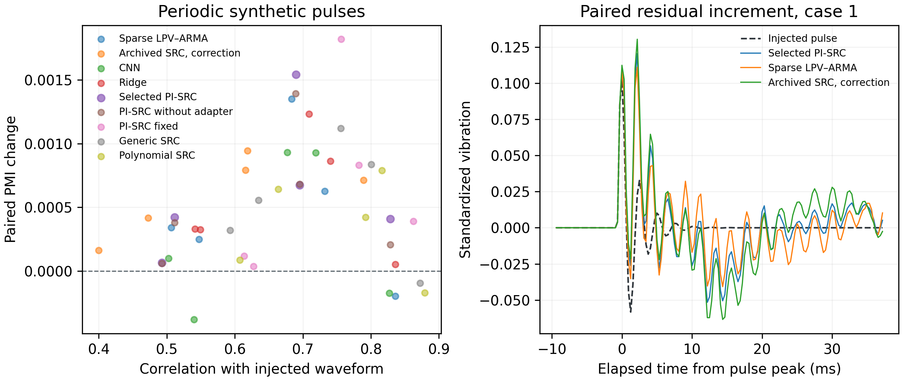{width=6.35in}

A particularly important negative control changes measured speed while holding physical vibration fixed. Applying +2% RPM bias only to the predictor raised PMI by 0.098194. Changing only diagnostic angle raised it by 0.004508, with the same forecast. Biasing both gave 0.044913. The predictor-only PMI increment is over two orders of magnitude greater than the median periodic pulse increment in this experiment. Phase-locked features can improve prediction while their residuals remain vulnerable to measurement error. Gear-fault condition monitoring needs sensor quality controls, known health labels and independent validation of decision thresholds. [@fyfe1997order; @cheng2014deformation; @abboud2017envelope]

# 10. Ablation, robustness and limits of attribution

## 10.1 Controlled representation and adapter effects

The development ablation ladder provides evidence at several levels. SRC-Linear, SRC-Polynomial and SRC-Speed scored 0.447954, 0.447872 and 0.411939, respectively. The tiny reduction from adding the tested generic polynomial expansions to a time-only model is weak evidence of standalone benefit. The gain for SRC-Speed is consistent with operating-condition dependence. The separate fixed-architecture comparator parity test withheld measured speed by fitting with nominal 145 RPM. Seven of nine measured-RPM variants improved on their controls, including NARX by 0.068379 and CNN by 0.049183 in MSE. ARX and TFT were worse by 0.002418 and 0.013780. Useful speed conditioning therefore depends on model and feature construction.

The physics-state linear readout reached 0.351040, versus 0.412117 for the tested generic nonlinear SRC. PI-SRC without the adapter scored 0.340706. These ladder rows jointly change representation, budget and fitting conditions. More targeted refits show the strongest removal penalty for angular lags, with MSE rising to 0.359049. Removing both angle lags and carriers raised it to 0.377201. Removing innovations gave 0.347312, removing the carrier bank gave 0.334961, and using fixed-Hz carrier states in place of the selected order bank gave 0.334862. Such differences are conditional on the retained features, training sample and refitted representation. The removal rows change the number of fitted columns. A strictly dimension-matched replacement by time lags would help distinguish angular alignment from dimensionality and changed collinearity.

Table 10.1. Selected development ablations on an unchanged mask. Differences are signed against selected PI-SRC.

| Control | MSE | Change | Fitted coefficients |
| --- | --- | --- | --- |
| Selected PI-SRC | 0.329973 | — | 1,456 |
| Clean-MSE training-only selection | 0.326401 | −0.003573 | 1,456 |
| Compact configuration | 0.358022 | +0.028048 | 834 |
| Same weights, adapter off | 0.340706 | +0.010733 | 1,456 |
| No angular lags | 0.359049 | +0.029076 | 1,072 |
| No carrier bank | 0.334961 | +0.004987 | 1,363 |
| No angular lags or carrier bank | 0.377201 | +0.047228 | 979 |
| No innovation history | 0.347312 | +0.017339 | 805 |
| Fixed-Hz carriers only | 0.334862 | +0.004888 | 1,414 |
| Post hoc 12-order bank | 0.324770 | −0.005204 | 1,600 |

Figure 10.1 distinguishes removal penalties from lower-error retrospective variants.

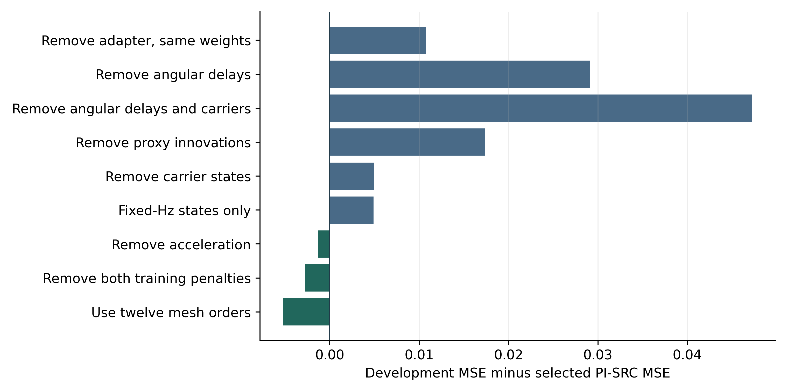{width=6.35in}

The same-weight correction is the cleanest single intervention. With gain 0.5, time constant 512 samples, memory 768 samples and clip 1.75 in the saved residual units, the selected fit reduces MSE by 0.010733 from the uncorrected score, a 3.15% decrease relative to that score. The identical correction lowers strict sparse LPV–ARMA from 0.371406 to 0.367992 and the physics-free Polynomial SRC from 0.447872 to 0.444834. Uncorrected PI-SRC remains 0.027286 below the corrected strict sparse comparator. Thus physical and other fitting choices account for part of the overall contrast, and a correction effect exists even without the physical bank. This estimate applies to the saved architecture. Other architectures and joint interventions can yield different marginal effects.

The clean-MSE training-only selection takes a smaller ridge value and a longer adapter kernel. It slightly won the clean guarded objective (0.355511 versus 0.355734) and went on to score 0.326401 on development. The registered multi-objective candidate had a better composite training score (0.371689 versus 0.372125) and smaller guarded pulse distortion (1.050501 versus 1.132523). The development ranking consequently depends on the objective. The 12-order configuration, together with variants removing augmentation or acceleration, is reported as a retrospective sensitivity. The 12-order row is 0.005204 lower than the primary on this development segment. The no-augmentation and no-acceleration rows give 0.327177 and 0.328697. The quadratic-only control gives 0.330390, and the tested lower and higher nonlinear budgets have similarly small changes. Those observations discourage attributing the whole gain to cubic complexity or to every selected intervention. The compact configuration uses 42.7% fewer fitted coefficients and a three-call warm median of 282.268 ms. Its MSE increases by 0.028048. Those measurements illustrate an engineering trade-off rather than a precise runtime comparison with the seven-call primary.

## 10.2 Sensor stress and residual interpretation

Development stress changes RPM and vibration inputs on an otherwise fixed record and leaves model coefficients frozen. The predictor-RPM lane feeds altered speed to the predictor while retaining measured RPM for angular diagnostics. The diagnostics-only lane changes the angle map for the unchanged residual. The combined lane alters both. Training uses its own guarded stress and pulse designs. The specific development scenarios and their magnitudes characterize frozen-model sensitivity rather than adding observations of physical sensor faults.

Table 10.2. Primary development MSE for the predictor-input intervention lane. Vibration noise is separate from the eight RPM cases.

| Input intervention | MSE |
| --- | --- |
| Clean measured input | 0.329973 |
| −2% / +2% RPM bias | 0.439358 / 0.457031 |
| Correlated 0.6% / independent 0.3% relative RPM jitter | 0.370028 / 0.339827 |
| RPM delayed 40 ms | 0.332180 |
| RPM quantized to 1 RPM | 0.333385 |
| 75 ms hold-last-value intervals | 0.329794 |
| Smooth profile warp | 0.360840 |
| Vibration noise SD 0.05 | 0.336254 |

Figure 10.2 shows the effect of measured-speed perturbations under the frozen predictors.

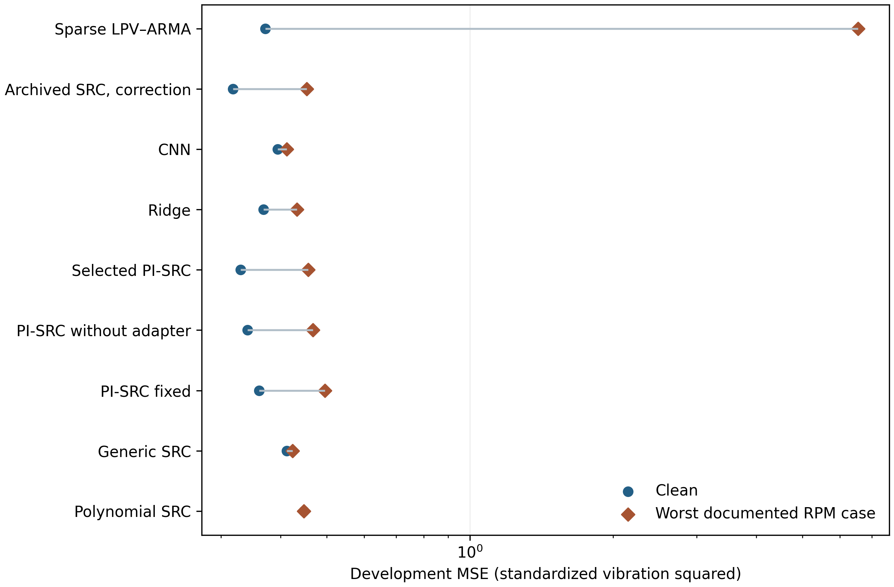{width=6.35in}

The +2% bias raised primary MSE by 38.51%. Under the same eight-case suite, worst-case MSE was 0.454057 for archived corrected SRC, 0.433301 for Ridge, 0.412020 for CNN and 6.554814 for strict sparse LPV–ARMA. The sparse model showed pronounced degradation under this tested bias. The clean and stressed rankings differ under these interventions. The isolated hold-last-value outcome below the primary clean score is a result on one synthetic schedule. Generalizing this outcome would require independent dropout schedules and acquisitions. RPM quantization here is a rounding intervention on the measured-speed channel. The vibration grid remained at 3.2 kHz and the saved model weights were unchanged.

The +2% predictor-only case raised PMI by 0.098194, versus 0.004508 when the perturbation affected only angle tracking and 0.044913 when it affected both. The median PMI rise for the five periodic primary pulse injections was 0.000422. The speed intervention can create periodic residual structure far larger than this particular synthetic tooth-related perturbation. All five periodic cases had a positive increase and neither aperiodic control did. Median residual–pulse correlation across the five periodic cases was 0.690. An operating threshold and field false-alarm rate require controls with diagnostic ground truth. Similar conditional AUCs under the provisional candidate grouping leave this specificity question open.

The main limitation is the number and diversity of acquisitions rather than the number of time samples. The guard protects against overlapping local histories across fitting and validation within a single training record. Phase, speed and load transfer require tests beyond this shared run environment. The deterministic refit reproduced the shipped primary checkpoint and predictions on the recorded platform. A four-family comparator seed study measures algorithmic variability under repeated fitting, with CNN averaging 0.397804 and sample SD 0.003005 over three runs. The between-machine error distribution remains unknown. Further independent evaluation would need frozen acquisition-level testing, calibrated speed timing and known condition labels, with streaming deadlines and sensor perturbations measured under deployment conditions.

# 11. Conclusions and next experiments

Matched forecasting confirmed the predictive advantage of the selected PI-SRC over the 21 requested comparators on the official development segment. Training and development MSE were 0.308688 and 0.329973, respectively. Development MSE was 11.16% below the strict sparse LPV–ARMA and 10.18% below Linear Regression. The executable archived corrected SRC retained a lower MSE of 0.317788, a 3.83% disadvantage for the selected PI-SRC relative to that anchor. The clean-only finalist and the 12-order retrospective ablation also achieved lower development errors than the registered multi-objective choice. Those outcomes preserve the distinction between H1’s comparative gain over the required families and the larger problem of beating the strongest earlier model.

For H2, angle history was the strongest tested structural contributor. Removing it raised development MSE to 0.359049 and removing both angular lags and carriers raised it to 0.377201. The causal correction, evaluated with fitted weights fixed, lowered MSE from 0.340706 to 0.329973. The same correction also benefited a conventional fit and a physics-free control. Evidence supports an advantage for the tested combination of physically aligned history, lagged innovation and a structured readout. The removal effects and different-sized feature sets do not identify additive causal contributions for all feature groups. The selected frequencies and decay constants are engineering settings selected in a bounded search.

For H3, the residual median PMI gap was 0.08473 under the provisional A/B labels, versus 0.07255 for the strict sparse comparator and 0.10335 for the archive. Five periodic synthetic interventions increased PMI, and changes in waveform correlation and energy show that preservation was imperfect. The +2% predictor-only RPM bias raised PMI by 0.09819. Confirmed crack sensitivity, false-alarm rates and decision thresholds require independent fault labels and measured sensor tolerance.

For H4, the selected model required 484.89 ms median CPU time for the 7.5 s record, with feature construction in the timed call. The strict sparse fit had lower latency and the executable archive had both lower latency and lower clean MSE. The strongest requirements for a next experiment are a predeclared frozen checkpoint, independent acquisitions across speed and load regimes, verified condition labels, speed-calibration controls and measured streaming deadlines. The existing replay, guards and mask provide the repeatable starting point for collecting that evidence.

# References

::: {#refs}
:::

# Appendix A. Complete model comparison

Table A.1. All rows on the official development interval [1792, 24000). Warm medians are measured one-thread batch milliseconds. An em dash indicates an unavailable measurement.

| Model | Evidence | MSE | RMSE | MAE | CPU (ms) |
| --- | --- | --- | --- | --- | --- |
| Archived SRC (corrected) | Archive replay | 0.317788 | 0.563727 | 0.448410 | 188.79 |
| Archived earlier SRC (corrected) | Saved forecasts | 0.317816 | 0.563752 | 0.449606 | — |
| Archived local SRC (corrected) | Archive replay | 0.318606 | 0.564452 | 0.448904 | 184.81 |
| Archived earlier SRC (base) | Saved forecasts | 0.325353 | 0.570397 | 0.455213 | — |
| Archived SRC (base) | Archive replay | 0.325630 | 0.570640 | 0.454468 | 185.98 |
| PI-SRC (selected) | Primary fit | 0.329973 | 0.574433 | 0.456412 | 484.89 |
| Linear Regression | Required family | 0.367386 | 0.606123 | 0.482352 | 951.88 |
| Ridge | Required family | 0.368059 | 0.606678 | 0.482731 | 994.58 |
| Sparse LPV-ARMA | Required family | 0.371406 | 0.609430 | 0.483517 | 87.96 |
| Lasso | Required family | 0.378298 | 0.615060 | 0.489438 | 953.80 |
| Sparse LPV-AR | Required family | 0.381496 | 0.617653 | 0.490459 | 66.09 |
| Elastic Net | Required family | 0.382196 | 0.618220 | 0.491920 | 1,827.37 |
| NARX | Required family | 0.383150 | 0.618991 | 0.491991 | 2,300.15 |
| CNN | Required family | 0.394638 | 0.628202 | 0.497356 | 181.20 |
| MLP | Required family | 0.406424 | 0.637514 | 0.505325 | 19.86 |
| TCN | Required family | 0.408577 | 0.639200 | 0.505173 | 318.67 |
| LSTM | Required family | 0.408813 | 0.639385 | 0.507251 | 173.86 |
| GRU | Required family | 0.416062 | 0.645028 | 0.510687 | 504.93 |
| ARIMA | Required family | 0.440065 | 0.663374 | 0.525433 | 13.58 |
| AR | Required family | 0.440566 | 0.663752 | 0.525635 | 0.33 |
| ARMA | Required family | 0.441706 | 0.664610 | 0.526208 | 9.87 |
| ARX | Required family | 0.443197 | 0.665730 | 0.527307 | 1.14 |
| SVR | Required family | 0.499373 | 0.706664 | 0.562443 | 3,780.92 |
| Gradient Boosting | Required family | 0.502513 | 0.708881 | 0.563802 | 2,121.70 |
| Time Series Transformer | Required family | 0.509394 | 0.713719 | 0.565179 | 1,257.82 |
| Random Forest | Required family | 0.595164 | 0.771469 | 0.610994 | 1,112.38 |
| Temporal Fusion Transformer | Required family | 0.967099 | 0.983412 | 0.777230 | 2,299.20 |

Each required family has a configuration, checkpoint and replay record. A fresh run reproduced all 21 configurations, saved checkpoint bytes, development forecasts and MSEs. Two sparse families refitted their protected supports. The executable archive rows use previously optimized weights. Saved-forecast rows support numeric alignment and error only.

# Appendix B. Reference-segment and protocol comparisons

The paper’s benchmark uses the authors’ own source segment. Table B.1 preserves their reported training and testing values. Table B.2 separates current-RPM replays on the supplied file from the strict lag-1 reference. Preprocessing, sample start and selection history matter for comparison. [@chen2025sparse]

Table B.1. External published values only. Unit and protocol attribution follow the original published experiment.

| Model | Paper training MSE | Paper test MSE |
| --- | --- | --- |
| ARI | 0.4049 | 0.3658 |
| ARIMA | 0.4034 | 0.3671 |
| Sparse LPV–AR | 0.3001 | 0.2911 |
| Sparse LPV–ARMA | 0.3099 | 0.2893 |

Table B.2. Local Sparse LPV–ARMA sensitivity on the supplied development file.

| Convention | Speed timing | Start | Count | MSE | Common MSE |
| --- | --- | --- | --- | --- | --- |
| strict development | previous | 1,792 | 22,208 | 0.371406 | 0.371406 |
| preserved archive current rpm | current | 316 | 23,684 | 0.336901 | 0.345151 |
| preserved archive previous rpm | previous | 1,792 | 22,208 | 0.345133 | 0.345133 |
| current rpm row cv legendre | current | 316 | 23,684 | 0.334422 | 0.342278 |
| current rpm row cv monomial | current | 316 | 23,684 | 0.439783 | 0.449338 |

Rescoring on a common mask aligns evaluation positions. A valid causal comparison also requires the specified information cutoff.

# Appendix C. Reproducibility and data access

The report was assembled against project release cca9804101e and fitted SRC source 802e5b6238. Canonical evidence consists of the precisely aligned development bundle, original optimization journals and replay receipts. The course data are supplied separately. Report creation uses targeted arithmetic and inference checks on saved artifacts.

Place the original input files in data/raw in the installed project environment. The replay command should report 22,208 targets beginning at zero-based index 1,792. The standard invocation generates the matched predictions and comparison. The separate frozen command checks future independent inputs for known overlap and uses checkpoint and input hashes.

~~~bash
python scripts/src_single_model.py --replay checkpoints/src/primary_pi_src.npz --record data/raw/sigvalid.mat
python scripts/run_pipeline.py --mode standard --data-dir data/raw --resume
python scripts/10_frozen_final_test.py --data-dir data/raw
~~~

Table C.1. Project records for traceable reproduction.

| Evidence | Project location |
| --- | --- |
| Raw input identity and split policy | inputs/input_manifest.csv and data/splits/protocol.json |
| Code and serialized PI-SRC | src/src_gearbox/src_model.py and checkpoints/src/primary_pi_src.npz |
| Training-only selection | results/optimization/selected_configs.json and trials.csv |
| Full comparison and validation status | results/metrics/all_model_comparison.csv and results/frozen/availability.json |
| Controlled ablation | results/ablations/src_ablations.csv and identical_adapter_controls.csv |
| Fault diagnostics and scope | results/fault/fault_group_summary.csv and fault_status.json |
| Full comparator rerun | results/experiments/baseline_refit/fresh_refit_reconciliation.json |
| Implementation and timed talks | Project README, executed notebooks, companion guide and both editable decks |

The report archive contains the editable source, generation tools, citation sources, plots and staged evidence. It builds without loading the original recordings. The broader implementation archive contains fitted checkpoints, configurations and reuse instructions.
